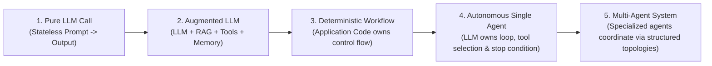
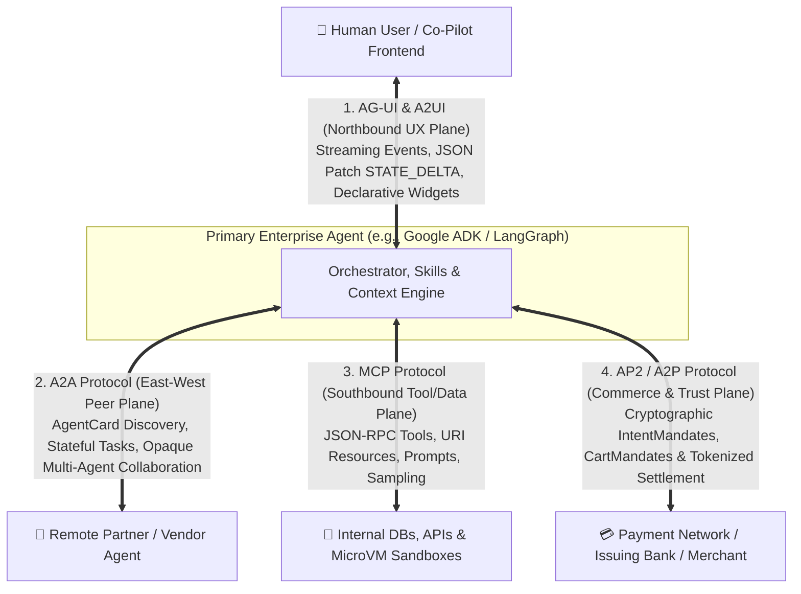
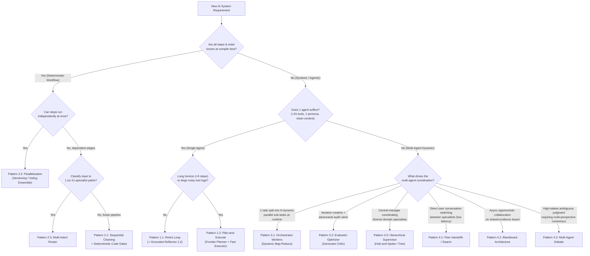

# Agentic AI Orchestration & Engineering Patterns: From Beginner to Production Architect

[-34A853)](#-18-chapter-curriculum--learning-path)

[-00897B)](./chapter-15-agent-to-frontend-ux-and-commerce-protocols.md)

> ⭐ *If you find this architectural reference handbook helpful for designing, interviewing, or building production multi-agent systems, please **star this repository**!*

A complete, framework-agnostic **18-chapter engineering handbook** on **Agentic AI Orchestration & Systems Engineering**. Every topic progresses from **Beginner** to **Intermediate** to **Advanced / Production Architect**, covering:
* **10 Core Orchestration Topologies (Chapters 1–5):** ReAct, Plan-and-Execute, Grounded Reflexion, Tree-of-Thoughts, Sequential Pipelines, Parallel Sectioning/Voting, Multi-Intent Routers, Orchestrator–Workers, Evaluator–Optimizer, Hierarchical Supervisors, Peer-to-Peer Swarms, Blackboards, and Multi-Agent Debate.
* **11 Deep-Dive Engineering & Protocol Pillars (Chapters 6–16):**
  * **Tool Calling & `CodeAct` (Ch 6)** · **Agentic RAG & GraphRAG (Ch 7)** · **Agent Skills & Progressive Disclosure (Ch 8)**
  * **MCP & A2A Interoperability (Ch 9)** · **Agentic Evals & `pass^k` Reliability (Ch 10)** · **Context Engineering & Long-Term Memory (Ch 11)**
  * **Security, Identity (`OAuth 2.1 OBO`), `CaMeL` & Sandboxing (Ch 12)** · **Agentic FinOps & Tokenomics (`TBOM` / `CpO`) (Ch 13)**
  * **Multimodal Live Streaming & Computer-Use (`SoM`) Agents (Ch 14)** · **Frontend UX & Commerce Protocols (`AG-UI`, `A2UI`, `AP2/A2P`) (Ch 15)**
  * **The Agent Quality Flywheel & Model Distillation (`SFT`/`DPO`/`RFT`) (Ch 16)**
* **Production State, Frameworks & Self-Assessment (Chapters 17–18):** Durable HITL Checkpointing, Master Decision Matrix, Concrete Code Idioms across **Google ADK**, **LangGraph**, **CrewAI**, **Microsoft AutoGen / Agent Framework**, and **OpenAI Agents SDK**, plus **90 Scenario-Based MCQs** in the final chapter.
* **Appendix A — The RAG Patterns Field Guide:** A deep-dive reference covering **45+ RAG patterns** (chunking, contextual retrieval, RAPTOR, hybrid RRF, ColBERT, HyDE, reranking, CAG vs. long-context, Adaptive-RAG, FLARE, IRCoT, Self-RAG, CRAG, Speculative RAG, GraphRAG, LightRAG, HippoRAG, ColPali) with purpose, when to use, and head-to-head comparison matrices.

---

**Contents**
| | |
| :--- | :--- |
| [📚 18-Chapter Curriculum & Learning Path](#-18-chapter-curriculum--learning-path) | [📊 At-a-Glance Pattern Comparison Matrix](#at-a-glance-pattern-comparison-matrix) |
| [🧭 The Spectrum of Agency & Golden Rule](#the-spectrum-of-agency--the-golden-rule) | [🛠️ Framework Selection Cheat Sheet](#framework-selection-cheat-sheet) |
| [📐 The Quantitative Laws of Orchestration](#the-quantitative-engineering-laws-of-orchestration) | [🌐 The 4-Plane Agent Protocol Stack](#the-4-plane-enterprise-agent-protocol-stack) |
| [🌳 Master Architecture Decision Tree](#master-architecture-decision-tree) | [🎯 Test Your Mastery (90 Scenario MCQs)](#-test-your-mastery-90-scenario-mcqs) |

---

## 📚 18-Chapter Curriculum & Learning Path

Every chapter traces one recurring enterprise scenario (*"AcmeCloud Incident & Billing SLA Resolution"*) from Beginner to Advanced alongside distinct real-world industry examples:

| Chapter | Title & Link | Progression | Core Architectures & Engineering Concepts Covered |
| :---: | :--- | :---: | :--- |
| **01** | **[Foundations, Memory Taxonomy & Engineering Laws](./chapter-01-foundations-and-mental-models.md)** | 🟢 Foundations | Workflows vs. Agents, The Augmented LLM, **4-Tier Memory Taxonomy** (Working, Episodic, Semantic, Procedural), **Compound Reliability Decay ($R = r^N$)**, and **Quadratic Context Token Tax ($O(K^2)$)**. |
| **02** | **[Single-Agent Orchestration Loops](./chapter-02-single-agent-loops.md)** | 🟢 Beginner | **1.1 ReAct** (with error-as-observation self-healing), **1.2 Plan-and-Execute** (with model tiering & dynamic replanning), **1.3 Grounded Reflexion**, and **Best-of-$N$ / Tree-of-Thoughts**. |
| **03** | **[Deterministic Multi-Agent Workflows](./chapter-03-deterministic-multi-agent-workflows.md)** | 🟡 Intermediate I | The **4 Multi-Agent Splitting Triggers**, **2.1 Sequential Chaining & Deterministic Code Gates**, **2.2 Parallelization (Sectioning vs. Voting Ensembles)**, and **2.3 Multi-Intent Routing**. |
| **04** | **[Dynamic & Hierarchical Orchestration](./chapter-04-dynamic-and-hierarchical-orchestration.md)** | 🟠 Intermediate II | **3.1 Orchestrator–Workers** (Dynamic Map-Reduce with Semaphore bounds), **3.2 Evaluator–Optimizer** (Adversarial Generator–Critic), and **3.3 Hierarchical Supervisor** (`AgentTool` vs. Graph Router & solving the "Telephone Game"). |
| **05** | **[Decentralized & Emergent Topologies](./chapter-05-decentralized-and-emergent-topologies.md)** | 🔴 Advanced | **4.1 Peer-to-Peer Handoffs / Swarms** (with cycle-breaker sets), **4.2 Blackboard Architecture** (Shared State & deduplicated event triggers), and **4.3 Multi-Agent Debate / Society of Minds**. |
| **06** | **[Tool Calling & Action Engineering](./chapter-06-tool-calling-and-action-engineering.md)** | 🟢 $\rightarrow$ 🔴 | **Beginner:** Brain vs. Hands boundary, Parallel vs. Sequential tool calls. **Intermediate:** ACI design, constrained schemas, actionable error-as-observation. **Advanced:** Dynamic Tool-RAG (400+ tools), `CodeAct` sandboxes, Idempotency & **Agentic Sagas**. |
| **07** | **[Agentic RAG & Knowledge Grounding](./chapter-07-agentic-rag-and-knowledge-grounding.md)** | 🟢 $\rightarrow$ 🔴 | **Beginner:** Why Naive RAG fails, Hybrid BM25 + Vector + Reranking, Retrieval-as-a-Tool. **Intermediate:** Multi-hop Query Decomposition, **Corrective RAG (CRAG)**, and **Self-RAG** (`[IsRel]`, `[IsSup]`, `[IsUse]`). **Advanced:** **GraphRAG** (Property Graphs + Community Summaries) & **Multi-Agent Federated RAG**. |
| **08** | **[Agent Skills & Procedural Memory](./chapter-08-agent-skills-and-procedural-memory.md)** | 🟢 $\rightarrow$ 🔴 | **Beginner:** `SKILL.md` anatomy (`name`, `description`, `scripts/`, `references/`) vs. Tools vs. RAG. **Intermediate:** **3-Tier Progressive Disclosure** (cutting idle prompt overhead by $>95\%$). **Advanced:** **Router Skills**, deterministic script offloading, semantic `skill_search`, & **With-vs-Without Ablation Evals**. |
| **09** | **[Model Context Protocol (MCP) & A2A](./chapter-09-mcp-and-a2a-interoperability.md)** | 🟢 $\rightarrow$ 🔴 | **Beginner:** Solving $N \times M$ integration; MCP Host/Client/Server & `Tools`, `Resources`, `Prompts`. **Intermediate:** `stdio` vs. `Streamable HTTP`, JSON-RPC lifecycle, **Eager vs. Lazy Tool Schema Loading**. **Advanced:** `Sampling` & `Elicitation`, MCP Security, & **A2A Protocol** (`AgentCard`, `Task` lifecycle). |
| **10** | **[Agentic Evaluation (Evals) & Observability](./chapter-10-agentic-evaluation-and-observability.md)** | 🟢 $\rightarrow$ 🔴 | **Beginner:** The **3 Eval Pillars** (Trajectory Accuracy, Outcome Quality, FinOps CpO). **Intermediate:** Trajectory modes (`EXACT`, `IN_ORDER`, `ANY_ORDER`), **4-Tier Golden Datasets**, Binary Rubric Judges. **Advanced:** **`pass^k` vs. `pass@k` consistency**, Hermetic Sandboxes, **Persona User Simulators**, & OTel Tracing. |
| **11** | **[Context Engineering & Long-Term Memory](./chapter-11-context-engineering-and-long-term-memory.md)** | 🟢 $\rightarrow$ 🔴 | **Beginner:** "Lost in the Middle" recall curve, Canonical Context Window Layout (Static Prefix $\rightarrow$ Recency Suffix). **Intermediate:** Observation Masking, Artifact Pointers & Watermark Summarization. **Advanced:** **OS Virtual Memory (`MemGPT`)**, **Bi-Temporal Knowledge Graphs (`valid_from`/`to`)**, & Async Consolidation. |
| **12** | **[Agentic Security, Identity & Sandboxing](./chapter-12-agentic-security-identity-and-sandboxing.md)** | 🟢 $\rightarrow$ 🔴 | **Beginner:** Indirect Prompt Injection, Simon Willison's **"Lethal Trifecta"**, Markdown image exfiltration & CSP. **Intermediate:** Parallel Tripwire Guardrails & **Dual-LLM Privilege Separation (`CaMeL`) + Taint Tracking**. **Advanced:** **OAuth 2.1 On-Behalf-Of (`sub`+`act`) + DB RLS**, and **gVisor / Firecracker MicroVM / Wasm Sandboxes**. |
| **13** | **[Agentic FinOps & Tokenomics](./chapter-13-agentic-finops-and-tokenomics.md)** | 🟢 $\rightarrow$ 🔴 | **Beginner:** **Token Bill of Materials (TBOM)**, **Cost per Validated Outcome (CpO)**, Thinking token billing, `TTFT`/`TPOT`/`TCT`. **Intermediate:** **The 6 High-Leverage Tokenomics Levers** (Prefix KV-Cache, Model Tiering, Adaptive Thinking, Lazy Schemas). **Advanced:** **`TokenBudgetEnforcer` Circuit Breakers** & **Hybrid PTU/GSU + PAYGO + Batch API Sizing**. |
| **14** | **[Multimodal, Computer-Use & Streaming Agents](./chapter-14-multimodal-computer-use-and-streaming-agents.md)** | 🟢 $\rightarrow$ 🔴 | **Beginner:** Legacy Cascaded Voice (`STT->LLM->TTS`) vs. **Native Multimodal Bidirectional Streaming**. **Intermediate:** **Computer-Use Agents (CUA)**, **Set-of-Mark (SoM) Grounding**, & Post-Action Visual Verification. **Advanced:** **Full-Duplex Barge-In Buffer Flush**, **Non-Blocking Async Tool Injection**, & $pHash$ Frame Gating. |
| **15** | **[Agent-to-Frontend UX & Commerce Protocols](./chapter-15-agent-to-frontend-ux-and-commerce-protocols.md)** | 🟢 $\rightarrow$ 🔴 | **Beginner:** The **3 Tiers of Generative UI** (Mapped Components, Declarative `A2UI`, Sandboxed `iframe`). **Intermediate:** **AG-UI Bidirectional Event Stream** & **`STATE_DELTA` (RFC 6902 JSON Patch)** Co-Pilot Canvases. **Advanced:** **AP2 / A2P (Agent Payments Protocol)** Cryptographic `IntentMandate` & `CartMandate` + **The 4-Protocol Stack**. |
| **16** | **[The Agent Quality Flywheel & Distillation](./chapter-16-agent-quality-flywheel-and-distillation.md)** | 🟢 $\rightarrow$ 🔴 | **Beginner:** The **5-Stage Closed-Loop Flywheel** & mining implicit failure signals (user retries, HITL edits, high steps). **Intermediate:** **Step-Level Fault Attribution Waterfall** & Automated Prompt/Skill Evolution (`BootstrapFewShot`/`TextGrad`). **Advanced:** **Trajectory Distillation (Frontier $\rightarrow$ Flash)** via SFT, **Self-Healed DPO Pairs**, & Shadow Cascades. |
| **17** | **[Production State, HITL & Framework Survey](./chapter-17-production-state-hitl-and-frameworks.md)** | 🔵 Ecosystem | Typed State Scoping, **Durable HITL Checkpointing & Time-Travel**, Master Decision Tree, Comparison Matrix, and concrete code idioms across **Google ADK**, **LangGraph**, **CrewAI**, **AutoGen (AG2)**, and **OpenAI Agents SDK**. |
| **18** | **[Architectural Mastery Quiz (90 MCQs)](./chapter-18-mcq-assessment-and-case-studies.md)** | 🎓 Final Chapter | **90 Scenario-Based Multiple-Choice Questions** (Beginner $\rightarrow$ Advanced) covering all 17 chapters and Appendix A with detailed explanations and distractor analysis. |

### 📎 Appendices (Reference Deep Dives)

| Appendix | Title & Link | Type | What It Covers |
| :---: | :--- | :---: | :--- |
| **A** | **[The RAG Patterns Field Guide](./appendix-a-rag-patterns-deep-dive.md)** | 📖 Reference | **45+ RAG patterns**, each with Purpose, Mechanism, Use When / Avoid When, and Cost: **Chunking** (Recursive, Semantic, Proposition, Late Chunking) · **Indexing** (Parent-Document, Auto-Merging, RAPTOR, Contextual Retrieval, Doc2Query) · **Representation** (BM25, SPLADE, Dense, ColBERT, Hybrid RRF) · **Query-Side** (Condensation, Rewrite, RAG-Fusion, HyDE, Step-Back, Decomposition, Routing, Self-Query) · **Post-Retrieval** (Cross-Encoder, LLM Rerank, MMR, Compression, Lost-in-the-Middle Ordering) · **Long-Context vs. RAG vs. CAG vs. Self-Route** · **Adaptive & Agentic** (Adaptive-RAG, FLARE, IRCoT, Self-RAG, CRAG, Speculative RAG, Deep Research) · **Structured & Graph** (Text-to-SQL, KG-RAG, GraphRAG, LightRAG, HippoRAG) · **Multimodal** (ColPali) · **Production** (ACL pre-filtering, freshness, semantic caching, RAG security, Recall@K/MRR/nDCG + faithfulness evals) · Symptom→Pattern table, Decision Tree & **RAG Maturity Ladder (L0–L5)**. |

---

## 🧭 The Spectrum of Agency & The Golden Rule

The most important architectural distinction in Agentic AI is **who owns the control flow** (`if/else`, `for`, `while`, branching, and termination): **application code** or **the LLM**?

> [!IMPORTANT]
> **The Golden Rule of Agentic Architecture:** Always use the most deterministic architecture that solves the problem. Hand control-flow decisions to an LLM *only* at the specific nodes where the execution path cannot be known at compile time. Nearly all successful production systems are **Deterministic–Agentic Hybrids**: a deterministic outer state machine containing bounded agentic inner loops.

---

## 📐 The Quantitative Engineering Laws of Orchestration

Why not chain 15 autonomous agents together in one shared conversation history? Because multi-step orchestration is governed by three mathematical laws (detailed in [Chapter 1](./chapter-01-foundations-and-mental-models.md)):

1. **The Compound Reliability Decay Law ($R_{\text{system}} = r^N$):**
   If each sequential step has $r = 95\%$ reliability, an unverified 10-step chain succeeds only $0.95^{10} = 59.9\%$ of the time. Inserting **Deterministic Code Gates** ([Chapter 3](./chapter-03-deterministic-multi-agent-workflows.md)) and **Grounded Verifiers** ([Chapters 2 & 4](./chapter-04-dynamic-and-hierarchical-orchestration.md)) between stages arrests error accumulation.
2. **The Quadratic Context Token Tax ($O(K^2)$):**
   Appending tool observations of size $T_{\text{obs}}$ to a single shared conversation window over $K$ turns bills $\sum_{k=1}^K k \cdot T_{\text{obs}} = O(K^2)$ cumulative input tokens and degrades middle-context attention. Delegating tool-heavy explorations to scoped sub-agents that return only structured summaries reduces token cost from $O(K^2)$ to $O(K)$.
3. **The Amdahl's Law of Agent Latency:**
   Sequential chains sum latency ($\sum_{i=1}^N L_i$), whereas parallel fan-out topologies bound latency by the slowest branch ($\max_i(L_i) + L_{\text{synth}}$).

---

## 🌐 The 4-Plane Enterprise Agent Protocol Stack

Modern enterprise agent architectures standardize communication across four non-overlapping protocol planes (detailed in [Chapter 9](./chapter-09-mcp-and-a2a-interoperability.md) and [Chapter 15](./chapter-15-agent-to-frontend-ux-and-commerce-protocols.md)):

---

## 🌳 Master Architecture Decision Tree

Use this flowchart (from [Chapter 17](./chapter-17-production-state-hitl-and-frameworks.md)) to pick the right orchestration topology in 30 seconds:

---

## 📊 At-a-Glance Pattern Comparison Matrix

Let $L$ be the average latency of a single LLM call, $K$ be the number of loop iterations, and $M$ be the number of specialist agents:

| Chapter | Pattern | Control Flow Owner | Latency Profile | Token Scaling | Context Isolation | Primary Failure Mode & Mandatory Guardrail |
| :--- | :--- | :--- | :--- | :--- | :--- | :--- |
| **[Ch 02](./chapter-02-single-agent-loops.md)** | **1.1 ReAct Loop** | Single LLM | $K \cdot L$ | $O(K^2)$ | Low | **Myopia & Context Bloat:** Cap `max_steps`; return tool exceptions as observations. |
| **[Ch 02](./chapter-02-single-agent-loops.md)** | **1.2 Plan-and-Execute** | Planner LLM + Code Loop | $(2 + K) \cdot L$ | $O(K)$ | High | **Stale Plan:** Always include a Replanner after each step summary. |
| **[Ch 02](./chapter-02-single-agent-loops.md)** | **1.3 Grounded Reflexion** | Actor + Verifier Loop | $(1\text{–}3) \cdot 2L$ | $O(\text{trials})$ | Medium | **Sycophantic Flip-Flop:** Run deterministic verifiers (AST/tests/regex) before LLM critique. |
| **[Ch 03](./chapter-03-deterministic-multi-agent-workflows.md)** | **2.1 Sequential Chain** | Application Code | $\sum_{i=1}^M L_i$ | $O(M)$ | High | **Compound Error Decay ($r^M$):** Insert deterministic `Pydantic`/business-rule gates between stages. |
| **[Ch 03](./chapter-03-deterministic-multi-agent-workflows.md)** | **2.2 Parallelization** | Application Code | $\max_i(L_i) + L_{\text{synth}}$ | $O(M)$ | High | **Hidden Data Dependencies & Failure Cancellation:** Ensure true independence; use `return_exceptions=True`. |
| **[Ch 03](./chapter-03-deterministic-multi-agent-workflows.md)** | **2.3 Intent Router** | Fast Classifier + Code | $L_{\text{fast}} + L_{\text{branch}}$ | **Lowest** ($O(1)$) | High | **Dropped Compound Intents:** Use multi-label `list[Intent]` schema to detect multi-part queries. |
| **[Ch 04](./chapter-04-dynamic-and-hierarchical-orchestration.md)** | **3.1 Orchestrator–Workers** | Orchestrator LLM | $2L + \max_i(L_{\text{worker}})$ | $O(N_{\text{workers}})$ | High | **Fan-Out Rate-Limit Bomb:** Enforce `max_length` on subtasks + `asyncio.Semaphore(K)`. |
| **[Ch 04](./chapter-04-dynamic-and-hierarchical-orchestration.md)** | **3.2 Evaluator–Optimizer** | Generator + Critic LLMs | $(1\text{–}3) \cdot 2L$ | $O(\text{rounds})$ | **High** (Clean Critic) | **Endless Nitpicking:** Separate `blocking_defects` from `minor_suggestions` in Critic schema. |
| **[Ch 04](./chapter-04-dynamic-and-hierarchical-orchestration.md)** | **3.3 Hierarchical Supervisor** | Central Supervisor LLM | $2K \cdot L$ (Hub hops) | $O(K \cdot M)$ | High | **"Telephone Game" Lossy Summaries:** Write structured facts directly to Typed Shared State. |
| **[Ch 05](./chapter-05-decentralized-and-emergent-topologies.md)** | **4.1 Peer Handoffs / Swarm** | Active Specialist LLM | **$1 \cdot L$ per turn** | $O(1)$ per turn | Medium | **Ping-Pong Handoff Cycle ($A \leftrightarrow B$):** Track `visited_edges` per turn + `max_handoffs`. |
| **[Ch 05](./chapter-05-decentralized-and-emergent-topologies.md)** | **4.2 Blackboard** | Event Controller + Board | $C_{\text{cycles}} \cdot \max(L_i)$ | $O(\text{triggers})$ | High | **Infinite Re-Triggering & Write Races:** Deduplicate `(agent, precondition_hash)` + atomic patch reducers. |
| **[Ch 05](./chapter-05-decentralized-and-emergent-topologies.md)** | **4.3 Multi-Agent Debate** | Debaters + Judge LLM | $(K_{\text{rounds}} + 1) \cdot L$ | **Highest** ($O(M \cdot K)$) | High | **Anchoring & Echo Chamber:** Enforce blind Round-1 parallel generation + orthogonal personas + early exit. |

---

## 🛠️ Framework Selection Cheat Sheet

Full code examples and architectural mappings are provided in [Chapter 17](./chapter-17-production-state-hitl-and-frameworks.md):

| Primary Engineering Requirement | Recommended Framework | Key Orchestration Primitives |
| :--- | :--- | :--- |
| **Google Cloud / Vertex AI native deployment, composable deterministic + hierarchical agents, and native A2A + MCP** | **Google ADK** | `SequentialAgent`, `ParallelAgent`, `LoopAgent`, `LlmAgent(output_key=..., sub_agents=[...])`, `AgentTool`, `BaseAgent` |
| **Low-level cyclic state machines, custom Blackboard reducers, dynamic fan-out, and durable time-travel checkpointing** | **LangGraph** | `StateGraph`, `Annotated[list, operator.add]` Reducers, `Send()` Map-Reduce, `Command(goto=...)`, `interrupt()` |
| **Rapid role-based organizational prototyping (`Researcher` + `Analyst` + `Writer`) with declarative YAML configs** | **CrewAI** | `Crew(process=Process.sequential \| Process.hierarchical)` + event-driven `Flows` (`@start`, `@listen`, `@router`) |
| **Conversational multi-agent group chats, code sandboxes, or Magentic-One ledger orchestration** | **Microsoft Agent Framework / AutoGen (AG2)** | `RoundRobinGroupChat`, `SelectorGroupChat`, `Swarm`, `MagenticOneGroupChat` |
| **Minimalist Python-first codebase with low abstraction overhead and fast peer-to-peer handoffs** | **OpenAI Agents SDK** | `Agent(handoffs=[...])`, `agent.as_tool()`, `Runner.run()`, `@input_guardrail` / `@output_guardrail` |

---

## 🎯 Test Your Mastery (90 Scenario MCQs)

Ready to validate your architectural judgment across all 17 chapters and Appendix A? Jump to the final chapter: **[Chapter 18: Architectural Mastery Quiz (90 Scenario-Based MCQs)](./chapter-18-mcq-assessment-and-case-studies.md)** for 90 real-world system design questions with complete answers and distractor explanations.

---

## 📄 License

Licensed under the [Apache License 2.0](LICENSE).
