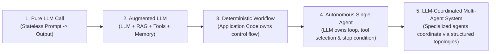
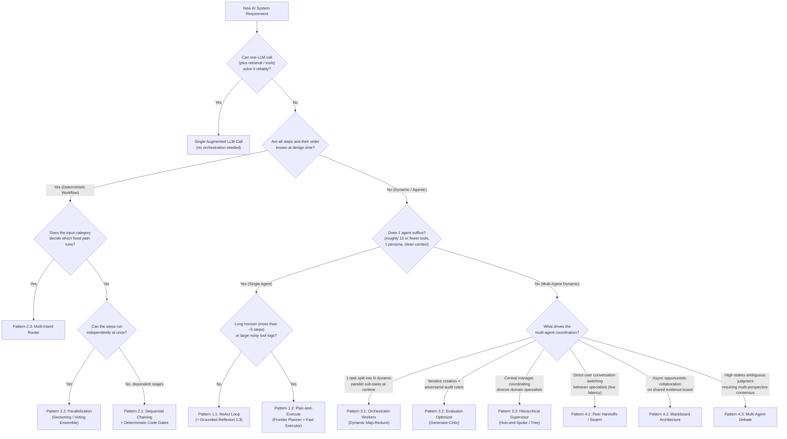

# Agentic AI Orchestration & Engineering Patterns: From Beginner to Production Architect

> ⭐ *If you find this architectural reference handbook helpful for designing, interviewing, or building production multi-agent systems, please **star this repository**!*

A complete, framework-, model- and cloud-agnostic **18-chapter engineering handbook** (plus a RAG appendix) on **Agentic AI Orchestration & Systems Engineering**. Every topic progresses from **Beginner** to **Intermediate** to **Advanced / Production Architect**, covering:
* **Foundations (Chapter 1):** Workflows vs. agents, the Augmented LLM, memory taxonomy, context engineering, and three back-of-the-envelope engineering laws.
* **12 Core Orchestration Patterns (Chapters 2–5):** ReAct, Plan-and-Execute, Grounded Reflexion (plus Best-of-$N$ / Tree-of-Thoughts), Sequential Chaining, Parallelization (Sectioning / Voting), Intent Routing, Orchestrator–Workers, Evaluator–Optimizer, Hierarchical Supervisor, Peer-to-Peer Handoffs / Swarms, Blackboard, and Multi-Agent Debate.
* **11 Deep-Dive Engineering & Protocol Pillars (Chapters 6–16):**
  * **Tool Calling & `CodeAct` (Ch 6)** · **Agentic RAG & GraphRAG (Ch 7)** · **Agent Skills & Progressive Disclosure (Ch 8)**
  * **MCP & A2A Interoperability (Ch 9)** · **Agentic Evals, `pass^k` & OTel Tracing (Ch 10)** · **Context Engineering & Long-Term Memory (Ch 11)**
  * **Security (Lethal Trifecta, OWASP, `CaMeL`), Delegated Identity (RFC 8693 Token Exchange) & Sandboxing (Ch 12)** · **Agentic FinOps & Tokenomics (`TBOM` / `CpO`, Prompt Caching) (Ch 13)**
  * **Multimodal Live Streaming & Computer-Use (`SoM`) Agents (Ch 14)** · **Frontend UX & Commerce Protocols (`AG-UI`, `A2UI`, MCP Apps, `AP2`) (Ch 15)**
  * **The Agent Quality Flywheel, Prompt Optimization & Model Distillation (`SFT`/`DPO`/`RFT`) (Ch 16)**
* **Production State, Frameworks & Self-Assessment (Chapters 17–18):** Durable HITL Checkpointing, Master Decision Tree & Comparison Matrix, and concrete code idioms across **LangGraph**, **CrewAI**, **Microsoft Agent Framework** (successor to AutoGen & Semantic Kernel; plus the AG2 fork), **OpenAI Agents SDK**, **Claude Agent SDK**, and **Google ADK**, followed by **90 Scenario-Based MCQs** in the final chapter.
* **Appendix A — The RAG Patterns Field Guide:** A deep-dive reference covering **45+ RAG patterns** (chunking, contextual retrieval, RAPTOR, hybrid RRF, ColBERT, HyDE, reranking, CAG vs. long-context, Adaptive-RAG, FLARE, IRCoT, Self-RAG, CRAG, Speculative RAG, GraphRAG, LightRAG, HippoRAG, ColPali) with purpose, when to use, and head-to-head comparison matrices.

> [!NOTE]
> **Last reviewed: October 2026.** Protocol and framework facts were checked against MCP spec `2026-07-28`, A2A v1.0, and the current LangGraph 1.x, OpenAI Agents SDK, Microsoft Agent Framework, Claude Agent SDK, and Google ADK docs. These move fast, so pin versions and verify API names against the release you install.
>
> **Vendor neutrality:** Every pattern is described in vendor-neutral terms and works on AWS, Azure, Google Cloud, on-prem, or a fully open-source stack. Product and model names (from any vendor) appear only as illustrative examples, and pseudocode uses generic interfaces (`llm_client`, `vector_index`, `object_store`, …) rather than cloud SDKs.

---

**Contents**
| | |
| :--- | :--- |
| [📚 18-Chapter Curriculum & Learning Path](#-18-chapter-curriculum--learning-path) | [📊 At-a-Glance Pattern Comparison Matrix](#-at-a-glance-pattern-comparison-matrix) |
| [🧭 The Spectrum of Agency & Golden Rule](#-the-spectrum-of-agency--the-golden-rule) | [🧰 Framework Selection Cheat Sheet](#-framework-selection-cheat-sheet) |
| [📐 The Quantitative Laws of Orchestration](#-the-quantitative-engineering-laws-of-orchestration) | [🌐 The 4-Plane Agent Protocol Stack](#-the-4-plane-agent-protocol-stack) |
| [🌳 Master Architecture Decision Tree](#-master-architecture-decision-tree) | [🎯 Test Your Mastery (90 Scenario MCQs)](#-test-your-mastery-90-scenario-mcqs) |

---

## 📚 18-Chapter Curriculum & Learning Path

Chapters 1–5 trace one recurring enterprise scenario (*"AcmeCloud Incident & Billing SLA Resolution"*) from Beginner to Advanced, and the later chapters reuse it alongside distinct real-world industry examples. Pattern numbers (`1.x`–`4.x`) denote the **complexity level**, not the chapter: Level 1 lives in Chapter 2, Level 2 in Chapter 3, and so on.

| Chapter | Title & Link | Progression | Core Architectures & Engineering Concepts Covered |
| :---: | :--- | :---: | :--- |
| **01** | **[Foundations, Memory Taxonomy & Engineering Laws](./chapter-01-foundations-and-mental-models.md)** | 🟢 Foundations | Workflows vs. Agents (Anthropic's *Building Effective Agents*), The Augmented LLM, **4-Tier Memory Taxonomy** (CoALA: Working, Episodic, Semantic, Procedural), **Context Engineering**, reasoning/thinking models, **Compound Reliability Decay ($R = r^N$)**, **Quadratic Context Token Tax ($O(K^2)$)**, and **Amdahl's Law of Agent Latency**. |
| **02** | **[Single-Agent Orchestration Loops](./chapter-02-single-agent-loops.md)** | 🟢 Beginner | **1.1 ReAct** (native tool calling, thinking models & error-as-observation self-healing), **1.2 Plan-and-Execute** (Plan-and-Solve / ReWOO lineage, model tiering & dynamic replanning), **1.3 Grounded Reflexion**, and **Best-of-$N$ vs. Tree-of-Thoughts**. |
| **03** | **[Deterministic Multi-Agent Workflows](./chapter-03-deterministic-multi-agent-workflows.md)** | 🟡 Intermediate I | The **4 Multi-Agent Splitting Triggers** (and single-agent fixes to try first), **2.1 Sequential Chaining & Deterministic Code Gates**, **2.2 Parallelization (Sectioning vs. Voting)** with correct `asyncio` failure semantics, **2.3 Multi-Intent Routing**, and a framework mapping (LangGraph, CrewAI Flows, Microsoft Agent Framework, OpenAI Agents SDK, Google ADK). |
| **04** | **[Dynamic & Hierarchical Orchestration](./chapter-04-dynamic-and-hierarchical-orchestration.md)** | 🟠 Intermediate II | **3.1 Orchestrator–Workers** (Dynamic Map-Reduce with typed subtasks, semaphores & timeouts, plus a production reality check on multi-agent token cost), **3.2 Evaluator–Optimizer** (grounded Generator–Critic), and **3.3 Hierarchical Supervisor** (agents-as-tools vs. handoffs, and solving the "Telephone Game"). |
| **05** | **[Decentralized & Emergent Topologies](./chapter-05-decentralized-and-emergent-topologies.md)** | 🔴 Advanced | **4.1 Peer-to-Peer Handoffs / Swarms** (cycle-breakers & handoff-context policy), **4.2 Blackboard Architecture** (shared state, deduplicated triggers & conflict-recording reducers), and **4.3 Multi-Agent Debate** (and why you should benchmark it against a simple vote first). |
| **06** | **[Tool Calling & Action Engineering](./chapter-06-tool-calling-and-action-engineering.md)** | 🟢 $\rightarrow$ 🔴 | **Beginner:** Brain vs. Hands boundary, call IDs, `tool_choice` & strict schemas, parallel vs. sequential calls, thinking models & tool calls. **Intermediate:** ACI design, mistake-proof schemas, actionable error-as-observation. **Advanced:** Dynamic Tool-RAG / Tool Search, `CodeAct` sandboxes, Idempotency & **Agentic Sagas**. |
| **07** | **[Agentic RAG & Knowledge Grounding](./chapter-07-agentic-rag-and-knowledge-grounding.md)** | 🟢 $\rightarrow$ 🔴 | **Beginner:** Why Naive RAG fails, Hybrid BM25 + Vector + Reranking, Retrieval-as-a-Tool. **Intermediate:** Query Decomposition, Adaptive-RAG routing, **Corrective RAG (CRAG)**, and **Self-RAG** reflection tokens (`Retrieve`, `IsRel`, `IsSup`, `IsUse`). **Advanced:** **GraphRAG**, **Multi-Agent Federated RAG**, deep-research loops & retrieved-content security. |
| **08** | **[Agent Skills & Procedural Memory](./chapter-08-agent-skills-and-procedural-memory.md)** | 🟢 $\rightarrow$ 🔴 | **Beginner:** The open Agent Skills format: `SKILL.md` anatomy (`name`, `description`, `scripts/`, `references/`, `assets/`) vs. Tools vs. RAG. **Intermediate:** **3-Tier Progressive Disclosure** (~50–100 tokens per skill at rest; cuts idle prompt overhead by $>95\%$). **Advanced:** **Router Skills**, deterministic script offloading, semantic `skill_search`, **With-vs-Without Ablation Evals**, skill supply-chain security & learned skills. |
| **09** | **[Model Context Protocol (MCP) & A2A](./chapter-09-mcp-and-a2a-interoperability.md)** | 🟢 $\rightarrow$ 🔴 | **Beginner:** Solving $N \times M$ integration; MCP Host/Client/Server & `Tools`, `Resources`, `Prompts` (+ structured tool output). **Intermediate:** `stdio` vs. `Streamable HTTP`, the stateless `2026-07-28` message flow vs. the legacy `initialize` handshake, **Eager vs. Lazy Tool Schema Loading**. **Advanced:** `Elicitation` & Multi Round-Trip Requests (`Sampling`/`Roots` now deprecated), Tasks, **OAuth 2.1 authorization**, MCP security & Registry, and the **A2A v1.0 Protocol** (Agent Card, `Task` lifecycle). |
| **10** | **[Agentic Evaluation (Evals) & Observability](./chapter-10-agentic-evaluation-and-observability.md)** | 🟢 $\rightarrow$ 🔴 | **Beginner:** The **3 Eval Pillars** (Trajectory, Outcome, Efficiency / Cost). **Intermediate:** Trajectory match modes (`EXACT`, `IN_ORDER`, `ANY_ORDER`), **4-Tier Golden Datasets**, calibrated Binary Rubric Judges. **Advanced:** **`pass^k` vs. `pass@k`** (τ-bench), Hermetic Sandboxes, **Persona User Simulators**, & **OTel GenAI Tracing**. |
| **11** | **[Context Engineering & Long-Term Memory](./chapter-11-context-engineering-and-long-term-memory.md)** | 🟢 $\rightarrow$ 🔴 | **Beginner:** "Lost in the Middle" & context rot, prompt caching, Canonical Context Window Layout (Static Prefix $\rightarrow$ Recency Suffix). **Intermediate:** Observation Masking, Artifact Pointers, Watermark Compaction & sub-agent isolation. **Advanced:** **OS Virtual Memory (`MemGPT` / Letta)**, **Bi-Temporal Knowledge Graphs (`t_valid` / `t_invalid`)**, Mem0-style updates & Async Consolidation. |
| **12** | **[Agentic Security, Identity & Sandboxing](./chapter-12-agentic-security-identity-and-sandboxing.md)** | 🟢 $\rightarrow$ 🔴 | **Beginner:** Indirect Prompt Injection, Simon Willison's **"Lethal Trifecta"** & Meta's Rule of Two, OWASP LLM Top 10 (2025) & Agentic Top 10, Markdown image exfiltration. **Intermediate:** Gated Tripwire Guardrails, **Dual-LLM pattern $\rightarrow$ `CaMeL`** (capabilities + taint tracking), MCP supply-chain threats. **Advanced:** **Delegated identity via RFC 8693 Token Exchange (`sub` + `act` + `aud`) + DB RLS**, and **gVisor / Firecracker MicroVM / Wasm Sandboxes**. |
| **13** | **[Agentic FinOps & Tokenomics](./chapter-13-agentic-finops-and-tokenomics.md)** | 🟢 $\rightarrow$ 🔴 | **Beginner:** **Token Bill of Materials (TBOM)**, **Cost per Validated Outcome (CpO)**, Thinking-token billing, `TTFT`/`TPOT`/`TCT`. **Intermediate:** **The 6 Tokenomics Levers** (Prefix Caching, Model Tiering, Thinking Budgets, Lazy Schemas…) & prompt-caching mechanics. **Advanced:** **`TokenBudgetEnforcer` Circuit Breakers**, **Provisioned Throughput (e.g., Azure OpenAI PTUs, Amazon Bedrock PT, Vertex AI GSUs) + PAYGO + Flex / Batch** sizing, & OTel cost telemetry. |
| **14** | **[Multimodal, Computer-Use & Streaming Agents](./chapter-14-multimodal-computer-use-and-streaming-agents.md)** | 🟢 $\rightarrow$ 🔴 | **Beginner:** Cascaded Voice (`STT->LLM->TTS`) vs. **Native Multimodal Bidirectional Streaming** (e.g., OpenAI Realtime, Gemini Live, Amazon Nova Sonic, or open LiveKit / Pipecat stacks). **Intermediate:** **Computer-Use Agents (CUA)**, **Set-of-Mark (SoM)** & other grounding strategies, Post-Action Visual Verification. **Advanced:** **Full-Duplex Barge-In** & context truncation, **Non-Blocking Async Tools**, & perceptual-hash frame gating. |
| **15** | **[Agent-to-Frontend UX & Commerce Protocols](./chapter-15-agent-to-frontend-ux-and-commerce-protocols.md)** | 🟢 $\rightarrow$ 🔴 | **Beginner:** The **3 Tiers of Generative UI** (Mapped Components, Declarative `A2UI`, Sandboxed `iframe`). **Intermediate:** **AG-UI Event Stream**, **`STATE_DELTA` (RFC 6902 JSON Patch)** Co-Pilot canvases, A2UI & **MCP Apps**. **Advanced:** **AP2 (Agent Payments Protocol)** Intent, Cart & Payment Mandates, the commerce landscape (ACP, UCP, x402) + **The 4-Protocol Stack**. |
| **16** | **[The Agent Quality Flywheel & Distillation](./chapter-16-agent-quality-flywheel-and-distillation.md)** | 🟢 $\rightarrow$ 🔴 | **Beginner:** The **5-Stage Closed-Loop Flywheel**, drift & model pinning, mining implicit failure signals (user retries, HITL edits, high step counts). **Intermediate:** **Step-Level Fault Attribution Waterfall** & automated prompt/skill optimization (`MIPROv2`, `GEPA`, `TextGrad`). **Advanced:** **Trajectory Distillation (Frontier $\rightarrow$ Small/Fast-tier model)** via SFT, same-context **DPO pairs** & RFT, plus shadow / canary cascades. |
| **17** | **[Production State, HITL & Framework Survey](./chapter-17-production-state-hitl-and-frameworks.md)** | 🔵 Ecosystem | Typed State Scoping, **Durable HITL Checkpointing & Time-Travel** (and its side-effect caveats), Master Decision Tree, Comparison Matrix, and concrete code idioms across **LangGraph**, **CrewAI**, **Microsoft Agent Framework / AutoGen / AG2**, **OpenAI Agents SDK**, **Claude Agent SDK**, and **Google ADK**. |
| **18** | **[Architectural Mastery Quiz (90 MCQs)](./chapter-18-mcq-assessment-and-case-studies.md)** | 🎓 Final Chapter | **90 Scenario-Based Multiple-Choice Questions** (Beginner $\rightarrow$ Advanced) covering all 17 chapters and Appendix A with detailed explanations and distractor analysis. |

### 📎 Appendices (Reference Deep Dives)

| Appendix | Title & Link | Type | What It Covers |
| :---: | :--- | :---: | :--- |
| **A** | **[The RAG Patterns Field Guide](./appendix-a-rag-patterns-deep-dive.md)** | 📖 Reference | **45+ RAG patterns**, each with Purpose, Mechanism, Use When / Avoid When, and Cost: **Chunking** (Recursive, Semantic, Proposition, Late Chunking) · **Indexing** (Parent-Document, Auto-Merging, RAPTOR, Contextual Retrieval, Doc2Query) · **Representation** (BM25, SPLADE, Dense, ColBERT, Hybrid RRF) · **Query-Side** (Condensation, Rewrite, RAG-Fusion, HyDE, Step-Back, Decomposition, Routing, Self-Query) · **Post-Retrieval** (Cross-Encoder, LLM Rerank, MMR, Compression, Lost-in-the-Middle Ordering) · **Long-Context vs. RAG vs. CAG vs. Self-Route** · **Adaptive & Agentic** (Adaptive-RAG, FLARE, IRCoT, Self-RAG, CRAG, Speculative RAG, Deep Research) · **Structured & Graph** (Text-to-SQL, KG-RAG, GraphRAG, LightRAG, HippoRAG) · **Multimodal** (ColPali) · **Production** (ACL pre-filtering, freshness, semantic caching, RAG security, Recall@K/MRR/nDCG + faithfulness evals) · Symptom→Pattern table, Decision Tree & **RAG Maturity Ladder (L0–L5)**. |

---

## 🧭 The Spectrum of Agency & The Golden Rule

The most important architectural distinction in Agentic AI is **who owns the control flow** (`if/else`, `for`, `while`, branching, and termination): **application code** or **the LLM**? Following Anthropic's *Building Effective Agents* (Dec 2024): **workflows** orchestrate LLMs and tools through predefined code paths, while **agents** let the LLM dynamically direct its own process and tool use ("an LLM agent runs tools in a loop to achieve a goal").

Control-flow ownership and agent count are **separate axes**: five LLM "agents" wired into a fixed pipeline are still a deterministic workflow (Chapter 3), while a single LLM in a tool loop is fully agentic. Adding agents is not the same as adding agency.

> [!IMPORTANT]
> **The Golden Rule of Agentic Architecture:** Always use the most deterministic (and simplest) architecture that solves the problem. Hand control-flow decisions to an LLM *only* at the specific nodes where the execution path cannot be known at design time. Most robust production systems are **Deterministic–Agentic Hybrids**: a deterministic outer state machine containing bounded agentic loops inside specific nodes. Genuinely open-ended domains such as coding agents are the notable exception: there, a largely autonomous single-agent loop with strong tools, sandboxing, and verifiers is often the right call.

---

## 📐 The Quantitative Engineering Laws of Orchestration

Why not chain 15 autonomous agents together in one shared conversation history? Because multi-step orchestration is governed by three back-of-the-envelope engineering laws: simplified models, not physical laws, but good predictors of production behavior (detailed in [Chapter 1](./chapter-01-foundations-and-mental-models.md)):

1. **The Compound Reliability Decay Law ($R_{\text{system}} = r^N$):**
   If each of $N$ sequential steps independently avoids an *uncaught, fatal* error with probability $r = 95\%$, an unverified 10-step chain succeeds only $0.95^{10} \approx 59.9\%$ of the time. Real agents can repair some mistakes (e.g., a tool error fed back as an observation), so the $r$ that matters is the chance an error is **never caught**. Raising it is exactly what **Deterministic Code Gates** ([Chapter 3](./chapter-03-deterministic-multi-agent-workflows.md)) and **Grounded Verifiers** ([Chapter 2](./chapter-02-single-agent-loops.md) & [Chapter 4](./chapter-04-dynamic-and-hierarchical-orchestration.md)) do between stages.
2. **The Quadratic Context Token Tax ($O(K^2)$):**
   Re-sending a growing shared history over $K$ tool-calling turns bills $\sum_{k=1}^{K} (P + k \cdot T_{\text{obs}}) = O(K^2)$ cumulative input tokens and degrades recall as the window fills ("Lost in the Middle", context rot). Example: reading ten 5,000-token log dumps in one loop costs ~275K input tokens for the logs alone, versus ~52K (about $5\times$ fewer) when isolated sub-agents each return a 200-token summary, which is effectively $O(K)$. Prompt caching lowers the *price* of re-sent prefixes, but not the context growth or the attention problem.
3. **The Amdahl's Law of Agent Latency:**
   Sequential chains sum latency ($\sum_{i=1}^N L_i$), whereas parallel fan-out is bounded by the slowest branch: $L_{\text{dispatch}} + \max_i(L_i) + L_{\text{synth}}$. As in Amdahl's law, the serial parts (planning, synthesis) cap the speedup; tail latency grows with fan-out, and provider rate limits can erase the theoretical gain.

---

## 🌐 The 4-Plane Agent Protocol Stack

Modern enterprise agent architectures standardize communication across four protocol planes (detailed in [Chapter 9](./chapter-09-mcp-and-a2a-interoperability.md) and [Chapter 15](./chapter-15-agent-to-frontend-ux-and-commerce-protocols.md)):

| Plane | Protocol | Stewardship & Status (Oct 2026) | Key Primitives |
| :--- | :--- | :--- | :--- |
| **Southbound** (agent ↔ tools & data) | **MCP** | Created by Anthropic (Nov 2024); donated to the Linux Foundation's Agentic AI Foundation (Dec 2025). Current spec `2026-07-28`. | `Tools` (with structured output), `Resources`, `Prompts`, `Elicitation`; `stdio` and stateless **Streamable HTTP** (HTTP+SSE is deprecated); OAuth 2.1 (servers are OAuth resource servers); Tasks & MCP Apps extensions. `Sampling`, `Roots`, and `Logging` are deprecated as of `2026-07-28`. |
| **East–West** (agent ↔ remote agent) | **A2A** | Created by Google (Apr 2025); Linux Foundation project since Jun 2025; **v1.0** in Mar 2026. | Agent Card at `/.well-known/agent-card.json`; `SendMessage` / `SendStreamingMessage`; `Task` states (`TASK_STATE_SUBMITTED` … `COMPLETED` / `FAILED` / `CANCELED` / `REJECTED`); JSON-RPC, gRPC, and HTTP+JSON bindings. |
| **Northbound** (agent ↔ UI & human) | **AG-UI + A2UI** (+ MCP Apps) | AG-UI from the CopilotKit team; A2UI open-sourced by Google (late 2025). Both pre-1.0. | AG-UI event stream (`TEXT_MESSAGE_*`, `TOOL_CALL_*`, `STATE_DELTA` as RFC 6902 JSON Patch); A2UI declarative component catalogs; MCP Apps `ui://` resources in sandboxed iframes. |
| **Commerce & Trust** | **AP2** | Announced by Google with 60+ partners (Sep 2025); an extension of A2A / MCP. | Intent, Cart, and Payment Mandates as Verifiable Digital Credentials. Complements ACP (checkout), UCP (shopping journey), and x402 (settlement). |

> [!NOTE]
> The planes are **responsibilities, not isolated wires**: AP2 rides on A2A/MCP, A2UI payloads can travel over A2A as well as AG-UI, and MCP Apps lets the tool plane ship UI. Treat everything crossing any plane (tool descriptions, tool results, remote agent output, Agent Cards) as **untrusted input** ([Chapter 12](./chapter-12-agentic-security-identity-and-sandboxing.md)).

---

## 🌳 Master Architecture Decision Tree

Use this flowchart (from [Chapter 17](./chapter-17-production-state-hitl-and-frameworks.md)) to pick the **simplest** orchestration pattern that meets the requirement:

> [!TIP]
> The "~15 tools" and "~5 steps" thresholds are rules of thumb. Reasoning models, tool search / deferred tool loading, Skills, and context compaction push them considerably. Measure on your own eval set ([Chapter 10](./chapter-10-agentic-evaluation-and-observability.md)) before adding agents: each one adds latency, cost, and a new handoff failure mode.

---

## 📊 At-a-Glance Pattern Comparison Matrix

Let $L$ be the average latency of a single LLM call, $K$ the number of loop iterations, $M$ the number of specialist agents (or pipeline stages), $N_{\text{workers}}$ the number of dynamically spawned workers, and $C_{\text{cycles}}$ the number of blackboard trigger cycles. Treat these as order-of-magnitude guides, not precise cost models:

| Chapter | Pattern | Control Flow Owner | Latency Profile | Token Scaling | Context Isolation | Primary Failure Mode & Mandatory Guardrail |
| :--- | :--- | :--- | :--- | :--- | :--- | :--- |
| **[Ch 02](./chapter-02-single-agent-loops.md)** | **1.1 ReAct Loop** | Single LLM | $K \cdot L$ | $O(K^2)$ (prompt caching cuts the price, not the growth) | Low | **Myopia & Context Bloat:** Cap `max_steps`; return tool exceptions as observations. |
| **[Ch 02](./chapter-02-single-agent-loops.md)** | **1.2 Plan-and-Execute** | Planner LLM + Code Loop | $(2 + K) \cdot L$ | $O(K)$ | High | **Stale Plan:** Always include a Replanner after each step summary. |
| **[Ch 02](./chapter-02-single-agent-loops.md)** | **1.3 Grounded Reflexion** | Actor + Verifier Loop | $(1\text{–}3) \cdot 2L$ | $O(\text{trials})$ | Medium | **Sycophantic Flip-Flop:** Run deterministic verifiers (AST/tests/regex) before LLM critique. |
| **[Ch 03](./chapter-03-deterministic-multi-agent-workflows.md)** | **2.1 Sequential Chain** | Application Code | $\sum_{i=1}^M L_i$ | $O(M)$ | High | **Compound Error Decay ($r^M$):** Insert deterministic `Pydantic`/business-rule gates between stages. |
| **[Ch 03](./chapter-03-deterministic-multi-agent-workflows.md)** | **2.2 Parallelization** | Application Code | $\max_i(L_i) + L_{\text{synth}}$ | $O(M)$ | High | **Hidden Data Dependencies & Lost Sibling Results:** Ensure true independence; add per-branch timeouts; use `asyncio.gather(..., return_exceptions=True)` (or a `TaskGroup` with per-task error handling) so one failure doesn't discard valid results. |
| **[Ch 03](./chapter-03-deterministic-multi-agent-workflows.md)** | **2.3 Intent Router** | Fast Classifier + Code | $L_{\text{fast}} + L_{\text{branch}}$ | **Lowest** ($O(1)$) | High | **Dropped Compound Intents:** Use a multi-label `list[Intent]` schema to detect multi-part queries. |
| **[Ch 04](./chapter-04-dynamic-and-hierarchical-orchestration.md)** | **3.1 Orchestrator–Workers** | Orchestrator LLM | $2L + \max_i(L_{\text{worker}})$ | $O(N_{\text{workers}})$ | High | **Fan-Out Rate-Limit Bomb:** Enforce `max_length` on subtasks + `asyncio.Semaphore(max_concurrency)` + per-worker timeouts. |
| **[Ch 04](./chapter-04-dynamic-and-hierarchical-orchestration.md)** | **3.2 Evaluator–Optimizer** | Generator + Critic LLMs | $(1\text{–}3) \cdot 2L$ | $O(\text{rounds})$ | **High** (Clean Critic) | **Endless Nitpicking:** Separate `blocking_defects` from `minor_suggestions` in the Critic schema; ground it with deterministic checks. |
| **[Ch 04](./chapter-04-dynamic-and-hierarchical-orchestration.md)** | **3.3 Hierarchical Supervisor** | Central Supervisor LLM | $2K \cdot L$ (Hub hops) | $O(K \cdot M)$ | High | **"Telephone Game" Lossy Summaries:** Write validated, structured facts directly to Typed Shared State. |
| **[Ch 05](./chapter-05-decentralized-and-emergent-topologies.md)** | **4.1 Peer Handoffs / Swarm** | Active Specialist LLM | **$1 \cdot L$ per turn** (no hub hop) | 1 call per turn, carrying the (filtered) conversation history | Medium | **Ping-Pong Handoff Cycle ($A \leftrightarrow B$):** Track `visited_edges` per turn + `max_handoffs`. |
| **[Ch 05](./chapter-05-decentralized-and-emergent-topologies.md)** | **4.2 Blackboard** | Event Controller + Board | $C_{\text{cycles}} \cdot \max(L_i)$ | $O(\text{triggers})$ | High | **Infinite Re-Triggering & Write Races:** Deduplicate trigger signatures + snapshot reads + conflict-recording patch reducers. |
| **[Ch 05](./chapter-05-decentralized-and-emergent-topologies.md)** | **4.3 Multi-Agent Debate** | Debaters + Judge LLM | $(K_{\text{rounds}} + 1) \cdot L$ | **Highest** ($O(M \cdot K)$ calls; prompt tokens approach $O(M^2 \cdot K)$ when every debater reads all peers) | High | **Anchoring & Echo Chamber:** Blind Round-1 parallel generation + orthogonal personas + early exit; benchmark against a majority vote first. |

---

## 🧰 Framework Selection Cheat Sheet

Full code examples and architectural mappings are provided in [Chapter 17](./chapter-17-production-state-hitl-and-frameworks.md). Rows are in no particular order of preference. Most of these frameworks can call models from several providers (directly or via adapters such as LiteLLM), and all of them can run self-hosted on Kubernetes or serverless containers (e.g., AWS Fargate / Lambda, Azure Container Apps, Google Cloud Run) or on a managed agent runtime (e.g., Amazon Bedrock AgentCore, Microsoft Foundry Agent Service, Google Agent Runtime, formerly Vertex AI Agent Engine). Because most of them speak **MCP** and **A2A**, you can mix them per component:

| Primary Engineering Requirement | Recommended Framework | Key Orchestration Primitives |
| :--- | :--- | :--- |
| **Low-level cyclic state machines, custom Blackboard reducers, dynamic fan-out, and durable time-travel checkpointing** | **LangGraph** (1.x) | `StateGraph`, `Annotated[list, operator.add]` Reducers, `Send()` Map-Reduce, `Command(goto=...)`, `interrupt()` + `Command(resume=...)`, checkpointers |
| **Rapid role-based organizational prototyping (`Researcher` + `Analyst` + `Writer`) with declarative YAML configs** | **CrewAI** | `Crew(process=Process.sequential \| Process.hierarchical)` inside event-driven `Flows` (`@start`, `@listen`, `@router`, `and_` / `or_`, `@persist`) |
| **.NET or Python enterprise stacks (with first-party Azure integration) needing graph workflows with checkpointing, group chats, or Magentic-style ledger orchestration** | **Microsoft Agent Framework** (successor to AutoGen + Semantic Kernel; AutoGen is in maintenance mode, AG2 is a separate community fork) | `WorkflowBuilder` (typed executors & edges), `SequentialBuilder`, `ConcurrentBuilder`, `HandoffBuilder`, `GroupChatBuilder`, `MagenticBuilder` |
| **Minimalist Python-first codebase with low abstraction overhead and fast peer-to-peer handoffs** | **OpenAI Agents SDK** | `Agent(handoffs=[...])`, `handoff(input_filter=...)`, `agent.as_tool()`, `Runner.run()`, `@input_guardrail` / `@output_guardrail`, sessions, `needs_approval`, built-in tracing |
| **A single long-horizon, tool-heavy agent (coding, research, ops) with strong context management and deterministic hooks** | **Claude Agent SDK** | `query()`, `ClaudeSDKClient`, `ClaudeAgentOptions`, subagents, hooks (`PreToolUse` / `PostToolUse`), `can_use_tool`, MCP servers, Skills |
| **Composable deterministic + hierarchical agent trees with native A2A + MCP; Gemini-optimized but model-agnostic (other providers via LiteLLM), with a first-party path to Google Cloud** | **Google ADK** | `SequentialAgent`, `ParallelAgent`, `LoopAgent`, `LlmAgent(output_key=..., sub_agents=[...])`, `AgentTool`, `BaseAgent`, callbacks & `BasePlugin`; deploy to any container platform (Kubernetes, serverless containers) or to Google's managed Agent Runtime (formerly Vertex AI Agent Engine) |

---

## 🎯 Test Your Mastery (90 Scenario MCQs)

Ready to validate your architectural judgment across all 17 chapters and Appendix A? Jump to the final chapter: **[Chapter 18: Architectural Mastery Quiz (90 Scenario-Based MCQs)](./chapter-18-mcq-assessment-and-case-studies.md)** for 90 real-world system design questions with complete answers and distractor explanations.

---

## 📄 License

Licensed under the [Apache License 2.0](LICENSE).
