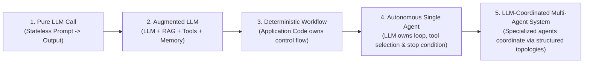
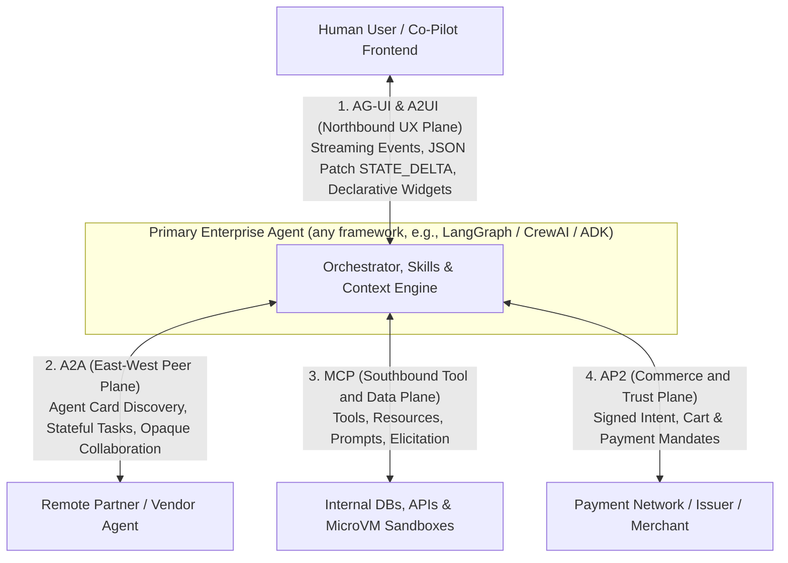
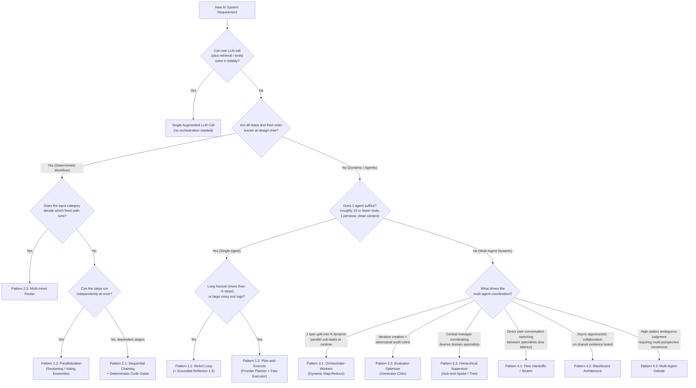

# Agentic AI Orchestration & Engineering Patterns

*If this handbook helps you design, interview for, or build production multi-agent systems, a star on the repository is appreciated.*

This is an engineering handbook on agentic AI orchestration and systems engineering, written to be independent of any framework, model, or cloud. It has 18 chapters plus five reference appendices (A–E), and each topic starts at the beginner level and works up through intermediate material to what a production architect needs. Here's what's inside:

* Foundations (Chapter 1): workflows vs. agents, the Augmented LLM, memory taxonomy, context engineering, and three back-of-the-envelope engineering laws.
* The 12 core orchestration patterns (Chapters 2–5): ReAct, Plan-and-Execute, Grounded Reflexion (plus Best-of-$N$ / Tree-of-Thoughts), Sequential Chaining, Parallelization (Sectioning / Voting), Intent Routing, Orchestrator–Workers, Evaluator–Optimizer, Hierarchical Supervisor, Peer-to-Peer Handoffs / Swarms, Blackboard, and Multi-Agent Debate.
* Eleven deeper engineering and protocol topics (Chapters 6–16):
  * Tool calling and `CodeAct` (Ch 6) · Agentic RAG and GraphRAG (Ch 7) · Agent Skills and progressive disclosure (Ch 8)
  * MCP and A2A interoperability (Ch 9) · Agentic evals, `pass^k` and OTel tracing (Ch 10) · Context engineering and long-term memory (Ch 11)
  * Security (Lethal Trifecta, OWASP, `CaMeL`), delegated identity (RFC 8693 Token Exchange) and sandboxing (Ch 12) · Agentic FinOps and tokenomics (`TBOM` / `CpO`, prompt caching) (Ch 13)
  * Multimodal live streaming and computer-use (`SoM`) agents (Ch 14) · Frontend UX and commerce protocols (`AG-UI`, `A2UI`, MCP Apps, `AP2`) (Ch 15)
  * The agent quality flywheel, prompt optimization and model distillation (`SFT`/`DPO`/`RFT`) (Ch 16)
* Production state, frameworks and self-assessment (Chapters 17–18): durable HITL checkpointing, the master decision tree and comparison matrix, and concrete code idioms for LangGraph, CrewAI, Microsoft Agent Framework (successor to AutoGen and Semantic Kernel; plus the AG2 fork), OpenAI Agents SDK, Claude Agent SDK, and Google ADK. The final chapter has 105 scenario-based MCQs.
* Appendices A–E (reference material):
  * Appendix A, *The RAG Patterns Field Guide*: 45+ RAG patterns (chunking, contextual retrieval, RAPTOR, hybrid RRF, ColBERT, HyDE, reranking, CAG vs. long-context, Adaptive-RAG, FLARE, IRCoT, Self-RAG, CRAG, Speculative RAG, GraphRAG, LightRAG, HippoRAG, ColPali) with purpose, when to use, and head-to-head comparison matrices.
  * Appendix B, *The Reasoning & Planning Patterns Field Guide*: 20+ reasoning patterns, from Chain-of-Thought and Self-Consistency through Tree / Graph of Thoughts, LATS, ReWOO, LLMCompiler, and Reflexion / CRITIC / CoVe, to reasoning models and test-time compute.
  * Appendix C, *Agent Benchmarks & Evaluation Datasets Reference*: what public agent benchmarks (BFCL, τ-bench, SWE-bench, WebArena, OSWorld, GAIA, AgentDojo, and more) measure, how they are graded, where they mislead, and how to report results credibly.
  * Appendix D, *The Agentic AI Threat & Defense Catalog*: 14 agentic threats mapped to OWASP and MITRE ATLAS, a catalog of defense patterns, a defense-in-depth reference architecture, and a threat-modeling checklist.
  * Appendix E, *Glossary of Agentic AI Terms*: an A–Z reference of the patterns, protocols, metrics, and acronyms used in the book, each linked to the chapters that cover it.

> [!NOTE]
> **Last reviewed: October 2026.** Protocol and framework facts were checked against MCP spec `2026-07-28`, A2A v1.0, and the current LangGraph 1.x, OpenAI Agents SDK, Microsoft Agent Framework, Claude Agent SDK, and Google ADK docs. These move fast, so pin versions and verify API names against the release you install.
>
> Vendor neutrality: every pattern is described in vendor-neutral terms and works on AWS, Azure, Google Cloud, on-prem, or a fully open-source stack. Product and model names (from any vendor) appear only as examples, and the pseudocode uses generic interfaces (`llm_client`, `vector_index`, `object_store`, …) rather than cloud SDKs.

---

## Contents

* [Curriculum and learning path](#curriculum-and-learning-path)
* [Appendices](#appendices)
* [The spectrum of agency and the Golden Rule](#the-spectrum-of-agency-and-the-golden-rule)
* [Three engineering laws of orchestration](#three-engineering-laws-of-orchestration)
* [The four-plane protocol stack](#the-four-plane-protocol-stack)
* [Architecture decision tree](#architecture-decision-tree)
* [Pattern comparison matrix](#pattern-comparison-matrix)
* [Choosing a framework](#choosing-a-framework)
* [Test yourself](#test-yourself)

---

## Curriculum and learning path

Chapters 1–5 follow one enterprise scenario (*"AcmeCloud Incident & Billing SLA Resolution"*) from beginner to advanced. Later chapters keep using it, alongside examples from other industries. Pattern numbers (`1.x`–`4.x`) mark the complexity level, not the chapter: Level 1 lives in Chapter 2, Level 2 in Chapter 3, and so on.

| Chapter | Title | Level | What it covers |
| :---: | :--- | :---: | :--- |
| 01 | [Foundations, Memory Taxonomy & Engineering Laws](./chapter-01-foundations-and-mental-models.md) | Foundations | Workflows vs. agents (Anthropic's *Building Effective Agents*), the Augmented LLM, the 4-tier memory taxonomy (CoALA: working, episodic, semantic, procedural), context engineering, reasoning/thinking models, compound reliability decay ($R = r^N$), the quadratic context token tax ($O(K^2)$), and Amdahl's law of agent latency. |
| 02 | [Single-Agent Orchestration Loops](./chapter-02-single-agent-loops.md) | Beginner | 1.1 ReAct (native tool calling, thinking models, error-as-observation self-healing), 1.2 Plan-and-Execute (Plan-and-Solve / ReWOO lineage, model tiering, dynamic replanning), 1.3 Grounded Reflexion, and Best-of-$N$ vs. Tree-of-Thoughts. |
| 03 | [Deterministic Multi-Agent Workflows](./chapter-03-deterministic-multi-agent-workflows.md) | Intermediate I | The four multi-agent splitting triggers (and the single-agent fixes to try first), 2.1 Sequential Chaining with deterministic code gates, 2.2 Parallelization (sectioning vs. voting) with correct `asyncio` failure semantics, 2.3 Multi-Intent Routing, and a framework mapping (LangGraph, CrewAI Flows, Microsoft Agent Framework, OpenAI Agents SDK, Google ADK). |
| 04 | [Dynamic & Hierarchical Orchestration](./chapter-04-dynamic-and-hierarchical-orchestration.md) | Intermediate II | 3.1 Orchestrator–Workers (dynamic map-reduce with typed subtasks, semaphores and timeouts, plus a reality check on multi-agent token cost), 3.2 Evaluator–Optimizer (grounded generator–critic), and 3.3 Hierarchical Supervisor (agents-as-tools vs. handoffs, and how to avoid the "Telephone Game"). |
| 05 | [Decentralized & Emergent Topologies](./chapter-05-decentralized-and-emergent-topologies.md) | Advanced | 4.1 Peer-to-Peer Handoffs / Swarms (cycle-breakers and a handoff-context policy), 4.2 Blackboard Architecture (shared state, deduplicated triggers, conflict-recording reducers), and 4.3 Multi-Agent Debate (and why to benchmark it against a simple vote first). |
| 06 | [Tool Calling & Action Engineering](./chapter-06-tool-calling-and-action-engineering.md) | Beginner → Advanced | Beginner: the brain vs. hands boundary, call IDs, `tool_choice` and strict schemas, parallel vs. sequential calls, thinking models and tool calls. Intermediate: ACI design, mistake-proof schemas, actionable error-as-observation. Advanced: dynamic Tool-RAG / Tool Search, `CodeAct` sandboxes, idempotency and agentic sagas. |
| 07 | [Agentic RAG & Knowledge Grounding](./chapter-07-agentic-rag-and-knowledge-grounding.md) | Beginner → Advanced | Beginner: why naive RAG fails, hybrid BM25 + vector + reranking, retrieval-as-a-tool. Intermediate: query decomposition, Adaptive-RAG routing, Corrective RAG (CRAG), and Self-RAG reflection tokens (`Retrieve`, `IsRel`, `IsSup`, `IsUse`). Advanced: GraphRAG, multi-agent federated RAG, deep-research loops, and retrieved-content security. |
| 08 | [Agent Skills & Procedural Memory](./chapter-08-agent-skills-and-procedural-memory.md) | Beginner → Advanced | Beginner: the open Agent Skills format, `SKILL.md` anatomy (`name`, `description`, `scripts/`, `references/`, `assets/`), and how skills differ from tools and RAG. Intermediate: 3-tier progressive disclosure (~50–100 tokens per skill at rest, which cuts idle prompt overhead by $>95\%$). Advanced: router skills, deterministic script offloading, semantic `skill_search`, with-vs-without ablation evals, skill supply-chain security, and learned skills. |
| 09 | [Model Context Protocol (MCP) & A2A](./chapter-09-mcp-and-a2a-interoperability.md) | Beginner → Advanced | Beginner: solving $N \times M$ integration; MCP host/client/server and `Tools`, `Resources`, `Prompts` (plus structured tool output). Intermediate: `stdio` vs. `Streamable HTTP`, the stateless `2026-07-28` message flow vs. the legacy `initialize` handshake, eager vs. lazy tool schema loading. Advanced: `Elicitation` and multi round-trip requests (`Sampling`/`Roots` now deprecated), Tasks, OAuth 2.1 authorization, MCP security and the Registry, and the A2A v1.0 protocol (Agent Card, `Task` lifecycle). |
| 10 | [Agentic Evaluation (Evals) & Observability](./chapter-10-agentic-evaluation-and-observability.md) | Beginner → Advanced | Beginner: the three eval pillars (trajectory, outcome, efficiency / cost). Intermediate: trajectory match modes (`EXACT`, `IN_ORDER`, `ANY_ORDER`), 4-tier golden datasets, calibrated binary rubric judges. Advanced: `pass^k` vs. `pass@k` (τ-bench), hermetic sandboxes, persona user simulators, and OTel GenAI tracing. |
| 11 | [Context Engineering & Long-Term Memory](./chapter-11-context-engineering-and-long-term-memory.md) | Beginner → Advanced | Beginner: "Lost in the Middle" and context rot, prompt caching, the canonical context window layout (static prefix $\rightarrow$ recency suffix). Intermediate: observation masking, artifact pointers, watermark compaction, sub-agent isolation. Advanced: OS-style virtual memory (`MemGPT` / Letta), bi-temporal knowledge graphs (`t_valid` / `t_invalid`), Mem0-style updates, and async consolidation. |
| 12 | [Agentic Security, Identity & Sandboxing](./chapter-12-agentic-security-identity-and-sandboxing.md) | Beginner → Advanced | Beginner: indirect prompt injection, Simon Willison's "Lethal Trifecta" and Meta's Rule of Two, the OWASP LLM Top 10 (2025) and Agentic Top 10, Markdown image exfiltration. Intermediate: gated tripwire guardrails, the Dual-LLM pattern $\rightarrow$ `CaMeL` (capabilities + taint tracking), MCP supply-chain threats. Advanced: delegated identity via RFC 8693 Token Exchange (`sub` + `act` + `aud`) plus database RLS, and gVisor / Firecracker microVM / Wasm sandboxes. |
| 13 | [Agentic FinOps & Tokenomics](./chapter-13-agentic-finops-and-tokenomics.md) | Beginner → Advanced | Beginner: the Token Bill of Materials (TBOM), Cost per Validated Outcome (CpO), thinking-token billing, `TTFT`/`TPOT`/`TCT`. Intermediate: the six tokenomics levers (prefix caching, model tiering, thinking budgets, lazy schemas…) and how prompt caching works. Advanced: `TokenBudgetEnforcer` circuit breakers, sizing provisioned throughput (e.g., Azure OpenAI PTUs, Amazon Bedrock PT, Vertex AI GSUs) alongside PAYGO and Flex / Batch, and OTel cost telemetry. |
| 14 | [Multimodal, Computer-Use & Streaming Agents](./chapter-14-multimodal-computer-use-and-streaming-agents.md) | Beginner → Advanced | Beginner: cascaded voice (`STT->LLM->TTS`) vs. native multimodal bidirectional streaming (e.g., OpenAI Realtime, Gemini Live, Amazon Nova Sonic, or open LiveKit / Pipecat stacks). Intermediate: computer-use agents (CUA), Set-of-Mark (SoM) and other grounding strategies, post-action visual verification. Advanced: full-duplex barge-in and context truncation, non-blocking async tools, perceptual-hash frame gating. |
| 15 | [Agent-to-Frontend UX & Commerce Protocols](./chapter-15-agent-to-frontend-ux-and-commerce-protocols.md) | Beginner → Advanced | Beginner: the three tiers of generative UI (mapped components, declarative `A2UI`, sandboxed `iframe`). Intermediate: the AG-UI event stream, `STATE_DELTA` (RFC 6902 JSON Patch) co-pilot canvases, A2UI and MCP Apps. Advanced: AP2 (Agent Payments Protocol) intent, cart and payment mandates, the other commerce protocols (ACP, UCP, x402), and the four-protocol stack. |
| 16 | [The Agent Quality Flywheel & Distillation](./chapter-16-agent-quality-flywheel-and-distillation.md) | Beginner → Advanced | Beginner: the 5-stage closed-loop flywheel, drift and model pinning, mining implicit failure signals (user retries, HITL edits, high step counts). Intermediate: the step-level fault attribution waterfall and automated prompt/skill optimization (`MIPROv2`, `GEPA`, `TextGrad`). Advanced: trajectory distillation (frontier $\rightarrow$ small/fast-tier model) via SFT, same-context DPO pairs and RFT, plus shadow / canary cascades. |
| 17 | [Production State, HITL & Framework Survey](./chapter-17-production-state-hitl-and-frameworks.md) | Ecosystem | Typed state scoping, durable HITL checkpointing and time-travel (with its side-effect caveats), the master decision tree, the comparison matrix, and concrete code idioms for LangGraph, CrewAI, Microsoft Agent Framework / AutoGen / AG2, OpenAI Agents SDK, Claude Agent SDK, and Google ADK. |
| 18 | [Architectural Mastery Quiz (105 MCQs)](./chapter-18-mcq-assessment-and-case-studies.md) | Final chapter | 105 scenario-based multiple-choice questions (beginner $\rightarrow$ advanced) covering all 17 chapters and the appendices, with detailed explanations and an analysis of each distractor. |

### Appendices

| Appendix | Title | Type | What it covers |
| :---: | :--- | :---: | :--- |
| A | [The RAG Patterns Field Guide](./appendix-a-rag-patterns-deep-dive.md) | Reference | 45+ RAG patterns, each with purpose, mechanism, when to use or avoid it, and cost. Chunking (Recursive, Semantic, Proposition, Late Chunking) · Indexing (Parent-Document, Auto-Merging, RAPTOR, Contextual Retrieval, Doc2Query) · Representation (BM25, SPLADE, Dense, ColBERT, Hybrid RRF) · Query-side (Condensation, Rewrite, RAG-Fusion, HyDE, Step-Back, Decomposition, Routing, Self-Query) · Post-retrieval (Cross-Encoder, LLM Rerank, MMR, Compression, Lost-in-the-Middle Ordering) · Long-Context vs. RAG vs. CAG vs. Self-Route · Adaptive and agentic (Adaptive-RAG, FLARE, IRCoT, Self-RAG, CRAG, Speculative RAG, Deep Research) · Structured and graph (Text-to-SQL, KG-RAG, GraphRAG, LightRAG, HippoRAG) · Multimodal (ColPali) · Production (ACL pre-filtering, freshness, semantic caching, RAG security, Recall@K/MRR/nDCG + faithfulness evals) · a symptom→pattern table, decision tree, and the RAG Maturity Ladder (L0–L5). |
| B | [The Reasoning & Planning Patterns Field Guide](./appendix-b-reasoning-and-planning-patterns.md) | Reference | 20+ reasoning and planning patterns, each with purpose, mechanism, when to use or avoid it, and cost. Foundations (test-time compute, the generator–verifier gap) · Prompt-level (Few-Shot and Zero-Shot CoT, Self-Consistency, Least-to-Most, Plan-and-Solve, PoT / PAL) · Search-based (Best-of-$N$ + verifier, PRM vs. ORM, Tree of Thoughts, Graph of Thoughts, LATS) · Acting + reasoning (ReAct, ReWOO, Plan-and-Execute, LLMCompiler, HuggingGPT-style planning) · Self-improvement and critique (Self-Refine, Reflexion, CRITIC, Chain-of-Verification, and the evidence on intrinsic self-correction) · Reasoning models (effort / budget knobs, prompting, cost, why visible reasoning is not an audit log) · a master comparison matrix, decision tree, and the Reasoning Escalation Ladder. |
| C | [Agent Benchmarks & Evaluation Datasets Reference](./appendix-c-agent-benchmarks-and-evaluation-datasets.md) | Reference | What each public benchmark measures, its task format, primary metric, source, and caveats. Tool calling (BFCL, ToolBench, API-Bank, Nexus) · Policy-bound conversational agents (τ-bench, τ²-bench, AgentBench) · Software engineering (SWE-bench family, Terminal-Bench) · Web, mobile and computer use (WebShop, Mind2Web, WebArena, VisualWebArena, OSWorld, AndroidWorld) · General assistants and deep research (GAIA, AssistantBench, BrowseComp) · Long-horizon ML engineering (MLE-bench, RE-Bench, METR time horizons) · Multi-agent failures (MAST) · RAG and grounding (RAGAS, FACTS Grounding, RAGTruth) · Security (AgentDojo, InjecAgent, AgentHarm) · Methodology (public vs. private golden sets, `pass@k` vs. `pass^k`, contamination, harness effects, credible reporting) · a comparison matrix and a guide to choosing benchmarks. |
| D | [The Agentic AI Threat & Defense Catalog](./appendix-d-agentic-threat-and-defense-catalog.md) | Reference | Standard vocabularies (OWASP Top 10 for LLM Applications 2025, OWASP Agentic Threats T1–T17, OWASP Top 10 for Agentic Applications ASI01–ASI10, MITRE ATLAS) · 14 agentic threats, each with attack vector, documented example, detection signals, controls, and framework mappings · closer looks at exfiltration channels, MCP attack classes, and cross-agent injection in A2A · 10 defense patterns (capability bounding / Rule of Two, Dual-LLM and `CaMeL`, least privilege and delegated tokens, risk-tiered approval gates, egress allowlists and output sanitization, sandboxing tiers, guardrail classifiers, provenance and signing, budget circuit breakers, red-teaming) · a defense-in-depth reference architecture, a threat-modeling checklist, and anti-patterns. |
| E | [Glossary of Agentic AI Terms](./appendix-e-glossary.md) | Glossary | An A–Z reference of ~180 terms (patterns, protocols, metrics, and acronyms). Definitions are short and match how the chapters use each term, with "See:" links to the chapters (and Appendix A) that develop the idea. Book-specific terms (e.g., TBOM, CpO) are clearly marked, and a primary-sources table covers the key terms. |

---

## The spectrum of agency and the Golden Rule

The most important architectural distinction in agentic AI is who owns the control flow (`if/else`, `for`, `while`, branching, and termination): application code, or the LLM. This book follows the definitions in Anthropic's *Building Effective Agents* (Dec 2024). **Workflows** orchestrate LLMs and tools through predefined code paths. **Agents** let the LLM direct its own process and tool use ("an LLM agent runs tools in a loop to achieve a goal").

Control-flow ownership and agent count are separate axes. Five LLM "agents" wired into a fixed pipeline are still a deterministic workflow (Chapter 3), while a single LLM running a tool loop is fully agentic. More agents doesn't mean more agency.

> [!IMPORTANT]
> **The Golden Rule of Agentic Architecture:** Always use the most deterministic (and simplest) architecture that solves the problem. Hand control-flow decisions to an LLM *only* at the specific nodes where the execution path can't be known at design time. Most production systems that hold up well are **Deterministic–Agentic Hybrids**: a deterministic outer state machine with bounded agentic loops inside specific nodes. Genuinely open-ended domains such as coding agents are the main exception. There, a largely autonomous single-agent loop with strong tools, sandboxing, and verifiers is often the right call.

---

## Three engineering laws of orchestration

Why not chain 15 autonomous agents together in one shared conversation history? Because multi-step orchestration runs into three back-of-the-envelope engineering laws. They're simplified models rather than physical laws, but they predict production behavior well. [Chapter 1](./chapter-01-foundations-and-mental-models.md) covers them in detail.

1. **The Compound Reliability Decay Law ($R_{\text{system}} = r^N$).**
   Suppose each of $N$ sequential steps independently avoids an *uncaught, fatal* error with probability $r = 95\%$. An unverified 10-step chain then succeeds only $0.95^{10} \approx 59.9\%$ of the time. Real agents can repair some mistakes (a tool error fed back as an observation, for instance), so the $r$ that matters is the chance an error is never caught. Raising it is exactly what deterministic code gates ([Chapter 3](./chapter-03-deterministic-multi-agent-workflows.md)) and grounded verifiers ([Chapter 2](./chapter-02-single-agent-loops.md) and [Chapter 4](./chapter-04-dynamic-and-hierarchical-orchestration.md)) do between stages.
2. **The Quadratic Context Token Tax ($O(K^2)$).**
   Re-sending a growing shared history over $K$ tool-calling turns bills $\sum_{k=1}^{K} (P + k \cdot T_{\text{obs}}) = O(K^2)$ cumulative input tokens, and recall degrades as the window fills ("Lost in the Middle", context rot). Reading ten 5,000-token log dumps in one loop costs ~275K input tokens for the logs alone. If isolated sub-agents each return a 200-token summary instead, it's ~52K (about $5\times$ fewer), which is effectively $O(K)$. Prompt caching lowers the *price* of re-sent prefixes. It does nothing about context growth or the attention problem.
3. **The Amdahl's Law of Agent Latency.**
   Sequential chains add up latency ($\sum_{i=1}^N L_i$), while parallel fan-out is bounded by the slowest branch: $L_{\text{dispatch}} + \max_i(L_i) + L_{\text{synth}}$. As in Amdahl's law, the serial parts (planning, synthesis) cap the speedup. Tail latency also grows with fan-out, and provider rate limits can wipe out the theoretical gain.

---

## The four-plane protocol stack

Enterprise agent architectures now standardize communication across four protocol planes. [Chapter 9](./chapter-09-mcp-and-a2a-interoperability.md) and [Chapter 15](./chapter-15-agent-to-frontend-ux-and-commerce-protocols.md) go into the details.

| Plane | Protocol | Steward and status (Oct 2026) | Key primitives |
| :--- | :--- | :--- | :--- |
| Southbound (agent ↔ tools & data) | MCP | Created by Anthropic (Nov 2024); donated to the Linux Foundation's Agentic AI Foundation (Dec 2025). Current spec `2026-07-28`. | `Tools` (with structured output), `Resources`, `Prompts`, `Elicitation`; `stdio` and stateless Streamable HTTP (HTTP+SSE is deprecated); OAuth 2.1 (servers are OAuth resource servers); Tasks and MCP Apps extensions. `Sampling`, `Roots`, and `Logging` are deprecated as of `2026-07-28`. |
| East–West (agent ↔ remote agent) | A2A | Created by Google (Apr 2025); Linux Foundation project since Jun 2025; v1.0 in Mar 2026. | Agent Card at `/.well-known/agent-card.json`; `SendMessage` / `SendStreamingMessage`; `Task` states (`TASK_STATE_SUBMITTED` … `COMPLETED` / `FAILED` / `CANCELED` / `REJECTED`); JSON-RPC, gRPC, and HTTP+JSON bindings. |
| Northbound (agent ↔ UI & human) | AG-UI + A2UI (+ MCP Apps) | AG-UI from the CopilotKit team; A2UI open-sourced by Google (late 2025). Both pre-1.0. | AG-UI event stream (`TEXT_MESSAGE_*`, `TOOL_CALL_*`, `STATE_DELTA` as RFC 6902 JSON Patch); A2UI declarative component catalogs; MCP Apps `ui://` resources in sandboxed iframes. |
| Commerce & trust | AP2 | Announced by Google with 60+ partners (Sep 2025); an extension of A2A / MCP. | Intent, Cart, and Payment Mandates as Verifiable Digital Credentials. Complements ACP (checkout), UCP (shopping journey), and x402 (settlement). |

Think of the planes as responsibilities rather than isolated wires. AP2 rides on A2A/MCP, A2UI payloads can travel over A2A as well as AG-UI, and MCP Apps lets the tool plane ship UI. Whatever crosses a plane (tool descriptions, tool results, remote agent output, Agent Cards) should be treated as untrusted input; see [Chapter 12](./chapter-12-agentic-security-identity-and-sandboxing.md).

---

## Architecture decision tree

This flowchart comes from [Chapter 17](./chapter-17-production-state-hitl-and-frameworks.md). Use it to find the simplest orchestration pattern that meets the requirement:

The "~15 tools" and "~5 steps" thresholds are rules of thumb, and reasoning models, tool search / deferred tool loading, Skills, and context compaction push them considerably. Measure on your own eval set ([Chapter 10](./chapter-10-agentic-evaluation-and-observability.md)) before adding agents. Each one adds latency, cost, and a new way for handoffs to fail.

---

## Pattern comparison matrix

Let $L$ be the average latency of a single LLM call, $K$ the number of loop iterations, $M$ the number of specialist agents (or pipeline stages), $N_{\text{workers}}$ the number of dynamically spawned workers, and $C_{\text{cycles}}$ the number of blackboard trigger cycles. Read the table as order-of-magnitude guidance; it isn't a precise cost model.

| Chapter | Pattern | Who owns control flow | Latency | Token scaling | Context isolation | Main failure mode and required guardrail |
| :--- | :--- | :--- | :--- | :--- | :--- | :--- |
| [Ch 02](./chapter-02-single-agent-loops.md) | 1.1 ReAct Loop | Single LLM | $K \cdot L$ | $O(K^2)$ (prompt caching cuts the price, not the growth) | Low | Myopia and context bloat. Cap `max_steps`; return tool exceptions as observations. |
| [Ch 02](./chapter-02-single-agent-loops.md) | 1.2 Plan-and-Execute | Planner LLM + code loop | $(2 + K) \cdot L$ | $O(K)$ | High | Stale plan. Always include a replanner after each step summary. |
| [Ch 02](./chapter-02-single-agent-loops.md) | 1.3 Grounded Reflexion | Actor + verifier loop | $(1\text{–}3) \cdot 2L$ | $O(\text{trials})$ | Medium | Sycophantic flip-flop. Run deterministic verifiers (AST/tests/regex) before LLM critique. |
| [Ch 03](./chapter-03-deterministic-multi-agent-workflows.md) | 2.1 Sequential Chain | Application code | $\sum_{i=1}^M L_i$ | $O(M)$ | High | Compound error decay ($r^M$). Insert deterministic `Pydantic`/business-rule gates between stages. |
| [Ch 03](./chapter-03-deterministic-multi-agent-workflows.md) | 2.2 Parallelization | Application code | $\max_i(L_i) + L_{\text{synth}}$ | $O(M)$ | High | Hidden data dependencies and lost sibling results. Make sure branches are truly independent; add per-branch timeouts; use `asyncio.gather(..., return_exceptions=True)` (or a `TaskGroup` with per-task error handling) so one failure doesn't discard valid results. |
| [Ch 03](./chapter-03-deterministic-multi-agent-workflows.md) | 2.3 Intent Router | Fast classifier + code | $L_{\text{fast}} + L_{\text{branch}}$ | Lowest ($O(1)$) | High | Dropped compound intents. Use a multi-label `list[Intent]` schema to detect multi-part queries. |
| [Ch 04](./chapter-04-dynamic-and-hierarchical-orchestration.md) | 3.1 Orchestrator–Workers | Orchestrator LLM | $2L + \max_i(L_{\text{worker}})$ | $O(N_{\text{workers}})$ | High | Fan-out rate-limit bomb. Enforce `max_length` on subtasks + `asyncio.Semaphore(max_concurrency)` + per-worker timeouts. |
| [Ch 04](./chapter-04-dynamic-and-hierarchical-orchestration.md) | 3.2 Evaluator–Optimizer | Generator + critic LLMs | $(1\text{–}3) \cdot 2L$ | $O(\text{rounds})$ | High (clean critic) | Endless nitpicking. Separate `blocking_defects` from `minor_suggestions` in the critic schema, and ground it with deterministic checks. |
| [Ch 04](./chapter-04-dynamic-and-hierarchical-orchestration.md) | 3.3 Hierarchical Supervisor | Central supervisor LLM | $2K \cdot L$ (hub hops) | $O(K \cdot M)$ | High | "Telephone Game" lossy summaries. Write validated, structured facts directly to typed shared state. |
| [Ch 05](./chapter-05-decentralized-and-emergent-topologies.md) | 4.1 Peer Handoffs / Swarm | Active specialist LLM | $1 \cdot L$ per turn (no hub hop) | 1 call per turn, carrying the (filtered) conversation history | Medium | Ping-pong handoff cycle ($A \leftrightarrow B$). Track `visited_edges` per turn + `max_handoffs`. |
| [Ch 05](./chapter-05-decentralized-and-emergent-topologies.md) | 4.2 Blackboard | Event controller + board | $C_{\text{cycles}} \cdot \max(L_i)$ | $O(\text{triggers})$ | High | Infinite re-triggering and write races. Deduplicate trigger signatures + snapshot reads + conflict-recording patch reducers. |
| [Ch 05](./chapter-05-decentralized-and-emergent-topologies.md) | 4.3 Multi-Agent Debate | Debaters + judge LLM | $(K_{\text{rounds}} + 1) \cdot L$ | Highest ($O(M \cdot K)$ calls; prompt tokens approach $O(M^2 \cdot K)$ when every debater reads all peers) | High | Anchoring and echo chamber. Blind round-1 parallel generation + orthogonal personas + early exit; benchmark against a majority vote first. |

---

## Choosing a framework

[Chapter 17](./chapter-17-production-state-hitl-and-frameworks.md) has the full code examples and architectural mappings. The rows below aren't ranked. Most of these frameworks can call models from several providers (directly or through adapters such as LiteLLM), and all of them can run self-hosted on Kubernetes or serverless containers (e.g., AWS Fargate / Lambda, Azure Container Apps, Google Cloud Run) or on a managed agent runtime (e.g., Amazon Bedrock AgentCore, Microsoft Foundry Agent Service, Google Agent Runtime, formerly Vertex AI Agent Engine). Since most of them speak MCP and A2A, you can mix frameworks per component.

| If you need | Framework | Key orchestration primitives |
| :--- | :--- | :--- |
| Low-level cyclic state machines, custom Blackboard reducers, dynamic fan-out, and durable time-travel checkpointing | LangGraph (1.x) | `StateGraph`, `Annotated[list, operator.add]` reducers, `Send()` map-reduce, `Command(goto=...)`, `interrupt()` + `Command(resume=...)`, checkpointers |
| Fast role-based prototyping of an "organization" (`Researcher` + `Analyst` + `Writer`) with declarative YAML configs | CrewAI | `Crew(process=Process.sequential \| Process.hierarchical)` inside event-driven `Flows` (`@start`, `@listen`, `@router`, `and_` / `or_`, `@persist`) |
| .NET or Python enterprise stacks (with first-party Azure integration) that need graph workflows with checkpointing, group chats, or Magentic-style ledger orchestration | Microsoft Agent Framework (successor to AutoGen + Semantic Kernel; AutoGen is in maintenance mode, and AG2 is a separate community fork) | `WorkflowBuilder` (typed executors and edges), `SequentialBuilder`, `ConcurrentBuilder`, `HandoffBuilder`, `GroupChatBuilder`, `MagenticBuilder` |
| A minimal, Python-first codebase with little abstraction overhead and fast peer-to-peer handoffs | OpenAI Agents SDK | `Agent(handoffs=[...])`, `handoff(input_filter=...)`, `agent.as_tool()`, `Runner.run()`, `@input_guardrail` / `@output_guardrail`, sessions, `needs_approval`, built-in tracing |
| A single long-horizon, tool-heavy agent (coding, research, ops) with strong context management and deterministic hooks | Claude Agent SDK | `query()`, `ClaudeSDKClient`, `ClaudeAgentOptions`, subagents, hooks (`PreToolUse` / `PostToolUse`), `can_use_tool`, MCP servers, Skills |
| Composable deterministic and hierarchical agent trees with native A2A + MCP; optimized for Gemini but model-agnostic (other providers via LiteLLM), with a first-party path to Google Cloud | Google ADK | `SequentialAgent`, `ParallelAgent`, `LoopAgent`, `LlmAgent(output_key=..., sub_agents=[...])`, `AgentTool`, `BaseAgent`, callbacks and `BasePlugin`; deploy to any container platform (Kubernetes, serverless containers) or to Google's managed Agent Runtime (formerly Vertex AI Agent Engine) |

---

## Test yourself

[Chapter 18](./chapter-18-mcq-assessment-and-case-studies.md) closes the book with 105 scenario-based system design questions that span all 17 chapters and the appendices. Every question comes with the answer and an explanation of why each distractor is wrong.

---

## License

Licensed under the [Apache License 2.0](LICENSE).
