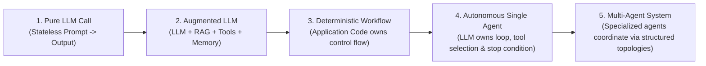
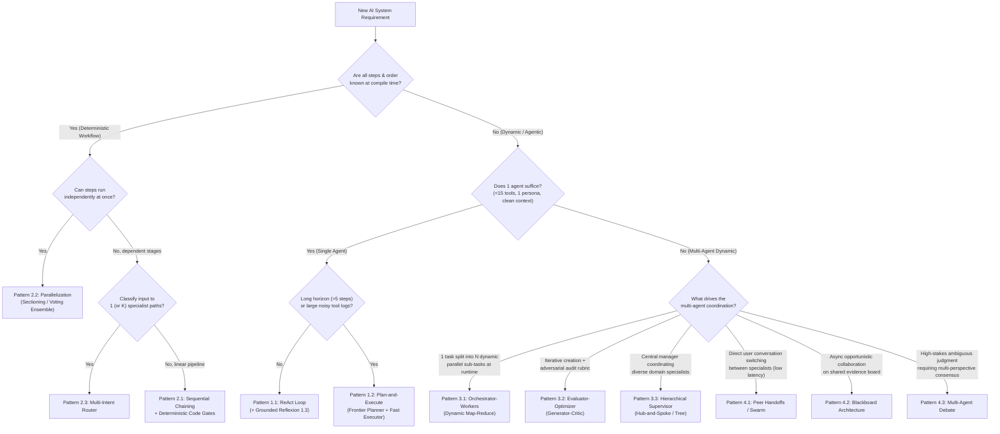

# Agentic AI Orchestration Patterns: From Beginner to Production Architect

[%20%26%20A2A%20(Horizontal)-8E24AA)](./chapter-06-production-mechanics-and-protocols.md#66-interoperability-protocols-mcp-vs-a2a)

> ⭐ *If you find this architectural reference guide helpful for designing, interviewing, or building multi-agent systems, please **star this repository**!*

A complete, framework-agnostic **8-chapter engineering handbook** on **Agentic AI Orchestration**. Designed for software engineers, cloud architects, and AI builders, this repository covers **what** the 10 core agentic architectures are, **why** each topology exists (backed by reliability and token-scaling math), **step-by-step runtime execution traces**, **exception-safe control-loop pseudocode**, **production reliability mechanics** (Durable HITL Checkpointing, Agentic Sagas, Idempotency, OpenTelemetry Trajectory Evaluation, and MCP vs. A2A protocols), and **how modern frameworks implement them** (**Google ADK**, **LangGraph**, **CrewAI**, **Microsoft AutoGen / Agent Framework**, and **OpenAI Agents SDK**).

---

**Contents**
| | |
| :--- | :--- |
| [📚 8-Chapter Curriculum & Learning Path](#-8-chapter-curriculum--learning-path) | [📊 At-a-Glance Pattern Comparison Matrix](#at-a-glance-pattern-comparison-matrix) |
| [🧭 The Spectrum of Agency & Golden Rule](#the-spectrum-of-agency--the-golden-rule) | [🛠️ Framework Selection Cheat Sheet](#framework-selection-cheat-sheet) |
| [📐 The Quantitative Laws of Orchestration](#the-quantitative-engineering-laws-of-orchestration) | [🔍 What Makes v2.0 Production-Grade](#what-makes-this-guide-production-grade-v20-highlights) |
| [🌳 Master Architecture Decision Tree](#master-architecture-decision-tree) | [🎯 Test Your Mastery (30 Scenario MCQs)](#-test-your-mastery-30-scenario-mcqs) |

---

## 📚 8-Chapter Curriculum & Learning Path

Every chapter traces one recurring enterprise scenario (*"AcmeCloud Incident & Billing SLA Resolution"*) as it scales from a single tool-calling loop to a decentralized multi-agent system, alongside distinct real-world industry examples:

| Chapter | Title & Link | Level | Core Architectures & Engineering Concepts Covered |
| :---: | :--- | :---: | :--- |
| **01** | **[Foundations, Memory Taxonomy & Engineering Laws](./chapter-01-foundations-and-mental-models.md)** | 🟢 Foundations | Workflows vs. Agents, The Augmented LLM, **4-Tier Memory Taxonomy** (Working, Episodic, Semantic, Procedural), **Compound Reliability Decay ($R = r^N$)**, and **Quadratic Context Token Tax ($O(K^2)$)**. |
| **02** | **[Single-Agent Orchestration Loops](./chapter-02-single-agent-loops.md)** | 🟢 Beginner | **1.1 ReAct** (with error-as-observation self-healing), **1.2 Plan-and-Execute** (with model tiering & dynamic replanning), **1.3 Grounded Reflexion**, and **Best-of-$N$ / Tree-of-Thoughts**. |
| **03** | **[Deterministic Multi-Agent Workflows](./chapter-03-deterministic-multi-agent-workflows.md)** | 🟡 Intermediate I | The **4 Multi-Agent Splitting Triggers**, **2.1 Sequential Chaining & Deterministic Code Gates**, **2.2 Parallelization (Sectioning vs. Voting Ensembles)**, and **2.3 Multi-Intent Routing**. |
| **04** | **[Dynamic & Hierarchical Orchestration](./chapter-04-dynamic-and-hierarchical-orchestration.md)** | 🟠 Intermediate II | **3.1 Orchestrator–Workers** (Dynamic Map-Reduce with Semaphore bounds), **3.2 Evaluator–Optimizer** (Adversarial Generator–Critic), and **3.3 Hierarchical Supervisor** (`AgentTool` vs. Graph Router & solving the "Telephone Game"). |
| **05** | **[Decentralized & Emergent Topologies](./chapter-05-decentralized-and-emergent-topologies.md)** | 🔴 Advanced | **4.1 Peer-to-Peer Handoffs / Swarms** (with cycle-breaker sets), **4.2 Blackboard Architecture** (Shared State & deduplicated event triggers), and **4.3 Multi-Agent Debate / Society of Minds**. |
| **06** | **[Production Mechanics, Sagas & Protocols](./chapter-06-production-mechanics-and-protocols.md)** | 🟣 Production Eng. | Typed State Scoping & **Pass-by-Reference Artifact Pointers**, Runtime Context Compaction, **Durable HITL Checkpointing & Time-Travel**, **The Agentic Saga Pattern & Tool Idempotency**, OpenTelemetry **Trajectory Evaluation**, and **MCP vs. A2A**. |
| **07** | **[Master Decision Matrix & Framework Survey](./chapter-07-decision-matrix-and-framework-survey.md)** | 🔵 Ecosystem | Master Architecture Decision Tree, Quantitative Pattern Comparison Matrix, and side-by-side code idioms across **Google ADK**, **LangGraph**, **CrewAI**, **AutoGen (AG2)**, and **OpenAI Agents SDK**. |
| **08** | **[Architectural Mastery Quiz (30 MCQs)](./chapter-08-mcq-assessment-and-case-studies.md)** | 🎓 Self-Assessment | **30 Scenario-Based Multiple-Choice Questions** with detailed architectural explanations and distractor analysis across all 7 chapters. |

---

## 🧭 The Spectrum of Agency & The Golden Rule

The most important architectural distinction in Agentic AI is **who owns the control flow** (`if/else`, `for`, `while`, branching, and termination): **application code** or **the LLM**?

> [!IMPORTANT]
> **The Golden Rule of Agentic Architecture:** Always use the most deterministic architecture that solves the problem. Hand control-flow decisions to an LLM *only* at the specific nodes where the execution path cannot be known at compile time. Nearly all successful production systems are **Deterministic–Agentic Hybrids**: a deterministic outer state machine containing bounded agentic inner loops.

---

## 📐 The Quantitative Engineering Laws of Orchestration

Why not chain 15 autonomous agents together in one shared conversation history? Because multi-step orchestration is governed by three mathematical laws (detailed in [Chapter 1](./chapter-01-foundations-and-mental-models.md)):

1. **The Compound Reliability Decay Law ($R_{\text{system}} = r^N$):**
   If each sequential step has $r = 95\%$ reliability, an unverified 10-step chain succeeds only $0.95^{10} = 59.9\%$ of the time. Inserting **Deterministic Code Gates** ([Chapter 3](./chapter-03-deterministic-multi-agent-workflows.md)) and **Grounded Verifiers** ([Chapters 2 & 4](./chapter-04-dynamic-and-hierarchical-orchestration.md)) between stages arrests error accumulation.
2. **The Quadratic Context Token Tax ($O(K^2)$):**
   Appending tool observations of size $T_{\text{obs}}$ to a single shared conversation window over $K$ turns bills $\sum_{k=1}^K k \cdot T_{\text{obs}} = O(K^2)$ cumulative input tokens and degrades middle-context attention. Delegating tool-heavy explorations to scoped sub-agents that return only structured summaries reduces token cost from $O(K^2)$ to $O(K)$.
3. **The Amdahl's Law of Agent Latency:**
   Sequential chains sum latency ($\sum_{i=1}^N L_i$), whereas parallel fan-out topologies bound latency by the slowest branch ($\max_i(L_i) + L_{\text{synth}}$).

---

## 🌳 Master Architecture Decision Tree

Use this flowchart (from [Chapter 7](./chapter-07-decision-matrix-and-framework-survey.md)) to pick the right orchestration topology in 30 seconds:

---

## 📊 At-a-Glance Pattern Comparison Matrix

Let $L$ be the average latency of a single LLM call, $K$ be the number of loop iterations, and $M$ be the number of specialist agents:

| Chapter | Pattern | Control Flow Owner | Latency Profile | Token Scaling | Context Isolation | Primary Failure Mode & Mandatory Guardrail |
| :--- | :--- | :--- | :--- | :--- | :--- | :--- |
| **[Ch 02](./chapter-02-single-agent-loops.md)** | **1.1 ReAct Loop** | Single LLM | $K \cdot L$ | $O(K^2)$ | Low | **Myopia & Context Bloat:** Cap `max_steps`; return tool exceptions as observations. |
| **[Ch 02](./chapter-02-single-agent-loops.md)** | **1.2 Plan-and-Execute** | Planner LLM + Code Loop | $(2 + K) \cdot L$ | $O(K)$ | High | **Stale Plan:** Always include a Replanner after each step summary. |
| **[Ch 02](./chapter-02-single-agent-loops.md)** | **1.3 Grounded Reflexion** | Actor + Verifier Loop | $(1\text{–}3) \cdot 2L$ | $O(\text{trials})$ | Medium | **Sycophantic Flip-Flop:** Run deterministic verifiers (AST/tests/regex) before LLM critique. |
| **[Ch 03](./chapter-03-deterministic-multi-agent-workflows.md)** | **2.1 Sequential Chain** | Application Code | $\sum_{i=1}^M L_i$ | $O(M)$ | High | **Compound Error Decay ($r^M$):** Insert deterministic `Pydantic`/business-rule gates between stages. |
| **[Ch 03](./chapter-03-deterministic-multi-agent-workflows.md)** | **2.2 Parallelization** | Application Code | $\max_i(L_i) + L_{\text{synth}}$ | $O(M)$ | High | **Hidden Data Dependencies & Failure Cancellation:** Ensure true independence; use `return_exceptions=True`. |
| **[Ch 03](./chapter-03-deterministic-multi-agent-workflows.md)** | **2.3 Intent Router** | Fast Classifier + Code | $L_{\text{fast}} + L_{\text{branch}}$ | **Lowest** ($O(1)$) | High | **Dropped Compound Intents:** Use multi-label `list[Intent]` schema to detect multi-part queries. |
| **[Ch 04](./chapter-04-dynamic-and-hierarchical-orchestration.md)** | **3.1 Orchestrator–Workers** | Orchestrator LLM | $2L + \max_i(L_{\text{worker}})$ | $O(N_{\text{workers}})$ | High | **Fan-Out Rate-Limit Bomb:** Enforce `max_length` on subtasks + `asyncio.Semaphore(K)`. |
| **[Ch 04](./chapter-04-dynamic-and-hierarchical-orchestration.md)** | **3.2 Evaluator–Optimizer** | Generator + Critic LLMs | $(1\text{–}3) \cdot 2L$ | $O(\text{rounds})$ | **High** (Clean Critic) | **Endless Nitpicking:** Separate `blocking_defects` from `minor_suggestions` in Critic schema. |
| **[Ch 04](./chapter-04-dynamic-and-hierarchical-orchestration.md)** | **3.3 Hierarchical Supervisor** | Central Supervisor LLM | $2K \cdot L$ (Hub hops) | $O(K \cdot M)$ | High | **"Telephone Game" Lossy Summaries:** Write structured facts directly to Typed Shared State. |
| **[Ch 05](./chapter-05-decentralized-and-emergent-topologies.md)** | **4.1 Peer Handoffs / Swarm** | Active Specialist LLM | **$1 \cdot L$ per turn** | $O(1)$ per turn | Medium | **Ping-Pong Handoff Cycle ($A \leftrightarrow B$):** Track `visited_edges` per turn + `max_handoffs`. |
| **[Ch 05](./chapter-05-decentralized-and-emergent-topologies.md)** | **4.2 Blackboard** | Event Controller + Board | $C_{\text{cycles}} \cdot \max(L_i)$ | $O(\text{triggers})$ | High | **Infinite Re-Triggering & Write Races:** Deduplicate `(agent, precondition_hash)` + atomic patch reducers. |
| **[Ch 05](./chapter-05-decentralized-and-emergent-topologies.md)** | **4.3 Multi-Agent Debate** | Debaters + Judge LLM | $(K_{\text{rounds}} + 1) \cdot L$ | **Highest** ($O(M \cdot K)$) | High | **Anchoring & Echo Chamber:** Enforce blind Round-1 parallel generation + orthogonal personas + early exit. |

---

## 🛠️ Framework Selection Cheat Sheet

Full code examples and architectural mappings are provided in [Chapter 7](./chapter-07-decision-matrix-and-framework-survey.md):

| Primary Engineering Requirement | Recommended Framework | Key Orchestration Primitives |
| :--- | :--- | :--- |
| **Google Cloud / Vertex AI native deployment, composable deterministic + hierarchical agents, and native A2A + MCP** | **Google ADK** | `SequentialAgent`, `ParallelAgent`, `LoopAgent`, `LlmAgent(output_key=..., sub_agents=[...])`, `AgentTool`, `BaseAgent` |
| **Low-level cyclic state machines, custom Blackboard reducers, dynamic fan-out, and durable time-travel checkpointing** | **LangGraph** | `StateGraph`, `Annotated[list, operator.add]` Reducers, `Send()` Map-Reduce, `Command(goto=...)`, `interrupt()` |
| **Rapid role-based organizational prototyping (`Researcher` + `Analyst` + `Writer`) with declarative YAML configs** | **CrewAI** | `Crew(process=Process.sequential \| Process.hierarchical)` + event-driven `Flows` (`@start`, `@listen`, `@router`) |
| **Conversational multi-agent group chats, code sandboxes, or Magentic-One ledger orchestration** | **Microsoft Agent Framework / AutoGen (AG2)** | `RoundRobinGroupChat`, `SelectorGroupChat`, `Swarm`, `MagenticOneGroupChat` |
| **Minimalist Python-first codebase with low abstraction overhead and fast peer-to-peer handoffs** | **OpenAI Agents SDK** | `Agent(handoffs=[...])`, `agent.as_tool()`, `Runner.run()`, `@input_guardrail` / `@output_guardrail` |

---

## 🔍 What Makes This Guide Production-Grade (v2.0 Highlights)

Unlike high-level overview posts, every chapter in this repository includes **production-hardened engineering mechanics**:
* **Self-Healing Tool Loops ([Chapter 2](./chapter-02-single-agent-loops.md)):** Catching tool execution exceptions (`ValidationError`, syntax errors) and feeding them back as structured observations rather than crashing worker threads.
* **Bounded Concurrency & Fault Isolation ([Chapters 3 & 4](./chapter-04-dynamic-and-hierarchical-orchestration.md)):** Using `asyncio.Semaphore(K)` and `return_exceptions=True` on dynamic worker fan-outs so a single failed branch or runaway decomposition never takes down the pipeline.
* **Cycle Detection & Trigger Deduplication ([Chapter 5](./chapter-05-decentralized-and-emergent-topologies.md)):** Deterministic `visited_edges` sets for Swarm handoffs and `fired_signatures` for Blackboard controllers.
* **The Agentic Saga Pattern & Tool Idempotency ([Chapter 6](./chapter-06-production-mechanics-and-protocols.md)):** Deterministic `idempotency_key` generation and LIFO compensating rollbacks when multi-step write workflows fail midway.
* **OpenTelemetry Distributed Tracing & Trajectory Evaluation ([Chapter 6](./chapter-06-production-mechanics-and-protocols.md)):** Evaluating process trajectory (`Exact Match`, `In-Order Match`, `Step Efficiency`) alongside final outcome faithfulness.

---

## 🎯 Test Your Mastery (30 Scenario MCQs)

Ready to validate your architectural judgment? Jump to **[Chapter 8: Architectural Mastery Quiz (30 Scenario-Based MCQs)](./chapter-08-mcq-assessment-and-case-studies.md)** for 30 real-world system design questions with complete answers and distractor explanations.

---

## 📄 License

Licensed under the [Apache License 2.0](LICENSE).
