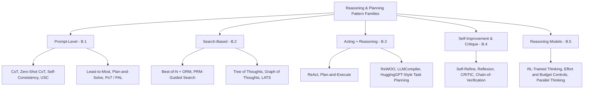
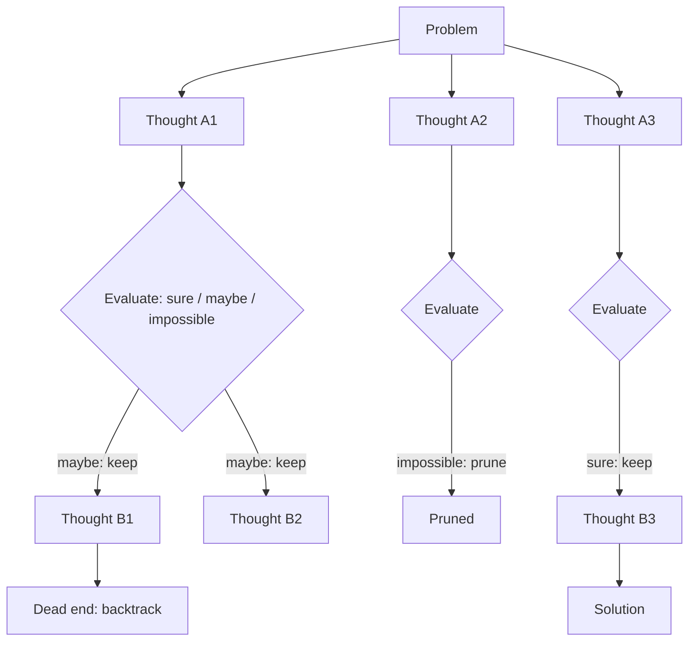
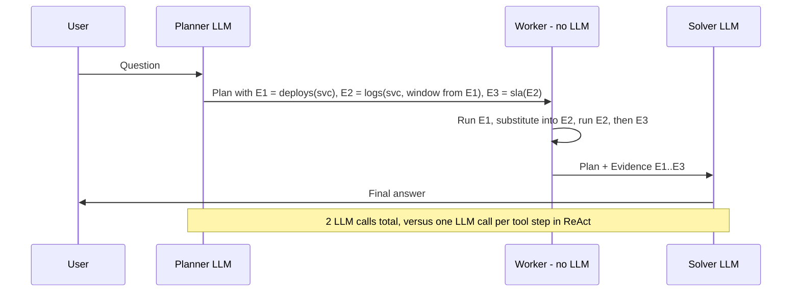
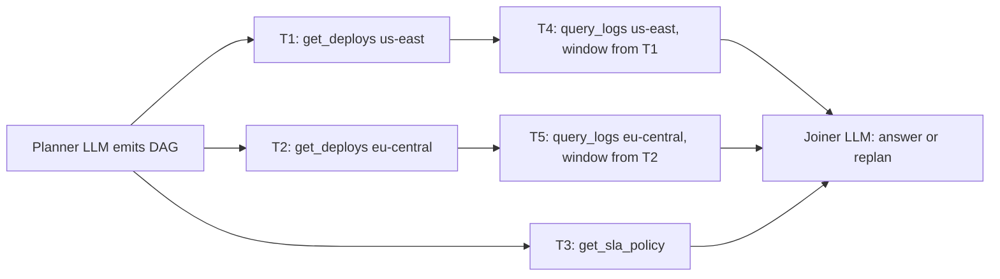
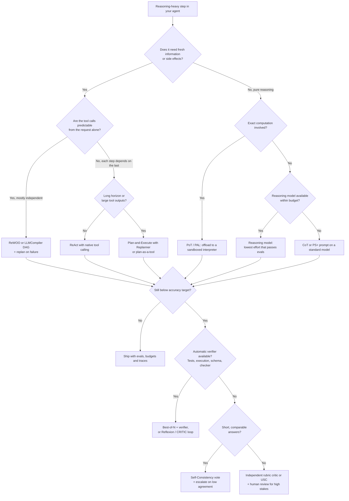

# Appendix B: The Reasoning & Planning Patterns Field Guide

[← Previous: Appendix A — The RAG Patterns Field Guide](./appendix-a-rag-patterns-deep-dive.md) | [Book Index](./README.md) | [Next: Appendix C — Agent Benchmarks & Evaluation Datasets Reference →](./appendix-c-agent-benchmarks-and-evaluation-datasets.md) | [Related: Chapter 2 — Single-Agent Loops](./chapter-02-single-agent-loops.md) | [Related: Chapter 4 — Dynamic & Hierarchical Orchestration](./chapter-04-dynamic-and-hierarchical-orchestration.md) | [Related: Chapter 13 — Agentic FinOps & Tokenomics](./chapter-13-agentic-finops-and-tokenomics.md)

---

[Chapter 2](./chapter-02-single-agent-loops.md) introduced the three single-agent loops (ReAct, Plan-and-Execute, and Reflection / Reflexion / Tree-of-Thoughts). [Chapter 4](./chapter-04-dynamic-and-hierarchical-orchestration.md) split the critic into its own agent (Evaluator–Optimizer), and [Chapter 13](./chapter-13-agentic-finops-and-tokenomics.md) showed what thinking tokens cost. This appendix is a reference for how an agent reasons and plans. It covers more than 20 named patterns, from a single "Let's think step by step" up to verifier-guided tree search and RL-trained reasoning models.

For each pattern I describe the reasoning failure it fixes and how it works, with a diagram or pseudocode where that helps. Then comes where it pays off, where it backfires, and a rough cost in LLM calls, serial depth (latency) and tokens. The costs are expressed structurally so you can estimate them for your own workload. Each family closes with a table that puts the competing patterns side by side.

> [!IMPORTANT]
> Extra reasoning compute only pays off when something can tell good reasoning from bad. More thinking, more samples and more search all generate candidates. Accuracy improves only when a selection signal (a verifier, a test suite, a tool result, an environment, or a well-calibrated vote) picks the right one. Most production reasoning failures are selection failures rather than generation failures.

A note on the numbers: every benchmark figure below is quoted from the cited paper, on that paper's models and benchmarks, at the date shown. Read them as evidence that a mechanism *can* help, not as a forecast for your workload, and re-measure on your own golden set ([Chapter 10](./chapter-10-agentic-evaluation-and-observability.md)).

---

## Table of Contents

* [B.0 Foundations](#b0-foundations)
* [B.1 Prompt-level reasoning patterns](#b1-prompt-level-reasoning-patterns)
* [B.2 Search-based reasoning](#b2-search-based-reasoning)
* [B.3 Planning with tools](#b3-planning-with-tools)
* [B.4 Self-improvement and critique](#b4-self-improvement-and-critique)
* [B.5 Reasoning models and test-time compute](#b5-reasoning-models-and-test-time-compute)
* [B.6 Master comparison matrix](#b6-master-comparison-matrix)
* [B.7 Decision tree and escalation ladder](#b7-decision-tree-and-escalation-ladder)
* [B.8 Anti-patterns](#b8-anti-patterns)
* [B.9 Primary sources](#b9-primary-sources)
* [Key takeaways](#key-takeaways)

---

## B.0 Foundations

### B.0.1 Working definitions

| Term | Working definition in this book | Example |
| :--- | :--- | :--- |
| **Reasoning** | Intermediate computation the model performs *in tokens* before committing to an answer or action. The tokens may be visible (a chain of thought in the output) or hidden (a reasoning model's internal thinking). | Working out that 42 minutes of downtime is below a 45-minute SLA threshold |
| **Planning** | Choosing and ordering a *sequence of actions* (tool calls, sub-tasks, sub-agents) toward a goal, before or while executing them. | `[check deploys] → [correlate 503s] → [check SLA policy]` |
| **Test-time (inference-time) compute** | Any extra computation spent per request to improve the answer: longer reasoning, more samples, search, verification, or revision. | Sampling 8 SQL candidates and running each against a sandbox |
| **Verifier / reward model** | Anything that scores a candidate: a deterministic check (tests, compiler, schema), a trained reward model, or an LLM judge. | `pytest`, a process reward model, a rubric judge |

### B.0.2 Four ways to spend test-time compute

Every pattern in this appendix spends extra compute along one or more of four axes:

| Axis | What you get | Patterns | Latency shape |
| :--- | :--- | :--- | :--- |
| Depth (sequential) | A longer, more careful single line of reasoning | CoT, Least-to-Most, Plan-and-Solve, reasoning models' internal thinking | Grows with tokens: serial |
| Breadth (parallel) | Many independent attempts, then selection | Self-Consistency, Best-of-$N$, parallel thinking | Roughly the slowest sample: parallel |
| Search (branch + evaluate + backtrack) | Exploration of partial solutions with pruning | ToT, GoT, PRM-guided beam search, LATS | Serial depth × branching |
| Grounding (external feedback) | New information the model cannot produce by thinking | ReAct, ReWOO, LLMCompiler, CRITIC, Reflexion, PoT/PAL | Bound by tool latency |

> [!TIP]
> Grounding is the only axis that adds information. Depth, breadth and search recombine what the model already knows; grounding brings in facts, execution results and test outcomes. When a task fails because the model *lacks information*, no amount of thinking will fix it. Add a tool ([Chapter 6](./chapter-06-tool-calling-and-action-engineering.md)) or retrieval ([Appendix A](./appendix-a-rag-patterns-deep-dive.md)) first.

### B.0.3 The generator–verifier gap

When you sample many candidates, two quantities matter. **Coverage** (pass@$k$) is the fraction of problems where *at least one* of $k$ samples is correct. **Selection accuracy** is how often your selector (vote, verifier, judge) actually picks a correct sample.

*Large Language Monkeys* (Brown et al., 2024) showed that coverage can keep climbing with sample count. In the paper, repeated sampling with DeepSeek-Coder-V2-Instruct raised the fraction of SWE-bench Lite issues solved from 15.9% with one sample to 56% with 250 samples, because each candidate could be checked automatically. The same paper reports that in domains without automatic verifiers, majority voting and reward models plateau beyond several hundred samples. Coverage you can't select from is wasted spend.

Don't confuse pass@$k$ with $\text{pass}^k$. The first means *at least one* of $k$ attempts succeeds, which is what Best-of-$N$ exploits when a verifier exists. The second means *all* $k$ trials succeed, which is what users experience as reliability; [Chapter 10](./chapter-10-agentic-evaluation-and-observability.md) covers it.

### B.0.4 Pattern map



---

## B.1 Prompt-level reasoning patterns

These patterns change only the prompt or the decoding strategy. There are no tools and no training. They were discovered on non-reasoning models in 2022–2023, and section B.5 explains how much of their value reasoning models have since absorbed. They're still the right tools for small, fast, non-thinking models, and for cases where you need a *visible*, structured rationale.

### B.1.1 Few-shot chain-of-thought (Wei et al., NeurIPS 2022)

Some multi-step problems go wrong when the model has to jump straight to the answer. Few-shot CoT puts a few exemplars in the prompt in the form `question → step-by-step reasoning → answer`. The model imitates the format and writes intermediate steps before it answers.

The paper found that CoT helped mainly at large scale (roughly 100B+ parameters in its experiments). Prompting PaLM 540B with eight CoT exemplars reached state-of-the-art GSM8K accuracy at the time, beating a fine-tuned model with a verifier.

It costs one call, with a longer prompt (the exemplars, which are cacheable) and a longer output (the chain). Use it for arithmetic, symbolic and multi-hop tasks on a non-reasoning model, especially when you also want the steps in the output for review. Skip it on reasoning models (B.5.3), and on single lookups or classifications where reasoning adds tokens and no accuracy.

### B.1.2 Zero-shot CoT, "Let's think step by step" (Kojima et al., NeurIPS 2022)

Zero-shot CoT gets the benefit of CoT without writing exemplars. It takes two prompts. The first appends *"Let's think step by step"* to draw out the reasoning; the second extracts the final answer from that reasoning in the required format. With InstructGPT (`text-davinci-002`), the paper (2022) reports accuracy rising from 17.7% to 78.7% on MultiArith and from 10.4% to 40.7% on GSM8K.

That's one or two calls, and the answer-extraction call can often be replaced by a structured output schema. It makes a quick baseline on a non-reasoning model, or for a task family with no good exemplars. Don't use it with reasoning models: OpenAI's reasoning best-practices guide explicitly advises against "think step by step"-style instructions for them, since they already reason internally.

### B.1.3 Self-Consistency (Wang et al., ICLR 2023)

A single sampled chain has high variance, and one early misstep shouldn't decide the answer. Self-Consistency samples $N$ diverse reasoning chains at non-zero temperature, extracts each final answer, and takes the majority vote. The reasoning paths are "marginalized out". This is the parallel-breadth axis in its simplest form. The paper reports gains over greedy CoT of +17.9% on GSM8K, +11.0% on SVAMP, +12.2% on AQuA and +6.4% on StrategyQA.

Exact-match voting is impossible for free-form outputs such as summaries, code or open answers. For those, the Universal Self-Consistency variant (USC; Chen et al., 2023) gives all $N$ candidates to an LLM and asks it to pick the most consistent one.

The cost is $N$ calls, fully parallel, so latency is about that of the slowest sample, and the shared prompt prefix is cacheable ([Chapter 13](./chapter-13-agentic-finops-and-tokenomics.md)). [Chapter 3](./chapter-03-deterministic-multi-agent-workflows.md)'s Voting Ensemble (Pattern 2.2) generalizes the pattern across prompts and model families. Use it for short, discrete, comparable answers (a number, a label, a choice, a SQL result set), and as a cheap uncertainty signal where low agreement means "escalate". Skip it when answers are long and unique (use USC or a verifier instead), or when all samples share the same systematic error. Voting can't fix a bias that every sample has.

```python
from collections import Counter

async def self_consistency(question: str, n: int = 5, min_agreement: float = 0.6) -> dict:
    # N independent samples in parallel; temperature > 0 gives diverse reasoning paths
    samples = await asyncio.gather(*(
        llm.generate_structured_async(question, schema=AnswerWithReasoning, temperature=0.8)
        for _ in range(n)
    ))
    votes = Counter(normalize(s.final_answer) for s in samples)  # normalize: "42", "42.0", "forty-two"
    answer, count = votes.most_common(1)[0]
    agreement = count / n
    # Low agreement is a useful uncertainty signal: escalate instead of guessing
    return {"answer": answer, "agreement": agreement, "escalate": agreement < min_agreement}
```

### B.1.4 Least-to-Most prompting (Zhou et al., ICLR 2023)

Least-to-Most targets easy-to-hard generalization: problems that are harder or longer than any exemplar in the prompt. It runs in two stages. First the model decomposes the problem into an ordered list of simpler sub-problems. Then it solves them in sequence, feeding each sub-answer into the next sub-problem's prompt. With `code-davinci-002`, the paper reports that least-to-most prompting solved the SCAN compositional-generalization benchmark in every split with at least 99% accuracy using 14 exemplars, against 16% for CoT.

You pay one decomposition call plus $k$ sequential solve calls, so latency grows linearly with $k$. It suits compositional problems with a natural "solve the small case first" structure, like multi-part calculations, nested instructions and long transformations. If the sub-problems are independent, solve them in parallel instead (B.3.4). It also won't help much when the decomposition itself is the hard part.

Least-to-Most is the prompt-level ancestor of query decomposition in RAG ([Appendix A, A.4](./appendix-a-rag-patterns-deep-dive.md#a4-pre-retrieval-query-side-patterns)) and of Plan-and-Execute (B.3.3). Its "abstract first" sibling, *Step-Back Prompting*, is covered in Appendix A.4.

### B.1.5 Plan-and-Solve, PS and PS+ (Wang et al., ACL 2023)

The Plan-and-Solve authors observed three error types in zero-shot CoT: calculation errors, missing-step errors and semantic misunderstanding. Their method targets the first two. PS replaces "Let's think step by step" with an instruction to *first devise a plan, then carry it out step by step*, which is aimed at missing steps. PS+ adds more detailed instructions aimed at calculation errors, such as extracting the relevant variables and computing intermediate results carefully. Across ten datasets, the paper reports that PS+ outperformed zero-shot CoT, and that on math reasoning it was comparable to 8-shot manual CoT.

It's one call, with slightly longer output than zero-shot CoT. Reach for it when you want a one-call, zero-shot reasoning prompt for a non-reasoning model. It's also the conceptual seed of the Plan-and-Execute agent architecture (B.3.3). Reasoning models plan internally and don't need it, and a task that needs fresh information mid-plan calls for a tool loop.

### B.1.6 Program-of-Thoughts (PoT) and Program-Aided Language Models (PAL)
*PoT: Chen et al., TMLR 2023 · PAL: Gao et al., ICML 2023*

LLMs are good at reasoning and bad at computation in free text: arithmetic, counting, date math, iteration. PoT and PAL separate the two. The model writes a program (typically Python) that expresses the reasoning, a sandboxed interpreter executes it, and the program's output is the answer. PoT reported an average gain of about 12% over CoT across its math and financial QA datasets. PAL with Codex surpassed PaLM-540B with CoT by an absolute 15% top-1 on GSM8K. Both figures are as reported in each paper.

The cost is one call plus interpreter time. That usually means *fewer* output tokens than a long textual chain, and far fewer arithmetic errors. Use it for any step with exact computation: finance, SLA arithmetic, unit conversion, date windows, aggregation over tool outputs. This is the reasoning-pattern view of the CodeAct sandboxes in [Chapter 6](./chapter-06-tool-calling-and-action-engineering.md). It's the wrong choice if you can't sandbox code execution ([Chapter 12](./chapter-12-agentic-security-identity-and-sandboxing.md)) or if the problem isn't computational (commonsense, judgment).

> [!TIP]
> Of the patterns in this section, this one has aged best. Reasoning models can still slip in long calculations, while a deterministic interpreter computes exactly what the program says (so the remaining risk moves to the program's logic, which you can test). [Chapter 4](./chapter-04-dynamic-and-hierarchical-orchestration.md)'s rule, *"Don't ask an LLM to do contract arithmetic"*, is PoT applied to production.

### Prompt-level patterns compared

| Pattern | LLM calls | Serial depth | Token cost | Parallel | Needs exemplars | Best for |
| :--- | :---: | :---: | :---: | :---: | :---: | :--- |
| Few-shot CoT | 1 | 1 | Medium | No | Yes | Multi-step reasoning with visible steps on non-reasoning models |
| Zero-shot CoT | 1–2 | 1–2 | Low | No | No | Fast baseline without exemplars |
| Self-Consistency | $N$ | 1 | Low × $N$ | Yes | Optional | Discrete answers; uncertainty estimation |
| Least-to-Most | $1 + k$ | $1 + k$ | High | No | Yes | Compositional, easy-to-hard generalization |
| Plan-and-Solve (PS+) | 1 | 1 | Low | No | No | Zero-shot math and multi-step tasks |
| PoT / PAL | 1 + exec | 1 | Low | No | Optional | Exact computation |

---

## B.2 Search-based reasoning

Prompt-level patterns produce one or a few complete chains. Search-based patterns treat reasoning as exploration: they generate many candidates (whole answers or partial steps), score them, and keep the best. The quality of the scorer sets the ceiling (B.0.3).

### B.2.1 Best-of-$N$ with an outcome verifier (ORM)
*Foundational: Cobbe et al., "Training Verifiers to Solve Math Word Problems", 2021 (which also introduced GSM8K)*

Best-of-$N$ turns coverage into accuracy. If one of $N$ samples is right and you can recognize it, you win. Sample $N$ complete solutions, score each with a verifier, and return the top-scored one. The verifier can be one of three kinds:

1. Deterministic, which is the best option: unit tests, a compiler, SQL execution against a sandbox, schema validation, a symbolic math checker.
2. A trained outcome reward model (ORM) that scores the final result.
3. An LLM judge with a rubric. This is the weakest kind, and it is subject to self-preference bias (see [Chapter 4](./chapter-04-dynamic-and-hierarchical-orchestration.md)).

Cobbe et al. found that verification significantly improved GSM8K performance and scaled better with more data than a fine-tuning baseline. *Large Language Monkeys* (B.0.3) showed the same effect at scale for code with test-based verification.

You pay for $N$ parallel generations plus $N$ verifications. Deterministic verifiers are nearly free; LLM judges double the bill. Use it for code generation (tests), SQL (execution), structured extraction (schema plus cross-field rules) and math (a checker). Of all the external scaffolds, this is the one that still pays off most with reasoning models (B.5.6). Don't use it when the only available verifier is the same model that generated the candidates, with no rubric or ground truth. That's intrinsic self-evaluation in disguise (B.4.5).

```python
async def best_of_n(task: str, n: int, verifiers: list[Callable[[str], Awaitable[float | None]]]) -> str:
    """Generate N candidates in parallel; return the best one that passes every hard check."""
    candidates = await asyncio.gather(*(generator.generate_async(task, temperature=0.8) for _ in range(n)))

    async def score(c: str) -> float:
        total = 0.0
        for verify in verifiers:            # ordered: cheapest deterministic checks first
            s = await verify(c)             # None means "hard fail" (tests fail, schema invalid)
            if s is None:
                return float("-inf")
            total += s
        return total

    scores = await asyncio.gather(*(score(c) for c in candidates))
    best_score, best = max(zip(scores, candidates), key=lambda t: t[0])
    if best_score == float("-inf"):
        raise NoValidCandidateError(task)   # escalate; never ship an unverified candidate
    return best
```

### B.2.2 Process vs. outcome reward models (PRM vs. ORM)
*Uesato et al. (DeepMind), 2022 · Lightman et al. (OpenAI), "Let's Verify Step by Step", ICLR 2024*

An ORM scores a complete solution: is the final answer correct? A **process reward model (PRM)** scores each intermediate step: is this step valid? A solution's score then aggregates its step scores, for example as the product or the minimum. Scoring the process lets you catch right answers reached by wrong reasoning, and prune bad partial solutions early. And because a PRM can score *partial* solutions, it enables step-level search: beam search or lookahead that extends only the most promising partial chains.

The evidence comes from three lines of work:

* Uesato et al. (2022) found that pure outcome supervision gave similar *final-answer* error rates with less labeling on GSM8K, but that correct *reasoning steps* required process-based supervision (or reward models that emulate it).
* Lightman et al. found that process supervision significantly outperformed outcome supervision for training reward models on MATH. Their process-supervised model solved 78% of a representative subset of the MATH test set, and they released PRM800K, a dataset of 800K step-level human labels.
* Snell et al. (2024) analyzed searching against PRMs and adaptive revision. They found that the best strategy depends on prompt difficulty, and that allocating compute adaptively per prompt ("compute-optimal" scaling) was more than 4× more efficient than a Best-of-$N$ baseline. In a FLOPs-matched comparison, on problems where a smaller model already had non-trivial success, test-time compute let it outperform a 14× larger model.

PRM-guided beam search with beam width $w$, expansion $b$ and depth $d$ costs roughly $w \cdot b \cdot d$ step generations plus as many PRM scores, with serial depth $d$. It makes sense if you run your own models and can train or obtain a step-level verifier (math, code, formal domains), or when you need to audit the steps themselves (education, compliance, regulated calculations). With API access only and no step-level verifier, it's hard to justify, because a prompted LLM "step judge" is far less reliable than a trained PRM. Watch out for reward hacking too: a policy optimized hard against a learned verifier finds the verifier's blind spots.

> [!NOTE]
> Most teams building agents never train a PRM. They meet the idea in two places. One is step-level trajectory evaluation of agents (was each tool call justified?) in [Chapter 10](./chapter-10-agentic-evaluation-and-observability.md), along with fault attribution in [Chapter 16](./chapter-16-agent-quality-flywheel-and-distillation.md). The other is the RL pipelines that produce reasoning models (B.5.1), where verifiable rewards play the role of the verifier.

### B.2.3 Tree of Thoughts (Yao et al., NeurIPS 2023)

Tree of Thoughts (ToT) lets the model explore, look ahead and backtrack instead of committing to one left-to-right chain. Each coherent intermediate step is a "thought", which is a node in the tree. At each node the model generates $b$ candidate next thoughts, either by independent sampling or by proposing several at once. It then evaluates each state itself, as a scalar value judgment or a vote across states. The search runs as BFS, keeping the best $k$ per level, or as DFS, going deep and backtracking when a state is judged hopeless. On the Game of 24, the paper reports that GPT-4 with CoT solved 4% of tasks while ToT reached 74%.

It's expensive: roughly $b \cdot k \cdot d$ generation calls plus evaluation calls, with serial depth $d$, though calls within a level can run in parallel. ToT fits puzzle-like problems where partial states can be judged and early mistakes are fatal, such as combinatorial search, constrained planning, or creative tasks with checkable constraints. It's also useful for offline data generation when you want diverse, high-quality traces. Avoid it when production latency matters, when a reasoning model is available (it explores internally), or when partial states can't be evaluated reliably. A noisy evaluator turns ToT into an expensive random walk.



### B.2.4 Graph of Thoughts (Besta et al., AAAI 2024)

Graph of Thoughts (GoT) generalizes the tree into an arbitrary graph, so thoughts can be merged and refined in loops as well as branched. Thoughts are vertices and dependencies are edges. The operations include *generate* (branch), *aggregate* (merge several thoughts into one, such as combining partial sorted lists) and *refine* (loop on a thought), and a controller executes a predefined graph of operations. On sorting, the paper reports that GoT improved quality by 62% over ToT while reducing cost by more than 31%.

Cost depends on the operation graph. Merging can reduce total calls compared with exhaustive branching, which is where the reported savings over ToT come from. GoT works for problems with a natural divide → solve → merge structure (sorting, set operations, merging partial documents or summaries) where you can design the operation graph up front. It executes a *designed* graph and doesn't discover one, so it's no help when the decomposition isn't known in advance.

If you already think in Orchestrator–Workers terms ([Chapter 4](./chapter-04-dynamic-and-hierarchical-orchestration.md)), GoT is Map-Reduce for thoughts. *Generate* is the map, *aggregate* is the reduce, and *refine* is an Evaluator–Optimizer loop on one node.

### B.2.5 Language Agent Tree Search (Zhou et al., ICML 2024)

LATS combines reasoning, acting and planning by running tree search over *actions in an environment*, where ToT only searches over thoughts. It adapts Monte Carlo Tree Search (MCTS) to language agents. Each iteration selects a promising node (balancing exploration and exploitation) and expands it with $n$ candidate actions. It evaluates them with an LM-powered value function combined with environment feedback such as test results and observations. Then it simulates to a terminal state, backpropagates the value, and reflects on failures, keeping Reflexion-style lessons to guide later iterations. The paper (2023–2024) reports 92.7% pass@1 on HumanEval with GPT-4, and an average score of 75.9 on WebShop with GPT-3.5.

The cost is very high and highly variable: MCTS iterations × (expansion + evaluation + reflection calls), plus environment steps. Exploring many trajectories is only affordable when the environment is cheap, safe and resettable (sandboxed code execution, simulated web environments, games) and success can be checked. Don't use it where actions have side effects you can't roll back, such as payments, emails or production writes. You can't "try 20 branches" against a real customer account. It's also usually too slow for interactive latency budgets.

### Search-based patterns compared

| Pattern | Searches over | Selection signal | LLM calls (structural) | Parallelism | Tolerance of a noisy scorer | Best for |
| :--- | :--- | :--- | :--- | :---: | :---: | :--- |
| Self-Consistency (B.1.3) | Whole answers | Majority vote | $N$ | Very high | Medium (no scorer needed) | Discrete answers |
| Best-of-$N$ + verifier | Whole answers | ORM, tests, judge | $N$ + verification | Very high | Very low (bounded by verifier) | Code, SQL, math with checkers |
| PRM-guided beam search | Partial chains (steps) | Step-level PRM | $\approx w \cdot b \cdot d$ | Medium (per level) | Very low | Math and formal reasoning with a trained PRM |
| Tree of Thoughts | Partial thoughts | LLM self-evaluation | $\approx b \cdot k \cdot d$ + evals | Medium (per level) | Low | Puzzles, constrained planning |
| Graph of Thoughts | Thoughts + merges | LLM scoring per operation | Graph-dependent | Medium | Low | Divide-solve-merge problems |
| LATS | Action trajectories | LM value + environment feedback | MCTS iterations × (expand + evaluate + reflect) | Low | Medium (env grounds it) | Resettable sandboxes, coding, web sims |

---

## B.3 Planning with tools

When reasoning needs fresh information or side effects, the agent has to interleave thinking with tool calls. What separates the patterns in this family is when the model sees observations, and how many tool calls can run at once.

### B.3.1 ReAct, Reason + Act (Yao et al., ICLR 2023)

ReAct handles tasks where step $t+1$ depends on the result of step $t$. The agent interleaves *Thought → Action → Observation* until it's done. The full treatment, including native tool calling, error-as-observation and reasoning-model details, is in [Chapter 2, Pattern 1.1](./chapter-02-single-agent-loops.md). On ALFWorld and WebShop, the paper reports that ReAct with one or two in-context examples outperformed imitation- and RL-trained baselines by absolute success rates of 34% and 10%.

The cost is $K$ serial LLM calls, each re-reading the growing history, which comes to $O(K^2)$ total input tokens without compaction ([Chapter 11](./chapter-11-context-engineering-and-long-term-memory.md)). For short (2–5 step), exploratory, dependency-heavy tool use, it's the right default. If the plan is knowable up front and the steps are independent, use ReWOO or LLMCompiler. If the horizon is long and observations are large, use Plan-and-Execute.

### B.3.2 ReWOO, Reasoning WithOut Observation (Xu et al., 2023)

Every ReAct step re-sends the full history just to choose the next call. ReWOO removes that redundant re-prompting by splitting the work into three modules:

1. Planner. One LLM call writes the *whole* plan up front, with tool calls whose inputs reference earlier results through placeholders (`#E1`, `#E2`, …).
2. Worker. It executes the tool calls and substitutes evidence into the placeholders. No LLM call is needed between tools.
3. Solver. One LLM call combines the plan and all the evidence into the answer.

The paper reports 5× token efficiency and a 4% accuracy improvement on HotpotQA. It also demonstrates offloading the planning ability from 175B GPT-3.5 into a 7B LLaMA model.

With two LLM calls (Planner and Solver) plus the tool calls, ReWOO has the lowest token cost in this family. It works when the information-gathering plan is predictable from the question alone: multi-hop lookups, report assembly, fixed audits. The Worker can also run independent placeholders in parallel. The catch is that plain ReWOO has no replanning. When observations should change the plan (*"there was no deployment yesterday"*), a surprise in `#E1` silently poisons every later step.



### B.3.3 Plan-and-Execute (planner, executor, replanner)
*Popularized by LangChain's "Plan-and-Execute Agents" post (2023), which cites BabyAGI and the Plan-and-Solve paper as inspirations*

Plan-and-Execute keeps a global plan as a cognitive anchor over long horizons, and isolates noisy tool output inside per-step executors. A planner writes a step list. A scoped executor (often a small-model ReAct loop) runs each step and returns a structured summary, and a replanner revises the remaining steps after each result. Full treatment, pseudocode and a trace are in [Chapter 2, Pattern 1.2](./chapter-02-single-agent-loops.md).

You pay for one plan call, the executor calls for each step, and one replan call per step, all serial. That's worth it for 5–15 step goals with large intermediate outputs, especially when you want model tiering (a frontier planner, a cheap executor). On short tasks the planning overhead dominates, and if every step is a single tool call, ReWOO or LLMCompiler fits better.

> [!TIP]
> Think of ReWOO versus Plan-and-Execute as a dial between cost and resilience. ReWOO plans once and never looks back, which is cheapest but brittle when something unexpected comes back. Plan-and-Execute replans after every step and copes with surprises, at the price of a frontier-model call per step. A common middle ground is to replan only on signal: when a step fails, returns empty, or contradicts an assumption recorded in the plan.

### B.3.4 LLMCompiler, a parallel function-calling DAG (Kim et al., ICML 2024)

LLMCompiler cuts latency by executing independent tool calls in parallel, much as a compiler schedules independent instructions. It has three components:

1. A Function Calling Planner emits a DAG of tasks with explicit dependencies.
2. A Task Fetching Unit dispatches each task as soon as its dependencies resolve, substituting results into arguments.
3. An Executor runs ready tasks concurrently.

A final joining step decides whether to answer or replan (the paper supports dynamic replanning). Compared with ReAct, the paper reports up to 3.7× latency speedup, up to 6.7× cost savings and up to ~9% accuracy improvement.

The cost is one planner call and one join call (plus any replans) on top of the tool calls. Latency is roughly the critical path of the DAG rather than the number of tasks, which is [Chapter 13](./chapter-13-agentic-finops-and-tokenomics.md)'s $\max$-not-sum rule. Use it for fan-out-heavy tool workloads such as *"compare these 5 services' error rates"*, multi-entity lookups and parallel retrieval. If the steps are inherently sequential, the DAG collapses into a chain and you pay planning overhead for nothing. Be careful as well with tools whose side effects depend on an order the DAG doesn't capture.



```python
async def execute_dag(tasks: dict[str, Task], tools: dict[str, Callable], max_concurrency: int = 8) -> dict:
    """ReWOO/LLMCompiler-style executor: run each task as soon as its dependencies are done."""
    results: dict[str, Any] = {}
    done = {tid: asyncio.Event() for tid in tasks}
    sem = asyncio.Semaphore(max_concurrency)

    async def run(tid: str, task: Task) -> None:
        for dep in task.depends_on:                       # wait only for real dependencies
            await done[dep].wait()
        args = substitute_placeholders(task.args, results)  # "$T1" -> results["T1"]
        async with sem:
            try:
                results[tid] = await tools[task.tool](**args)
            except Exception as exc:                      # failures become evidence for the joiner
                results[tid] = f"TaskError({type(exc).__name__}): {exc}"
        done[tid].set()

    await asyncio.gather(*(run(tid, t) for tid, t in tasks.items()))  # planner must emit an acyclic graph
    return results
```

### B.3.5 HuggingGPT-style task planning, LLM as controller (Shen et al., NeurIPS 2023)

Here an LLM coordinates many specialized models or tools that it can't replace. HuggingGPT works in four stages. Task planning parses the request into sub-tasks with dependencies. Model selection picks an expert model for each sub-task based on its *function description*. Task execution runs the models, passing outputs along the dependencies, and response generation summarizes the results. The original work used ChatGPT as the controller and models from the Hugging Face hub as the experts.

The cost is a planning call, a selection per task, the executions and a summary call, and expert-model latency usually dominates. The pattern fits multimodal or multi-specialist pipelines (vision → speech → text). Its modern descendants are description-based routing over tool catalogs, `SKILL.md` playbooks and agent cards ([Chapters 8](./chapter-08-agent-skills-and-procedural-memory.md) and [9](./chapter-09-mcp-and-a2a-interoperability.md)). It breaks down when the catalog is large and the descriptions are poor, because selection quality is bounded by description quality. That's the same lesson as tool-schema engineering ([Chapter 6](./chapter-06-tool-calling-and-action-engineering.md)).

### Tool-using loops compared

| Pattern | LLM calls (for $T$ tool calls) | Serial LLM depth | Token cost | Tool parallelism | Copes with surprises | Best for |
| :--- | :---: | :---: | :---: | :---: | :---: | :--- |
| ReAct | $\approx T + 1$ | $\approx T + 1$ | High ($O(T^2)$ history) | Per-turn parallel calls only | Very well (sees every observation) | Short, exploratory, dependent steps |
| ReWOO | 2 | 2 | Low | Yes, independent placeholders | Poorly (no replanning) | Predictable multi-hop gathering |
| Plan-and-Execute | $1 + \sum \text{executor} + \text{replans}$ | High | Medium (scoped contexts) | Usually sequential | Well (replanner) | Long horizons, big tool outputs |
| LLMCompiler | 2 + replans | 2 + replans | Low | Yes, full DAG | Moderately (replan on join) | Fan-out-heavy, latency-sensitive tool use |
| HuggingGPT-style | $2 + \text{selections}$ | Low | Medium | Yes, along dependencies | Somewhat | Multi-model / multimodal orchestration |

---

## B.4 Self-improvement and critique

These patterns add a feedback loop: generate, critique, revise. The research is now fairly consistent about when that works. The loop helps when the feedback carries information the generator didn't have, such as test results, tool outputs, retrieved evidence or an independent rubric. It's unreliable when the model simply re-reads its own answer. [Chapter 2, Pattern 1.3](./chapter-02-single-agent-loops.md) gives the production loop; [Chapter 4, Pattern 3.2](./chapter-04-dynamic-and-hierarchical-orchestration.md) separates the critic into its own agent.

### B.4.1 Self-Refine (Madaan et al., NeurIPS 2023)

Self-Refine improves a draft at inference time with no training, using one model in three roles: *Generate → Feedback (the same LLM critiques the draft) → Refine (the same LLM rewrites using the feedback)*, repeated until a stop condition. The paper tested seven tasks, including dialogue, code optimization, code readability, math and sentiment reversal. Humans and automatic metrics preferred Self-Refine outputs over one-step generation, and task performance improved by about 20% absolute on average.

It costs $1 + 2r$ serial calls for $r$ rounds. Use it for preference and quality dimensions with explicit criteria: tone, readability, completeness against a checklist, formatting. Don't count on it for correctness of reasoning when there's no external check, because that's exactly where intrinsic self-correction fails (B.4.5).

### B.4.2 Reflexion (Shinn et al., NeurIPS 2023)

Reflexion learns across trials without weight updates, which the authors call "verbal reinforcement learning". An Actor attempts the task, and an Evaluator produces a signal (tests, environment reward, exact match, or an LLM judgment). A Self-Reflection step turns failures into natural-language lessons that are stored in episodic memory and fed into the next trial. The paper reports 91% pass@1 on HumanEval, against 80% for the GPT-4 baseline it compared with.

The cost is trials × (actor calls + evaluation + reflection), serial across trials. It works for retryable tasks with a trustworthy pass/fail signal: code with tests, SQL with execution, environment tasks. If the evaluator is weak, or self-generated with no grounding, the lessons come from a wrong signal and teach the wrong rule. It's also a poor fit for one-shot actions with side effects.

### B.4.3 CRITIC, tool-interactive critiquing (Gou et al., ICLR 2024)

CRITIC makes critique evidence-based by having the model check its draft *with tools*. Starting from an initial output, it iterates *Verify → Correct*. The model calls a tool suited to the claim (a search engine for facts, a code interpreter for programs, a toxicity classifier for safety) to check specific aspects of the draft. It then writes a critique grounded in the tool results and revises. The paper reports consistent gains on free-form QA, mathematical program synthesis and toxicity reduction, and the authors emphasize how much self-improvement depends on external feedback.

The cost is $1 + r \times$ (tool calls + critique + revision), and tool latency usually dominates. This is the critique pattern I'd default to. Verify fact-heavy answers with retrieval, generated code or calculations by execution, and policy-sensitive text with a classifier. When no relevant tool exists for the claim type, fall back to an independent critic with a rubric ([Chapter 4](./chapter-04-dynamic-and-hierarchical-orchestration.md)).

```python
async def critic_loop(task: str, max_rounds: int = 2) -> str:
    draft = await llm.generate_async(task)
    for _ in range(max_rounds):
        claims = await llm.generate_structured_async(f"List checkable claims in:\n{draft}", schema=ClaimList)
        # Ground every claim in an external signal: search for facts, execution for code/math
        evidence = await asyncio.gather(*(verify_with_tool(c) for c in claims.items))
        problems = [e for e in evidence if e.verdict in ("contradicted", "unsupported", "exec_error")]
        if not problems:
            return draft                       # nothing refuted by evidence: stop, don't nitpick
        draft = await llm.generate_async(
            f"Task: {task}\nDraft: {draft}\nEvidence-based problems:\n{problems}\n"
            "Revise ONLY what the evidence refutes; keep everything else unchanged."
        )
    return draft
```

### B.4.4 Chain-of-Verification (Dhuliawala et al., Meta, Findings of ACL 2024)

CoVe targets factual hallucination in long-form and list answers. It drafts a response, then plans verification questions that fact-check the draft. Each question is answered independently, so the answers aren't biased by the draft or by each other. Finally it generates a verified response.

The cost is one draft, one planning call, $q$ independent verification calls (in parallel) and one final call. CoVe suits list-style or multi-fact answers whose individual claims are easy to check in isolation. It gets much stronger when the verification step uses retrieval instead of the model's memory, at which point it becomes a structured CRITIC. It doesn't help when claims can't be checked independently, or when the model's parametric knowledge is the very thing in doubt and no retrieval is available.

### B.4.5 Intrinsic self-correction is unreliable

> [!WARNING]
> "Review your answer and fix any mistakes" is not a reliability mechanism. Huang et al. (*Large Language Models Cannot Self-Correct Reasoning Yet*, ICLR 2024) found that LLMs struggle to self-correct reasoning without external feedback, and that performance sometimes degrades after self-correction. The paper attributes some earlier positive results to setups that used oracle labels, for example only asking the model to retry when the ground truth said it was wrong. Kamoi et al.'s critical survey (TACL 2024) reached a consistent conclusion: no prior work demonstrated successful self-correction with feedback from *prompted* LLMs, except on tasks exceptionally suited to it. Self-correction does work well with reliable external feedback, and large-scale fine-tuning can enable it.

| Feedback source | Example | Reliability for fixing *reasoning* errors | Pattern |
| :--- | :--- | :---: | :--- |
| Deterministic external check | Unit tests, compiler, SQL execution, schema validator | Very high | Reflexion with tests, Best-of-$N$, CRITIC (code) |
| Tool-retrieved evidence | Search results, database lookups, retrieved documents | High | CRITIC, CoVe with retrieval |
| Independent critic with a rubric | Different prompt, context or model family; explicit pass criteria | Medium | Evaluator–Optimizer ([Chapter 4](./chapter-04-dynamic-and-hierarchical-orchestration.md)) |
| Trained verifier / reward model | ORM or PRM | Medium (domain-bound; hackable) | B.2.1, B.2.2 |
| Same model, same context, "are you sure?" | Intrinsic self-critique | Very low (can flip correct answers) | Avoid for correctness |

Reasoning models change the baseline, but the rule still holds. RL-trained reasoning models already check and backtrack inside their thinking (B.5.1), so an *ungrounded* extra critique pass adds even less than it did for older models. What still adds value is feedback the model can't generate by thinking: execution results, retrieved facts and independent verification.

### Critique patterns compared

| Pattern | Feedback source | Memory across attempts | LLM calls | Grounded | Best for |
| :--- | :--- | :---: | :--- | :---: | :--- |
| Self-Refine | Same LLM | Within episode | $1 + 2r$ | No (unless given a rubric or checks) | Style, readability, checklist completeness |
| Reflexion | Evaluator signal + verbal lessons | Yes, episodic | Trials × (act + eval + reflect) | Yes, if the evaluator is external | Retryable tasks with tests or rewards |
| CRITIC | External tools | Within episode | $1 + r \times$ (tools + critique + revise) | Yes | Facts, code, math, toxicity |
| CoVe | Independent verification Q&A | Within episode | $3 + q$ | Partial (yes with retrieval) | Multi-fact and list answers |
| Evaluator–Optimizer ([Ch. 4](./chapter-04-dynamic-and-hierarchical-orchestration.md)) | Separate critic agent | Defect history | Rounds × 2 | Yes, with deterministic checks | High-compliance artifacts |

---

## B.5 Reasoning models and test-time compute

### B.5.1 From prompted reasoning to trained reasoning

Everything in B.1–B.4 *prompts* or *scaffolds* a model into reasoning. Starting in late 2024, vendors shipped models trained with reinforcement learning to reason before answering:

| Milestone | What it showed |
| :--- | :--- |
| OpenAI o1 (*"Learning to reason with LLMs"*, Sept 2024) | Large-scale RL teaches the model to use a long internal chain of thought: break problems down, recognize mistakes, try alternative approaches. OpenAI reported that performance improves with both more RL (train-time compute) and more time spent thinking (test-time compute). Later o-series and GPT-5-family models continue this line with selectable reasoning effort. |
| Google Gemini 2.0 Flash Thinking (experimental, Dec 2024) → Gemini 2.5 (2025) | Google called 2.0 Flash Thinking its first thinking model; with Gemini 2.5 it began building thinking into the model family. The 2.5 models launched with a developer-controlled `thinking_budget` (a token budget); Gemini 3 introduced the level-based `thinking_level`. Gemini 2.5 Deep Think (Aug 2025) productized parallel thinking: generating many ideas at once and revising or combining them before answering. |
| DeepSeek-R1 (DeepSeek-AI, Jan 2025; published in *Nature*, Sept 2025) | An open-weight demonstration. R1-Zero was trained with RL directly on the base model, without supervised fine-tuning first, and reasoning behaviors such as self-verification and reflection emerged, though with readability and language-mixing problems. R1 added cold-start data and multi-stage training. The RL algorithm, GRPO, scores a group of sampled outputs against each other instead of training a separate critic model. DeepSeek also released smaller dense models distilled from R1 (Qwen- and Llama-based). |
| Anthropic Claude 3.7 Sonnet (Feb 2025) | A hybrid reasoning model: one model that answers instantly or uses extended thinking, controlled by a `budget_tokens` parameter. Claude 4 models added interleaved thinking (reasoning between tool calls), initially behind a beta header. Newer Claude models replace the manual budget with adaptive thinking, where the model decides when and how deeply to think, steered by an effort setting. |
| s1: Simple test-time scaling (Muennighoff et al., 2025) | Test-time scaling can be cheap to reproduce. Fine-tuning Qwen2.5-32B-Instruct on just 1,000 curated reasoning traces, plus budget forcing (ending thinking early, or appending *"Wait"* to make the model keep thinking), exceeded o1-preview on competition math by up to 27%, as reported in the paper. |

Architecturally, RL with verifiable rewards (correct math answers, passing tests) is the training-time version of Best-of-$N$ with a verifier (B.2.1): sample, check, reinforce what passed. The model internalizes much of the search that ToT and Self-Consistency did externally. Applied to your own domain, the same idea is Reinforcement Fine-Tuning, covered in [Chapter 16](./chapter-16-agent-quality-flywheel-and-distillation.md).

### B.5.2 Effort and budget controls

Reasoning models expose a dial for how much test-time compute to spend per call. The parameter names differ by provider: OpenAI `reasoning_effort` (or `reasoning.effort` in the Responses API), Anthropic `budget_tokens` for manual extended thinking (deprecated on the Claude 4.6 models and rejected by Claude 4.7 and later, which use adaptive thinking with an effort setting instead, per Anthropic's documentation as of October 2026), Gemini 2.5 `thinking_budget`, Gemini 3 `thinking_level`, and an `enable_thinking`-style switch in hybrid open-weight models such as Qwen3. [Chapter 13, Lever 3](./chapter-13-agentic-finops-and-tokenomics.md) lists the accepted values and billing rules. These names change between model generations, so check the provider's current documentation before you hard-code one.

My rules for setting the dial:

1. Set it per node rather than per application. A router or classifier node needs minimal or no thinking, a planner or replanner node may need high effort, and a step executor usually needs low effort.
2. Choose the level with evals. Sweep effort levels on your golden set and pick the lowest level that meets the accuracy target. The objective is CpO, not accuracy alone ([Chapter 13](./chapter-13-agentic-finops-and-tokenomics.md)).
3. Treat a budget as a cap rather than a target, and measure actual thinking tokens from usage metadata.
4. Escalate on signal. Retry at higher effort only when a cheap check fails (schema invalid, tests fail, low self-consistency agreement). Don't run everything at maximum effort "just in case".

```python
EFFORT_BY_NODE = {"router": "minimal", "executor": "low", "planner": "high", "judge": "medium"}

async def call_with_escalation(node: str, prompt: str, check: Callable[[str], bool]) -> str:
    levels = ["minimal", "low", "medium", "high"]
    start = levels.index(EFFORT_BY_NODE[node])
    for effort in levels[start:]:              # escalate only when a cheap verifier fails
        out = await reasoning_llm.generate_async(prompt, effort=effort)  # map to provider param
        if check(out):
            return out
        budget.record_escalation(node, effort) # track escalation rate as a FinOps metric
    raise VerificationFailedError(node)
```

### B.5.3 Prompting reasoning models

| Old habit (non-reasoning models) | With reasoning models | Why |
| :--- | :--- | :--- |
| *"Let's think step by step"* | Remove it. State the goal, constraints and success criteria. | The model already reasons internally. OpenAI's reasoning best-practices guide advises against CoT instructions for its reasoning models. |
| Hand-written step-by-step procedures for *how to think* | Prefer high-level guidance. Anthropic's prompting best practices recommend general instructions over prescriptive steps; a prompt like "think thoroughly" often does better than a hand-written step-by-step plan. | Prescriptive scaffolds can constrain a search the model does better on its own. Keep *business* rules explicit; drop *thinking* recipes. |
| Many few-shot exemplars by default | Try zero-shot first, and add examples only for output format or domain conventions (also OpenAI's guidance). | Exemplars can anchor the model to a narrower strategy. |
| Asking for the reasoning in the visible output | Ask for the answer plus a short, structured justification (evidence IDs, assumptions). | Visible "reasoning" is not the model's actual reasoning (B.5.5), and it costs output tokens twice. |
| External ToT or Self-Consistency on every call | Raise the effort level first. Add external search only if evals show a gap *and* a verifier exists. | The internal search is cheaper per unit of accuracy, and the external scaffold needs a selector anyway. |
| Dropping prior turns' reasoning to save tokens | Pass reasoning artifacts back exactly as the API requires (thinking blocks, reasoning items, thought signatures). | Required for correct multi-turn tool use on several APIs ([Chapter 2](./chapter-02-single-agent-loops.md)). |

### B.5.4 Cost and latency trade-offs

Thinking tokens are output tokens. They're billed at the output rate and add directly to wall-clock time through $N_{\text{out}} \cdot \text{TPOT}$ in [Chapter 13](./chapter-13-agentic-finops-and-tokenomics.md)'s Task Completion Time formula. A 6-step agent loop at a high budget can spend most of its bill on thinking.

Breadth and depth behave differently on latency. $N$ parallel samples cost $N\times$ tokens but add little latency, while a longer single chain costs fewer total tokens and is strictly serial. For interactive UX, then, cap thinking depth and use parallel candidates plus a verifier when accuracy has to rise.

Overthinking is real. Chen et al. (*"Do NOT Think That Much for 2+3=?"*, 2024) documented o1-like models spending excessive compute on simple problems for minimal benefit, and proposed efficiency metrics and mitigations. Route easy traffic to low effort (B.5.2).

Compute-optimal allocation also beats uniform allocation. Snell et al. (B.2.2) showed that adapting the test-time strategy to prompt difficulty was more than 4× more efficient than uniform Best-of-$N$. In production that translates to difficulty-aware routing (a cheap router or confidence signal) plus escalation.

Here is a simple model for comparing a reasoning-model call with an external Best-of-$N$ scaffold on a non-reasoning model:

$$\text{Cost}_{\text{reasoning}} \approx T_{\text{in}} \cdot p_{\text{in}} + (T_{\text{think}} + T_{\text{out}}) \cdot p_{\text{out}} \qquad \text{Cost}_{\text{BoN}} \approx N \cdot \left(T_{\text{in}} \cdot p_{\text{in}}^{\text{cached}} + T_{\text{out}} \cdot p_{\text{out}}\right) + N \cdot C_{\text{verify}}$$

Compare the two on cost per validated outcome rather than per call. A cheaper call that fails verification more often isn't actually cheaper.

### B.5.5 Visible reasoning is not an audit log

> [!CAUTION]
> Chain-of-thought text can be unfaithful to what actually drove the answer. Turpin et al. (NeurIPS 2023) biased few-shot prompts, for example by reordering options so the correct answer in every exemplar was "(A)". Models followed the bias, yet their CoT explanations did not mention it, and accuracy dropped by as much as 36% on a suite of 13 BIG-Bench Hard tasks with GPT-3.5 and Claude 1.0. Anthropic's *Reasoning Models Don't Always Say What They Think* (Chen et al., 2025) tested reasoning models with hints placed in the prompt. When the models used a hint, their CoTs revealed it at least occasionally in most settings, but the reveal rate was often below 20%.
>
> What this means in practice:
> * Don't use the model's reasoning text as the justification of record for a decision. Log the things that actually happened: tool calls, inputs, retrieved evidence IDs and verifier results ([Chapter 10](./chapter-10-agentic-evaluation-and-observability.md)).
> * Monitoring reasoning traces is useful but insufficient as a safety control. Keep deterministic guardrails, permissions and human approval gates ([Chapters 12](./chapter-12-agentic-security-identity-and-sandboxing.md) and [17](./chapter-17-production-state-hitl-and-frameworks.md)).
> * Many hosted APIs return summarized or opaque reasoning rather than raw thinking. Design your observability around that.

### B.5.6 When external scaffolds still help

| External scaffold | Still worth it with reasoning models? | Why / when |
| :--- | :---: | :--- |
| Best-of-$N$ + deterministic verifier | Yes, the strongest case | Adds a selection signal the model can't produce internally (tests, execution, schema, checkers). |
| Tool grounding (ReAct, CRITIC, PoT) | Yes | Adds information and exact computation. Thinking can't fetch yesterday's logs. |
| Plan-as-artifact + context isolation (Plan-and-Execute, to-do tools) | Yes, for long horizons | Addresses context rot and myopia over many steps, which is a context problem rather than a reasoning one ([Chapter 11](./chapter-11-context-engineering-and-long-term-memory.md)). |
| Parallel DAG execution (LLMCompiler) | Yes, for latency | Reasoning models don't make your tools run concurrently. |
| Self-Consistency voting | Sometimes | Useful as an uncertainty signal and for high-stakes discrete answers. Costs $N\times$ an already expensive call. |
| Independent critic (Evaluator–Optimizer) | When grounded | Worth it with deterministic checks and a rubric. Ungrounded same-model critique adds little. |
| Tree of Thoughts / Graph of Thoughts | Rarely in production | Mostly internalized. Reserve for offline data generation or problems with a cheap, reliable state evaluator. |
| LATS / MCTS over actions | Only in resettable sandboxes | Valuable for code or simulated environments with tests. Unsafe with irreversible side effects. |
| Zero-shot CoT / PS+ prompts | No | Redundant at best. Keep them for small, non-reasoning models. |

---

## B.6 Master comparison matrix

*LLM calls and serial depth are structural estimates: $N$ = samples, $k$ = sub-problems, $T$ = tool calls, $r$ = refinement rounds, $q$ = verification questions, $b$ = branching factor, $w$ = beam width, $d$ = depth. Token-cost and robustness ratings are relative within this table. "Robustness" here is an overall rating of how reliably the pattern reaches a correct result in realistic conditions, so it can differ from the narrower columns in the family tables (for example, how well a loop copes with surprises in B.3).*

| Pattern | Family | LLM calls | Serial depth (latency) | Token cost | Parallelism | Robustness | Needs external signal? | Best for |
| :--- | :--- | :---: | :---: | :---: | :---: | :---: | :---: | :--- |
| Zero-shot / few-shot CoT | Prompt | 1 | 1 | Low | No | Low | No | Visible steps on non-reasoning models |
| Self-Consistency | Prompt / Breadth | $N$ | 1 | High | Yes | High | No (vote) | Discrete answers, uncertainty |
| Least-to-Most | Prompt / Depth | $1 + k$ | $1 + k$ | High | No | Medium | No | Compositional problems |
| Plan-and-Solve (PS+) | Prompt / Depth | 1 | 1 | Low | No | Low | No | Zero-shot multi-step |
| PoT / PAL | Prompt / Grounding | 1 + exec | 1 | Low | No | High | Interpreter | Exact computation |
| Best-of-$N$ + verifier | Search / Breadth | $N$ + verify | 1–2 | High | Yes | Very high (good verifier) | Yes | Code, SQL, math |
| PRM-guided search | Search | $\approx w b d$ | $d$ | Very high | Per level | High | Trained PRM | Math and formal domains |
| Tree of Thoughts | Search | $\approx b k d$ + evals | $d$ | Highest | Per level | Low | LLM self-eval | Puzzles, offline data generation |
| Graph of Thoughts | Search | Graph-dependent | Graph depth | Very high | Per level | Medium | LLM scoring | Divide-solve-merge |
| LATS | Search + Acting | MCTS iterations × calls | High | Highest | Limited | High (env-grounded) | Environment | Resettable sandboxes |
| ReAct | Acting | $\approx T + 1$ | $\approx T + 1$ | High | Per turn | High | Tools | Short exploratory tool use |
| ReWOO | Acting / Planning | 2 | 2 + tool critical path | Low | Yes | Low | Tools | Predictable multi-hop gathering |
| Plan-and-Execute | Acting / Planning | $1 + \sum \text{exec} + \text{replans}$ | High | Medium | Usually no | High | Tools | Long horizons |
| LLMCompiler | Acting / Planning | 2 + replans | DAG critical path | Low | Yes | Medium | Tools | Latency-sensitive fan-out |
| HuggingGPT-style | Acting / Planning | $2 + \text{selections}$ | Low LLM depth | Medium | Yes | Low | Expert models | Multi-model pipelines |
| Self-Refine | Critique | $1 + 2r$ | $1 + 2r$ | Medium | No | Low | No (rubric helps) | Style and quality polish |
| Reflexion | Critique / Memory | Trials × 2–3 | Trials × 2–3 | High | No | High (good evaluator) | Evaluator | Retryable tasks with tests |
| CRITIC | Critique / Grounding | $1 + r \times$ (critique + revise) | $1 + 2r$ + tools | Medium | Tool checks: yes | High | Yes | Facts, code, toxicity |
| CoVe | Critique | $3 + q$ | 4 | Medium | Verifications: yes | Medium | Optional retrieval | Multi-fact answers |
| Reasoning model (effort dial) | Trained depth | 1 | 1 (long decode) | Medium to very high | Vendor-internal | High | No | Default for hard reasoning steps |

---

## B.7 Decision tree and escalation ladder

### B.7.1 Decision tree



### B.7.2 The escalation ladder

| Level | Architecture | Move up a level when… |
| :---: | :--- | :--- |
| R0 | Direct answer: small or fast model, no explicit reasoning, structured output | Evals show multi-step errors |
| R1 | Prompted or native reasoning: CoT / PS+ on standard models, or a reasoning model at low effort; PoT for any arithmetic | Accuracy plateaus below target at reasonable effort |
| R2 | Tuned effort and routing: per-node effort levels, difficulty-aware routing, escalation on cheap-check failure | Errors persist on a definable task class *and* a verifier exists |
| R3 | Verified breadth: Best-of-$N$ with deterministic verifiers; Self-Consistency for discrete answers | Tasks need fresh information or multi-step actions |
| R4 | Grounded loops: ReAct / ReWOO / LLMCompiler for gathering; CRITIC or Reflexion for correction; Plan-and-Execute for long horizons | Resettable environments with reliable rewards make exploration affordable |
| R5 | Search over trajectories: LATS / MCTS in sandboxes, or offline ToT for data generation, feeding RFT or distillation ([Chapter 16](./chapter-16-agent-quality-flywheel-and-distillation.md)) | — |

> [!WARNING]
> Don't skip rungs. Teams often jump from R0 to R5 (*"let's add tree search!"*) when the real problem was missing information (a tool was needed), arithmetic in free text (PoT was needed), or an effort level set too low. Justify each rung with eval evidence on a failing task category, and track cost per validated outcome at every rung.

---

## B.8 Anti-patterns

1. "Let's think step by step" on a reasoning model. It's redundant and can hurt, and you pay twice: once for hidden thinking and once for visible reasoning. → *State goals, constraints and success criteria instead (B.5.3).*
2. Ungrounded self-critique loops for correctness. *"Are you sure? Check your work."* can flip correct answers. → *Ground critique in tests, tools or retrieval (B.4.5).*
3. Maximum effort everywhere. Overthinking easy requests burns output tokens and seconds. → *Set effort per node, chosen by evals, and escalate on signal (B.5.2).*
4. Best-of-$N$ without a real selector. Sampling 16 candidates and letting the same model pick "the best" is mostly expensive noise. → *Use deterministic verifiers, or vote only on comparable answers.*
5. Voting on long free-form answers by exact match. Every sample is unique, so there's no majority. → *Use USC, a rubric judge, or extract comparable fields first.*
6. LLM arithmetic in free text. → *PoT / PAL or a deterministic function (B.1.6).*
7. Plan-once-execute-blindly. ReWOO-style plans with no replanning silently propagate a wrong early assumption. → *Replan on failure, emptiness or contradiction (B.3.3).*
8. Sequential tool calls that could run in parallel. → *Emit a DAG and execute independent tasks concurrently (B.3.4).*
9. Tree search against irreversible actions, such as exploring branches that send emails or move money. → *Search only in sandboxes, and gate real side effects behind approval ([Chapter 17](./chapter-17-production-state-hitl-and-frameworks.md)).*
10. Treating chain-of-thought as the audit trail. → *Log tool calls, evidence IDs and verifier results; CoT can be unfaithful (B.5.5).*
11. Dropping reasoning artifacts between tool-use turns where the API requires them. → *Append the full assistant message, as in [Chapter 2](./chapter-02-single-agent-loops.md).*
12. Optimizing hard against a learned verifier or LLM judge. The policy learns the judge's blind spots (reward hacking). → *Prefer verifiable rewards, rotate and audit judges, and keep held-out human review.*
13. Unbounded reflection or search, with no `max_rounds` and no budget. → *Hard caps in code plus the `TokenBudgetEnforcer` from [Chapter 13](./chapter-13-agentic-finops-and-tokenomics.md).*

---

## B.9 Primary sources

*Every entry below was checked against its arXiv record or official page. Venues are listed where confirmed; otherwise the arXiv year is given.*

| Pattern / topic | Primary source | Link |
| :--- | :--- | :--- |
| Chain-of-Thought | Wei et al., *Chain-of-Thought Prompting Elicits Reasoning in Large Language Models*, NeurIPS 2022 | [arXiv:2201.11903](https://arxiv.org/abs/2201.11903) |
| Zero-Shot CoT | Kojima et al., *Large Language Models are Zero-Shot Reasoners*, NeurIPS 2022 | [arXiv:2205.11916](https://arxiv.org/abs/2205.11916) |
| Self-Consistency | Wang et al., *Self-Consistency Improves Chain of Thought Reasoning in Language Models*, ICLR 2023 | [arXiv:2203.11171](https://arxiv.org/abs/2203.11171) |
| Universal Self-Consistency | Chen et al., *Universal Self-Consistency for Large Language Model Generation*, 2023 | [arXiv:2311.17311](https://arxiv.org/abs/2311.17311) |
| Least-to-Most | Zhou et al., *Least-to-Most Prompting Enables Complex Reasoning in Large Language Models*, ICLR 2023 | [arXiv:2205.10625](https://arxiv.org/abs/2205.10625) |
| Plan-and-Solve | Wang et al., *Plan-and-Solve Prompting: Improving Zero-Shot Chain-of-Thought Reasoning by Large Language Models*, ACL 2023 | [arXiv:2305.04091](https://arxiv.org/abs/2305.04091) |
| Program of Thoughts | Chen et al., *Program of Thoughts Prompting: Disentangling Computation from Reasoning for Numerical Reasoning Tasks*, TMLR 2023 | [arXiv:2211.12588](https://arxiv.org/abs/2211.12588) |
| PAL | Gao et al., *PAL: Program-aided Language Models*, ICML 2023 | [arXiv:2211.10435](https://arxiv.org/abs/2211.10435) |
| Verifiers + GSM8K | Cobbe et al., *Training Verifiers to Solve Math Word Problems*, 2021 | [arXiv:2110.14168](https://arxiv.org/abs/2110.14168) |
| Process vs. outcome feedback | Uesato et al., *Solving math word problems with process- and outcome-based feedback*, 2022 | [arXiv:2211.14275](https://arxiv.org/abs/2211.14275) |
| Process reward models / PRM800K | Lightman et al., *Let's Verify Step by Step*, ICLR 2024 | [arXiv:2305.20050](https://arxiv.org/abs/2305.20050) · [PRM800K](https://github.com/openai/prm800k) |
| Compute-optimal test-time scaling | Snell et al., *Scaling LLM Test-Time Compute Optimally can be More Effective than Scaling Model Parameters*, 2024 (ICLR 2025) | [arXiv:2408.03314](https://arxiv.org/abs/2408.03314) |
| Repeated sampling / coverage | Brown et al., *Large Language Monkeys: Scaling Inference Compute with Repeated Sampling*, 2024 | [arXiv:2407.21787](https://arxiv.org/abs/2407.21787) |
| Tree of Thoughts | Yao et al., *Tree of Thoughts: Deliberate Problem Solving with Large Language Models*, NeurIPS 2023 | [arXiv:2305.10601](https://arxiv.org/abs/2305.10601) · [Code](https://github.com/princeton-nlp/tree-of-thought-llm) |
| Graph of Thoughts | Besta et al., *Graph of Thoughts: Solving Elaborate Problems with Large Language Models*, AAAI 2024 | [arXiv:2308.09687](https://arxiv.org/abs/2308.09687) · [Code](https://github.com/spcl/graph-of-thoughts) |
| LATS | Zhou et al., *Language Agent Tree Search Unifies Reasoning, Acting, and Planning in Language Models*, ICML 2024 | [arXiv:2310.04406](https://arxiv.org/abs/2310.04406) · [Code](https://github.com/lapisrocks/LanguageAgentTreeSearch) |
| ReAct | Yao et al., *ReAct: Synergizing Reasoning and Acting in Language Models*, ICLR 2023 | [arXiv:2210.03629](https://arxiv.org/abs/2210.03629) |
| ReWOO | Xu et al., *ReWOO: Decoupling Reasoning from Observations for Efficient Augmented Language Models*, 2023 | [arXiv:2305.18323](https://arxiv.org/abs/2305.18323) · [Code](https://github.com/billxbf/ReWOO) |
| Plan-and-Execute agents | LangChain, *Plan-and-Execute Agents* (blog), 2023 | [blog.langchain.dev](https://blog.langchain.dev/plan-and-execute-agents/) |
| LLMCompiler | Kim et al., *An LLM Compiler for Parallel Function Calling*, ICML 2024 | [arXiv:2312.04511](https://arxiv.org/abs/2312.04511) · [Code](https://github.com/SqueezeAILab/LLMCompiler) |
| HuggingGPT | Shen et al., *HuggingGPT: Solving AI Tasks with ChatGPT and its Friends in Hugging Face*, NeurIPS 2023 | [arXiv:2303.17580](https://arxiv.org/abs/2303.17580) · [Code (JARVIS)](https://github.com/microsoft/JARVIS) |
| Self-Refine | Madaan et al., *Self-Refine: Iterative Refinement with Self-Feedback*, NeurIPS 2023 | [arXiv:2303.17651](https://arxiv.org/abs/2303.17651) |
| Reflexion | Shinn et al., *Reflexion: Language Agents with Verbal Reinforcement Learning*, NeurIPS 2023 | [arXiv:2303.11366](https://arxiv.org/abs/2303.11366) |
| CRITIC | Gou et al., *CRITIC: Large Language Models Can Self-Correct with Tool-Interactive Critiquing*, ICLR 2024 | [arXiv:2305.11738](https://arxiv.org/abs/2305.11738) |
| Chain-of-Verification | Dhuliawala et al., *Chain-of-Verification Reduces Hallucination in Large Language Models*, Findings of ACL 2024 | [arXiv:2309.11495](https://arxiv.org/abs/2309.11495) |
| Limits of self-correction | Huang et al., *Large Language Models Cannot Self-Correct Reasoning Yet*, ICLR 2024 | [arXiv:2310.01798](https://arxiv.org/abs/2310.01798) |
| Self-correction survey | Kamoi et al., *When Can LLMs Actually Correct Their Own Mistakes? A Critical Survey of Self-Correction of LLMs*, TACL 2024 | [arXiv:2406.01297](https://arxiv.org/abs/2406.01297) |
| OpenAI o1 | OpenAI, *Learning to reason with LLMs*, Sept 2024 | [openai.com](https://openai.com/index/learning-to-reason-with-llms/) |
| Reasoning-model prompting (OpenAI) | OpenAI, *Reasoning best practices* (developer guide) | [platform.openai.com](https://platform.openai.com/docs/guides/reasoning-best-practices) |
| DeepSeek-R1 | DeepSeek-AI, *DeepSeek-R1: Incentivizing Reasoning Capability in LLMs via Reinforcement Learning*, 2025; *Nature* 645 (2025) | [arXiv:2501.12948](https://arxiv.org/abs/2501.12948) · [Nature](https://www.nature.com/articles/s41586-025-09422-z) · [GitHub](https://github.com/deepseek-ai/DeepSeek-R1) |
| Claude extended and adaptive thinking | Anthropic, *Claude 3.7 Sonnet* announcement, Feb 2025; extended-thinking documentation; prompting best practices (thinking guidance) | [anthropic.com](https://www.anthropic.com/news/claude-3-7-sonnet) · [Docs](https://docs.anthropic.com/en/docs/build-with-claude/extended-thinking) · [Prompting best practices](https://platform.claude.com/docs/en/build-with-claude/prompt-engineering/claude-prompting-best-practices) |
| Gemini thinking | Google, *Gemini 2.5: Our most intelligent AI model* (Mar 2025, which describes 2.0 Flash Thinking as Google's first thinking model); Gemini API thinking documentation; *Gemini 2.5 Deep Think* (Aug 2025) | [blog.google](https://blog.google/technology/google-deepmind/gemini-model-thinking-updates-march-2025/) · [Docs](https://ai.google.dev/gemini-api/docs/thinking) · [Deep Think](https://blog.google/products/gemini/gemini-2-5-deep-think/) |
| Budget forcing | Muennighoff et al., *s1: Simple test-time scaling*, 2025 | [arXiv:2501.19393](https://arxiv.org/abs/2501.19393) |
| Overthinking | Chen et al., *Do NOT Think That Much for 2+3=? On the Overthinking of o1-Like LLMs*, 2024 | [arXiv:2412.21187](https://arxiv.org/abs/2412.21187) |
| CoT faithfulness | Turpin et al., *Language Models Don't Always Say What They Think: Unfaithful Explanations in Chain-of-Thought Prompting*, NeurIPS 2023 | [arXiv:2305.04388](https://arxiv.org/abs/2305.04388) |
| Reasoning-model faithfulness | Chen et al. (Anthropic), *Reasoning Models Don't Always Say What They Think*, 2025 | [arXiv:2505.05410](https://arxiv.org/abs/2505.05410) |

---

## Key takeaways

1. Selection matters more than generation. Extra thinking, samples and search only help when a verifier, tool, environment or vote can tell good candidates from bad (B.0.3).
2. Grounding is the only axis that adds information. If the model lacks facts, add a tool or retrieval before adding reasoning (B.0.2).
3. Offload exact computation to code. PoT / PAL and deterministic functions beat free-text arithmetic, even on reasoning models (B.1.6).
4. Best-of-$N$ with a deterministic verifier is the strongest external scaffold. It stays valuable with reasoning models because it adds a signal the model can't produce internally (B.2.1, B.5.6).
5. Process supervision catches what outcome checks miss. PRMs score steps and enable step-level search, but they are domain-bound and hackable (B.2.2).
6. Choose the tool loop by dependency structure: ReAct for dependent exploration, ReWOO or LLMCompiler for predictable or parallel gathering, Plan-and-Execute for long horizons. Replan on signal (B.3).
7. Intrinsic self-correction is unreliable. Critique works when it's grounded in tests, tools, retrieval or an independent rubric; "are you sure?" is not a reliability mechanism (B.4.5).
8. Reasoning models change how you prompt. Drop "think step by step" and prescriptive thinking recipes, state goals, constraints and success criteria, try zero-shot first, and pass reasoning artifacts back (B.5.3).
9. Treat effort as a per-node dial tuned with evals. Thinking tokens are output tokens. Route by difficulty, escalate on cheap-check failure, and optimize cost per validated outcome (B.5.2, B.5.4).
10. Visible reasoning is not an audit log. CoT can be unfaithful, so log tool calls, evidence and verifier results, and keep deterministic guardrails (B.5.5).

---

[← Previous: Appendix A — The RAG Patterns Field Guide](./appendix-a-rag-patterns-deep-dive.md) | [Book Index](./README.md) | [Next: Appendix C — Agent Benchmarks & Evaluation Datasets Reference →](./appendix-c-agent-benchmarks-and-evaluation-datasets.md) | [Related: Chapter 2 — Single-Agent Loops](./chapter-02-single-agent-loops.md) | [Related: Chapter 4 — Dynamic & Hierarchical Orchestration](./chapter-04-dynamic-and-hierarchical-orchestration.md) | [Related: Chapter 13 — Agentic FinOps & Tokenomics](./chapter-13-agentic-finops-and-tokenomics.md)
