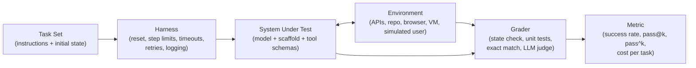
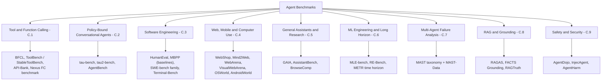
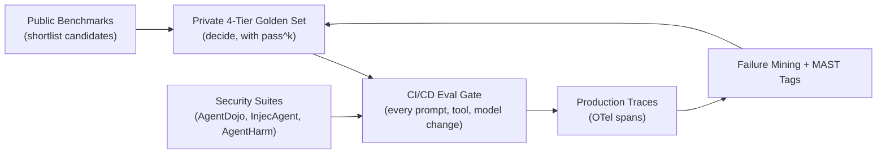
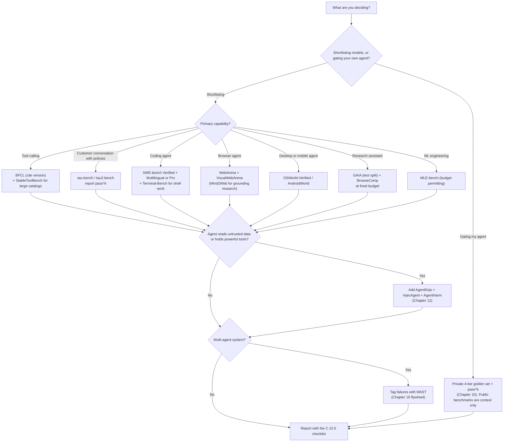

# Appendix C: Agent Benchmarks & Evaluation Datasets Reference

[← Previous: Appendix B — The Reasoning & Planning Patterns Field Guide](./appendix-b-reasoning-and-planning-patterns.md) | [Book Index](./README.md) | [Next: Appendix D — The Agentic AI Threat & Defense Catalog →](./appendix-d-agentic-threat-and-defense-catalog.md) | [Related: Chapter 10 — Agentic Evaluation & Observability](./chapter-10-agentic-evaluation-and-observability.md) | [Related: Chapter 16 — The Agent Quality Flywheel & Distillation](./chapter-16-agent-quality-flywheel-and-distillation.md)

---

[Chapter 10](./chapter-10-agentic-evaluation-and-observability.md) covered how to evaluate *your* agent: the three pillars (trajectory, outcome, efficiency), 4-tier golden datasets, calibrated LLM judges, and `pass^k`. [Chapter 16](./chapter-16-agent-quality-flywheel-and-distillation.md) showed how to turn production failures into new eval cases. This appendix is a reference catalog of public benchmarks: what each one actually measures, how it is graded, and where its numbers mislead.

The entries follow roughly the same order. First comes the capability under test, then the task format and environment (what the agent sees, what it can do, where it runs) and the primary metric. After that you'll find the originating paper or release with its year (links are collected in the [Primary sources](#c122-primary-sources) table), the known caveats around contamination, saturation, label noise and harness sensitivity, and finally where the benchmark is informative and where it isn't.

> [!IMPORTANT]
> A benchmark score is a property of the whole system (model + scaffold + tools + budget + harness + grader), measured on someone else's task distribution. It can tell you which candidates deserve a closer look. It cannot tell you whether your agent is ready to ship. That decision belongs to your own golden set and `pass^k` gates ([Chapter 10](./chapter-10-agentic-evaluation-and-observability.md)).

A note on the numbers in this appendix. Task counts, metric definitions and design details come from the original papers and official pages. Scores are quoted only as historical context, attributed to the paper and year that reported them. Leaderboards move monthly, so check the live leaderboard (and its harness version) before you cite any number.

---

## Table of Contents

* [C.0 Anatomy of an agent benchmark](#c0-anatomy-of-an-agent-benchmark)
* [C.1 Tool and function calling](#c1-tool-and-function-calling)
* [C.2 Conversational tool agents with policies](#c2-conversational-tool-agents-with-policies)
* [C.3 Software engineering and coding](#c3-software-engineering-and-coding)
* [C.4 Web, mobile and computer use](#c4-web-mobile-and-computer-use)
* [C.5 General assistants and deep research](#c5-general-assistants-and-deep-research)
* [C.6 ML engineering and long-horizon autonomy](#c6-ml-engineering-and-long-horizon-autonomy)
* [C.7 Multi-agent failure analysis (MAST)](#c7-multi-agent-failure-analysis-mast)
* [C.8 RAG and grounding evaluations](#c8-rag-and-grounding-evaluations)
* [C.9 Safety and security agent benchmarks](#c9-safety-and-security-agent-benchmarks)
* [C.10 Using benchmarks correctly](#c10-using-benchmarks-correctly)
* [C.11 Comparison matrix and decision aid](#c11-comparison-matrix-and-decision-aid)
* [C.12 Anti-patterns and primary sources](#c12-anti-patterns-and-primary-sources)
* [Summary](#summary)

---

## C.0 Anatomy of an agent benchmark

### C.0.1 Why agent benchmarks are different

A static LLM benchmark is a list of `(prompt, reference answer)` pairs. An **agent benchmark** is closer to an integration test suite. It needs an environment the agent can change (a database, a repository, a browser, a virtual machine), a grader that decides whether the end state is correct, and a harness that runs the loop, enforces budgets and resets state between tasks. Any one of these parts can move the score.



### C.0.2 Four grading styles and how they fail

| Grading style | How it works | Examples | Typical failure |
| :--- | :--- | :--- | :--- |
| Final-state check | Compare the environment's end state with an annotated goal state | τ-bench (database state), OSWorld, AndroidWorld, WebArena | Checker too strict (rejects valid alternatives) or too lenient (accepts do-nothing runs) |
| Execution / unit tests | Run tests against the agent's patch or program | SWE-bench family, Terminal-Bench, HumanEval/MBPP | Weak tests let wrong patches pass; flaky environments fail correct ones |
| Exact or normalized match | Compare a short answer string with the reference | GAIA, AssistantBench, BrowseComp (via a grader model) | Formatting differences; answers that drift as the live web changes |
| Structural / judge-based | Parse the call or output and match structure, or ask an LLM judge | BFCL (AST matching), ToolBench (ToolEval), RAGAS, FACTS Grounding | Judge bias and judge-version drift; structural match ≠ real-world success |

> [!WARNING]
> Validity has two halves. The *Agentic Benchmark Checklist* (Zhu et al., 2025) separates **task validity** (a task is solvable *if and only if* the agent has the target capability) from **outcome validity** (the success signal really means the task was done). The authors report that flaws in either can shift measured performance by up to 100% in relative terms. Their two concrete examples: SWE-bench Verified uses insufficient test cases, and τ-bench counted empty responses as successes (as reported in the paper, 2025). Read every benchmark's grader before you trust its leaderboard.

### C.0.3 The benchmark map



---

## C.1 Tool and function calling

These benchmarks isolate the action-emission step. Given a user request and a set of tool schemas, does the model pick the right function, fill in the right arguments, call several in parallel when it should, and abstain when no tool fits? They are the closest public proxy for the tool-design concerns in [Chapter 6](./chapter-06-tool-calling-and-action-engineering.md).

### C.1.1 BFCL (Berkeley Function-Calling Leaderboard)

BFCL measures function-calling accuracy across simple, multiple, parallel and parallel-multiple calls, plus irrelevance detection, which means correctly *not* calling a tool. Later versions add stateful multi-turn and agentic tasks. The model receives function documentation and a query and has to emit calls. According to the leaderboard's own version history, v1 introduced Abstract Syntax Tree (AST) evaluation, v3 introduced multi-turn interactions, and v4 introduced "holistic agentic evaluation" (web search, memory management and format sensitivity). Functions span several languages, for example Python, Java and JavaScript.

Scores are accuracy per category. AST matching parses the emitted call and checks function name, parameter names, types and values against the acceptable answers. Executable categories actually run the call, multi-turn categories check state across turns, and an overall score aggregates the categories. The source is Patil et al., *The Berkeley Function Calling Leaderboard (BFCL): From Tool Use to Agentic Evaluation of Large Language Models*, ICML 2025, which grew out of the Gorilla project (Patil et al., 2023).

The version matters most. v1, v3 and v4 measure different things, so scores from different versions are not comparable; always cite the version. Structural correctness is also not task success: a call can match the AST and still be the wrong business action. The paper reports that strong models do well on single-turn calls and points to memory, dynamic decision-making and long-horizon reasoning as the remaining weaknesses. Finally, v4 measures prompt format sensitivity explicitly, a reminder that a model's tool-calling score can shift with how tools are presented. Check whether a model was run with native function calling or prompt-based calling before you compare.

Use it for shortlisting models for tool-heavy agents and for checking irrelevance and abstention behavior. Don't use it to predict end-to-end task success in your domain.

### C.1.2 ToolBench / ToolLLM (and StableToolBench)

ToolBench asks whether a model can plan multi-step solutions over a very large catalog of real REST APIs, including choosing among thousands of tools. The catalog has 16,464 real-world RESTful APIs across 49 categories, collected from RapidAPI Hub. The paper builds single-tool and multi-tool instructions, and solution paths are explored with a depth-first search-based decision tree. Grading uses ToolEval, an automatic LLM-judge evaluator that reports pass rate (was the instruction completed within budget?) and win rate (pairwise preference against a reference solution path). Source: Qin et al., *ToolLLM: Facilitating Large Language Models to Master 16000+ Real-world APIs*, ICLR 2024.

The practical problem is live-API instability. APIs change, rate-limit or disappear, so the same agent scores differently over time. StableToolBench (Guo et al., Findings of ACL 2024) responds with a virtual API server (a cache of real responses plus LLM-based API simulators) and a stable evaluation system using solvable pass rate and win rate. Both metrics still depend on an LLM judge, so pin the judge model and version, and report them.

It's a good fit for research on tool retrieval and planning over large tool catalogs, which becomes relevant once you expose hundreds of MCP tools (see [Chapter 9](./chapter-09-mcp-and-a2a-interoperability.md)). It's a poor fit for quick regression testing; use StableToolBench or your own fakes there for reproducibility.

### C.1.3 API-Bank

API-Bank measures planning, retrieving and calling APIs in dialogue settings. It provides a runnable evaluation system with 73 API tools, plus 314 annotated tool-use dialogues containing 753 API calls. The paper also releases a larger training set and the Lynx model trained on it. Scoring checks the correctness of API calls (and of responses) against the annotated dialogues. Source: Li et al., *API-Bank: A Comprehensive Benchmark for Tool-Augmented LLMs*, EMNLP 2023.

It is small by modern standards, and its tools and dialogues predate today's native function-calling APIs, so it works best as a historical or teaching baseline. I'd use it to teach the "call / retrieve / plan" decomposition, never to rank frontier models.

### C.1.4 Nexus Function-Calling Benchmark (NexusRaven)

This benchmark targets zero-shot function calling against real API libraries, including nested calls (one call's output is another's argument) and parallel calls. Nexusflow released it with the open NexusRaven-V2 13B function-calling model in late 2023. The task suites are built on real APIs such as the National Vulnerability Database (NVD), VirusTotal and the Open Threat Exchange (OTX). Most suites are public, and Nexusflow keeps one internal. The metric is function-call success rate per suite. The source is Nexusflow's NexusRaven-V2 release and benchmark (GitHub, 2023), which is a vendor release, not a peer-reviewed paper.

Because it was published together with a model it was used to showcase, treat the original comparisons as vendor-reported. Its domain is also narrower than BFCL's (mostly cybersecurity APIs, plus a few others). It makes a useful second opinion on nested-call competence. It isn't a basis for general tool-use rankings.

| | BFCL | ToolBench / StableToolBench | API-Bank | Nexus FC |
| :--- | :--- | :--- | :--- | :--- |
| Scale | Many categories, multi-language | 16,464 real APIs | 73 tools, 314 dialogues | Several real API libraries |
| Grader | AST match + execution + state | LLM judge (pass / win rate) | Reference API calls | Call success |
| Multi-turn / agentic | Yes (v3+, v4 agentic) | Multi-step paths | Dialogue | Nested / parallel |
| Reproducibility | High (static + versioned) | Low (live APIs); fixed by StableToolBench | High | High |
| Best for | Model shortlisting | Large-catalog tool retrieval research | Teaching baseline | Nested-call checks |

---

## C.2 Conversational tool agents with policies

Customer-facing agents don't just call tools. They talk to a user over many turns while following a domain policy ("refunds only within 30 days", "verify identity first"). These benchmarks put a simulated user in the loop and grade the final world state, which is the same pattern Chapter 10 recommends for your own hermetic evals.

### C.2.1 τ-bench (tau-bench)

τ-bench measures multi-turn tool-agent-user interaction under domain policies, and how consistent that behavior is across repeated trials. It has two domains, retail and airline. Each has a database, domain APIs and a written policy document. An LLM plays the user from a hidden scenario, and the agent has to gather information, follow the policy and act through tools.

Task success is graded mainly by comparing the final database state with an annotated goal state. The paper also introduces **`pass^k`**: the probability that *all* $k$ independent trials of a task succeed, estimated per task and averaged across tasks (see [Chapter 10 §10.3](./chapter-10-agentic-evaluation-and-observability.md#103-advanced-reliability-math-sandboxes-and-the-quality-flywheel) for the estimator and code). Source: Yao, Shinn, Razavi & Narasimhan, *τ-bench: A Benchmark for Tool-Agent-User Interaction in Real-World Domains*, 2024 (ICLR 2025). The original paper reported that even strong function-calling agents (for example GPT-4o) succeeded on fewer than 50% of tasks, with retail `pass^8` below 25% (as reported in the paper, 2024).

A few things to watch. The simulated user is itself an LLM, so its behavior adds noise; pin the simulator model and report it. On outcome validity, the Agentic Benchmark Checklist paper reported that τ-bench counted empty responses as successful (2025), so use the latest harness version and read its changelog. Final-state grading accepts many valid paths, which is good, but it can't see *how* the agent spoke to the user. If tone and disclosure matter to you, add rubric checks for them.

Use it to compare models on policy adherence and reliability (`pass^k`), and as a template for building your own domain sandbox. Don't use it to claim readiness in a different domain. Your policies and tools are different.

### C.2.2 τ²-bench (tau2-bench)

τ²-bench is about dual-control conversations, where both the agent *and* the user act on a shared environment. Technical support is the typical case: the agent runs backend diagnostics while the user toggles phone settings. It adds a telecom domain modeled as a Dec-POMDP, alongside the retail and airline domains in the public repository. Tasks come from a compositional task generator that builds verifiable tasks from atomic components. The user simulator is tightly coupled to the environment, so its actions are constrained by tools and observable state.

The metric is task success (final-state and action checks), with `pass^k` reliability reporting, and ablations separate reasoning errors from communication and coordination errors. Source: Barres, Dong, Ray, Si & Narasimhan, *τ²-Bench: Evaluating Conversational Agents in a Dual-Control Environment*, 2025. The authors report significant performance drops when agents move from no-user to dual-control settings.

The user is still simulated. Programmatically generated tasks improve coverage, though they may not match the messiness of real support transcripts. Reach for it when your agent has to guide a human through actions (IT help desk, device setup, field service). For single-control back-office automation, the original τ-bench domains are closer.

### C.2.3 AgentBench

AgentBench measures broad "LLM-as-agent" competence across eight heterogeneous environments: operating system, database, knowledge graph, digital card game, lateral-thinking puzzles, house-holding, web shopping and web browsing. Each is multi-turn and open-ended, and per-environment success metrics are combined into an overall score. Source: Liu et al., *AgentBench: Evaluating LLMs as Agents*, ICLR 2024. Its headline findings at the time were a large gap between top proprietary models and open models, and that long-term reasoning, decision-making and instruction following were the main obstacles.

A single aggregate hides very different skills, so always read the per-environment breakdown. Some environments reuse earlier benchmarks (web shopping and web browsing, for example), so check for overlap with other suites you report. It gives you a broad capability profile of a new model. It won't help you choose an agent for one specific job.

---

## C.3 Software engineering and coding

### C.3.1 HumanEval and MBPP, the non-agentic baselines

These two measure function-level program synthesis from a docstring or short description. There is no environment interaction, no repository and no tool use. HumanEval has 164 hand-written Python problems, each with a signature, docstring and unit tests. MBPP (Mostly Basic Programming Problems) has 974 short, entry-level Python tasks, each with a description and test cases. Both report **`pass@k`**, the probability that at least one of $k$ samples passes the tests, which Chen et al. (2021) popularized along with an unbiased estimator. Sources: Chen et al., *Evaluating Large Language Models Trained on Code*, 2021 (HumanEval and Codex), and Austin et al., *Program Synthesis with Large Language Models*, 2021 (MBPP).

The tests are weak. EvalPlus (Liu et al., NeurIPS 2023) extended HumanEval's tests by about 80× (HumanEval+) and found that the original tests missed many incorrect programs, enough to change model rankings. Contamination and saturation are the other problem, since both sets have been public since 2021. LiveCodeBench (Jain et al., 2024) responds by continuously collecting new contest problems (LeetCode, AtCoder, Codeforces) and tagging each with its release date, so you can evaluate only on problems published after a model's training cutoff.

Treat them as a sanity check on raw coding ability. They support no claim about *agentic* software engineering.

### C.3.2 The SWE-bench family

SWE-bench measures repository-level issue resolution. Given a real codebase and an issue, can the agent produce a patch that makes the failing tests pass without breaking the rest? Each instance is a repository snapshot, an issue text and hidden tests (`FAIL_TO_PASS` and `PASS_TO_PASS`). The agent edits code, typically inside a Docker container, and the harness applies the patch and runs the tests. The metric is % Resolved: the share of instances where all `FAIL_TO_PASS` tests now pass and all `PASS_TO_PASS` tests still pass. Source: Jimenez et al., *SWE-bench: Can Language Models Resolve Real-World GitHub Issues?*, ICLR 2024. When it was released, the best model resolved 1.96% of issues (as reported in the paper, 2023).

| Variant | What changes | Size | Source |
| :--- | :--- | :--- | :--- |
| SWE-bench (Full) | Original set | 2,294 tasks from 12 Python repos | Jimenez et al., ICLR 2024 |
| SWE-bench Lite | Cheaper subset of self-contained functional bug fixes (single-file gold patches, filtered issue text) | 300 test instances | SWE-bench team |
| SWE-bench Verified | Human-screened subset. 93 professional developers filtered out underspecified issues and unfair or unrelated tests, and labeled difficulty by estimated fix time | 500 tasks | OpenAI with the SWE-bench authors, Aug 2024 |
| SWE-bench Multimodal | Visual, user-facing JavaScript domains; every task includes at least one image | 617 tasks from 17 JavaScript repos | Yang et al., ICLR 2025 |
| SWE-bench Multilingual | Breaks the Python monoculture | 300 tasks, 42 repos, 9 languages | SWE-bench team, 2025 (introduced alongside SWE-smith) |
| SWE-Bench Pro (Scale AI) | Long-horizon, multi-file, enterprise-style tasks; public, held-out and commercial splits | 1,865 problems from 41 repos | Deng et al., 2025 |

Read these caveats before quoting any SWE-bench number:

* Solutions leak and tests are weak. *SWE-Bench+* (Aleithan et al., 2024) analyzed resolved patches from a then-leading agent and found that 32.67% involved solutions given in the issue report or comments, and 31.08% passed because of weak tests. Filtering these out cut that agent's resolve rate from 12.47% to 3.97% (as reported in the paper, 2024). The ABC paper (2025) also flags insufficient tests in SWE-bench Verified.
* Models memorize. *The SWE-Bench Illusion* (Liang, Garg & Zilouchian Moghaddam, 2025) showed models could identify the buggy file path from the issue text alone, without the repository, with up to 76% accuracy on SWE-bench Verified, versus at most 53% on repositories outside SWE-bench. That points to contamination rather than reasoning.
* Scaffolds overfit to Python. The SWE-bench Multilingual authors note that agent frameworks often rely on Python-specific tooling, effectively overfitting to SWE-bench Verified. In one example they report, the same agent framework and model scored 43% on Multilingual versus 63% on Verified (Claude 3.7 Sonnet with SWE-agent, 2025).
* Some newer designs resist contamination. SWE-Bench Pro keeps its held-out and commercial sets private. According to Scale AI's announcement, its public set favors repositories under strong copyleft licenses (such as GPL) to reduce the chance they appear in training corpora.
* The scaffold often matters more than the model. The same model can differ widely across scaffolds (agent loop, tools, retries, test-time sampling). Always report the scaffold, the budget and whether the agent could run the hidden tests' framework.

Use SWE-bench to compare coding agents *with the scaffold held fixed*, and prefer Verified, Multilingual or Pro over Full and Lite. It won't predict performance on your monorepo, language mix or review standards. Mine your own closed issues for that.

### C.3.3 Terminal-Bench

Terminal-Bench measures long-horizon, realistic work in a command-line environment: software engineering, system administration, data processing, model training and security tasks. Terminal-Bench 2.0 is a curated set of 89 hard tasks. Each has a unique container environment, a human-written reference solution and tests for verification. It runs through the Harbor harness, which supports many agent harnesses (including CLI coding agents and the authors' neutral *Terminus* agent). The metric is task success rate, verified by each task's tests. Source: Merrill et al., *Terminal-Bench: Benchmarking Agents on Hard, Realistic Tasks in Command Line Interfaces*, ICLR 2026. The project started in 2025 as a Stanford and Laude Institute collaboration, and the paper reports frontier models and agents scoring below 65% (as reported in the paper, 2026).

With 89 tasks, one task is about 1.1 points; the confidence-interval math is in [C.10.5](#c105-what-a-credible-result-looks-like). The same model inside different terminal agents can score very differently, so compare models inside the same harness. Point releases fix tasks, so cite the dataset version (for example `terminal-bench@2.0`).

It's the right choice for DevOps, SRE and "agent with a shell" use cases. It says nothing about GUI or web tasks.

---

## C.4 Web, mobile and computer use

Computer-use agents ([Chapter 14](./chapter-14-multimodal-computer-use-and-streaming-agents.md)) are graded either offline, against recorded human action sequences, or online, in live, resettable environments with state checks. Online grading is more faithful. It is also more expensive and harder to keep reproducible.

### C.4.1 WebShop

WebShop measures grounded web navigation and instruction following on a simulated e-commerce site: search, browse, pick options, buy. The shop has 1.18 million real products and 12,087 crowd-sourced instructions. A programmatic reward scores how well the purchased item's attributes, options and price match the instruction, and task success rate counts full matches. In the paper, the best model reached 29% success versus 59% for human experts (as reported, 2022). Source: Yao, Chen, Yang & Narasimhan, *WebShop: Towards Scalable Real-World Web Interaction with Grounded Language Agents*, NeurIPS 2022.

The site is simulated and text-centric, so it says little about modern visual web agents. Partial-credit rewards can look high even when few purchases are fully correct, so report success rate as well. Use it for cheap, reproducible experiments on agent loops and RL, not for claims about robustness on real websites.

### C.4.2 Mind2Web

Mind2Web tests generalist web agents following instructions on real websites, including unseen sites and domains. It has over 2,000 open-ended tasks from 137 websites in 31 domains, with crowd-sourced action sequences (click, type, select). It is primarily an offline dataset of recorded pages and actions. The metrics are element accuracy, operation F1, step success rate and task success rate, scored against the recorded human trajectory, and test splits cover cross-task, cross-website and cross-domain generalization. Source: Deng et al., *Mind2Web: Towards a Generalist Agent for the Web*, NeurIPS 2023 (Datasets & Benchmarks).

Each task has a single reference trajectory, so a valid alternative path counts as an error. Recorded pages also go stale relative to the live sites. It's well suited to training and evaluating action grounding on real HTML at scale. For end-to-end success claims, use an online benchmark.

### C.4.3 WebArena

WebArena runs long-horizon tasks on realistic, self-hosted websites with functional correctness checks. Its 812 tasks span self-hosted web apps covering e-commerce, a social forum, collaborative software development and content management, plus utility tools. The sites run in containers and are reset between evaluations. The metric is task success rate, checked by programmatic evaluators that match answers or inspect the resulting site state. Humans achieved 78.24% in the paper (2023). Source: Zhou et al., *WebArena: A Realistic Web Environment for Building Autonomous Agents*, ICLR 2024.

Programmatic evaluators can be too strict or too lenient on edge cases, and environment setup and reset bugs can masquerade as agent failures. Scores can also shift with the observation format the agent receives (accessibility tree, screenshot or both), so report it. WebArena is a solid basis for reproducible online web-agent comparisons. Visual-only agents without accessibility-tree access need VisualWebArena alongside it.

### C.4.4 VisualWebArena

VisualWebArena covers web tasks that require visual understanding, such as product images, visual layout and image-referenced instructions. It has 910 tasks across Classifieds (a new environment), Shopping and Reddit-style sites, built on the WebArena infrastructure. The metric is task success rate with programmatic evaluators, plus visual evaluators for some tasks. Source: Koh et al., *VisualWebArena: Evaluating Multimodal Agents on Realistic Visually Grounded Web Tasks*, ACL 2024.

It inherits WebArena's infrastructure caveats, and results are sensitive to how screenshots are annotated (set-of-marks overlays, for example). Use it for multimodal web agents. It doesn't cover desktop or OS-level tasks.

### C.4.5 OSWorld (and OSWorld-Verified)

OSWorld measures open-ended computer use in real operating systems: desktop apps, file management and cross-application workflows. Its 369 tasks run in real VMs (mainly Ubuntu, with Windows support). Each task has a setup configuration and a custom execution-based evaluation script that inspects the final machine state. The metric is task success rate. In the paper, humans completed 72.36% of tasks and the best model completed 12.24% (as reported, 2024). Source: Xie et al., *OSWorld: Benchmarking Multimodal Agents for Open-Ended Tasks in Real Computer Environments*, NeurIPS 2024.

The benchmark itself has been revised. In July 2025 the authors released OSWorld-Verified, which fixed 300+ reported task issues and added parallel cloud evaluation. Scores on the original release and on Verified are not directly comparable. The infrastructure is also flaky: VM snapshots, network-dependent tasks and timing can all fail runs, so report the excluded tasks and the step budget.

It's the headline comparison for desktop computer-use agents. For browser-only products, WebArena-style suites fit better.

### C.4.6 AndroidWorld

AndroidWorld measures autonomous control of an Android device across real apps. It has 116 programmatic tasks across 20 real Android apps on an emulator. Tasks are parameterized and generated dynamically, so the same template yields many concrete variants, and each task has initialization, success-checking and tear-down logic based on device system state. The metric is task success rate; the paper's best baseline agent (M3A) completed 30.6% (as reported, 2024). Source: Rawles et al., *AndroidWorld: A Dynamic Benchmarking Environment for Autonomous Agents*, ICLR 2025.

The authors' own robustness analysis shows that task variations can significantly change agent performance. Report results over several random seeds and parameterizations, not just one. Use it for mobile agents, and as a model of contamination-resistant, parameterized task design. It doesn't support desktop or web claims; the authors found that a desktop web agent adapted to Android was less effective.

---

## C.5 General assistants and deep research

### C.5.1 GAIA

GAIA measures general-assistant robustness using questions that are conceptually simple for humans but need multi-step reasoning, web browsing, multimodal file handling and tool use. There are 466 questions in three difficulty levels, some with attached files (spreadsheets, images, PDFs). Answers are short and unambiguous. The authors released the questions but kept the answers to 300 of them private to power a leaderboard. Scoring is accuracy on the short final answer (normalized exact match), reported per level. At release, humans scored 92% versus 15% for GPT-4 with plugins (as reported in the paper, 2023). Source: Mialon et al., *GAIA: A Benchmark for General AI Assistants*, ICLR 2024.

The public validation split has been available since 2023, so be suspicious of strong validation scores and prefer the hidden test leaderboard. Some answers depend on web content that can change or disappear. GAIA is good for comparing general-purpose agent stacks (browsing + code + file tools) and a poor proxy for domain-specific enterprise assistants.

### C.5.2 AssistantBench

AssistantBench measures realistic, time-consuming tasks on the open web, for example comparing local services or prices under constraints. It has 214 tasks with automatically verifiable, closed-form answers, and agents browse the live web. Scoring is accuracy against the closed-form reference answers. The paper also introduces the SeePlanAct (SPA) agent. Source: Yoran et al., *AssistantBench: Can Web Agents Solve Realistic and Time-Consuming Tasks?*, EMNLP 2024.

The small $N$ means wide confidence intervals, and live-web drift changes the ground truth over time. The paper notes that closed-book models sometimes guess correctly, at low precision, so track precision and abstention as well as accuracy. It suits web research agents that must aggregate across sites. Don't use it as a reproducible regression gate.

### C.5.3 BrowseComp

BrowseComp measures persistence and creativity in web search, specifically finding hard-to-locate, entangled facts. Its 1,266 questions have short, verifiable answers and were created "inverted": the authors start from a fact and write a question that is hard to find but easy to check. Accuracy against the reference answer is graded by a model-based grader in OpenAI's `simple-evals` repository, and calibration (stated confidence) can be reported as well. Source: Wei et al. (OpenAI), *BrowseComp: A Simple Yet Challenging Benchmark for Browsing Agents*, 2025.

By the authors' own description, it deliberately sidesteps the real user-query distribution, long answers and ambiguity. They compare it to programming competitions for coding agents: "incomplete but useful". Scores are highly sensitive to search budget. In its multi-agent research write-up, Anthropic reported that token usage alone explained about 80% of performance variance in its BrowseComp analysis ([Chapter 4](./chapter-04-dynamic-and-hierarchical-orchestration.md)).

Compare deep-research and search agents on it at a fixed budget. It doesn't judge report quality or synthesis, so add rubric-based evaluation of long-form output for that.

---

## C.6 ML engineering and long-horizon autonomy

### C.6.1 MLE-bench

MLE-bench measures end-to-end machine learning engineering: preparing data, training models, running experiments and submitting predictions. It uses 75 ML engineering competitions curated from Kaggle. The agent works in a sandbox with the competition data and produces a submission file, which is graded locally. Results are placements against the historical human Kaggle leaderboard, usually reported as the percentage of competitions that earn at least a bronze medal. The best setup in the paper (o1-preview with the AIDE scaffold) reached bronze level in 16.9% of competitions (as reported, 2024). Source: Chan et al. (OpenAI), *MLE-bench: Evaluating Machine Learning Agents on Machine Learning Engineering*, ICLR 2025.

Kaggle competitions and their winning solutions are public, so the paper studies pre-training contamination explicitly. Results scale with compute and wall-clock budget, so always report them. Runs are expensive. It's built for data-science and AutoML agents and is far too costly for a CI gate.

### C.6.2 RE-Bench

RE-Bench compares frontier AI research-engineering capability directly with human experts. It has 7 open-ended ML research-engineering environments (for example, optimizing a kernel or fitting a scaling law), with human baseline data from 71 eight-hour attempts by 61 experts. Each environment gets a normalized score, compared with humans at matched time budgets, and agents are evaluated with best-of-$k$ over attempts. Source: Wijk et al. (METR), *RE-Bench: Evaluating frontier AI R&D capabilities of language model agents against human experts*, 2024.

The results depend heavily on budget. With a 2-hour total budget, the best agents scored about 4× higher than the experts. With 8 hours, humans narrowly exceeded the top agent, and with 32 total hours humans scored about 2× higher (as reported, 2024). There are only 7 environments, but because the conclusions flip with the time budget, RE-Bench is the clearest public demonstration that "who wins" depends on the budget you choose. It's a good lens on budget-dependent comparisons and long-horizon returns. It isn't meant for general product decisions.

### C.6.3 METR time-horizon methodology

This one isn't a benchmark at all. It's a metric: the **50%-task-completion time horizon**, the length (in human expert time) of tasks an AI agent completes with 50% success. The tasks are drawn from RE-Bench, HCAST and 66 new shorter software tasks, each timed with human experts. A logistic fit of success against human task length gives the horizon, in minutes or hours. Kwa et al. (METR), *Measuring AI Ability to Complete Long Software Tasks*, 2025, report a horizon of about 50 minutes for models such as Claude 3.7 Sonnet, and a doubling time of about seven months since 2019, possibly faster in 2024 (as reported, 2025).

The authors themselves flag external validity limits: the tasks are software-centric and cleaner than real work. A 50% success threshold is also far below what a production workflow needs, so translate it into `pass^k` terms before drawing deployment conclusions. It's useful for strategic planning about which task lengths are becoming automatable, and as a template for reporting your own agent's success against task length. Don't expect precise product forecasts from it.

---

## C.7 Multi-agent failure analysis (MAST)

Most benchmarks tell you *whether* a system failed. MAST tells you *why* a multi-agent system failed. That makes it a natural companion to the fault-attribution waterfall in [Chapter 16 §16.2](./chapter-16-agent-quality-flywheel-and-distillation.md#162-fault-attribution-and-automated-prompt-evolution-intermediate) and to the topologies in Chapters [3](./chapter-03-deterministic-multi-agent-workflows.md), [4](./chapter-04-dynamic-and-hierarchical-orchestration.md) and [5](./chapter-05-decentralized-and-emergent-topologies.md).

MAST is a taxonomy and an annotated dataset of failure modes in multi-agent LLM systems (MAS). MAST-Data contains 1,600+ annotated traces from 7 popular MAS frameworks (for example ChatDev, MetaGPT, AG2, Magentic-One and OpenManus) on coding, math and general-agent tasks. The taxonomy was built from 150 traces with expert annotators, with Cohen's $\kappa = 0.88$ inter-annotator agreement, and an LLM-as-a-judge annotator is released for scaling. What it produces is a distribution of failure modes per trace, framework and model. It's a diagnostic, not a leaderboard. Source: Cemri et al., *Why Do Multi-Agent LLM Systems Fail?*, 2025 (NeurIPS 2025 Datasets & Benchmarks track).

| Category | Failure modes (MAST IDs) | What it looks like in your traces | First fix to try |
| :--- | :--- | :--- | :--- |
| FC1. System design / specification issues | FM-1.1 Disobey task specification · FM-1.2 Disobey role specification · FM-1.3 Step repetition · FM-1.4 Loss of conversation history · FM-1.5 Unaware of termination conditions | Agents ignore constraints, step outside their roles, loop or forget earlier context | Typed handoff contracts, explicit termination conditions, context engineering ([Chapter 11](./chapter-11-context-engineering-and-long-term-memory.md)) |
| FC2. Inter-agent misalignment | FM-2.1 Conversation reset · FM-2.2 Fail to ask for clarification · FM-2.3 Task derailment · FM-2.4 Information withholding · FM-2.5 Ignored other agent's input · FM-2.6 Reasoning-action mismatch | Agents talk past each other, drop findings, drift off-goal, or say one thing and do another | Shared state or blackboard with schemas, mandatory clarification paths, fewer agents ([Chapter 5](./chapter-05-decentralized-and-emergent-topologies.md)) |
| FC3. Task verification | FM-3.1 Premature termination · FM-3.2 No or incomplete verification · FM-3.3 Incorrect verification | "Done" declared too early, or a verifier signs off on broken output | Deterministic verifiers (tests, schema checks) before any LLM critic ([Chapter 4](./chapter-04-dynamic-and-hierarchical-orchestration.md)) |

The frameworks studied are mostly research systems, so your production mix will differ. LLM-judge annotation scales well but needs spot-checking against humans, the same rule Chapter 10 applies to any judge. Failure-mode frequencies are not comparable across task types. Use MAST to label your own failed multi-agent traces so that flywheel fixes target the right layer. Don't use it to rank frameworks against each other.

> [!TIP]
> Make MAST a column in your failure-mining queue. When Chapter 16's flywheel turns a failed trace into a new eval case, tag it with the earliest MAST mode. After a few weeks the histogram tells you whether to invest in prompts and specs (FC1), coordination design (FC2) or verifiers (FC3).

---

## C.8 RAG and grounding evaluations

RAG evaluation is covered in depth in [Appendix A §A.10.6](./appendix-a-rag-patterns-deep-dive.md#a106-evaluating-rag-retrieval-metrics-vs-generation-metrics). This is a short reference for the most-cited public tools and datasets.

| Name | Type | What it measures | Source | Main caveat |
| :--- | :--- | :--- | :--- | :--- |
| RAGAS | Open-source metric framework | Reference-free faithfulness, answer relevance and context relevance, plus reference-based context recall and related metrics | Es et al., *Ragas: Automated Evaluation of Retrieval Augmented Generation*, EACL 2024 (demo) | LLM-judge metrics: scores depend on the judge model and prompt version. Calibrate against human labels |
| FACTS Grounding | Benchmark + leaderboard | Whether long-form responses (documents up to 32k tokens) are fully grounded in the provided document while fulfilling the request | Jacovi et al. (Google), 2025 | Measures grounding to the given context, not world factuality. Uses an ensemble of judge models from several families to reduce self-preference bias, with public and private splits |
| RAGTruth | Annotated corpus | Word-level hallucination annotations on about 18,000 RAG responses across QA, summarization and data-to-text tasks | Niu et al., ACL 2024 | A detector benchmark (train or evaluate hallucination detectors), not an end-to-end RAG system evaluation |

For agentic RAG, also report retrieval-side metrics (Recall@K, MRR, nDCG) on your own labeled queries. No public benchmark knows your corpus, your ACLs or your "unanswerable" cases.

---

## C.9 Safety and security agent benchmarks

These benchmarks measure whether an agent can be hijacked (prompt injection) or misused (harmful requests), the threats covered in [Chapter 12](./chapter-12-agentic-security-identity-and-sandboxing.md). [Appendix D](./appendix-d-agentic-threat-and-defense-catalog.md) treats agent security in reference depth.

### C.9.1 AgentDojo

AgentDojo measures utility and robustness to indirect prompt injection together, for agents that call tools over untrusted data. It is an extensible environment rather than a static suite: 97 realistic user tasks (email client, e-banking, travel booking, workspace tools) and 629 security test cases, with pluggable attacks and defenses. It reports benign utility, utility under attack and **attack success rate (ASR)** for targeted malicious goals. Source: Debenedetti et al. (ETH Zurich), *AgentDojo: A Dynamic Environment to Evaluate Prompt Injection Attacks and Defenses for LLM Agents*, NeurIPS 2024 (Datasets & Benchmarks).

A low ASR against the built-in attacks is not robustness against adaptive attackers, and the authors designed the environment so that new attacks can be added. A defense that drives ASR to zero by also destroying utility is not a win either, so report both numbers. AgentDojo is where I'd compare defenses (Dual-LLM, CaMeL-style designs, classifiers, tool filtering) on the utility-security trade-off. It can't certify an agent as "secure".

### C.9.2 InjecAgent

InjecAgent measures how vulnerable tool-integrated agents are to **indirect prompt injection (IPI)**. It has 1,054 test cases over 17 user tools and 62 attacker tools. Each case embeds an attacker instruction in a user tool's response, and the benchmark checks whether the agent then carries out the attacker's goal. There are two attack intents, direct harm to the user and exfiltration of private data, each in a base setting and an enhanced setting that adds a "hacking prompt". The metric is attack success rate. In the paper, a ReAct-prompted GPT-4 agent was vulnerable 24% of the time in the base setting, and enhanced attacks increased success (as reported, 2024). Source: Zhan, Liang, Ying & Kang, *InjecAgent: Benchmarking Indirect Prompt Injections in Tool-Integrated Large Language Model Agents*, Findings of ACL 2024.

As a static suite with simulated tool responses, it is cheap and reproducible. It is also easier to overfit and less representative of adaptive attacks than AgentDojo, and utility is not measured in the same environment. That makes it a good fast regression check on IPI susceptibility and a poor tool for evaluating defenses that trade utility for safety.

### C.9.3 AgentHarm

AgentHarm measures misuse robustness. Does the agent refuse explicitly malicious multi-step tasks, and if it is jailbroken, can it still complete them? It has 110 explicitly malicious agent tasks (440 with augmentations) across 11 harm categories (for example fraud, cybercrime and harassment), executed with synthetic tools. It reports a refusal rate and a harm score, and a high harm score requires both non-refusal and competent multi-step completion. The authors found leading LLMs were often compliant with malicious agent requests even without jailbreaking (as reported, 2024). Source: Andriushchenko et al. (Gray Swan AI and the UK AI Safety Institute, with academic collaborators), *AgentHarm: A Benchmark for Measuring Harmfulness of LLM Agents*, ICLR 2025.

The tools are synthetic, so real-world harm potential depends on the real tools you grant. The dataset is public and could be trained against, so pair it with private red-teaming. Use it for model selection and guardrail evaluation when an agent holds powerful tools. It doesn't measure prompt-injection robustness; that's the job of AgentDojo and InjecAgent.

---

## C.10 Using benchmarks correctly

### C.10.1 Public benchmarks vs. your private golden set

| Question you're answering | Public benchmark | Private golden set ([Chapter 10](./chapter-10-agentic-evaluation-and-observability.md)) |
| :--- | :--- | :--- |
| "Which 3 models are worth trying?" | Yes: a good, cheap shortlist | Partly: expensive to run across many models |
| "Is this model better for my users?" | No: distribution mismatch | Yes: the only valid answer |
| "Did my prompt, tool or skill change regress anything?" | No: too coarse, and not your tasks | Yes: gate every change |
| "Is my agent robust to prompt injection?" | Yes: AgentDojo / InjecAgent as a floor | Yes: add your tools, data and attack surface |
| "Can I compare with published work?" | Yes, but only with the same harness and version | No: not comparable externally |
| "Is it contamination-free?" | Rarely guaranteed | Yes, if you keep it private and refresh it |

The stack I'd recommend has four parts: (1) shortlist with 2–3 public benchmarks that match your capability profile ([C.11](#c11-comparison-matrix-and-decision-aid)); (2) decide with your 4-tier private golden set plus `pass^k`; (3) keep the golden set alive by mining production failures ([Chapter 16](./chapter-16-agent-quality-flywheel-and-distillation.md)); (4) re-run a public security suite on every model upgrade.



### C.10.2 `pass@k` vs. `pass^k` vs. averaged `pass@1`

| Metric | Question it answers | Who uses it | What it means in production |
| :--- | :--- | :--- | :--- |
| `pass@k` | Does at least one of $k$ attempts succeed? | HumanEval/MBPP, code generation, best-of-$k$ setups | Valid only if you actually run $k$ attempts and have a verifier that picks the winner (for example, tests). Otherwise it overstates quality |
| `pass@1` (averaged over $n$ runs) | Expected single-run success | Most agent leaderboards (often from a single run) | Your average user experience. Running it once hides variance |
| `pass^k` | Do all $k$ attempts succeed? | τ-bench, τ²-bench | Reliability: what repeat users and automated pipelines experience |
| Best-of-$k$ under a time budget | Best score over $k$ attempts within a budget | RE-Bench | Valid for offline research tasks with a scorer, not for interactive agents |

With per-trial success $\hat{p}$, a rough intuition is $\text{pass@}k \approx 1-(1-\hat{p})^k$ and $\text{pass}^k \approx \hat{p}^k$. Compute the real thing per task and then average across tasks, as Chapter 10 shows. My rule of thumb: if a vendor reports `pass@k` for an interactive agent, ask what selects the winning attempt at run time. If the answer is "nothing", the number doesn't describe what your users will see.

### C.10.3 Contamination and benchmark overfitting

**Contamination** means the test items (or their solutions) were in the training data. **Benchmark overfitting** means the *system* (prompts, scaffolds, hyperparameters, even the people building it) has been tuned to the test set, even without any data leak. *AI Agents That Matter* (Kapoor et al., 2024) found that many agent benchmarks have inadequate holdout sets, or none, which leads to fragile agents that take shortcuts.

| Mechanism | Evidence | Mitigation |
| :--- | :--- | :--- |
| Pre-training exposure to public issues, solutions or contest problems | SWE-Bench+ (94% of SWE-bench issues created before the evaluated models' cutoffs); *The SWE-Bench Illusion* file-path probe | Post-cutoff tasks (LiveCodeBench, SWE-Bench+), private splits (GAIA test answers, SWE-Bench Pro held-out and commercial, FACTS private split) |
| Solution leakage inside the task | SWE-Bench+: solutions given in issue text or comments | Filter tasks whose inputs contain the answer; human screening (SWE-bench Verified) |
| Scaffold overfitting | SWE-bench Multilingual authors: Python-specific tooling overfits to Verified | Evaluate on sibling benchmarks (Multilingual, Multimodal, Pro) with the scaffold frozen |
| Agents "finding" the benchmark | HAL's log inspection found agents searching for the benchmark on HuggingFace instead of solving the task (Kapoor et al., 2025) | Block benchmark sources in the agent's browsing tools; inspect logs, not just scores |
| Static task templates | One fixed instance per task | Parameterized or generated tasks (AndroidWorld, τ²-bench's compositional generator) |
| Leaderboard hill-climbing | Repeated submissions tuned against the test set | Keep a private holdout you never tune on; report the number of submissions or configurations tried |

> [!WARNING]
> Your private golden set can be contaminated too. If your prompt optimizer (DSPy, GEPA, TextGrad, see [Chapter 16](./chapter-16-agent-quality-flywheel-and-distillation.md)) or your engineers iterate against the same cases you report, the score goes up while generalization doesn't. Keep a held-out split that is evaluated rarely and never tuned on.

### C.10.4 Harness, scaffold and budget effects

The same model can produce very different numbers on the same benchmark. The usual causes:

1. The scaffold. The agent loop (ReAct, plan-and-execute, multi-agent), tool interfaces, file viewers and edit tools all matter. SWE-agent showed that the agent-computer interface alone moves results ([Chapter 6](./chapter-06-tool-calling-and-action-engineering.md)).
2. The budget: step limits, wall-clock limits, token caps and the number of attempts. RE-Bench's winner flips between 2-hour and 8-hour budgets, and token usage explained most of the BrowseComp variance in Anthropic's analysis.
3. Reasoning effort and sampling. HAL's 21,730 rollouts (9 models × 9 benchmarks, about USD 40,000) found that higher reasoning effort reduced accuracy in the majority of runs (Kapoor et al., 2025). More thinking is not automatically better.
4. Observation format, such as accessibility tree vs. screenshot vs. set-of-marks (web and OS benchmarks), or native function calling vs. prompt-formatted tools (BFCL).
5. Grader and judge versions. LLM-judged benchmarks (ToolEval, RAGAS, BrowseComp's grader, FACTS) drift when the judge model changes.
6. Benchmark version: OSWorld vs. OSWorld-Verified, BFCL v3 vs. v4, Terminal-Bench 2.0 vs. later point releases, and harness patches (τ-bench).
7. Environment flakiness from Docker images, VM snapshots, rate-limited live APIs and live-web drift.

> [!TIP]
> Hold everything fixed except the variable you're testing. For a model comparison, freeze the scaffold, budget, harness version and judge. For a scaffold comparison, freeze the model. Cost-aware leaderboards such as HAL (Princeton) report accuracy against cost across models, scaffolds and benchmarks for exactly this reason.

### C.10.5 What a credible result looks like

Every result needs error bars. For a benchmark of $N$ independent tasks with success rate $\hat{p}$, the standard error is

$$\text{SE} = \sqrt{\frac{\hat{p}\,(1-\hat{p})}{N}}, \qquad \text{95\% CI} \approx \hat{p} \pm 1.96\,\text{SE}$$

| Benchmark size $N$ | SE at $\hat{p} = 0.5$ | 95% CI half-width |
| :---: | :---: | :---: |
| 89 (Terminal-Bench 2.0) | 5.3 pts | ±10.4 pts |
| 214 (AssistantBench) | 3.4 pts | ±6.7 pts |
| 500 (SWE-bench Verified) | 2.2 pts | ±4.4 pts |
| 1,266 (BrowseComp) | 1.4 pts | ±2.8 pts |

So a 3-point gap on an 89-task benchmark is noise. *Adding Error Bars to Evals* (Miller, 2024) recommends reporting standard errors, using clustered standard errors when questions come in related groups, using paired comparisons when two systems answer the same questions, and running a power analysis before you commit to an eval budget. This table covers only between-task sampling noise. Run-to-run (sampling) variance comes on top of it, which is why you need multiple runs.

Here is the checklist I'd hold any reported result to:

* [ ] System card: model and dated version, scaffold and version, tools exposed, system prompt or skill version.
* [ ] Harness: benchmark name and version, subset or split, excluded tasks and why, environment image or commit.
* [ ] Budget: max steps, wall-clock limit, token cap, number of attempts, reasoning-effort setting.
* [ ] Runs: number of independent runs per task. Report the mean and the spread, plus `pass^k` where reliability matters.
* [ ] Uncertainty: 95% CIs, and paired tests for A/B comparisons.
* [ ] Cost: cost per task and cost per validated success (Cost per Validated Outcome, [Chapter 13](./chapter-13-agentic-finops-and-tokenomics.md)), plus P50/P95 latency.
* [ ] Judge: judge model and version, prompt, and human-agreement figure, for any LLM-judged metric.
* [ ] Contamination note: model training cutoff vs. task creation dates, and any memorization probes run.
* [ ] Artifacts: trajectories and logs published or retained for audit. Inspect a sample of "successes" by hand.

```python
from dataclasses import dataclass
from math import sqrt


@dataclass
class BenchmarkRun:
    benchmark: str          # e.g., "swe-bench-verified"
    benchmark_version: str  # harness/dataset version you actually ran
    n_tasks: int
    successes: int
    total_cost_usd: float   # all runs, failed ones included


def summarize(run: BenchmarkRun) -> dict[str, float]:
    p = run.successes / run.n_tasks
    se = sqrt(p * (1 - p) / run.n_tasks)
    return {
        "success_rate": p,
        "ci95_low": max(0.0, p - 1.96 * se),
        "ci95_high": min(1.0, p + 1.96 * se),
        "cost_per_task": run.total_cost_usd / run.n_tasks,
        # Cost per validated success; mirrors Chapter 13's CpO.
        "cost_per_success": (run.total_cost_usd / run.successes) if run.successes else float("inf"),
    }
```

---

## C.11 Comparison matrix and decision aid

### C.11.1 Comparison matrix

*"Run cost" is a rough relative guide (compute, infrastructure and tokens), not a measured figure.*

| Benchmark | Capability | Environment | Grader | Primary metric | Live / static | Contamination exposure | Run cost |
| :--- | :--- | :--- | :--- | :--- | :--- | :--- | :---: |
| BFCL | Function calling | Static + stateful (v3+) | AST / execution / state | Category accuracy | Static, versioned | Medium (public) | Low |
| ToolBench / StableToolBench | Large-catalog tool use | Live or virtual APIs | LLM judge | Pass / win rate | Live (Stable: cached + simulated) | Medium | Medium |
| API-Bank | Tool dialogue | Runnable APIs | Reference calls | Call accuracy | Static | High (old) | Low |
| τ-bench / τ²-bench | Policy-bound conversation | DB + simulated user (+ dual control) | Final state | Success, `pass^k` | Static domains, generated tasks (τ²) | Medium | Medium |
| AgentBench | Broad agent skills | 8 environments | Per-environment | Overall score | Static | High (2023) | Medium |
| HumanEval / MBPP | Code generation (not agentic) | None | Unit tests | `pass@k` | Static | Very high | Very low |
| SWE-bench Verified | Repo issue resolution | Docker repo | Unit tests | % resolved | Static | High | Medium–High |
| SWE-bench Multilingual / Multimodal | Non-Python / visual SWE | Docker repo | Unit tests | % resolved | Static | Medium | Medium–High |
| SWE-Bench Pro | Long-horizon enterprise SWE | Docker repo | Unit tests | % resolved | Public + private splits | Low (private splits) | High |
| Terminal-Bench 2.0 | CLI / DevOps tasks | Containers (Harbor) | Task tests | Success rate | Static, versioned | Medium | Medium |
| WebShop | Web navigation (simulated) | Simulated shop | Attribute reward | Reward, success | Static | High | Low |
| Mind2Web | Web action grounding | Offline real pages | Step match | Step / task success | Offline | Medium | Low |
| WebArena / VisualWebArena | Online web tasks | Self-hosted sites | Programmatic checks | Success rate | Resettable online | Medium | Medium |
| OSWorld(-Verified) | Desktop computer use | Real VMs | Execution scripts | Success rate | Resettable online | Medium | High |
| AndroidWorld | Mobile control | Emulator | System-state checks | Success rate | Parameterized | Low | Medium |
| GAIA | General assistant | Open web + files | Exact match | Accuracy by level | Live web; hidden test answers | Medium (validation public) | Medium |
| AssistantBench | Open-web research tasks | Live web | Answer match | Accuracy | Live web | Medium | Medium |
| BrowseComp | Persistent search | Live web | Model grader | Accuracy | Live web | Medium | Medium–High |
| MLE-bench | ML engineering | Sandbox + Kaggle data | Leaderboard placement | % medals | Static | High (Kaggle public) | Very high |
| RE-Bench | AI R&D engineering | GPU environments | Normalized score | Score vs. humans at budget | Static | Low | Very high |
| MAST | MAS failure diagnosis | Traces | Human + LLM judge | Failure-mode distribution | Dataset | N/A (diagnostic) | Low |
| RAGAS / FACTS / RAGTruth | Grounding | Text | LLM judge / annotations | Faithfulness / grounding | Static (FACTS private split) | Medium | Low |
| AgentDojo | Prompt-injection robustness | Simulated tool suites | Task + attack checks | Utility, ASR | Extensible | Medium | Low–Medium |
| InjecAgent | IPI susceptibility | Simulated tool outputs | Attacker-goal check | ASR | Static | Medium | Low |
| AgentHarm | Misuse robustness | Synthetic tools | Refusal + harm scoring | Refusal rate, harm score | Static | Medium | Low |

### C.11.2 Choosing benchmarks



---

## C.12 Anti-patterns and primary sources

### C.12.1 Common anti-patterns

| Anti-pattern | Why it hurts | Do this instead |
| :--- | :--- | :--- |
| Leaderboard-driven procurement (picking the model at the top of SWE-bench) | Scaffold, budget and distribution differ from yours | Shortlist with benchmarks, then decide on your golden set |
| Quoting a score without its version or harness | OSWorld vs. Verified, BFCL v3 vs. v4 and harness patches aren't comparable | Cite benchmark version, split, scaffold and budget |
| Single-run headline numbers | Hides run-to-run variance and flakiness | Multiple runs, mean ± CI, `pass^k` |
| `pass@k` for interactive agents | Users get one attempt, and nothing selects the winner at run time | `pass@1` (averaged) and `pass^k` |
| Ignoring cost | Accuracy gains often come from simply spending more | Report cost per task, cost per validated success, latency |
| Using HumanEval/MBPP to claim agentic coding ability | Function-level, saturated, contaminated | SWE-bench Verified, Multilingual or Pro, Terminal-Bench |
| Treating "resolved" as "correct" | Weak tests pass wrong patches (SWE-Bench+) | Inspect a sample of "successful" patches; add your own tests |
| Tuning on the test set | Benchmark overfitting; fragile agents | Train / validation / held-out splits; tune only on validation |
| One reference trajectory as ground truth | Penalizes valid alternative paths | Final-state grading or `IN_ORDER` trajectory matching (Chapter 10) |
| Security by low ASR on one static suite | Adaptive attackers break static defenses | Multiple suites, adaptive red-teaming, architectural defenses (Chapter 12) |
| Reading only the aggregate | AgentBench- or GAIA-style averages hide per-category collapse | Report per environment, level or tier |
| Never reading the logs | Agents may "solve" tasks by finding the answers (HAL) | LLM-aided log review plus human spot-checks of successes |

### C.12.2 Primary sources

| Benchmark / work | Primary source | Link |
| :--- | :--- | :--- |
| BFCL | Patil et al., *The Berkeley Function Calling Leaderboard (BFCL): From Tool Use to Agentic Evaluation of Large Language Models*, ICML 2025 | [gorilla.cs.berkeley.edu/leaderboard.html](https://gorilla.cs.berkeley.edu/leaderboard.html) |
| Gorilla (BFCL origin) | Patil et al., *Gorilla: Large Language Model Connected with Massive APIs*, 2023 | [arXiv:2305.15334](https://arxiv.org/abs/2305.15334) |
| ToolBench / ToolLLM | Qin et al., *ToolLLM: Facilitating Large Language Models to Master 16000+ Real-world APIs*, ICLR 2024 | [arXiv:2307.16789](https://arxiv.org/abs/2307.16789) |
| StableToolBench | Guo et al., Findings of ACL 2024 | [arXiv:2403.07714](https://arxiv.org/abs/2403.07714) |
| API-Bank | Li et al., EMNLP 2023 | [arXiv:2304.08244](https://arxiv.org/abs/2304.08244) |
| NexusRaven-V2 / Nexus FC benchmark | Nexusflow, 2023 (vendor release) | [github.com/nexusflowai/NexusRaven-V2](https://github.com/nexusflowai/NexusRaven-V2) |
| τ-bench | Yao, Shinn, Razavi & Narasimhan, 2024 (ICLR 2025) | [arXiv:2406.12045](https://arxiv.org/abs/2406.12045) · [GitHub](https://github.com/sierra-research/tau-bench) |
| τ²-bench | Barres, Dong, Ray, Si & Narasimhan, 2025 | [arXiv:2506.07982](https://arxiv.org/abs/2506.07982) · [GitHub](https://github.com/sierra-research/tau2-bench) |
| AgentBench | Liu et al., ICLR 2024 | [arXiv:2308.03688](https://arxiv.org/abs/2308.03688) · [GitHub](https://github.com/THUDM/AgentBench) |
| HumanEval | Chen et al., *Evaluating Large Language Models Trained on Code*, 2021 | [arXiv:2107.03374](https://arxiv.org/abs/2107.03374) |
| MBPP | Austin et al., *Program Synthesis with Large Language Models*, 2021 | [arXiv:2108.07732](https://arxiv.org/abs/2108.07732) |
| EvalPlus (HumanEval+) | Liu et al., NeurIPS 2023 | [arXiv:2305.01210](https://arxiv.org/abs/2305.01210) |
| LiveCodeBench | Jain et al., 2024 | [arXiv:2403.07974](https://arxiv.org/abs/2403.07974) |
| SWE-bench | Jimenez et al., ICLR 2024 | [arXiv:2310.06770](https://arxiv.org/abs/2310.06770) |
| SWE-bench Verified | OpenAI with the SWE-bench authors, Aug 2024 | [openai.com/index/introducing-swe-bench-verified](https://openai.com/index/introducing-swe-bench-verified/) |
| SWE-bench Multimodal | Yang et al., ICLR 2025 | [arXiv:2410.03859](https://arxiv.org/abs/2410.03859) |
| SWE-bench Multilingual | SWE-bench team, 2025 (released alongside SWE-smith, Yang et al., 2025) | [swebench.com/multilingual.html](https://www.swebench.com/multilingual.html) · [arXiv:2504.21798](https://arxiv.org/abs/2504.21798) |
| SWE-Bench Pro | Deng et al. (Scale AI), 2025 | [arXiv:2509.16941](https://arxiv.org/abs/2509.16941) |
| SWE-Bench+ | Aleithan et al., 2024 | [arXiv:2410.06992](https://arxiv.org/abs/2410.06992) |
| The SWE-Bench Illusion | Liang, Garg & Zilouchian Moghaddam, 2025 | [arXiv:2506.12286](https://arxiv.org/abs/2506.12286) |
| Terminal-Bench | Merrill et al., ICLR 2026 | [arXiv:2601.11868](https://arxiv.org/abs/2601.11868) · [tbench.ai](https://www.tbench.ai/) |
| WebShop | Yao, Chen, Yang & Narasimhan, NeurIPS 2022 | [arXiv:2207.01206](https://arxiv.org/abs/2207.01206) |
| Mind2Web | Deng et al., NeurIPS 2023 | [arXiv:2306.06070](https://arxiv.org/abs/2306.06070) |
| WebArena | Zhou et al., ICLR 2024 | [arXiv:2307.13854](https://arxiv.org/abs/2307.13854) · [webarena.dev](https://webarena.dev/) |
| VisualWebArena | Koh et al., ACL 2024 | [arXiv:2401.13649](https://arxiv.org/abs/2401.13649) |
| OSWorld | Xie et al., NeurIPS 2024 | [arXiv:2404.07972](https://arxiv.org/abs/2404.07972) · [os-world.github.io](https://os-world.github.io/) |
| OSWorld-Verified | XLANG Lab, July 2025 | [xlang.ai/blog/osworld-verified](https://xlang.ai/blog/osworld-verified) |
| AndroidWorld | Rawles et al., ICLR 2025 | [arXiv:2405.14573](https://arxiv.org/abs/2405.14573) · [GitHub](https://github.com/google-research/android_world) |
| GAIA | Mialon et al., ICLR 2024 | [arXiv:2311.12983](https://arxiv.org/abs/2311.12983) · [huggingface.co/gaia-benchmark](https://huggingface.co/gaia-benchmark) |
| AssistantBench | Yoran et al., EMNLP 2024 | [arXiv:2407.15711](https://arxiv.org/abs/2407.15711) |
| BrowseComp | Wei et al. (OpenAI), 2025 | [arXiv:2504.12516](https://arxiv.org/abs/2504.12516) |
| MLE-bench | Chan et al. (OpenAI), ICLR 2025 | [arXiv:2410.07095](https://arxiv.org/abs/2410.07095) · [GitHub](https://github.com/openai/mle-bench) |
| RE-Bench | Wijk et al. (METR), 2024 | [arXiv:2411.15114](https://arxiv.org/abs/2411.15114) |
| METR time horizon | Kwa et al. (METR), *Measuring AI Ability to Complete Long Software Tasks*, 2025 | [arXiv:2503.14499](https://arxiv.org/abs/2503.14499) · [METR blog](https://metr.org/blog/2025-03-19-measuring-ai-ability-to-complete-long-tasks/) |
| MAST | Cemri et al., *Why Do Multi-Agent LLM Systems Fail?*, 2025 (NeurIPS 2025 D&B) | [arXiv:2503.13657](https://arxiv.org/abs/2503.13657) · [GitHub](https://github.com/multi-agent-systems-failure-taxonomy/MAST) |
| RAGAS | Es et al., EACL 2024 | [arXiv:2309.15217](https://arxiv.org/abs/2309.15217) · [GitHub](https://github.com/vibrantlabsai/ragas) |
| FACTS Grounding | Jacovi et al. (Google), *The FACTS Grounding Leaderboard: Benchmarking LLMs' Ability to Ground Responses to Long-Form Input*, 2025 | [arXiv:2501.03200](https://arxiv.org/abs/2501.03200) |
| RAGTruth | Niu et al., ACL 2024 | [arXiv:2401.00396](https://arxiv.org/abs/2401.00396) |
| AgentDojo | Debenedetti et al., NeurIPS 2024 (D&B) | [arXiv:2406.13352](https://arxiv.org/abs/2406.13352) · [GitHub](https://github.com/ethz-spylab/agentdojo) |
| InjecAgent | Zhan, Liang, Ying & Kang, Findings of ACL 2024 | [arXiv:2403.02691](https://arxiv.org/abs/2403.02691) · [GitHub](https://github.com/uiuc-kang-lab/InjecAgent) |
| AgentHarm | Andriushchenko et al., ICLR 2025 | [arXiv:2410.09024](https://arxiv.org/abs/2410.09024) · [Dataset](https://huggingface.co/datasets/ai-safety-institute/AgentHarm) |
| AI Agents That Matter | Kapoor, Stroebl, Siegel, Nadgir & Narayanan, 2024 | [arXiv:2407.01502](https://arxiv.org/abs/2407.01502) |
| Agentic Benchmark Checklist (ABC) | Zhu et al., *Establishing Best Practices for Building Rigorous Agentic Benchmarks*, 2025 | [arXiv:2507.02825](https://arxiv.org/abs/2507.02825) |
| HAL | Kapoor et al., *Holistic Agent Leaderboard: The Missing Infrastructure for AI Agent Evaluation*, 2025 | [arXiv:2510.11977](https://arxiv.org/abs/2510.11977) · [hal.cs.princeton.edu](https://hal.cs.princeton.edu/) |
| Error bars for evals | Miller, *Adding Error Bars to Evals: A Statistical Approach to Language Model Evaluations*, 2024 | [arXiv:2411.00640](https://arxiv.org/abs/2411.00640) |

---

## Summary

1. A score belongs to a system, not a model. Model, scaffold, tools, budget, harness version and grader all move the number, so report them all.
2. Use public benchmarks to shortlist and private golden sets to decide. No leaderboard knows your users, tools, policies or risk profile.
3. Match the benchmark to the capability: BFCL for tool calls, τ/τ²-bench for policy-bound conversations, the SWE-bench family and Terminal-Bench for coding, WebArena/OSWorld/AndroidWorld for computer use, GAIA/BrowseComp for research, and MLE-bench/RE-Bench for long-horizon ML work.
4. Read the grader before the leaderboard. Weak tests, lenient state checks and judge drift can inflate or deflate scores substantially (SWE-Bench+, ABC).
5. Assume contamination for anything that was public before the model's cutoff. Prefer post-cutoff, private-split, parameterized or generated tasks, and probe for memorization.
6. Report `pass^k` for reliability and averaged `pass@1` for typical experience. Save `pass@k` for setups that really run $k$ attempts with a verifier.
7. Put error bars on everything. On an 89-task benchmark the 95% CI is about ±10 points. Use multiple runs and paired comparisons.
8. Treat cost as a first-class metric. Report cost per task and cost per validated success next to accuracy; many "gains" are just bigger budgets.
9. Diagnose failures instead of only scoring them. Tag multi-agent failures with MAST and feed them into the Chapter 16 flywheel so fixes target the right layer.
10. Security needs its own suites and adaptive testing. AgentDojo, InjecAgent and AgentHarm set a floor, not a certificate. Pair them with architectural defenses (Chapter 12).

---

[← Previous: Appendix B — The Reasoning & Planning Patterns Field Guide](./appendix-b-reasoning-and-planning-patterns.md) | [Book Index](./README.md) | [Next: Appendix D — The Agentic AI Threat & Defense Catalog →](./appendix-d-agentic-threat-and-defense-catalog.md) | [Related: Chapter 10 — Agentic Evaluation & Observability](./chapter-10-agentic-evaluation-and-observability.md) | [Related: Chapter 16 — The Agent Quality Flywheel & Distillation](./chapter-16-agent-quality-flywheel-and-distillation.md)
