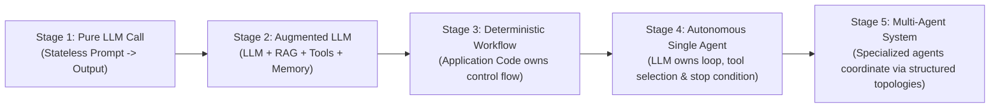
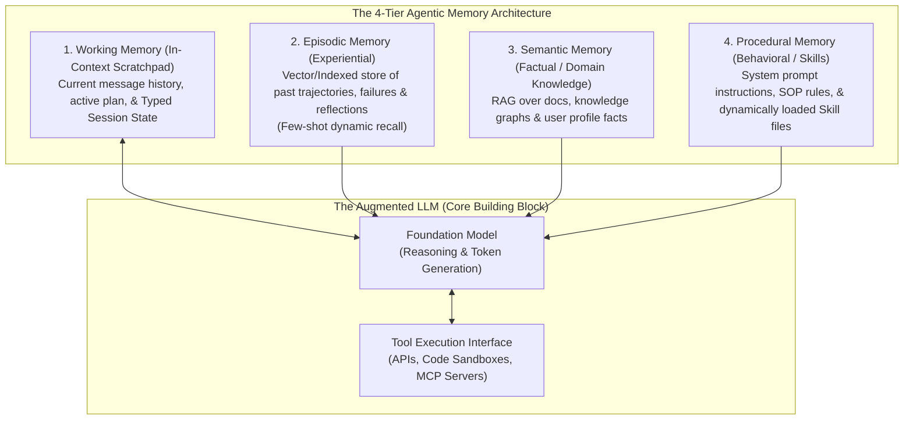

# Chapter 1: Foundations, The Spectrum of Agency & The Engineering Laws of Orchestration

[📚 Book Index](./README.md) | [Next: Chapter 2 — Single-Agent Loops ➡️](./chapter-02-single-agent-loops.md)

---

## 1.1 The Spectrum of Agency: Workflows vs. Agents

The single most important architectural question in Agentic AI is **who owns the control flow** (`if/else`, `for`, `while`, branching, and termination): **application code** or **the LLM**?

Instead of a binary "Agent vs. Non-Agent" label, production AI systems exist along a 5-stage **Spectrum of Agency**:

| Architectural Dimension | Deterministic Workflow (Stage 3) | Autonomous Agent (Stages 4–5) |
| :--- | :--- | :--- |
| **Control Flow Owner** | **Application Code** defines the exact graph and step order at compile time. | **The LLM** dynamically selects the next action, tool, or peer at runtime. |
| **Execution Path** | Predictable and repeatable ($A \rightarrow B \rightarrow C$). | Adaptive; Step $t+1$ depends on runtime observations from Step $t$. |
| **Latency & Cost Profile** | Bounded ($O(1)$ or fixed $k$ LLM calls). | Unbounded without explicit code guardrails ($O(N)$ dynamic turns). |
| **Debuggability** | High — standard software stack traces and unit tests. | Requires trajectory tracing and step-level evaluation. |
| **Ideal Problem Space** | Known Standard Operating Procedures (SOPs) with clear stages. | Open-ended, ambiguous problems where the required tools/steps vary per input. |

> [!IMPORTANT]
> **The Golden Rule of Agentic Architecture:** Always use the most deterministic architecture that solves the problem. Hand control-flow decisions to an LLM *only* at the specific nodes where the execution path cannot be known at compile time. Nearly all successful production systems are **Deterministic–Agentic Hybrids**: a deterministic outer state machine containing bounded agentic loops inside specific nodes.

---

## 1.2 Anatomy of an Augmented LLM & The 4-Tier Memory Taxonomy

Before orchestrating multiple agents, every agent node is built on top of an **Augmented LLM**: a foundation model connected to **Retrieval**, **Tools (Action Execution)**, and **Memory**.

A common architectural flaw is treating "Memory" as a single bucket. In agentic systems, memory is divided into **four distinct functional tiers**:

1. **Working Memory (Short-Term / In-Context State):** Everything currently inside the active prompt context window or session state dictionary (`messages`, current task variables, intermediate tool observations).
2. **Episodic Memory (Past Experiences):** Concrete records of past task executions (*"Last time query $X$ failed with error $Y$, fix $Z$ resolved it"*). Used in **Reflexion** to prevent repeating historical mistakes across sessions.
3. **Semantic Memory (External Knowledge & Facts):** Structured and unstructured domain facts retrieved via RAG, vector search, SQL, or Knowledge Graphs (e.g., customer contract terms, runbooks).
4. **Procedural Memory (How to Act):** Encoded rules, system prompts, fine-tuned weights, and modular **Skills** loaded dynamically into context when a domain task is triggered.

---

## 1.3 The Three Quantitative Engineering Laws of Orchestration

Why not just chain 20 autonomous agents together for every problem? Because multi-step orchestration is governed by three unforgiving mathematical laws:

### Law 1: The Compound Reliability Decay Law ($R_{\text{system}} = r^N$)
If an orchestration pipeline requires $N$ sequential steps and each step succeeds with independent probability $r$ (e.g., $r = 0.95$, or $95\%$ per-step accuracy), the probability that the entire end-to-end chain succeeds without error decays exponentially:

$$R_{\text{system}} = r^N$$

* At $N = 1$ step ($r = 0.95$): **$95.0\%$** system reliability.
* At $N = 5$ steps ($r = 0.95^5$): **$77.4\%$** system reliability.
* At $N = 10$ steps ($r = 0.95^{10}$): **$59.9\%$** system reliability (fails ~40% of the time!).
* At $N = 20$ steps ($r = 0.95^{20}$): **$35.8\%$** system reliability.

> **Architectural Consequence:** You cannot build reliable 10-step agentic workflows without inserting **Deterministic Code Gates** (Chapter 3) or **Verifier/Critic Loops** (Chapters 2 & 4) at intermediate boundaries to reset the error rate back toward $1.0$.

### Law 2: The Quadratic Context Token Tax ($O(K^2)$)
In a single shared conversation loop of $K$ tool-calling turns, where the system prompt + user query has size $P$ and each turn appends a tool observation of average size $T_{\text{obs}}$, Turn $k$ re-processes all prior turns. Total input tokens billed across $K$ turns is:

$$\text{Total Input Tokens} = \sum_{k=1}^{K} \left(P + k \cdot T_{\text{obs}}\right) = K \cdot P + T_{\text{obs}} \cdot \frac{K(K+1)}{2} = O(K^2)$$

* If a single agent reads ten $5,000$-token log dumps sequentially inside one ReAct loop ($K=10$), by Turn 10 it has processed **$275,000$ cumulative input tokens** of logs—degrading attention ("Lost in the Middle") and inflating latency.
* If instead an **Orchestrator** delegates those 10 log inspections to 10 isolated sub-agents that each process $5,000$ tokens in a fresh context and return a $200$-token summary, total input tokens drop to **$\approx 52,000$ tokens ($5.3\times$ cheaper and faster!)**.

> **Architectural Consequence:** Sub-agent delegation is not just about logical organization—it is a primary mechanism for **context scoping and reducing $O(K^2)$ token cost to $O(K)$**.

### Law 3: The Amdahl's Law of Agent Latency
For sequential agent chains, end-to-end latency is the sum of every step: $L_{\text{seq}} = \sum_{i=1}^N L_i$.
For parallelized fan-out topologies, end-to-end latency is bounded by the slowest parallel branch plus aggregation overhead:

$$L_{\text{parallel}} = L_{\text{dispatch}} + \max_{i \in \{1..N\}}(L_i) + L_{\text{synthesize}}$$

---

## 1.4 The Running Scenario (Beginner $\rightarrow$ Advanced)

To compare all 10 orchestration architectures directly across Chapters 2–6, we will trace one recurring enterprise problem as it scales in complexity—alongside distinct industry examples for every pattern:

> **Running Scenario — "AcmeCloud Enterprise Incident & Billing Resolution"**
> A customer submits a support ticket:
> *"Why did my `checkout-service` start throwing HTTP 503 errors after yesterday's deployment, and can I get an SLA credit for the downtime?"*

---

[📚 Book Index](./README.md) | [Next: Chapter 2 — Single-Agent Loops ➡️](./chapter-02-single-agent-loops.md)
