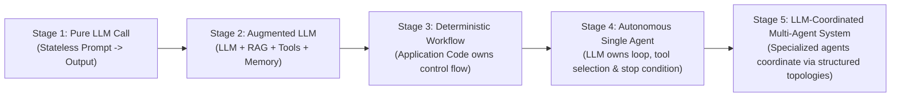

# Chapter 1: Foundations and the engineering laws of orchestration

[Book Index](./README.md) | [Next: Chapter 2 — Single-Agent Loops →](./chapter-02-single-agent-loops.md)

---

If the vocabulary is new to you, keep [Appendix E: Glossary of Agentic AI Terms](./appendix-e-glossary.md) open while you read. It defines the patterns, protocols, metrics, and acronyms used throughout the book, and links each term to the chapter that covers it.

## 1.1 The spectrum of agency: workflows vs. agents

The first architectural question to ask about any agentic system is who owns the control flow (`if/else`, `for`, `while`, branching, and termination). Is it your application code, or the LLM?

I'm borrowing this framing from Anthropic's widely cited essay *"Building Effective Agents"* (Erik Schluntz & Barry Zhang, December 2024). It puts everything beyond a single prompt–response under the umbrella of **agentic systems**, then draws one sharp line through it. In **workflows**, LLMs and tools are orchestrated through predefined code paths. In **agents**, the LLM directs its own process and tool usage, deciding what to do next and when it's done.

The industry settled on a compact working definition in 2025, popularized by Simon Willison: *"An LLM agent runs tools in a loop to achieve a goal."*

In practice "agent vs. non-agent" isn't a binary label. Production systems sit somewhere along a five-stage **spectrum of agency**:

| | Deterministic workflow (Stage 3) | Autonomous agent (Stages 4–5) |
| :--- | :--- | :--- |
| Who owns control flow | Application code defines the exact graph and step order at design time. | The LLM selects the next action, tool, or peer at runtime. |
| Execution path | Predictable and repeatable ($A \rightarrow B \rightarrow C$), even though each LLM step's *content* is still stochastic. | Adaptive; Step $t+1$ depends on runtime observations from Step $t$. |
| Latency and cost | Bounded ($O(1)$ or fixed $k$ LLM calls). | Unbounded without explicit code guardrails ($O(N)$ dynamic turns). |
| Debuggability | High. Standard stack traces and unit tests around each step. | Requires trajectory tracing and step-level evaluation. |
| Best fit | Known Standard Operating Procedures (SOPs) with clear stages. | Open-ended, ambiguous problems where the required tools/steps vary per input. |

Note that "who owns control flow" and "how many agents" are independent axes. Five LLM "agents" wired into a fixed pipeline are still a deterministic workflow (that's exactly what Chapter 3 covers), while a single LLM in a tool loop is fully agentic. Stage 5 on the spectrum means multi-agent systems where an LLM decides who acts next (Chapters 4–5). Adding agents doesn't add agency.

> [!IMPORTANT]
> **The Golden Rule of Agentic Architecture:** use the most deterministic (and simplest) architecture that solves the problem. Hand control-flow decisions to an LLM *only* at the specific nodes where the execution path can't be known at design time. Most reliable production systems end up as **Deterministic–Agentic Hybrids**: a deterministic outer state machine with bounded agentic loops inside specific nodes. Genuinely open-ended domains such as coding agents are the notable exception. There, a largely autonomous single-agent loop with strong tools, sandboxing, and verifiers is often the right call.

---

## 1.2 Anatomy of an augmented LLM and the 4-tier memory taxonomy

Every agent node, however you orchestrate it, is built on an **augmented LLM**, the core building block in Anthropic's taxonomy: a foundation model connected to retrieval, tools (action execution), and memory.

A common design mistake is to treat "memory" as one bucket. The **CoALA** framework (*Cognitive Architectures for Language Agents*, Sumers, Yao, Narasimhan & Griffiths, TMLR 2024) borrows from cognitive science and splits agent memory into four functional tiers:

1. **Working memory** is the short-term, in-context state: everything currently in the prompt's context window or session state dictionary (`messages`, current task variables, intermediate tool observations).
2. **Episodic memory** holds concrete records of past task executions (*"Last time query $X$ failed with error $Y$, fix $Z$ resolved it"*). Reflexion (Chapter 2) keeps an episodic buffer of verbal lessons so the agent doesn't repeat mistakes across retry trials. Persist that buffer and the benefit carries across sessions too.
3. **Semantic memory** is external knowledge: structured and unstructured domain facts retrieved via RAG, vector search, SQL, or knowledge graphs (customer contract terms, runbooks, and so on).
4. **Procedural memory** encodes how to act: rules, system prompts, agent code, fine-tuned weights, and modular Skills loaded into context when a domain task is triggered (Chapter 8).

Keep in mind that the model only ever "sees" working memory. Episodic, semantic, and procedural memory matter only once something retrieves them into the context window, which is why you can't design memory separately from context.

### From prompt engineering to context engineering

By mid-2025 the core craft had a new name: **context engineering**. The job is to curate the *entire* set of tokens the model sees on each call (instructions, tool definitions, retrieved knowledge, memory, message history, and tool results), not just to word a single prompt well. Anthropic's *"Effective context engineering for AI agents"* (September 2025) treats context as a finite resource with diminishing returns. As inputs grow, models suffer **"context rot"** (documented across 18 frontier models in Chroma's July 2025 report of the same name), so you want the smallest set of high-signal tokens that gets the job done. You can read every orchestration pattern in this book as a context-engineering decision about what each LLM call gets to see. Chapter 11 covers the techniques: compaction, scratchpads, just-in-time retrieval, and long-term memory.

Reasoning ("thinking") models also change the building block. Modern frontier models reason internally before answering, often with a configurable thinking budget or effort level. That makes old tricks like "think step by step" largely redundant (OpenAI's guidance for its reasoning models explicitly says to avoid chain-of-thought prompting), and the engineering effort shifts toward clear goals, constraints, tools, and context. Chapter 2 shows how this changes the ReAct loop.

---

## 1.3 Three quantitative laws of orchestration

Why not chain 20 autonomous agents together for every problem? Because multi-step orchestration is governed by three back-of-the-envelope laws. They're simplified models, not physics, but they predict real production behavior surprisingly well.

### Law 1: The Compound Reliability Decay Law ($R_{\text{system}} = r^N$)

Suppose a pipeline needs $N$ sequential steps, each step succeeds with independent probability $r$ (say $r = 0.95$, or $95\%$ per-step accuracy), and any single error is fatal. The probability that the whole chain succeeds decays exponentially:

$$R_{\text{system}} = r^N$$

* At $N = 1$ step ($r = 0.95$): $95.0\%$ system reliability.
* At $N = 5$ steps ($r = 0.95^5$): $77.4\%$ system reliability.
* At $N = 10$ steps ($r = 0.95^{10}$): $59.9\%$ system reliability, so it fails about 40% of the time.
* At $N = 20$ steps ($r = 0.95^{20}$): $35.8\%$ system reliability.

The model assumes independent, unrecoverable errors. Real agents can notice and repair mistakes (a tool error fed back as an observation, for example), so the $r$ that matters is the per-step probability of an error that is never caught. That's exactly the lever architecture gives you.

The practical consequence: you can't build a reliable 10-step agentic workflow without inserting deterministic code gates (Chapter 3) or verifier/critic loops (Chapters 2 and 4) at intermediate boundaries. Each verified checkpoint catches and repairs errors before they propagate, so failures stop compounding across the chain.

### Law 2: The Quadratic Context Token Tax ($O(K^2)$)

Take a single shared conversation loop of $K$ tool-calling turns. The system prompt plus user query has size $P$, and each turn appends a tool observation of average size $T_{\text{obs}}$. The LLM call made after observation $k$ re-processes the prompt plus all $k$ observations so far, so the total input tokens billed across those $K$ calls is:

$$\text{Total Input Tokens} = \sum_{k=1}^{K} \left(P + k \cdot T_{\text{obs}}\right) = K \cdot P + T_{\text{obs}} \cdot \frac{K(K+1)}{2} = O(K^2)$$

Here's what that looks like with real numbers. If a single agent reads ten $5,000$-token log dumps one after another inside one ReAct loop ($K=10$), the log content alone accounts for $5{,}000 \times 55 = 275{,}000$ cumulative input tokens. Meanwhile the model's attention degrades as the window fills ("Lost in the Middle", Liu et al., TACL 2024; "context rot"), and latency grows.

Now have an orchestrator delegate those 10 log inspections to 10 isolated sub-agents. Each one processes $5,000$ tokens in a fresh context and returns a $200$-token summary. Total input drops to roughly $50{,}000 + 2{,}000 \approx 52{,}000$ tokens (about $5\times$ fewer), and wall-clock latency drops too if the sub-agents run in parallel.

> [!NOTE]
> Prompt caching softens the bill but not the attention problem. Major providers bill cached prompt prefixes at a steep discount (up to ~90% off on several platforms), so re-processing an unchanged history is cheaper than the raw formula suggests. Caching does nothing for context-window limits, distraction, or context rot, though; scoping context is still the real fix. Keep prompts append-only with a stable prefix to maximize cache hits (Chapter 13).

So sub-agent delegation is more than a way to organize code. It's one of the main tools you have for context scoping: it turns one $O(K^2)$ history into many small, bounded contexts (effectively $O(K)$ total, since each sub-agent returns only a compact summary).

### Law 3: Amdahl's Law of Agent Latency

For sequential agent chains, end-to-end latency is the sum of every step: $L_{\text{seq}} = \sum_{i=1}^N L_i$.
For parallel fan-out topologies, it's bounded by the slowest branch plus aggregation overhead:

$$L_{\text{parallel}} = L_{\text{dispatch}} + \max_{i \in \{1..N\}}(L_i) + L_{\text{synthesize}}$$

As in Amdahl's original law, the serial portions (planning/dispatch and synthesis) cap the speedup no matter how many branches you add. Two corollaries follow in practice:

* Tail latency grows with fan-out. The more branches you run, the more likely one of them is slow, so $\max_i(L_i)$ creeps up. Use per-branch timeouts and accept partial results where you can.
* Parallelism has costs of its own. Provider rate limits (requests/tokens per minute) and the synthesizer's growing input can erase the theoretical gains.

---

## 1.4 The running scenario

To compare the core orchestration patterns directly across Chapters 2–5, I'll trace one recurring enterprise problem as it grows in complexity (beginner to advanced), alongside separate industry examples for each pattern.

> **Running Scenario — "AcmeCloud Enterprise Incident & Billing Resolution"**
> A customer submits a support ticket:
> *"Why did my `checkout-service` start throwing HTTP 503 errors after yesterday's deployment, and can I get an SLA credit for the downtime?"*

Patterns are labeled `Pattern L.n`, where `L` is the complexity level:

| Level | Chapter | Patterns |
| :---: | :--- | :--- |
| 1 | [Chapter 2 — Single-Agent Loops](./chapter-02-single-agent-loops.md) | 1.1 ReAct · 1.2 Plan-and-Execute · 1.3 Reflection, Reflexion & Tree-of-Thoughts |
| 2 | [Chapter 3 — Deterministic Multi-Agent Workflows](./chapter-03-deterministic-multi-agent-workflows.md) | 2.1 Sequential Pipeline · 2.2 Parallelization · 2.3 Intent Routing |
| 3 | [Chapter 4 — Dynamic & Hierarchical Orchestration](./chapter-04-dynamic-and-hierarchical-orchestration.md) | 3.1 Orchestrator–Workers · 3.2 Evaluator–Optimizer · 3.3 Hierarchical Supervisor |
| 4 | [Chapter 5 — Decentralized & Emergent Topologies](./chapter-05-decentralized-and-emergent-topologies.md) | 4.1 Peer-to-Peer Handoffs · 4.2 Blackboard · 4.3 Multi-Agent Debate |

---

[Book Index](./README.md) | [Next: Chapter 2 — Single-Agent Loops →](./chapter-02-single-agent-loops.md)
