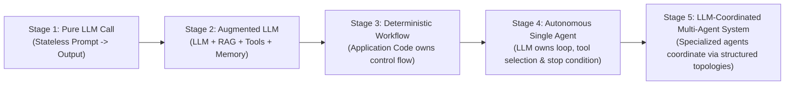

# Chapter 1: Foundations, The Spectrum of Agency & The Engineering Laws of Orchestration

[📚 Book Index](./README.md) | [Next: Chapter 2 — Single-Agent Loops ➡️](./chapter-02-single-agent-loops.md)

---

## 1.1 The Spectrum of Agency: Workflows vs. Agents

The single most important architectural question in Agentic AI is **who owns the control flow** (`if/else`, `for`, `while`, branching, and termination): **application code** or **the LLM**?

This framing follows Anthropic's widely cited essay *"Building Effective Agents"* (Erik Schluntz & Barry Zhang, December 2024), which groups everything beyond a single prompt–response under the umbrella of **agentic systems** and then draws one sharp line:
* **Workflows** — LLMs and tools are orchestrated through **predefined code paths**.
* **Agents** — the LLM **dynamically directs its own process and tool usage**, deciding what to do next and when it is done.

A compact working definition that the industry converged on in 2025 (popularized by Simon Willison): ***"An LLM agent runs tools in a loop to achieve a goal."***

Instead of a binary "Agent vs. Non-Agent" label, production AI systems exist along a 5-stage **Spectrum of Agency**:

| Architectural Dimension | Deterministic Workflow (Stage 3) | Autonomous Agent (Stages 4–5) |
| :--- | :--- | :--- |
| **Control Flow Owner** | **Application Code** defines the exact graph and step order at design time. | **The LLM** dynamically selects the next action, tool, or peer at runtime. |
| **Execution Path** | Predictable and repeatable ($A \rightarrow B \rightarrow C$), even though each LLM step's *content* is still stochastic. | Adaptive; Step $t+1$ depends on runtime observations from Step $t$. |
| **Latency & Cost Profile** | Bounded ($O(1)$ or fixed $k$ LLM calls). | Unbounded without explicit code guardrails ($O(N)$ dynamic turns). |
| **Debuggability** | High — standard software stack traces and unit tests around each step. | Requires trajectory tracing and step-level evaluation. |
| **Ideal Problem Space** | Known Standard Operating Procedures (SOPs) with clear stages. | Open-ended, ambiguous problems where the required tools/steps vary per input. |

> [!NOTE]
> **Two axes, not one.** "Who owns control flow" and "how many agents" are **independent** dimensions. A system with five LLM "agents" wired into a fixed pipeline is still a *deterministic workflow* (that is exactly Chapter 3), while a single LLM in a tool loop is fully *agentic*. Stage 5 on this spectrum means multi-agent systems where **an LLM** decides who acts next (Chapters 4–5). Adding agents is not the same as adding agency.

> [!IMPORTANT]
> **The Golden Rule of Agentic Architecture:** Always use the most deterministic (and simplest) architecture that solves the problem. Hand control-flow decisions to an LLM *only* at the specific nodes where the execution path cannot be known at design time. Most robust production systems are **Deterministic–Agentic Hybrids**: a deterministic outer state machine containing bounded agentic loops inside specific nodes. (Genuinely open-ended domains such as coding agents are the notable exception: there, a largely autonomous single-agent loop with strong tools, sandboxing, and verifiers is often the right call.)

---

## 1.2 Anatomy of an Augmented LLM & The 4-Tier Memory Taxonomy

Before orchestrating multiple agents, every agent node is built on top of an **Augmented LLM** (the core building block in Anthropic's taxonomy): a foundation model connected to **Retrieval**, **Tools (Action Execution)**, and **Memory**.

A common architectural flaw is treating "Memory" as a single bucket. Borrowing from cognitive science—as formalized for language agents by the **CoALA** framework (*Cognitive Architectures for Language Agents*, Sumers, Yao, Narasimhan & Griffiths, TMLR 2024)—agent memory is divided into **four distinct functional tiers**:

1. **Working Memory (Short-Term / In-Context State):** Everything currently inside the active prompt context window or session state dictionary (`messages`, current task variables, intermediate tool observations).
2. **Episodic Memory (Past Experiences):** Concrete records of past task executions (*"Last time query $X$ failed with error $Y$, fix $Z$ resolved it"*). **Reflexion** (Chapter 2) uses an episodic buffer of verbal lessons to avoid repeating mistakes **across retry trials**; persisting that buffer extends the benefit **across sessions**.
3. **Semantic Memory (External Knowledge & Facts):** Structured and unstructured domain facts retrieved via RAG, vector search, SQL, or Knowledge Graphs (e.g., customer contract terms, runbooks).
4. **Procedural Memory (How to Act):** Encoded rules, system prompts, agent code, fine-tuned weights, and modular **Skills** loaded dynamically into context when a domain task is triggered (Chapter 8).

> [!NOTE]
> Only working memory is "seen" by the model. Episodic, semantic, and procedural memory matter only once something **retrieves** them into the context window—which is why memory design is inseparable from context design.

### From Prompt Engineering to Context Engineering
By mid-2025 the industry had renamed the core craft: **context engineering**—curating the *entire* set of tokens the model sees on each call (instructions, tool definitions, retrieved knowledge, memory, message history, and tool results), not just wording a single prompt. Anthropic's *"Effective context engineering for AI agents"* (September 2025) frames context as a **finite resource with diminishing returns**: as inputs grow, models suffer **"context rot"** (documented across 18 frontier models in Chroma's July 2025 report of the same name), so the goal is the *smallest set of high-signal tokens* that gets the job done. Every orchestration pattern in this book can be read as a context-engineering decision about *what each LLM call gets to see*. Chapter 11 covers the techniques (compaction, scratchpads, just-in-time retrieval, long-term memory).

> [!TIP]
> **Reasoning ("thinking") models change the building block.** Modern frontier models reason internally before answering, often with a configurable **thinking budget / effort level**. This makes old tricks like "think step by step" largely redundant (OpenAI's guidance for its reasoning models explicitly says to avoid chain-of-thought prompting) and shifts the engineering effort toward **clear goals, constraints, tools, and context**. Chapter 2 shows how this affects the ReAct loop.

---

## 1.3 The Three Quantitative Engineering Laws of Orchestration

Why not just chain 20 autonomous agents together for every problem? Because multi-step orchestration is governed by three back-of-the-envelope engineering laws. They are simplified models, not physical laws—but they predict real production behavior surprisingly well:

### Law 1: The Compound Reliability Decay Law ($R_{\text{system}} = r^N$)
If an orchestration pipeline requires $N$ sequential steps and each step succeeds with independent probability $r$ (e.g., $r = 0.95$, or $95\%$ per-step accuracy), and any single error is fatal, the probability that the entire end-to-end chain succeeds decays exponentially:

$$R_{\text{system}} = r^N$$

* At $N = 1$ step ($r = 0.95$): **$95.0\%$** system reliability.
* At $N = 5$ steps ($r = 0.95^5$): **$77.4\%$** system reliability.
* At $N = 10$ steps ($r = 0.95^{10}$): **$59.9\%$** system reliability (fails ~40% of the time!).
* At $N = 20$ steps ($r = 0.95^{20}$): **$35.8\%$** system reliability.

> **Caveat:** The model assumes independent, **unrecoverable** errors. Real agents can notice and repair mistakes (e.g., a tool error fed back as an observation), so the $r$ that matters is the per-step probability of an error that is **never caught**. That is precisely the lever architecture gives you.

> **Architectural Consequence:** You cannot build reliable 10-step agentic workflows without inserting **Deterministic Code Gates** (Chapter 3) or **Verifier/Critic Loops** (Chapters 2 & 4) at intermediate boundaries. Each verified checkpoint catches and repairs errors before they propagate, so failures stop compounding across the whole chain.

### Law 2: The Quadratic Context Token Tax ($O(K^2)$)
In a single shared conversation loop of $K$ tool-calling turns, where the system prompt + user query has size $P$ and each turn appends a tool observation of average size $T_{\text{obs}}$, the LLM call made after observation $k$ re-processes the prompt plus all $k$ observations so far. Total input tokens billed across those $K$ calls is:

$$\text{Total Input Tokens} = \sum_{k=1}^{K} \left(P + k \cdot T_{\text{obs}}\right) = K \cdot P + T_{\text{obs}} \cdot \frac{K(K+1)}{2} = O(K^2)$$

* If a single agent reads ten $5,000$-token log dumps sequentially inside one ReAct loop ($K=10$), the log content alone accounts for **$5{,}000 \times 55 = 275{,}000$ cumulative input tokens**—while the model's attention degrades as the window fills ("Lost in the Middle", Liu et al., TACL 2024; "context rot") and latency grows.
* If instead an **Orchestrator** delegates those 10 log inspections to 10 isolated sub-agents that each process $5,000$ tokens in a fresh context and return a $200$-token summary, total input tokens drop to roughly **$50{,}000 + 2{,}000 \approx 52{,}000$ tokens (about $5\times$ fewer)**, and wall-clock latency also drops if the sub-agents run in parallel.

> [!NOTE]
> **Prompt caching softens the bill, not the attention problem.** Major providers bill cached prompt prefixes at a steep discount (up to ~90% off on several platforms), so re-processing an unchanged history is cheaper than the raw formula suggests. Caching does nothing for context-window limits, distraction, or context rot—scoping context remains the real fix. Keep prompts **append-only with a stable prefix** to maximize cache hits (Chapter 13).

> **Architectural Consequence:** Sub-agent delegation is not just about logical organization—it is a primary mechanism for **context scoping**, turning one $O(K^2)$ history into many small, bounded contexts (effectively $O(K)$ total, since each sub-agent returns only a compact summary).

### Law 3: The Amdahl's Law of Agent Latency
For sequential agent chains, end-to-end latency is the sum of every step: $L_{\text{seq}} = \sum_{i=1}^N L_i$.
For parallelized fan-out topologies, end-to-end latency is bounded by the slowest parallel branch plus aggregation overhead:

$$L_{\text{parallel}} = L_{\text{dispatch}} + \max_{i \in \{1..N\}}(L_i) + L_{\text{synthesize}}$$

As in Amdahl's original law, the **serial portions** (planning/dispatch and synthesis) cap the achievable speedup no matter how many branches you add. Two practical corollaries:
* **Tail latency grows with fan-out:** the more branches, the more likely one of them is slow, so $\max_i(L_i)$ creeps up. Use per-branch timeouts and accept partial results where possible.
* **Parallelism is not free:** provider rate limits (requests/tokens per minute) and the synthesizer's growing input can erase the theoretical gains.

---

## 1.4 The Running Scenario (Beginner $\rightarrow$ Advanced)

To compare the core orchestration patterns directly across Chapters 2–5, we will trace one recurring enterprise problem as it scales in complexity—alongside distinct industry examples for every pattern:

> **Running Scenario — "AcmeCloud Enterprise Incident & Billing Resolution"**
> A customer submits a support ticket:
> *"Why did my `checkout-service` start throwing HTTP 503 errors after yesterday's deployment, and can I get an SLA credit for the downtime?"*

**How patterns are numbered:** patterns are labeled `Pattern L.n`, where `L` is the complexity level:

| Level | Chapter | Patterns |
| :---: | :--- | :--- |
| **1** | [Chapter 2 — Single-Agent Loops](./chapter-02-single-agent-loops.md) | 1.1 ReAct · 1.2 Plan-and-Execute · 1.3 Reflection, Reflexion & Tree-of-Thoughts |
| **2** | [Chapter 3 — Deterministic Multi-Agent Workflows](./chapter-03-deterministic-multi-agent-workflows.md) | 2.1 Sequential Pipeline · 2.2 Parallelization · 2.3 Intent Routing |
| **3** | [Chapter 4 — Dynamic & Hierarchical Orchestration](./chapter-04-dynamic-and-hierarchical-orchestration.md) | 3.1 Orchestrator–Workers · 3.2 Evaluator–Optimizer · 3.3 Hierarchical Supervisor |
| **4** | [Chapter 5 — Decentralized & Emergent Topologies](./chapter-05-decentralized-and-emergent-topologies.md) | 4.1 Peer-to-Peer Handoffs · 4.2 Blackboard · 4.3 Multi-Agent Debate |

---

[📚 Book Index](./README.md) | [Next: Chapter 2 — Single-Agent Loops ➡️](./chapter-02-single-agent-loops.md)
