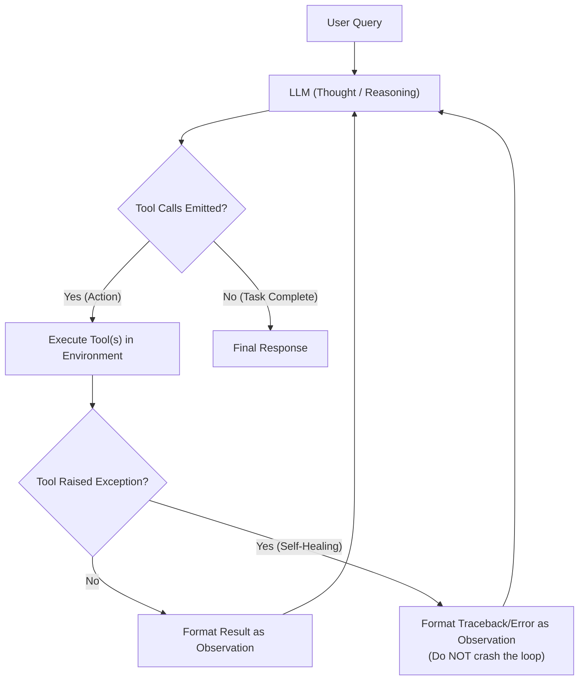
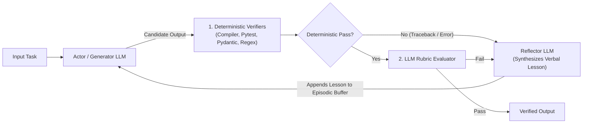

# Chapter 2 (Beginner): Single-agent orchestration patterns

[← Previous: Chapter 1 — Foundations](./chapter-01-foundations-and-mental-models.md) | [Book Index](./README.md) | [Next: Chapter 3 — Deterministic Multi-Agent Workflows →](./chapter-03-deterministic-multi-agent-workflows.md)

---

At the beginner level, a single agent runs inside a control loop with tools and working memory. Before you design anything multi-agent, it pays to understand where these single-agent loops work and where they break.

The patterns here are numbered 1.x because they're the Level 1 (single-agent) entries in the book's pattern catalog. Level 2–4 patterns appear in Chapters 3–5 (see the numbering table in [Chapter 1](./chapter-01-foundations-and-mental-models.md), §1.4).

---

## Pattern 1.1: ReAct (Reason + Act Loop)
*The atomic unit of autonomous agency (Yao et al., "ReAct: Synergizing Reasoning and Acting in Language Models", 2022; ICLR 2023).*

### How it works
The LLM runs a continuous Thought $\rightarrow$ Action $\rightarrow$ Observation cycle. On each iteration it looks at the conversation history, works out what information is missing, emits one or more tool calls, and reads the returned observations (error messages included). It keeps going until it decides the task is complete.



### When to use it, and what goes wrong
ReAct exists because many problems can't be solved in a single retrieval pass: step $t+1$ depends on the runtime output of step $t$. You don't know which error log stream to query until you've checked which deployment happened yesterday.

One production detail that toy tutorials usually skip is exception feedback, or **error-as-observation**. When the LLM passes invalid arguments to a tool, or writes SQL with a syntax error, the runtime should catch the exception and return something like `"ToolError: column 'user_id' does not exist; available columns are [id, account_id]"` as a tool observation. The model can then correct itself on the next turn. Make these messages actionable (what was wrong, what's valid). A bare stack trace wastes tokens and teaches the model very little.

The loop has three characteristic failure modes:

1. **Local myopia** ("lost in the weeds"). ReAct only plans one step ahead, so a 300-line stack trace in step 2 can pull the agent away from answering the second half of the user's question.
2. **Quadratic context bloat** ($O(K^2)$). Every raw tool output stays in the message history for all later turns (Chapter 1, Law 2). Cap or summarize large observations before appending them.
3. **Runaway loops.** Without a hard step or token budget, an agent can repeat the same failing call indefinitely. Enforce `max_steps` in code, never in the prompt alone.

### ReAct in 2026: native tool calling and reasoning models
The original ReAct paper was a prompting technique. The model wrote `Thought:` / `Action:` / `Observation:` text and the harness parsed it with regexes. Modern implementations differ in three ways.

First, native tool calling has replaced text parsing. Models emit structured tool-call objects validated against a JSON Schema, and with the strict or constrained-decoding modes the major APIs offer, malformed or wrongly typed arguments become rare. Error-as-observation still matters for semantic and runtime failures: missing rows, permission denied, timeouts.

Second, the "Thought" is often internal. Reasoning models think before tool calls (and, with *interleaved thinking*, between them). Prompting them to "reason step by step" is redundant and can hurt, so state the goal, constraints, and stop criteria instead. You also need to pass reasoning state back unchanged each turn. Vendors implement this differently (Anthropic's thinking blocks, OpenAI's reasoning items in the Responses API, Gemini's thought signatures), but in every case the reasoning artifacts have to go back with the assistant message. If they don't, the API may reject the request or the model loses its train of thought. Append the full assistant message, not just its text.

Third, a single model turn can request several independent tool calls in parallel (fetch deployments *and* error logs, say). Run independent calls concurrently and return one result per `tool_call_id`.

### Framework-agnostic pseudocode
```python
from typing import Any, Callable

MAX_OBS_CHARS = 8_000  # Cap each observation to contain the O(K^2) context tax

def react_agent(
    user_query: str,
    tools: dict[str, Callable[..., Any]],
    model=llm,                # Injected so callers can choose a fast/cheap model
    max_steps: int = 10,
) -> str:
    messages = [
        # Goal + constraints + stop criteria. (Reasoning models think internally;
        # an explicit "think step by step" instruction is unnecessary for them.)
        {"role": "system", "content": "Resolve the user's request. Verify facts with tools. "
                                      "Stop and answer once every part of the request is addressed."},
        {"role": "user", "content": user_query},
    ]
    for step in range(max_steps):
        response = model.generate(messages, tools=[tool_schema(t) for t in tools.values()])
        # Append the FULL assistant message (text + tool calls + any reasoning/thought
        # signature blocks) so the next turn has consistent state.
        messages.append(response.message)

        if not response.tool_calls:  # LLM decided the goal is complete
            return response.text

        for call in response.tool_calls:  # Independent calls may also be run concurrently
            try:
                if call.name not in tools:
                    raise ValueError(f"Unknown tool '{call.name}'. Available: {sorted(tools)}")
                result = tools[call.name](**call.args)  # call.args: parsed JSON arguments
                observation = str(result)
            except Exception as exc:
                # CRITICAL: Feed tool errors back as observations so the LLM can self-correct
                observation = f"ToolExecutionError ({type(exc).__name__}): {exc}"

            if len(observation) > MAX_OBS_CHARS:
                observation = observation[:MAX_OBS_CHARS] + "\n...[truncated; refine your query]"
            messages.append({"role": "tool", "tool_call_id": call.id, "content": observation})

    raise RuntimeError(f"Guardrail triggered: ReAct loop exceeded {max_steps} iterations.")
```

### Execution trace (running scenario)
1. User: *"Why did my `checkout-service` start throwing 503 errors after yesterday's deployment, and can I get an SLA credit?"*
2. Turn 1. Thought: *"I need to check recent deployments for `checkout-service`."*
   * Action: `get_deployments(service="checkout-service", days=2)`
   * Observation: `Deploy #842 at 2026-10-15 14:00 UTC (DB connection pool reduced from 50 -> 5)`.
3. Turn 2. Thought: *"DB pool dropped to 5. Let me check 503 error logs around 14:00 UTC."*
   * Action: `query_logs(service="checkout-service", status_code="503")`
   * Observation: `ToolExecutionError (TypeError): status_code must be int, got str`. This is where self-healing kicks in. Strict schema validation would usually prevent this particular error, but the recovery mechanism is the same for runtime errors it can't catch.
4. Turn 3. Thought: *"Let me fix the argument type to integer `503`."*
   * Action: `query_logs(service="checkout-service", status_code=503)`
   * Observation: `ConnectionPoolExhausted from 14:02 to 14:44 UTC (42 minutes total downtime)`.
5. Turn 4. Thought: *"Now I must check if 42 minutes qualifies for an SLA credit."*
   * Action: `check_sla_policy(downtime_minutes=42)`
   * Observation: `SLA credit requires >45 minutes of monthly downtime.`
6. Turn 5. Thought: *"I have verified both answers."* $\rightarrow$ Emits the final answer: the root cause is the pool-size change in Deploy #842, and 42 minutes is below the 45-minute threshold, so there's no automatic credit.

### Industry examples
* A text-to-SQL data analyst lists tables $\rightarrow$ inspects the schema $\rightarrow$ runs SQL $\rightarrow$ gets a syntax error observation $\rightarrow$ fixes the SQL $\rightarrow$ returns the answer.
* An IT helpdesk access bot checks the user's Okta groups $\rightarrow$ checks manager approval status $\rightarrow$ provisions the access role. That last step is a write action and should sit behind a human-approval gate (see Chapter 17).

---

## Pattern 1.2: Plan-and-Execute (Planner–Executor–Replanner)
*Separating strategic multi-step planning from tactical step execution. Inspired by Plan-and-Solve prompting (Wang et al., ACL 2023) and ReWOO (Xu et al., 2023), and popularized as the LangChain/LangGraph "plan-and-execute" agent.*

### How it works
Instead of mixing global planning and noisy tool execution in one prompt, a dedicated **Planner LLM** first writes a structured checklist of steps. A **Step Executor** (a scoped ReAct loop) carries out one step at a time in its own context window and hands back only a concise summary. A **Replanner** reads that summary and either advances the checklist or revises the remaining steps.


### When to use it, and what goes wrong
There are three reasons to pick this over plain ReAct. The explicit plan works as an external anchor over horizons of 10+ steps, which reduces myopia. It also breaks the $O(K^2)$ context tax: if step 1 means reading 50,000 tokens of raw logs, those logs live and die inside step 1's isolated `Executor` scope, and the Replanner and step 2 see only a 150-token structured summary.

The third reason is model tiering, which cuts both cost and latency. Use a frontier reasoning model for the Planner/Replanner, since they're called only a few times (a GPT-, Claude Opus-, or Gemini Pro-class model, or a large open-weight model such as Qwen or DeepSeek). Use a fast, low-cost small-tier model for the Step Executor's inner tool calls (a GPT mini-, Claude Haiku-, or Gemini Flash-class model, or a small open-weight Llama/Qwen/Mistral model).

The costs are real, though. You wait for the initial plan before the first tool call runs, and every step adds a Replanner call. If you build "plan once, execute blindly" without a Replanner, you walk into the **stale plan trap**: one unexpected discovery in step 1 makes steps 2–5 useless. Summaries can also be lossy, and the executor may summarize away the one detail the Replanner needed. Ask for structured step results (key findings, evidence IDs, open questions) rather than free prose.

Two modern variants are worth knowing.

* **Plan-as-a-tool (to-do lists).** Many 2025–2026 coding and research agents keep a single strong ReAct loop but give it a `write_todos`-style tool to create and update an explicit checklist in context. Claude Code's to-do/task tools and LangChain's Deep Agents work this way. You get the anchoring benefit without a separate planner, but you don't get context isolation.
* **Parallel DAG plans.** ReWOO-style planners emit all tool calls up front with placeholders (`#E1`, `#E2`), and LLMCompiler (Kim et al., 2023) schedules independent steps in parallel. This helps when steps don't depend on each other's observations.

### Framework-agnostic pseudocode
```python
from typing import Optional
from pydantic import BaseModel

class PlanState(BaseModel):
    is_complete: bool
    updated_remaining_steps: list[str]
    final_response: Optional[str] = None

def plan_and_execute(user_goal: str, tools: dict, max_steps: int = 8) -> str:
    plan: list[str] = frontier_llm.generate_structured(
        f"Create a concise step-by-step plan for: {user_goal}", schema=list[str]
    )
    completed_steps: list[tuple[str, str]] = []

    for _ in range(max_steps):  # Hard cap on executed steps (plans can grow on replanning)
        if not plan:
            break
        current_step = plan.pop(0)

        # Isolated context: fast model runs ReAct; raw tool logs never leak out
        try:
            step_summary = react_agent(
                user_query=f"Global Goal: {user_goal}\nPrior Findings: {completed_steps}\n"
                           f"Execute ONLY this step and summarize findings: {current_step}",
                tools=tools,
                model=fast_llm,
            )
        except RuntimeError as exc:  # Step hit its own guardrail: let the Replanner adapt
            step_summary = f"STEP FAILED: {exc}"
        completed_steps.append((current_step, step_summary))

        # Replanner adapts remaining steps based on actual runtime findings
        decision: PlanState = frontier_llm.generate_structured(
            f"Goal: {user_goal}\nCompleted: {completed_steps}\nRemaining Plan: {plan}",
            schema=PlanState,
        )
        if decision.is_complete and decision.final_response:
            return decision.final_response
        plan = decision.updated_remaining_steps

    return frontier_llm.generate(f"Synthesize final answer for {user_goal} from {completed_steps}")
```

### Execution trace (running scenario)
*To show replanning, this trace uses an alternate version of the incident in which the customer's premise turns out to be wrong.*
1. The Planner creates a 3-step plan: `[1. Check recent deploys for checkout-service, 2. Correlate 503 error timestamps with deploy, 3. Check SLA credit eligibility]`.
2. The Step Executor runs step 1 and queries the deployment API. Surprise: there was no deployment to `checkout-service` yesterday.
3. The Replanner sees that step 1 disproved the user's premise, so it rewrites step 2 from *"Correlate 503 timestamps with deploy"* to *"Check upstream dependency health (`auth-service` and `payment-gateway`) for outages yesterday."*
4. The Step Executor runs steps 2 and 3. It finds that `auth-service` had a 60-minute outage causing `checkout-service` 503s $\rightarrow$ confirms 60m > 45m threshold $\rightarrow$ approves the SLA credit.

---

## Pattern 1.3: Self-Refinement, Episodic Reflexion & Tree-of-Thoughts
*Spending extra test-time compute to get higher reliability and deeper reasoning.*

### Three patterns that get lumped together as "reflection"
A lot of writing puts all self-correction in a single box. In practice there are three distinct test-time compute patterns, and they behave differently:

| Sub-pattern | How it works | Memory used | Good for |
| :--- | :--- | :--- | :--- |
| 1. Intrinsic Self-Refinement *(Self-Refine, Madaan et al., NeurIPS 2023)* | Generate draft $\rightarrow$ Critique against rubric $\rightarrow$ Rewrite within a single episode. | Working memory only. | Formatting, tone polishing, or multi-constraint document drafting. |
| 2. Grounded Reflexion *(Reflexion, Shinn et al., NeurIPS 2023)* | Execute trial $\rightarrow$ Evaluate with an external signal (unit tests, compiler, SQL `EXPLAIN`, environment reward) $\rightarrow$ Convert failure into a verbal lesson stored in episodic memory across retries. | Working + episodic memory. | Coding agents, SQL generation, schema extraction, and environment tasks with pass/fail signals. |
| 3. Branching Search: Best-of-$N$ & Tree-of-Thoughts (ToT) *(ToT: Yao et al., NeurIPS 2023)* | Best-of-$N$: sample $N$ complete candidates in parallel and pick one with a verifier/reward model (or majority vote, as in self-consistency). ToT: expand $B$ candidate "thoughts" at each step, score partial branches with a heuristic/verifier, and prune or backtrack (BFS/DFS). | Candidate set / tree state in working memory. | Complex algorithmic puzzles, architectural trade-off exploration, or high-variance code synthesis. |

A note on terminology: the evaluators in the original Reflexion paper ranged from exact-match and heuristics to LLM judges and *self-generated* unit tests. What this book calls "Grounded Reflexion" deliberately puts trustworthy external verifiers first, because a lesson is only as good as the failure signal behind it.

Reasoning models have also absorbed much of this search. Thinking models are trained to explore, self-check, and backtrack inside their own reasoning, so explicit ToT scaffolding is rarely worth its cost in production today. Two things still pay off: raising the model's thinking budget or effort for hard steps, and Best-of-$N$ with an external verifier (tests, a checker, a reward model), which adds information the model can't generate by thinking alone.



> [!WARNING]
> **The ungrounded reflection anti-pattern.** Asking an LLM *"Review your answer above; are you sure it is correct?"* without an external ground-truth verifier (test runner, schema validator, citation checker) or an explicit rubric frequently makes things worse. Huang et al. (*"Large Language Models Cannot Self-Correct Reasoning Yet"*, ICLR 2024) found that intrinsic self-correction on reasoning tasks often degrades accuracy. Laban et al.'s *FlipFlop* experiment (2023) reported models changing their answer in roughly 46% of cases when simply challenged with "Are you sure?", with accuracy dropping on average. This sycophantic flip-flopping often turns correct answers into wrong ones. Run deterministic verifiers first.

### Framework-agnostic pseudocode (Grounded Reflexion)
```python
from typing import Callable, Optional
from pydantic import BaseModel

class RubricVerdict(BaseModel):
    passed: bool
    failed_items: list[str]
    concise_lesson_for_next_trial: str

def grounded_reflexion_agent(
    task: str,
    deterministic_validators: list[Callable[[str], Optional[str]]],  # Return error msg or None
    rubric: list[str],
    max_trials: int = 3,
) -> str:
    episodic_lessons: list[str] = []
    draft = ""

    for trial in range(max_trials):
        draft = actor_llm.generate(
            f"Task: {task}\nLessons from prior failed trials (DO NOT REPEAT): {episodic_lessons}"
        )
        # Stage 1: Cheap, deterministic checks first (Regex, AST, Schema, Unit Tests)
        det_errors = [err for check in deterministic_validators if (err := check(draft))]
        if det_errors:
            lesson = reflector_llm.generate(
                f"Task: {task}\nDraft: {draft}\nFailed checks: {det_errors}\n"
                "State the root cause and one concrete rule to avoid it next time:"
            )
            episodic_lessons.append(lesson)
            continue

        # Stage 2: Rubric-grounded LLM verification (ideally a different model/prompt than the actor)
        verdict = reflector_llm.generate_structured(
            f"Task: {task}\nDraft: {draft}\nStrictly verify each rubric item: {rubric}",
            schema=RubricVerdict,
        )
        if verdict.passed:
            return draft
        episodic_lessons.append(verdict.concise_lesson_for_next_trial)

    # Never silently ship an unverified draft: escalate (human review, fallback answer, or error)
    return escalate_to_human(task=task, last_draft=draft, lessons=episodic_lessons)
```

### Execution trace (running scenario)
1. Trial 1 draft: *"Deploy #842 on internal host `10.128.4.19` caused 42m of 503s. We have credited \$200 to your account."*
2. The Stage 1 deterministic validator (`check_no_internal_ips`) fails it immediately, in $0.2\text{ms}$: `"Found RFC1918 private IP 10.128.4.19 in external customer response."`
   * Episodic lesson recorded: *"Never include internal `10.x.x.x` host IPs in customer-facing text."*
3. Trial 2 draft removes the IP but still claims a \$200 SLA credit was issued.
4. The Stage 2 rubric evaluator fails it on rubric item #2 (*"Must match SLA policy tool output"*): `42m < 45m threshold (ineligible)`.
   * Episodic lesson recorded: *"42m downtime is below the 45m SLA threshold; explain policy accurately instead of promising an automatic credit."*
5. Trial 3 draft passes both the Stage 1 deterministic validators and the Stage 2 rubric check, and is returned.

My rule of thumb: whenever a rubric item can be checked in code (here, comparing the stated credit against the `check_sla_policy` tool output), promote it to a Stage 1 deterministic validator. Save LLM rubric checks for what code genuinely can't judge.

---

For 20+ reasoning and planning patterns (Self-Consistency, Graph of Thoughts, LATS, ReWOO, LLMCompiler, CRITIC, Chain-of-Verification, reasoning models, and more) with cost profiles and a decision tree, see [Appendix B: The Reasoning & Planning Patterns Field Guide](./appendix-b-reasoning-and-planning-patterns.md).

---

## Chapter 2 summary

| Pattern | Who owns control flow | Context growth | Latency and token cost (rough, vs. one LLM call) | Best fit | Main failure mode |
| :--- | :--- | :--- | :--- | :--- | :--- |
| 1.1 ReAct Loop | Single LLM (1 step ahead) | $O(K^2)$ (all tool logs stay in window) | $1\times\text{–}5\times$ | Short, dynamic 2–5 step tool explorations. | Local myopia; context window pollution on long horizons. |
| 1.2 Plan-and-Execute | Frontier Planner + Scoped Executor | $O(K)$ (raw step logs discarded) | $3\times\text{–}8\times$ | Multi-part 5–15 step goals with large intermediate tool outputs. | High upfront latency; stale plans if replanner is omitted; lossy step summaries. |
| 1.3 Grounded Reflexion | Actor $\rightarrow$ Deterministic + Rubric Verifier | $O(\text{trials})$ | $2\times\text{–}4\times$ | Code/SQL generation, structured extraction, high-compliance responses. | Sycophantic flip-flopping if run *without* deterministic/rubric grounding. |

---

[← Previous: Chapter 1 — Foundations](./chapter-01-foundations-and-mental-models.md) | [Book Index](./README.md) | [Next: Chapter 3 — Deterministic Multi-Agent Workflows →](./chapter-03-deterministic-multi-agent-workflows.md)
