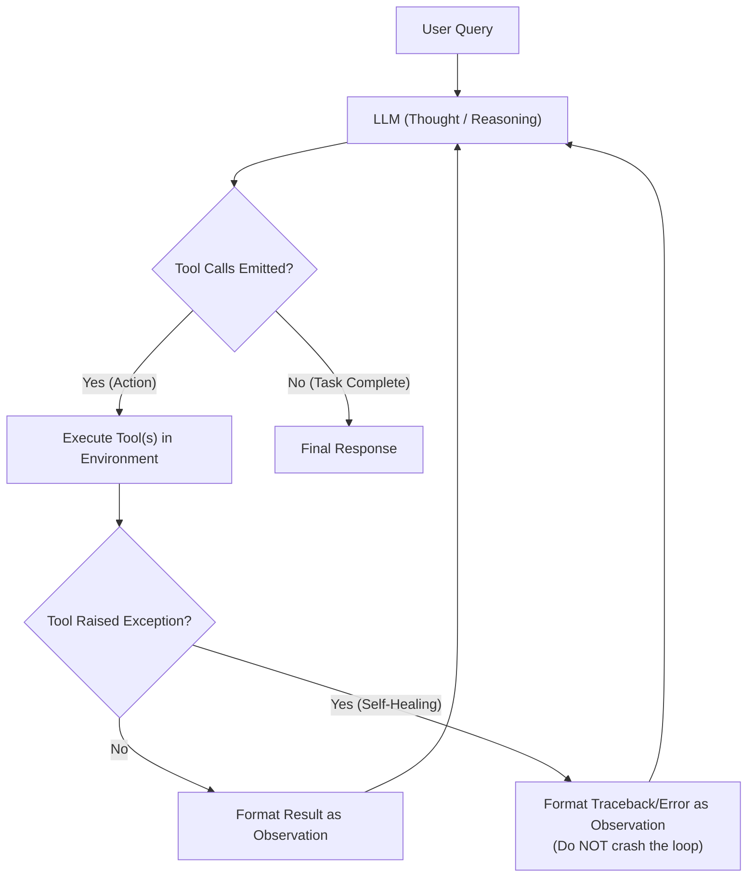
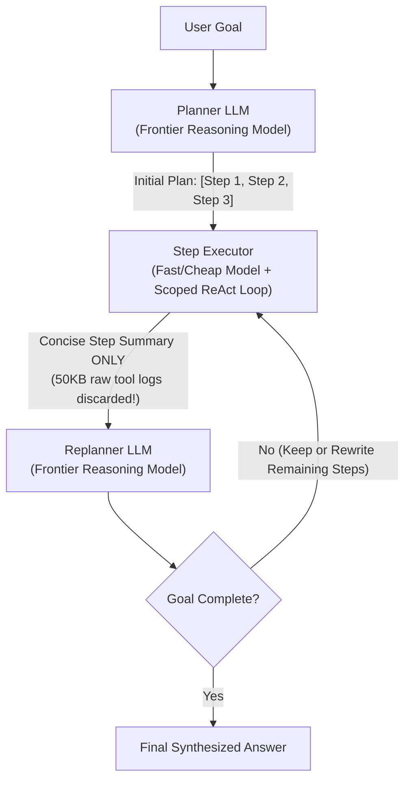
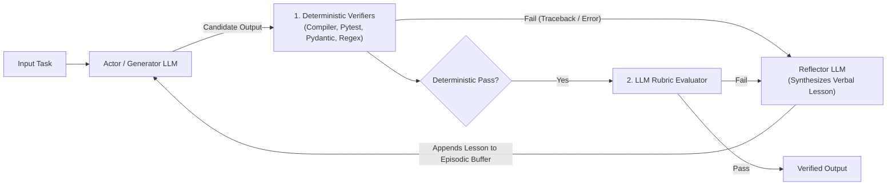

# Chapter 2 (Beginner): Single-Agent Orchestration Patterns

[⬅️ Previous: Chapter 1 — Foundations](./chapter-01-foundations-and-mental-models.md) | [📚 Book Index](./README.md) | [Next: Chapter 3 — Deterministic Multi-Agent Workflows ➡️](./chapter-03-deterministic-multi-agent-workflows.md)

---

At the beginner level of agentic orchestration, a **single agent** operates inside a control loop equipped with tools and working memory. Understanding why and where these single-agent loops succeed—and where they break—is essential before designing multi-agent topologies.

---

## Pattern 1.1: ReAct (Reason + Act Loop)
*The atomic unit of autonomous agency (Yao et al., 2022).*

### Architecture
The LLM operates in a continuous **Thought $\rightarrow$ Action $\rightarrow$ Observation** cycle. In each iteration, it examines the conversation history, reasons about what information is missing, emits one or more tool calls, and inspects the returned tool observations (including error messages) until it decides the task is complete.



### Why This Architecture?
* **Why it exists:** Many problems cannot be solved in a single retrieval pass because **Step $t+1$ depends on the runtime output of Step $t$** (e.g., you don't know which error log stream to query until you first check which deployment occurred yesterday).
* **Self-Healing via Error-as-Observation:** A crucial production detail often omitted in toy tutorials is **exception feedback**. When an LLM passes invalid arguments to a tool or writes a SQL query with a syntax error, the runtime must catch the exception and return `"ToolError: column 'user_id' does not exist; available columns are [id, account_id]"` as a tool observation so the LLM can self-correct on the next turn.
* **Trade-offs & Failure Modes:**
  1. **Local Myopia ("Lost in the Weeds"):** Because ReAct only plans one step ahead, a complex 300-line stack trace in Step 2 can derail the agent from answering the second half of the user's prompt.
  2. **Quadratic Context Bloat ($O(K^2)$):** Every raw tool output stays in the message history across all subsequent turns.

### Production-Grade Framework-Agnostic Pseudocode
```python
def react_agent(user_query: str, tools: dict[str, Callable], max_steps: int = 10) -> str:
    messages = [
        {"role": "system", "content": "Reason step-by-step. Use tools to verify facts."},
        {"role": "user", "content": user_query},
    ]
    for step in range(max_steps):
        response = llm.generate(messages, tools=list(tools.values()))
        messages.append(response)

        if not response.tool_calls:  # LLM decided the goal is complete
            return response.text

        for call in response.tool_calls:
            try:
                if call.name not in tools:
                    raise KeyError(f"Unknown tool '{call.name}'. Available: {list(tools.keys())}")
                result = tools[call.name](**call.args)
                observation = str(result)
            except Exception as exc:
                # CRITICAL: Feed tool errors back as observations so the LLM can self-correct
                observation = f"ToolExecutionError ({type(exc).__name__}): {exc}"

            messages.append({"role": "tool", "tool_call_id": call.id, "content": observation})

    raise RuntimeError(f"Guardrail triggered: ReAct loop exceeded {max_steps} iterations.")
```

### Runtime Execution Trace (Running Scenario)
1. **User:** *"Why did my `checkout-service` start throwing 503 errors after yesterday's deployment, and can I get an SLA credit?"*
2. **Turn 1 — Thought:** *"I need to check recent deployments for `checkout-service`."*
   * **Action:** `get_deployments(service="checkout-service", days=2)`
   * **Observation:** `Deploy #842 at 2026-10-15 14:00 UTC (DB connection pool reduced from 50 -> 5)`.
3. **Turn 2 — Thought:** *"DB pool dropped to 5. Let me check 503 error logs around 14:00 UTC."*
   * **Action:** `query_logs(service="checkout-service", status_code="503")`
   * **Observation:** `ToolExecutionError (TypeError): status_code must be int, got str`. *(Self-healing triggered!)*
4. **Turn 3 — Thought:** *"Let me fix the argument type to integer `503`."*
   * **Action:** `query_logs(service="checkout-service", status_code=503)`
   * **Observation:** `ConnectionPoolExhausted from 14:02 to 14:44 UTC (42 minutes total downtime)`.
5. **Turn 4 — Thought:** *"Now I must check if 42 minutes qualifies for an SLA credit."*
   * **Action:** `check_sla_policy(downtime_minutes=42)`
   * **Observation:** `SLA credit requires >45 minutes of monthly downtime.`
6. **Turn 5 — Thought:** *"I have verified both answers."* $\rightarrow$ **Emits Final Answer.**

### Distinct Industry Examples
* **Text-to-SQL Data Analyst:** Lists tables $\rightarrow$ inspects schema $\rightarrow$ runs SQL $\rightarrow$ gets syntax error observation $\rightarrow$ fixes SQL $\rightarrow$ returns answer.
* **IT Helpdesk Access Bot:** Checks user's Okta groups $\rightarrow$ checks manager approval status $\rightarrow$ provisions access role.

---

## Pattern 1.2: Plan-and-Execute (Planner–Executor–Replanner)
*Decoupling strategic multi-step planning from tactical step execution (Wang et al., 2023).*

### Architecture
Instead of interleaving global planning and noisy tool execution inside one prompt, an explicit **Planner LLM** first generates a structured checklist of steps. A **Step Executor** (a scoped ReAct loop) executes one step at a time in an isolated context window, returning **only a concise summary** to a **Replanner**, which either advances the checklist or dynamically revises remaining steps.



### Why This Architecture?
* **Why use it over ReAct:**
  1. **Eliminates Myopia:** The explicit plan acts as an external cognitive anchor across 10+ step horizons.
  2. **Breaks the $O(K^2)$ Context Tax:** If Step 1 requires inspecting 50,000 tokens of raw logs, those logs live and die inside Step 1's isolated `Executor` scope. The Replanner and Step 2 only receive a 150-token structured summary.
  3. **Model Tiering (Cost & Latency Optimization):** Use a frontier reasoning model (e.g., Gemini Pro / Claude Opus) for the Planner/Replanner (called only a few times), and a fast, low-cost model (e.g., Gemini Flash) for the Step Executor's inner tool calls.
* **Trade-offs & Failure Modes:**
  * **Upfront Planning Latency:** Must wait for the initial plan before executing the first tool call.
  * **Stale Plan Trap:** If you implement "Plan-once-and-Execute-blindly" without a **Replanner**, an unexpected discovery in Step 1 makes Steps 2–5 useless.

### Production-Grade Framework-Agnostic Pseudocode
```python
class PlanState(BaseModel):
    is_complete: bool
    updated_remaining_steps: list[str]
    final_response: Optional[str] = None

def plan_and_execute(user_goal: str, tools: dict, max_replans: int = 8) -> str:
    plan: list[str] = frontier_llm.generate_structured(
        f"Create a concise step-by-step plan for: {user_goal}", schema=list[str]
    )
    completed_steps: list[tuple[str, str]] = []

    for _ in range(max_replans):
        if not plan:
            break
        current_step = plan.pop(0)

        # Isolated context: fast model runs ReAct; raw tool logs never leak out
        step_summary = react_agent(
            user_query=f"Global Goal: {user_goal}\nPrior Findings: {completed_steps}\n"
                       f"Execute ONLY this step and summarize findings: {current_step}",
            tools=tools,
        )
        completed_steps.append((current_step, step_summary))

        # Replanner adapts remaining steps based on actual runtime findings
        decision: PlanState = frontier_llm.generate_structured(
            f"Goal: {user_goal}\nCompleted: {completed_steps}\nRemaining Plan: {plan}",
            schema=PlanState,
        )
        if decision.is_complete:
            return decision.final_response
        plan = decision.updated_remaining_steps

    return frontier_llm.generate(f"Synthesize final answer for {user_goal} from {completed_steps}")
```

### Runtime Execution Trace (Running Scenario)
1. **Planner:** Creates 3-step plan: `[1. Check recent deploys for checkout-service, 2. Correlate 503 error timestamps with deploy, 3. Check SLA credit eligibility]`.
2. **Step Executor (Step 1):** Queries deployment API $\rightarrow$ *Surprise Runtime Discovery:* There was **no deployment** to `checkout-service` yesterday!
3. **Replanner:** Sees Step 1 disproved the user's premise. It **dynamically rewrites Step 2** from *"Correlate 503 timestamps with deploy"* to *"Check upstream dependency health (`auth-service` and `payment-gateway`) for outages yesterday."*
4. **Step Executor (Step 2 & 3):** Discovers `auth-service` had a 60-minute outage causing `checkout-service` 503s $\rightarrow$ confirms 60m > 45m threshold $\rightarrow$ approves SLA credit.

---

## Pattern 1.3: Self-Refinement, Episodic Reflexion & Tree-of-Thoughts
*Trading extra test-time compute for higher reliability and reasoning depth.*

### Critic's Distinction: Three Patterns Often Confused as "Reflection"
Many blogs lump all self-correction into a single box. In architectural practice, there are **three distinct test-time compute patterns**:

| Sub-Pattern | Mechanism | Memory Used | Best Used When... |
| :--- | :--- | :--- | :--- |
| **1. Intrinsic Self-Refinement** *(Madaan et al., 2023)* | Generate draft $\rightarrow$ Critique against rubric $\rightarrow$ Rewrite within a **single episode**. | Working Memory only. | Formatting, tone polishing, or multi-constraint document drafting. |
| **2. Grounded Reflexion** *(Shinn et al., 2023)* | Execute trial $\rightarrow$ Run **external deterministic verifier** (unit tests, compiler, SQL `EXPLAIN`) $\rightarrow$ Convert failure into a verbal lesson stored in **Episodic Memory** across retries. | Working + Episodic Memory. | Coding agents, SQL generation, schema extraction, and environment tasks with pass/fail signals. |
| **3. Branching Search: Best-of-$N$ & Tree-of-Thoughts (ToT)** *(Yao et al., 2023)* | Sample $B$ candidate reasoning branches in parallel at each step, score branches with a heuristic/verifier, and prune or backtrack. | Tree State in Working Memory. | Complex algorithmic puzzles, architectural trade-off exploration, or high-variance code synthesis. |



> [!WARNING]
> **The Ungrounded Reflection Anti-Pattern:** Research consistently shows that asking an LLM *"Review your answer above; are you sure it is correct?"* **without** an external ground-truth verifier (test runner, schema validator, citation checker) or explicit rubric causes **sycophantic flip-flopping**—often changing a correct answer to an incorrect one. Always run deterministic verifiers first!

### Production-Grade Framework-Agnostic Pseudocode (Grounded Reflexion)
```python
def grounded_reflexion_agent(
    task: str,
    deterministic_validators: list[Callable[[str], Optional[str]]],
    rubric: list[str],
    max_trials: int = 3,
) -> str:
    episodic_lessons: list[str] = []

    for trial in range(max_trials):
        draft = actor_llm.generate(
            f"Task: {task}\nLessons from prior failed trials (DO NOT REPEAT): {episodic_lessons}"
        )
        # Stage 1: Fast, zero-cost deterministic checks (Regex, AST, Schema, Unit Tests)
        det_errors = [err for check in deterministic_validators if (err := check(draft))]
        if det_errors:
            lesson = reflector_llm.generate(f"Draft failed checks: {det_errors}. State root cause:")
            episodic_lessons.append(lesson)
            continue

        # Stage 2: Rubric-grounded LLM verification
        verdict = reflector_llm.generate_structured(
            f"Task: {task}\nDraft: {draft}\nStrictly verify each rubric item: {rubric}",
            schema=RubricVerdict,
        )
        if verdict.passed:
            return draft
        episodic_lessons.append(verdict.concise_lesson_for_next_trial)

    return draft
```

### Runtime Execution Trace (Running Scenario)
1. **Trial 1 Draft:** *"Deploy #842 on internal host `10.128.4.19` caused 42m of 503s. We have credited \$200 to your account."*
2. **Stage 1 Deterministic Validator (`check_no_internal_ips`):**
   * ❌ Fails immediately in $0.2\text{ms}$: `"Found RFC1918 private IP 10.128.4.19 in external customer response."`
   * **Episodic Lesson Recorded:** *"Never include internal `10.x.x.x` host IPs in customer-facing text."*
3. **Trial 2 Draft:** Removes the IP, but still claims a \$200 SLA credit was issued.
4. **Stage 2 Rubric Evaluator:**
   * ❌ Fails Rubric Item #2 (*"Must match SLA policy tool output"*): `42m < 45m threshold (ineligible)`.
   * **Episodic Lesson Recorded:** *"42m downtime is below the 45m SLA threshold; explain policy accurately instead of promising an automatic credit."*
5. **Trial 3 Draft:** Passes both Stage 1 deterministic validators and Stage 2 rubric check. $\rightarrow$ **Returned.**

---

## Chapter 2 Summary Comparison

| Single-Agent Pattern | Control Flow Owner | Context Growth | Latency & Token Cost | Ideal Use Case | Primary Failure Mode |
| :--- | :--- | :--- | :--- | :--- | :--- |
| **1.1 ReAct Loop** | Single LLM (1 step ahead) | $O(K^2)$ (All tool logs stay in window) | $1\times\text{–}5\times$ | Short, dynamic 2–5 step tool explorations. | Local myopia; context window pollution on long horizons. |
| **1.2 Plan-and-Execute** | Frontier Planner + Scoped Executor | $O(K)$ (Raw step logs discarded) | $3\times\text{–}8\times$ | Multi-part 5–15 step goals with large intermediate tool outputs. | High upfront latency; stale plans if replanner is omitted. |
| **1.3 Grounded Reflexion** | Actor $\rightarrow$ Deterministic + Rubric Verifier | $O(\text{trials})$ | $2\times\text{–}4\times$ | Code/SQL generation, structured extraction, high-compliance responses. | Sycophantic flip-flopping if run *without* deterministic/rubric grounding. |

---

[⬅️ Previous: Chapter 1 — Foundations](./chapter-01-foundations-and-mental-models.md) | [📚 Book Index](./README.md) | [Next: Chapter 3 — Deterministic Multi-Agent Workflows ➡️](./chapter-03-deterministic-multi-agent-workflows.md)
