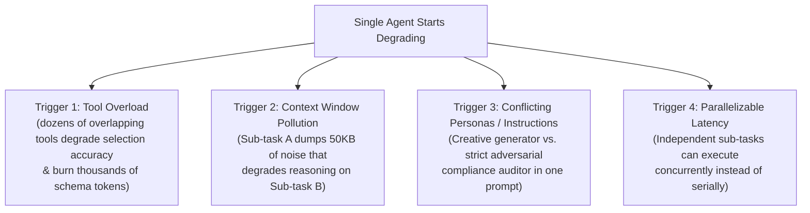
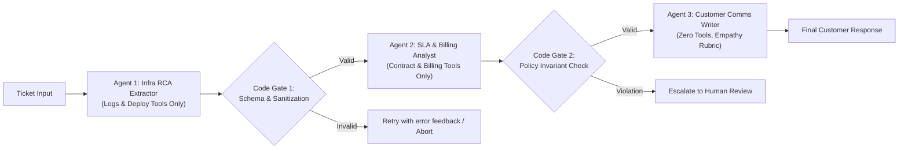
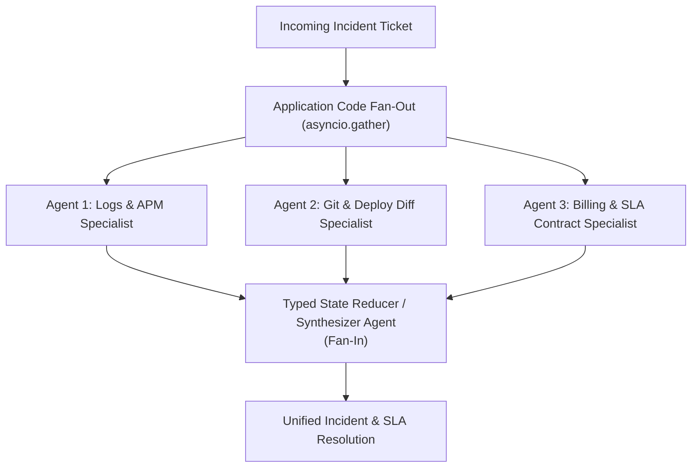

# Chapter 3 (Intermediate, Part 1): Deterministic Multi-Agent Workflows

[← Previous: Chapter 2 — Single-Agent Loops](./chapter-02-single-agent-loops.md) | [Book Index](./README.md) | [Next: Chapter 4 — Dynamic & Hierarchical Orchestration →](./chapter-04-dynamic-and-hierarchical-orchestration.md)

---

> [!NOTE]
> Pattern IDs in this book are pattern-family numbers, not chapter numbers. Family 1.x is single-agent loops (Chapter 2), 2.x is deterministic multi-agent workflows (this chapter), 3.x is dynamic and hierarchical orchestration (Chapter 4), and 4.x is decentralized topologies (Chapter 5).

## 3.1 When to split into multiple agents

A very common mistake in AI engineering is building a 10-agent system when a single agent with 5 tools would be faster, cheaper, and more reliable.

Before you split one agent into several, check that you've actually hit at least one of what I call the **Four Multi-Agent Triggers**:



Each trigger also has a cheaper fix that keeps you on one agent, and you should rule those out first.

For tool overload, there's no universal magic number. The threshold depends on the model and on how much your tool descriptions overlap. Before splitting, try loading tools dynamically: a retrieval step over tool descriptions ("Tool-RAG", Chapter 6), a provider feature such as Anthropic's *Tool Search Tool* with deferred tool definitions (Nov 2025), or on-demand Agent Skills (Chapter 8). For context pollution, try context engineering first (tool-result clearing, compaction, structured note-taking; see Chapter 11). For parallel latency, remember that most modern models support parallel tool calls in a single turn, which often removes the need for separate agents altogether.

Multi-agent systems also cost more. Anthropic reported that its multi-agent research system used roughly 15× the tokens of a chat interaction (Chapter 4 covers this).

Once you do cross into multi-agent design, start with deterministic multi-agent workflows, where your application code owns the orchestration graph between specialized agents. The three patterns in this chapter map to the *workflow* patterns in Anthropic's "Building Effective Agents" (Schluntz & Zhang, Dec 2024): prompt chaining (Pattern 2.1), parallelization with sectioning and voting (Pattern 2.2), and routing (Pattern 2.3). Anthropic's other two workflows, *orchestrator–workers* and *evaluator–optimizer*, hand part of the control flow to an LLM, so they live in Chapter 4.

---

## Pattern 2.1: Sequential chaining (the assembly line)
*A fixed linear sequence of specialized agents separated by deterministic validation gates.*

### Architecture
Application code calls a strict pipeline of specialized agents: $\text{Agent}_1 \rightarrow \text{Code Gate}_1 \rightarrow \text{Agent}_2 \rightarrow \text{Code Gate}_2 \rightarrow \text{Agent}_3$. Each agent gets a narrow system prompt, only the tools its stage needs, and a strict output schema (`Pydantic` / JSON Schema).



### Why it works
The main reason to build it this way is compound reliability decay ($R = r^N$), Law 1 from Chapter 1. With $r = 0.90$ per stage, an unverified 5-stage chain succeeds only $0.90^5 \approx 59\%$ of the time. Deterministic code gates (`G1`, `G2`) between stages catch malformed outputs, missing fields, and policy violations before they reach downstream agents. Failures get retried or escalated instead of propagating silently, which pushes the effective per-stage reliability toward $1.0$. That only holds for the error classes a gate can detect, though. A schema gate can't catch output that is valid but wrong: well-formed JSON with an incorrect root cause still passes. To catch semantic errors, pair gates with business invariants (like `G2`), cross-checks against tool data, or an LLM/rubric verifier (Chapter 4, Pattern 3.2).

The stages also act as hard context and security boundaries. `Agent 3`, which talks to external customers, never sees the raw stack traces, database credentials, or internal IP addresses that `Agent 1` processed. It only receives the sanitized `RCAReport` and `SLADecision` structs.

Note that structured outputs aren't the same as validated outputs. Provider "structured output" or constrained-decoding modes guarantee syntactically valid JSON that matches the schema. They don't guarantee every constraint (some strict modes ignore or reject keywords like numeric bounds), and they say nothing about business correctness. Always re-validate on your side, for example with Pydantic's `model_validate_json`.

The costs are what you'd expect from a straight line. Latency is serial ($L = \sum L_i$), because Stage $i+1$ needs Stage $i$'s output. And there's no dynamic backtracking: if `Agent 3` realizes `Agent 1` missed a log query, a strictly linear pipeline can't loop back. For that you need a cyclic graph (Chapter 4).

### Framework-agnostic pseudocode
```python
class RCAReport(BaseModel):
    service: str
    root_cause_summary: str
    downtime_minutes: int = Field(ge=0, le=1440)

class SLADecision(BaseModel):
    eligible_for_credit: bool
    credit_amount_usd: float = Field(ge=0.0)
    policy_citation: str

CREDIT_THRESHOLD_MINUTES = 45  # Contract: downtime must EXCEED 45 minutes

def sequential_support_pipeline(ticket: str) -> str:
    # Stage 1: Infra Specialist extracts structured RCA.
    # run_structured() validates against the schema and retries (with the
    # validation error fed back) a bounded number of times before raising.
    rca: RCAReport = infra_agent.run_structured(ticket, schema=RCAReport, max_retries=2)

    # Code Gate 1: Deterministic sanitization (strip internal IPs / hostnames)
    rca.root_cause_summary = redact_internal_hosts(rca.root_cause_summary)

    # Stage 2: Billing Specialist receives ONLY the sanitized RCAReport JSON
    sla: SLADecision = billing_agent.run_structured(rca.model_dump_json(), schema=SLADecision)

    # Code Gate 2: Hard programmatic business invariants
    if rca.downtime_minutes <= CREDIT_THRESHOLD_MINUTES and sla.credit_amount_usd > 0:
        return escalate_to_human(ticket, rca, sla, reason="Credit approved below SLA threshold")
    if sla.eligible_for_credit != (sla.credit_amount_usd > 0):
        return escalate_to_human(ticket, rca, sla, reason="Inconsistent SLA decision")

    # Stage 3: Comms Specialist drafts customer response
    return comms_agent.run(f"RCA: {rca.model_dump_json()}\nSLA: {sla.model_dump_json()}")
```

### Trace through the running scenario
1. `infra_agent` queries deployment and error logs $\rightarrow$ outputs `RCAReport(service="checkout-service", root_cause_summary="Deploy #842 reduced DB pool to 5", downtime_minutes=42)`.
2. Code Gate 1 validates the Pydantic bounds (`0 <= 42 <= 1440`) and scrubs internal IPs and hostnames.
3. `billing_agent` takes the 3-field `RCAReport`, checks the customer's contract, and outputs `SLADecision(eligible_for_credit=False, credit_amount_usd=0.0, policy_citation="Section 4.1: >45m required")`.
4. Code Gate 2 checks the business invariants in microseconds, with no LLM call.
5. `comms_agent` turns both validated structs into a clear customer email.

### Other examples
* Software spec-to-test: Product Spec Agent $\rightarrow$ API Schema Designer Agent $\rightarrow$ Implementation Coder Agent $\rightarrow$ Unit Test Generator Agent.
* Clinical note processing: Medical Scribe Agent (Audio transcript $\rightarrow$ SOAP Note) $\rightarrow$ ICD-10 Coding Agent $\rightarrow$ Prior-Authorization Form Agent. In regulated domains, keep a human sign-off gate before anything gets submitted.

---

## Pattern 2.2: Parallelization (sectioning and voting)
*Fan out to independent agents running concurrently, then fan in through a reducer or synthesizer.*

### Architecture
Application code dispatches work to $M$ agents concurrently (`asyncio.gather` / `asyncio.TaskGroup`) and merges what comes back. There are two variants.

In **sectioning** (divide and conquer), each parallel agent is a different specialist looking at a different dimension or slice of the problem. In **voting** (a self-consistency ensemble), several agents run the exact same task with varied prompts, temperatures, or model families, and then a programmatic majority vote or a judge picks the consensus output. Voting generalizes *self-consistency* (Wang et al., ICLR 2023): sample several reasoning paths and take the majority answer.



### Why it works
The obvious win is wall-clock time. Latency drops from $\sum_{i=1}^M L_i$ to $\max_{i}(L_i) + L_{\text{synth}}$. Total token cost doesn't go down, though; it usually goes up a little because of the synthesis step.

Sectioning also gives each dimension focused attention. Ask one code-review agent to check security, performance, and style in a single pass and its attention gets diluted. It often fixates on surface-level style and misses the deeper security flaws. Three dedicated specialists running in parallel each get a focused prompt and a clean context window.

Voting reduces variance. For high-stakes classification such as content safety or medical triage, a 3-way ensemble vote reduces the impact of single-sample errors. It can't eliminate them. If every voter has the same blind spot (same model, same prompt), their errors are correlated and the majority will be confidently wrong. Diversify models or prompts, and prefer voting for outputs you can compare exactly, like labels or short answers. Free-form outputs need a judge.

The hard requirement is independence: branches can't depend on each other's runtime findings. Suppose `BillingAgent` needs the exact `downtime_minutes` from `LogAgent` before it can query the billing table. Then the two can't run in one parallel pass. Restructure instead: have `BillingAgent` fetch the contract rules while `LogAgent` fetches the downtime, and let the synthesizer evaluate the threshold.

### Framework-agnostic pseudocode
```python
BRANCH_TIMEOUT_S = 60

async def run_branch(name: str, coro) -> str:
    """Per-branch timeout + error capture so one bad branch never sinks the fan-out."""
    try:
        return await asyncio.wait_for(coro, timeout=BRANCH_TIMEOUT_S)
    except Exception as exc:  # TimeoutError, rate limits, tool failures...
        return f"[{name} UNAVAILABLE: {type(exc).__name__}]"

async def parallel_incident_triage(ticket: str) -> str:
    # Fan-Out: All 3 specialists execute concurrently because their queries are independent:
    # - Log agent finds how long the 503 outage lasted
    # - Deploy agent finds what changed in yesterday's deploy
    # - Contract agent fetches the customer's SLA tier rules
    log_report, deploy_report, sla_rules = await asyncio.gather(
        run_branch("logs", log_agent.run_async(ticket)),
        run_branch("deploys", deploy_agent.run_async(ticket)),
        run_branch("contract", contract_agent.run_async(ticket)),
    )
    # Fan-In: Synthesizer reconciles findings and must flag any UNAVAILABLE branch
    # explicitly instead of guessing the missing data.
    return await synthesizer_agent.run_async(
        f"Ticket: {ticket}\nLogs: {log_report}\nDeploys: {deploy_report}\nSLA Rules: {sla_rules}\n"
        "If any input is marked UNAVAILABLE, state what could not be verified."
    )
```

> [!TIP]
> Know how `asyncio` fails in a fan-out.
> * `asyncio.gather(...)` with the default `return_exceptions=False`: the first exception propagates to the caller immediately. The other branches are not cancelled. They keep running (and spending tokens) in the background, but you lose their results.
> * `return_exceptions=True`: exceptions come back as values in the results list. Check `isinstance(r, BaseException)` before using a result, or an exception object ends up interpolated into your synthesizer prompt.
> * `asyncio.TaskGroup` (Python 3.11+): fail-fast. One failure cancels the sibling tasks and raises an `ExceptionGroup`. Use it when partial results are worthless.
> * None of these handles a slow branch. Always add per-branch timeouts (`asyncio.wait_for` / `asyncio.timeout`), as `run_branch` does above.

### Trace through the running scenario
1. Fan-out ($t = 0.0\text{s}$):
   * `log_agent` queries Prometheus/Loki for the 503 window ($2.1\text{s}$) $\rightarrow$ returns `42m downtime (14:02-14:44 UTC)`.
   * `deploy_agent` inspects yesterday's git diffs ($1.8\text{s}$) $\rightarrow$ returns `Deploy #842 lowered DB pool from 50 to 5`.
   * `contract_agent` looks up the customer's SLA contract ($1.1\text{s}$) $\rightarrow$ returns `Enterprise Tier requires >45m downtime for 10% credit`.
2. Fan-in ($t = 2.1\text{s}$): data gathering took $2.1\text{s}$ in total, against $5.0\text{s}$ sequentially. The timings are illustrative. Real multi-turn agent branches usually take tens of seconds, but the ratio holds.
3. `synthesizer_agent` compares `42m` against the `>45m` contract rule and drafts the full response.

---

## Pattern 2.3: Intent routing (classifier and dispatcher)
*Classify the incoming request once and send it to the best-suited specialist or multi-branch sub-workflow.*

### Architecture
A fast, lightweight router looks at the user query and dispatches it to the right downstream specialist or specialists. The router can be a small LLM emitting structured output, an embedding-similarity router, or a fine-tuned classifier.


### Why it works
Routing is the simplest answer to tool overload. Instead of binding 60 tools from 5 departments to one agent, each specialist gets only the 6–10 tools relevant to its domain.

It also lets you tier cost and latency. In many support workloads a large share of traffic is routine FAQs or simple lookups (measure your own distribution). Sending those to a fast, single-pass RAG chain or a smaller model can cut cost and latency substantially, and it saves the expensive multi-step agent loops for tickets that actually need them.

The trap is multi-intent queries. A naive router defined as `intent: Literal["INFRA", "BILLING", "FAQ"]` can pick only one bucket. Take the running scenario: *"Why did my service throw 503s [INFRA], and can I get an SLA credit [BILLING]?"* A single-choice router drops half of that question. The fix is to define the router schema with `intents: list[IntentEnum]` (multi-label classification). If `len(intents) == 1`, route straight to that specialist. If `len(intents) > 1`, dispatch to a sequential pipeline (2.1), a parallel fan-out (2.2), or a supervisor (3.3, Chapter 4) that covers every detected intent.

One caveat: self-reported confidence is poorly calibrated. A number the LLM writes into a `confidence` field is not a probability. For thresholding, prefer token log-probabilities, an embedding or classifier router with calibrated scores, or agreement between two cheap classifiers, and validate the threshold on labeled traffic.

### Framework-agnostic pseudocode
```python
class RouteClassification(BaseModel):
    intents: list[Literal["INFRA", "BILLING", "FAQ"]] = Field(min_length=1)
    confidence: float = Field(ge=0.0, le=1.0)  # Treat as a heuristic; calibrate offline

async def multi_intent_router(query: str) -> str:
    route: RouteClassification = await fast_router_llm.generate_structured_async(
        f"Classify all distinct user intents present in: {query}", schema=RouteClassification
    )
    if route.confidence < 0.6:
        return await human_triage_escalation(query)

    intent_set = set(route.intents)
    if intent_set == {"FAQ"}:
        return await fast_rag_lookup(query)
    if intent_set == {"INFRA"}:
        return await infra_agent.run_async(query)
    if intent_set == {"BILLING"}:
        return await billing_agent.run_async(query)

    # Compound multi-intent query (e.g., {"INFRA", "BILLING"}) -> Fan out or run pipeline!
    return await parallel_incident_triage(query)
```

---

## 3.2 The same workflows in real SDKs

Every pattern in this chapter is plain application code, so you don't need a framework. Most agent SDKs do ship primitives for these workflows, though:

| Framework | Sequential (2.1) | Parallel (2.2) | Routing (2.3) |
| :--- | :--- | :--- | :--- |
| LangGraph | `StateGraph` with `add_edge("a", "b")` | Multiple edges out of one node; fan-in via a reducer such as `Annotated[list, operator.add]` | `add_conditional_edges(node, route_fn)` |
| CrewAI Flows | `@start()` → `@listen(step)` | Several `@listen(step)` methods + `@listen(and_(a, b))` to join | `@router(step)` returning a route label |
| Microsoft Agent Framework | `SequentialBuilder` | `ConcurrentBuilder` | `WorkflowBuilder` with conditional edges |
| OpenAI Agents SDK | Chain `Runner.run(...)` calls in code | `asyncio.gather` over `Runner.run(...)` | A triage agent with `handoffs=[...]` (LLM-driven; see Chapter 5) |
| Google ADK | `SequentialAgent(sub_agents=[...])` | `ParallelAgent(sub_agents=[...])` | Custom `BaseAgent` / callbacks, or LLM delegation via `sub_agents` (Chapter 4) |

Here is the running scenario's fan-out/fan-in in two SDKs. Both express the same graph, so pick whichever framework your team already uses (Chapter 17 compares the rest).

In LangGraph, each node returns a partial state update, and passing a list of upstream nodes to `add_edge` makes the synthesizer wait for all branches:

```python
from typing import TypedDict
from langgraph.graph import StateGraph, START, END

class IncidentState(TypedDict, total=False):
    ticket: str
    log_report: str
    deploy_report: str
    sla_rules: str
    resolution: str

async def logs(s: IncidentState) -> dict:      return {"log_report": await log_agent.run_async(s["ticket"])}
async def deploys(s: IncidentState) -> dict:   return {"deploy_report": await deploy_agent.run_async(s["ticket"])}
async def contract(s: IncidentState) -> dict:  return {"sla_rules": await contract_agent.run_async(s["ticket"])}
async def synthesize(s: IncidentState) -> dict:
    return {"resolution": await synthesizer_agent.run_async(
        f"Logs: {s['log_report']}\nDeploys: {s['deploy_report']}\nSLA rules: {s['sla_rules']}\n"
        "Determine root cause and SLA credit eligibility.")}

builder = StateGraph(IncidentState)
for name, fn in [("logs", logs), ("deploys", deploys), ("contract", contract), ("synthesize", synthesize)]:
    builder.add_node(name, fn)
for branch in ("logs", "deploys", "contract"):
    builder.add_edge(START, branch)                               # fan-out
builder.add_edge(["logs", "deploys", "contract"], "synthesize")   # fan-in (join)
builder.add_edge("synthesize", END)
graph = builder.compile()   # await graph.ainvoke({"ticket": ticket})
```

In Google ADK, data flows through session state via `output_key` and `{key}` instruction templating:

```python
from google.adk.agents import LlmAgent, ParallelAgent, SequentialAgent

MODEL = FAST_MODEL  # a fast/small-tier model: a Gemini model id, or LiteLlm(model="provider/model") for other providers

log_agent = LlmAgent(name="LogAgent", model=MODEL, tools=[query_logs],
                     instruction="Find the 503 window for the ticket.", output_key="log_report")
deploy_agent = LlmAgent(name="DeployAgent", model=MODEL, tools=[git_diff],
                        instruction="Find what changed in yesterday's deploy.", output_key="deploy_report")
contract_agent = LlmAgent(name="ContractAgent", model=MODEL, tools=[get_contract],
                          instruction="Fetch the customer's SLA rules.", output_key="sla_rules")

synthesizer = LlmAgent(
    name="Synthesizer", model=MODEL,
    instruction=("Logs: {log_report}\nDeploys: {deploy_report}\nSLA rules: {sla_rules}\n"
                 "Determine root cause and SLA credit eligibility."),
)

root_agent = SequentialAgent(
    name="IncidentWorkflow",
    sub_agents=[
        ParallelAgent(name="Gather", sub_agents=[log_agent, deploy_agent, contract_agent]),
        synthesizer,
    ],
)
```

Parallel branches that write to shared state must use distinct keys (as above) or a merge reducer; otherwise concurrent writes overwrite each other. Code gates (Pattern 2.1) map to plain functions or nodes in LangGraph, custom `BaseAgent` steps or callbacks in ADK, and executors in Microsoft Agent Framework. For long-running workflows, pair the graph with durable execution and checkpointing (Chapter 17) so a crash mid-pipeline doesn't repeat stages that already completed and had side effects.

---

## Chapter 3 summary

| Pattern | Topology | Wall-clock latency | How context moves | Use it for | Main pitfall |
| :--- | :--- | :--- | :--- | :--- | :--- |
| 2.1 Sequential chain | $A \rightarrow \text{Gate} \rightarrow B \rightarrow \text{Gate} \rightarrow C$ | $\sum_{i=1}^N L_i$ | Structured schema handoff (`Pydantic`). | Multi-stage transformations where Stage $i+1$ depends on Stage $i$'s output. | Omitting validation gates between stages (causes $r^N$ reliability decay). |
| 2.2 Parallelization | Fan-Out $[A \parallel B \parallel C] \rightarrow \text{Synth}$ | $\max_i(L_i) + L_{\text{synth}}$ | Independent inputs $\rightarrow$ merged reducer state. | Independent diagnostic slices (sectioning) or consensus safety checks (voting). | Running tasks in parallel that actually have a hidden runtime data dependency; no per-branch timeouts. |
| 2.3 Intent router | Classifier $\rightarrow$ Branch $k$ | $L_{\text{router}} + L_{\text{branch}}$ | Raw query routed to chosen specialist(s). | Partitioning large tool sets across domains and tiering cheap vs. complex traffic. | Using a single-label enum when users ask compound multi-intent questions. |

---

[← Previous: Chapter 2 — Single-Agent Loops](./chapter-02-single-agent-loops.md) | [Book Index](./README.md) | [Next: Chapter 4 — Dynamic & Hierarchical Orchestration →](./chapter-04-dynamic-and-hierarchical-orchestration.md)
