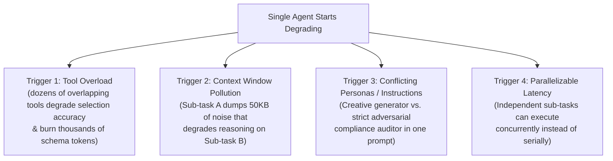
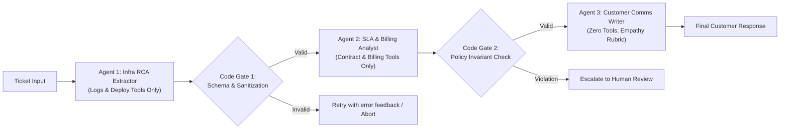
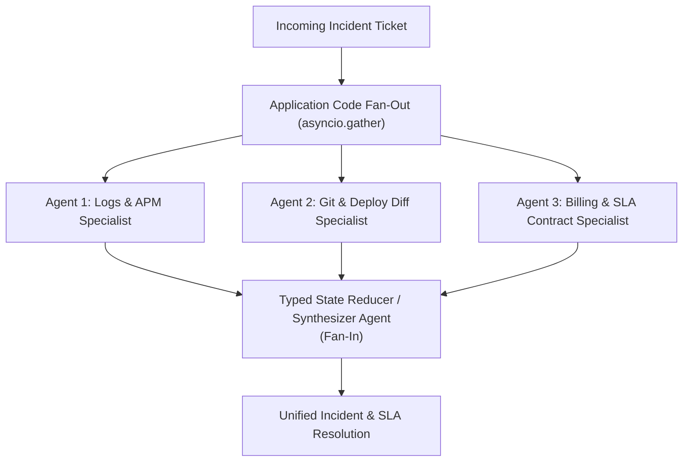
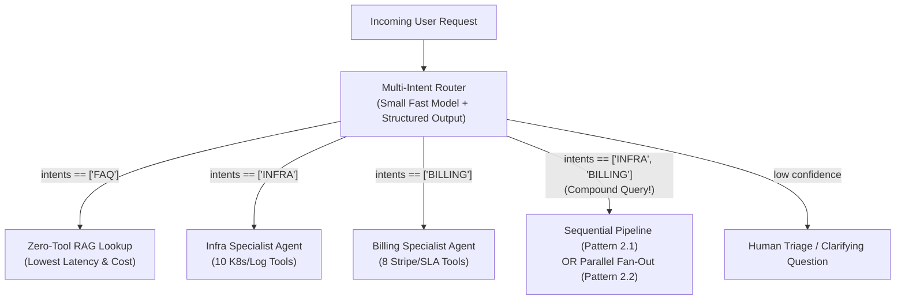

# Chapter 3 (Intermediate — Part 1): Deterministic Multi-Agent Workflows

[⬅️ Previous: Chapter 2 — Single-Agent Loops](./chapter-02-single-agent-loops.md) | [📚 Book Index](./README.md) | [Next: Chapter 4 — Dynamic & Hierarchical Orchestration ➡️](./chapter-04-dynamic-and-hierarchical-orchestration.md)

---

> [!NOTE]
> **How pattern numbers work in this book:** Pattern IDs are *pattern-family* numbers, not chapter numbers. Family **1.x** = single-agent loops (Chapter 2), **2.x** = deterministic multi-agent workflows (this chapter), **3.x** = dynamic & hierarchical orchestration (Chapter 4), **4.x** = decentralized topologies (Chapter 5).

## 3.1 Why Split into Multiple Agents? (The 4 Architectural Triggers)

One of the most common mistakes in AI engineering is creating a 10-agent system when a single agent with 5 tools would perform faster, cheaper, and more reliably.

Before splitting a single agent into multiple agents, verify that you have hit at least one of these **Four Multi-Agent Triggers**:



> [!TIP]
> **Rule out the single-agent fixes first.** Each trigger has a cheaper remedy that keeps one agent:
> * **Tool overload:** There is no universal "magic number" — the threshold depends on the model and on how much tool descriptions overlap. Before splitting, try dynamic tool loading (e.g., Anthropic's *Tool Search Tool* with deferred tool definitions, Nov 2025) or on-demand **Agent Skills** (Chapter 8).
> * **Context pollution:** Try context engineering first — tool-result clearing, compaction, and structured note-taking (Chapter 11).
> * **Parallel latency:** Most modern models support **parallel tool calls** in a single turn, which often removes the need for separate agents.
>
> Multi-agent systems also cost more: Anthropic reported that its multi-agent research system used roughly **15× the tokens of a chat interaction** (Chapter 4 covers this).

When you do cross the threshold into multi-agent design, **always start with Deterministic Multi-Agent Workflows**, where **application code** owns the orchestration graph between specialized agents. The three patterns in this chapter correspond to the *workflow* patterns in Anthropic's **"Building Effective Agents"** (Schluntz & Zhang, Dec 2024): **prompt chaining** (Pattern 2.1), **parallelization** with sectioning and voting (Pattern 2.2), and **routing** (Pattern 2.3). Anthropic's two remaining workflows, *orchestrator–workers* and *evaluator–optimizer*, hand part of the control flow to an LLM, so they are covered in Chapter 4.

---

## Pattern 2.1: Sequential Chaining / Pipeline (The Assembly Line)
*A fixed linear sequence of specialized agents separated by deterministic validation gates.*

### Architecture
Application code invokes a strict pipeline of specialized agents: $\text{Agent}_1 \rightarrow \text{Code Gate}_1 \rightarrow \text{Agent}_2 \rightarrow \text{Code Gate}_2 \rightarrow \text{Agent}_3$. Each agent has a narrow system prompt, only the tools required for its stage, and a strict output schema (`Pydantic` / JSON Schema).



### Why This Architecture?
* **Fights Compound Reliability Decay ($R = r^N$):** Recall Law 1 from Chapter 1. With $r = 0.90$ per stage, an unverified 5-stage chain succeeds only $0.90^5 \approx 59\%$ of the time. **Deterministic Code Gates** (`G1`, `G2`) between stages catch malformed outputs, missing fields, and policy violations *before* they corrupt downstream agents. Failures are then retried or escalated instead of propagating silently, which pushes the *effective* per-stage reliability toward $1.0$ — **but only for the error classes the gate can detect.**
  * *Nuance:* A schema gate can't catch output that is **valid but wrong**: well-formed JSON with an incorrect root cause still passes. To catch semantic errors, pair gates with business invariants (like `G2`), cross-checks against tool data, or an LLM/rubric verifier (Chapter 4, Pattern 3.2).
* **Hard Context & Security Boundaries:** `Agent 3` (which speaks to external customers) never sees the raw internal stack traces, database credentials, or internal IP addresses processed by `Agent 1`. It only receives the sanitized `RCAReport` and `SLADecision` structs.
* **Structured outputs ≠ validated outputs:** Provider "structured output" / constrained-decoding modes guarantee that the output is *syntactically* valid JSON matching the schema. They don't guarantee every constraint (some strict modes ignore or reject keywords like numeric bounds), and they don't guarantee business correctness. Always re-validate on your side (for example, Pydantic `model_validate_json`).
* **Trade-offs & Failure Modes:**
  * **Serial Latency ($L = \sum L_i$):** Stages can't run in parallel because Stage $i+1$ depends on Stage $i$'s output.
  * **No Dynamic Backtracking:** If `Agent 3` realizes `Agent 1` missed a log query, a strictly linear pipeline can't loop back. For that, you need a cyclic graph (Chapter 4).

### Production-Grade Framework-Agnostic Pseudocode
```python
class RCAReport(BaseModel):
    service: str
    root_cause_summary: str
    downtime_minutes: int = Field(ge=0, le=1440)

class SLADecision(BaseModel):
    eligible_for_credit: bool
    credit_amount_usd: float = Field(ge=0.0)
    policy_citation: str

CREDIT_THRESHOLD_MINUTES = 45  # Contract: downtime must EXCEED 45 minutes

def sequential_support_pipeline(ticket: str) -> str:
    # Stage 1: Infra Specialist extracts structured RCA.
    # run_structured() validates against the schema and retries (with the
    # validation error fed back) a bounded number of times before raising.
    rca: RCAReport = infra_agent.run_structured(ticket, schema=RCAReport, max_retries=2)

    # Code Gate 1: Deterministic sanitization (strip internal IPs / hostnames)
    rca.root_cause_summary = redact_internal_hosts(rca.root_cause_summary)

    # Stage 2: Billing Specialist receives ONLY the sanitized RCAReport JSON
    sla: SLADecision = billing_agent.run_structured(rca.model_dump_json(), schema=SLADecision)

    # Code Gate 2: Hard programmatic business invariants
    if rca.downtime_minutes <= CREDIT_THRESHOLD_MINUTES and sla.credit_amount_usd > 0:
        return escalate_to_human(ticket, rca, sla, reason="Credit approved below SLA threshold")
    if sla.eligible_for_credit != (sla.credit_amount_usd > 0):
        return escalate_to_human(ticket, rca, sla, reason="Inconsistent SLA decision")

    # Stage 3: Comms Specialist drafts customer response
    return comms_agent.run(f"RCA: {rca.model_dump_json()}\nSLA: {sla.model_dump_json()}")
```

### Runtime Execution Trace (Running Scenario)
1. **`infra_agent`** queries deployment and error logs $\rightarrow$ outputs `RCAReport(service="checkout-service", root_cause_summary="Deploy #842 reduced DB pool to 5", downtime_minutes=42)`.
2. **Code Gate 1** validates Pydantic bounds (`0 <= 42 <= 1440`) and scrubs internal IPs/hostnames.
3. **`billing_agent`** takes the 3-field `RCAReport`, checks the customer's contract, and outputs `SLADecision(eligible_for_credit=False, credit_amount_usd=0.0, policy_citation="Section 4.1: >45m required")`.
4. **Code Gate 2** checks the business invariants in microseconds, with no LLM call.
5. **`comms_agent`** synthesizes both validated structs into a clear customer email.

### Distinct Industry Examples
* **Software Spec-to-Test Pipeline:** Product Spec Agent $\rightarrow$ API Schema Designer Agent $\rightarrow$ Implementation Coder Agent $\rightarrow$ Unit Test Generator Agent.
* **Clinical Note Processing Pipeline:** Medical Scribe Agent (Audio transcript $\rightarrow$ SOAP Note) $\rightarrow$ ICD-10 Coding Agent $\rightarrow$ Prior-Authorization Form Agent. In regulated domains, keep a human sign-off gate before anything is submitted.

---

## Pattern 2.2: Parallelization (Sectioning & Voting Ensembles)
*Fan-Out to concurrent independent agents in parallel, then Fan-In via a reducer or synthesizer.*

### Architecture
Application code dispatches work across $M$ agents concurrently (`asyncio.gather` / `asyncio.TaskGroup`) and merges their outputs. It comes in two distinct variants:
1. **Sectioning (Divide & Conquer):** Each parallel agent is a **different specialist** evaluating a *different dimension or slice* of the problem concurrently.
2. **Voting / Self-Consistency Ensemble:** Multiple agents run the **exact same task** (using diverse prompts, temperatures, or model families). Then a programmatic majority vote or a judge selects the consensus output. This generalizes *self-consistency* (Wang et al., ICLR 2023): sample several reasoning paths and take the majority answer.



### Why This Architecture?
* **Wall-Clock Latency Collapse:** Reduces latency from $\sum_{i=1}^M L_i$ to $\max_{i}(L_i) + L_{\text{synth}}$. Total *token cost* doesn't go down; it usually goes up slightly because of the synthesis step.
* **Focused Attention per Dimension (Sectioning):** If one code-review agent has to check security, performance, AND style in a single pass, its attention gets diluted. It often fixates on surface-level style issues and misses deeper security flaws. Running 3 dedicated specialists in parallel gives each dimension its own focused prompt and clean context window.
* **Variance Reduction (Voting):** For high-stakes classification (e.g., content safety or medical triage), a 3-way ensemble vote *reduces* the impact of single-sample errors. It can't eliminate them: if every voter shares the same blind spot (same model, same prompt), its errors are correlated and the majority will be confidently wrong. Diversify models or prompts, and prefer voting for outputs that can be compared exactly (labels, short answers). Free-form outputs need a judge.
* **Trade-offs & Failure Modes:**
  * **Strict Independence Requirement:** Branches **can't depend on each other's runtime findings**. Suppose `BillingAgent` needs the exact `downtime_minutes` from `LogAgent` before it can query the billing table. Then the two can't run in a single parallel pass. Instead, have `BillingAgent` fetch the *contract rules* while `LogAgent` fetches the *downtime*, and let the **Synthesizer** evaluate the threshold.

### Production-Grade Framework-Agnostic Pseudocode
```python
BRANCH_TIMEOUT_S = 60

async def run_branch(name: str, coro) -> str:
    """Per-branch timeout + error capture so one bad branch never sinks the fan-out."""
    try:
        return await asyncio.wait_for(coro, timeout=BRANCH_TIMEOUT_S)
    except Exception as exc:  # TimeoutError, rate limits, tool failures...
        return f"[{name} UNAVAILABLE: {type(exc).__name__}]"

async def parallel_incident_triage(ticket: str) -> str:
    # Fan-Out: All 3 specialists execute concurrently because their queries are independent:
    # - Log agent finds how long the 503 outage lasted
    # - Deploy agent finds what changed in yesterday's deploy
    # - Contract agent fetches the customer's SLA tier rules
    log_report, deploy_report, sla_rules = await asyncio.gather(
        run_branch("logs", log_agent.run_async(ticket)),
        run_branch("deploys", deploy_agent.run_async(ticket)),
        run_branch("contract", contract_agent.run_async(ticket)),
    )
    # Fan-In: Synthesizer reconciles findings and must flag any UNAVAILABLE branch
    # explicitly instead of guessing the missing data.
    return await synthesizer_agent.run_async(
        f"Ticket: {ticket}\nLogs: {log_report}\nDeploys: {deploy_report}\nSLA Rules: {sla_rules}\n"
        "If any input is marked UNAVAILABLE, state what could not be verified."
    )
```

> [!TIP]
> **Know your `asyncio` failure semantics in fan-outs:**
> * **`asyncio.gather(...)` (default, `return_exceptions=False`):** The first exception propagates to the caller immediately. The other branches are **not cancelled**: they keep running (and spending tokens) in the background, but their results are lost to you.
> * **`return_exceptions=True`:** Exceptions come back as *values* in the results list. You must check `isinstance(r, BaseException)` before using a result. Otherwise an exception object ends up interpolated into your synthesizer prompt.
> * **`asyncio.TaskGroup` (Python 3.11+):** Fail-fast. One failure **cancels the sibling tasks** and raises an `ExceptionGroup`. Use it when partial results are worthless.
> * None of these handles a *slow* branch. Always add per-branch timeouts (`asyncio.wait_for` / `asyncio.timeout`), as `run_branch` does above.

### Runtime Execution Trace (Running Scenario)
1. **Fan-Out ($t = 0.0\text{s}$):**
   * `log_agent` queries Prometheus/Loki for the 503 window ($2.1\text{s}$) $\rightarrow$ returns `42m downtime (14:02-14:44 UTC)`.
   * `deploy_agent` inspects yesterday's git diffs ($1.8\text{s}$) $\rightarrow$ returns `Deploy #842 lowered DB pool from 50 to 5`.
   * `contract_agent` looks up the customer's SLA contract ($1.1\text{s}$) $\rightarrow$ returns `Enterprise Tier requires >45m downtime for 10% credit`.
2. **Fan-In ($t = 2.1\text{s}$):** Total data-gathering time is **$2.1\text{s}$** (vs. $5.0\text{s}$ sequentially). Timings are illustrative: real multi-turn agent branches usually take tens of seconds, but the ratio holds.
3. **`synthesizer_agent`** compares `42m` against the `>45m` contract rule and drafts the complete response.

---

## Pattern 2.3: Intent Routing / Triage (Classifier–Dispatcher)
*Classify the incoming request once and dispatch to the single best-suited specialist or multi-branch sub-workflow.*

### Architecture
A fast, lightweight **Router** inspects the user query and dispatches execution to the appropriate downstream specialist(s). The router can be a small LLM emitting structured output, an embedding-similarity router, or a fine-tuned classifier.



### Why This Architecture?
* **Prevents Tool Overload:** Instead of binding 60 tools across 5 departments to one agent, each specialist agent only receives the 6–10 tools relevant to its domain.
* **Cost & Latency Tiering:** In many support workloads, a large share of traffic is routine FAQs or simple lookups (measure your own distribution). Routing those to a fast, single-pass RAG chain, or to a smaller model, can cut cost and latency substantially. It also reserves expensive multi-step agent loops for the tickets that genuinely need them.
* **Critic's Fix — Solving the Multi-Intent Failure Mode:**
  * *The Trap:* A naive router defined as `intent: Literal["INFRA", "BILLING", "FAQ"]` can only pick **one** bucket. Take the Running Scenario: *"Why did my service throw 503s [INFRA], and can I get an SLA credit [BILLING]?"* A single-choice router drops half of that question!
  * *The Solution:* Define the router schema with **`intents: list[IntentEnum]`** (multi-label classification). If `len(intents) == 1`, route directly to that specialist. If `len(intents) > 1`, dispatch to a **Sequential Pipeline (2.1)**, a **Parallel Fan-Out (2.2)**, or a **Supervisor (3.3, Chapter 4)** that covers all detected intents.
* **Caveat — self-reported confidence is poorly calibrated:** A number the LLM writes into a `confidence` field is *not* a probability. For thresholding, prefer token log-probabilities, an embedding/classifier router with calibrated scores, or agreement between two cheap classifiers. Validate the threshold on labeled traffic.

### Production-Grade Framework-Agnostic Pseudocode
```python
class RouteClassification(BaseModel):
    intents: list[Literal["INFRA", "BILLING", "FAQ"]] = Field(min_length=1)
    confidence: float = Field(ge=0.0, le=1.0)  # Treat as a heuristic; calibrate offline

async def multi_intent_router(query: str) -> str:
    route: RouteClassification = await fast_router_llm.generate_structured_async(
        f"Classify all distinct user intents present in: {query}", schema=RouteClassification
    )
    if route.confidence < 0.6:
        return await human_triage_escalation(query)

    intent_set = set(route.intents)
    if intent_set == {"FAQ"}:
        return await fast_rag_lookup(query)
    if intent_set == {"INFRA"}:
        return await infra_agent.run_async(query)
    if intent_set == {"BILLING"}:
        return await billing_agent.run_async(query)

    # Compound multi-intent query (e.g., {"INFRA", "BILLING"}) -> Fan out or run pipeline!
    return await parallel_incident_triage(query)
```

---

## 3.2 Framework Mapping: The Same Workflows in Real SDKs

Every pattern in this chapter is plain application code, so you don't *need* a framework. Most modern agent SDKs ship first-class primitives for these workflows, though:

| Framework | Sequential (2.1) | Parallel (2.2) | Routing (2.3) |
| :--- | :--- | :--- | :--- |
| **Google ADK** | `SequentialAgent(sub_agents=[...])` | `ParallelAgent(sub_agents=[...])` | Custom `BaseAgent` / callbacks, or LLM delegation via `sub_agents` (Chapter 4) |
| **LangGraph** | `StateGraph` with `add_edge("a", "b")` | Multiple edges out of one node; fan-in via a reducer such as `Annotated[list, operator.add]` | `add_conditional_edges(node, route_fn)` |
| **CrewAI Flows** | `@start()` → `@listen(step)` | Several `@listen(step)` methods + `@listen(and_(a, b))` to join | `@router(step)` returning a route label |
| **Microsoft Agent Framework** | `SequentialBuilder` | `ConcurrentBuilder` | `WorkflowBuilder` with conditional edges |
| **OpenAI Agents SDK** | Chain `Runner.run(...)` calls in code | `asyncio.gather` over `Runner.run(...)` | A triage agent with `handoffs=[...]` (LLM-driven; see Chapter 5) |

**Example: the Running Scenario as a Google ADK workflow** (data flows through session state via `output_key` and `{key}` instruction templating):

```python
from google.adk.agents import LlmAgent, ParallelAgent, SequentialAgent

MODEL = "gemini-2.5-flash"  # any model id supported by your ADK version

log_agent = LlmAgent(name="LogAgent", model=MODEL, tools=[query_logs],
                     instruction="Find the 503 window for the ticket.", output_key="log_report")
deploy_agent = LlmAgent(name="DeployAgent", model=MODEL, tools=[git_diff],
                        instruction="Find what changed in yesterday's deploy.", output_key="deploy_report")
contract_agent = LlmAgent(name="ContractAgent", model=MODEL, tools=[get_contract],
                          instruction="Fetch the customer's SLA rules.", output_key="sla_rules")

synthesizer = LlmAgent(
    name="Synthesizer", model=MODEL,
    instruction=("Logs: {log_report}\nDeploys: {deploy_report}\nSLA rules: {sla_rules}\n"
                 "Determine root cause and SLA credit eligibility."),
)

root_agent = SequentialAgent(
    name="IncidentWorkflow",
    sub_agents=[
        ParallelAgent(name="Gather", sub_agents=[log_agent, deploy_agent, contract_agent]),
        synthesizer,
    ],
)
```

> [!NOTE]
> Parallel branches that write to shared state must use **distinct keys** (as above) or a merge reducer, otherwise concurrent writes overwrite each other. Code gates (Pattern 2.1) map to plain functions/nodes in LangGraph, custom `BaseAgent` steps or callbacks in ADK, and executors in Microsoft Agent Framework. For long-running workflows, pair the graph with **durable execution and checkpointing** (Chapter 17) so that a crash mid-pipeline doesn't repeat completed, side-effecting stages.

---

## Chapter 3 Summary Comparison

| Deterministic Pattern | Topology | Wall-Clock Latency | How Context Moves | Best Used When... | Key Pitfall to Avoid |
| :--- | :--- | :--- | :--- | :--- | :--- |
| **2.1 Sequential Chain** | $A \rightarrow \text{Gate} \rightarrow B \rightarrow \text{Gate} \rightarrow C$ | $\sum_{i=1}^N L_i$ | Structured schema handoff (`Pydantic`). | Multi-stage transformations where Stage $i+1$ depends on Stage $i$'s output. | Omitting validation gates between stages (causes $r^N$ reliability decay). |
| **2.2 Parallelization** | Fan-Out $[A \parallel B \parallel C] \rightarrow \text{Synth}$ | $\max_i(L_i) + L_{\text{synth}}$ | Independent inputs $\rightarrow$ merged reducer state. | Independent diagnostic slices (Sectioning) or consensus safety checks (Voting). | Running tasks in parallel that actually have a hidden runtime data dependency; no per-branch timeouts. |
| **2.3 Intent Router** | Classifier $\rightarrow$ Branch $k$ | $L_{\text{router}} + L_{\text{branch}}$ | Raw query routed to chosen specialist(s). | Partitioning large tool sets across domains and tiering cheap vs. complex traffic. | Using a single-label enum when users ask compound multi-intent questions. |

---

[⬅️ Previous: Chapter 2 — Single-Agent Loops](./chapter-02-single-agent-loops.md) | [📚 Book Index](./README.md) | [Next: Chapter 4 — Dynamic & Hierarchical Orchestration ➡️](./chapter-04-dynamic-and-hierarchical-orchestration.md)
