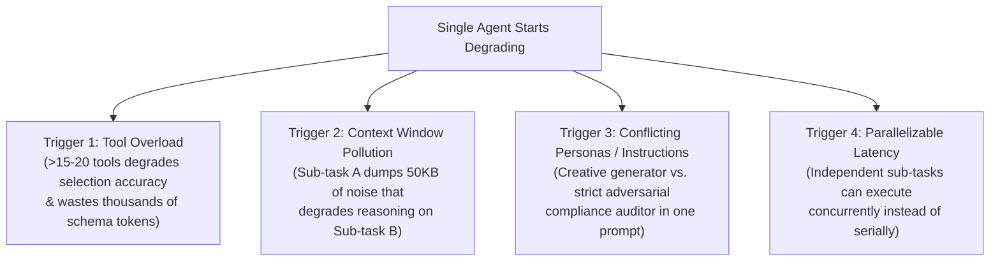
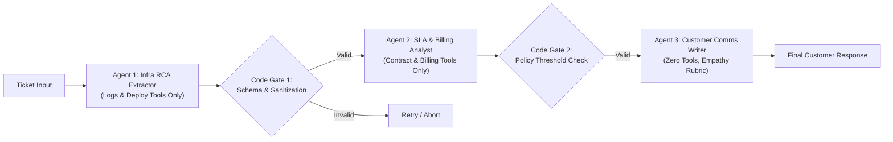
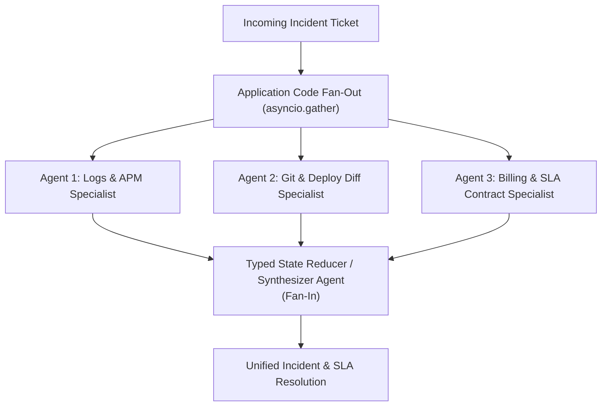
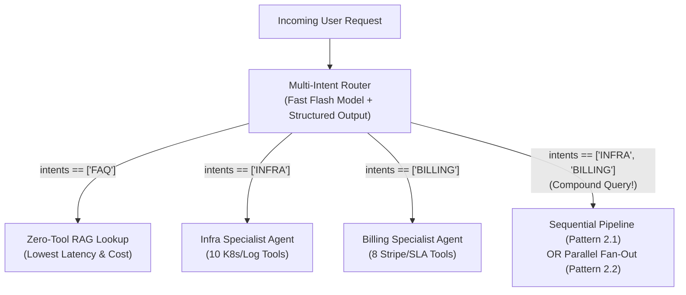

# Chapter 3 (Intermediate — Part 1): Deterministic Multi-Agent Workflows

[⬅️ Previous: Chapter 2 — Single-Agent Loops](./chapter-02-single-agent-loops.md) | [📚 Book Index](./README.md) | [Next: Chapter 4 — Dynamic & Hierarchical Orchestration ➡️](./chapter-04-dynamic-and-hierarchical-orchestration.md)

---

## 3.1 Why Split into Multiple Agents? (The 4 Architectural Triggers)

One of the most common mistakes in AI engineering is creating a 10-agent system when a single agent with 5 tools would perform faster, cheaper, and more reliably.

Before splitting a single agent into multiple agents, verify that you have hit at least one of these **Four Multi-Agent Triggers**:



When you do cross the threshold into multi-agent design, **always start with Deterministic Multi-Agent Workflows** where **application code** owns the orchestration graph between specialized agents.

---

## Pattern 2.1: Sequential Chaining / Pipeline (The Assembly Line)
*A fixed linear sequence of specialized agents separated by deterministic validation gates.*

### Architecture
Application code invokes a strict pipeline of specialized agents: $\text{Agent}_1 \rightarrow \text{Code Gate}_1 \rightarrow \text{Agent}_2 \rightarrow \text{Code Gate}_2 \rightarrow \text{Agent}_3$. Each agent has a narrow system prompt, only the tools required for its stage, and a strict output schema (`Pydantic` / JSON Schema).



### Why This Architecture?
* **Defeats Compound Reliability Decay ($R = r^N$):** Recall from Chapter 1 that an unverified 5-stage chain with $r = 0.90$ has only $0.90^5 = 59\%$ reliability. Inserting **Deterministic Code Gates** (`G1`, `G2`) between stages catches malformed outputs, missing fields, or policy violations *before* they corrupt downstream agents—resetting per-stage reliability near $1.0$.
* **Hard Context & Security Boundaries:** `Agent 3` (which speaks to external customers) never sees the raw internal stack traces, database credentials, or internal IP addresses processed by `Agent 1`—it only receives the sanitized `RCAReport` and `SLADecision` structs.
* **Trade-offs & Failure Modes:**
  * **Serial Latency ($L = \sum L_i$):** Cannot parallelize stages because Stage $i+1$ depends on Stage $i$'s output.
  * **No Dynamic Backtracking:** If `Agent 3` realizes `Agent 1` missed a log query, a strictly linear pipeline cannot loop back unless upgraded to a cyclic graph (Chapter 4).

### Production-Grade Framework-Agnostic Pseudocode
```python
class RCAReport(BaseModel):
    service: str
    root_cause_summary: str
    downtime_minutes: int = Field(ge=0, le=1440)

class SLADecision(BaseModel):
    eligible_for_credit: bool
    credit_amount_usd: float = Field(ge=0.0)
    policy_citation: str

def sequential_support_pipeline(ticket: str) -> str:
    # Stage 1: Infra Specialist extracts structured RCA
    rca: RCAReport = infra_agent.run_structured(ticket, schema=RCAReport)

    # Code Gate 1: Deterministic sanitization (strip any accidental internal IPs)
    rca.root_cause_summary = redact_internal_ips(rca.root_cause_summary)

    # Stage 2: Billing Specialist receives ONLY the sanitized RCAReport JSON
    sla: SLADecision = billing_agent.run_structured(rca.model_dump_json(), schema=SLADecision)

    # Code Gate 2: Hard programmatic invariant check
    if rca.downtime_minutes < 45 and sla.credit_amount_usd > 0:
        raise ValueError("Invariant violation: Automatic credit approved for <45m downtime.")

    # Stage 3: Comms Specialist drafts customer response
    return comms_agent.run(f"RCA: {rca.model_dump_json()}\nSLA: {sla.model_dump_json()}")
```

### Runtime Execution Trace (Running Scenario)
1. **`infra_agent`** queries deployment and error logs $\rightarrow$ outputs `RCAReport(service="checkout-service", root_cause_summary="Deploy #842 reduced DB pool to 5", downtime_minutes=42)`.
2. **Code Gate 1** validates Pydantic bounds (`0 <= 42 <= 1440`) and scrubs internal hostnames.
3. **`billing_agent`** takes the 3-field `RCAReport`, checks the customer's contract, and outputs `SLADecision(eligible_for_credit=False, credit_amount_usd=0.0, policy_citation="Section 4.1: >45m required")`.
4. **Code Gate 2** verifies business invariants in $0.01\text{ms}$.
5. **`comms_agent`** synthesizes both validated structs into a clear customer email.

### Distinct Industry Examples
* **Software Spec-to-Test Pipeline:** Product Spec Agent $\rightarrow$ API Schema Designer Agent $\rightarrow$ Implementation Coder Agent $\rightarrow$ Unit Test Generator Agent.
* **Clinical Note Processing Pipeline:** Medical Scribe Agent (Audio transcript $\rightarrow$ SOAP Note) $\rightarrow$ ICD-10 Coding Agent $\rightarrow$ Prior-Authorization Form Agent.

---

## Pattern 2.2: Parallelization (Sectioning & Voting Ensembles)
*Fan-Out to concurrent independent agents in parallel, then Fan-In via a reducer or synthesizer.*

### Architecture
Application code dispatches work across $M$ agents concurrently (`asyncio.gather`) and merges their outputs. Comes in two distinct architectural variants:
1. **Sectioning (Divide & Conquer):** Each parallel agent is a **different specialist** evaluating a *different dimension or slice* of the problem concurrently.
2. **Voting / Self-Consistency Ensemble:** Multiple agents run the **exact same task** (using diverse prompts, temperatures, or model families) and a programmatic majority vote or judge selects the consensus output.



### Why This Architecture?
* **Wall-Clock Latency Collapse:** Reduces latency from $\sum_{i=1}^M L_i$ to $\max_{i}(L_i) + L_{\text{synth}}$.
* **Uncorrelated Attention Windows (Sectioning):** When a single code-review agent is asked to check for security, performance, AND style in one pass, attention dilution causes it to focus on superficial style issues and miss deep security flaws. Running 3 dedicated specialist agents in parallel gives each dimension 100% of a clean attention window.
* **Variance Reduction (Voting):** For high-stakes classification (e.g., content safety or medical triage), a 3-model ensemble vote eliminates single-sample hallucination spikes.
* **Trade-offs & Failure Modes:**
  * **Strict Independence Requirement:** Branches **cannot depend on each other's runtime findings**. If `BillingAgent` needs to know the exact `downtime_minutes` found by `LogAgent` before it can query the billing table, they cannot run in a single parallel pass—instead, `BillingAgent` can fetch the *contract rules* in parallel while `LogAgent` fetches *downtime*, and the **Synthesizer** evaluates the threshold!

### Production-Grade Framework-Agnostic Pseudocode
```python
async def parallel_incident_triage(ticket: str) -> str:
    # Fan-Out: All 3 specialists execute concurrently because their queries are independent:
    # - Log agent finds how long the 503 outage lasted
    # - Deploy agent finds what changed in yesterday's deploy
    # - Contract agent fetches the customer's SLA tier rules
    log_report, deploy_report, sla_rules = await asyncio.gather(
        log_agent.run_async(ticket),
        deploy_agent.run_async(ticket),
        contract_agent.run_async(ticket),
        return_exceptions=True,  # Prevent 1 slow/failed branch from cancelling the other 2!
    )
    # Fan-In: Synthesizer reconciles findings (handling any partial branch failure gracefully)
    return await synthesizer_agent.run_async(
        f"Ticket: {ticket}\nLogs: {log_report}\nDeploys: {deploy_report}\nSLA Rules: {sla_rules}"
    )
```

> [!TIP]
> **Always use `return_exceptions=True` (or per-branch timeouts) in Parallel Fan-Outs:** Without it, if 1 of 4 parallel agents hits a transient API timeout, `asyncio.gather` cancels the other 3 healthy branches and wastes all their token spend.

### Runtime Execution Trace (Running Scenario)
1. **Fan-Out ($t = 0.0\text{s}$):**
   * `log_agent` queries Prometheus/Loki for 503 window ($2.1\text{s}$) $\rightarrow$ returns `42m downtime (14:02-14:44 UTC)`.
   * `deploy_agent` inspects yesterday's git diffs ($1.8\text{s}$) $\rightarrow$ returns `Deploy #842 lowered DB pool from 50 to 5`.
   * `contract_agent` looks up customer's SLA contract ($1.1\text{s}$) $\rightarrow$ returns `Enterprise Tier requires >45m downtime for 10% credit`.
2. **Fan-In ($t = 2.1\text{s}$):** Total data-gathering time is **$2.1\text{s}$** (vs. $5.0\text{s}$ sequentially).
3. **`synthesizer_agent`** compares `42m` against the `>45m` contract rule and drafts the complete response.

---

## Pattern 2.3: Intent Routing / Triage (Classifier–Dispatcher)
*Classify the incoming request once and dispatch to the single best-suited specialist or multi-branch sub-workflow.*

### Architecture
A fast, lightweight **Router** (a small LLM emitting structured output, an embedding similarity router, or a fine-tuned classifier) inspects the user query and dispatches execution to the appropriate downstream specialist(s).



### Why This Architecture?
* **Prevents Tool Overload:** Instead of binding 60 tools across 5 departments to one agent, each specialist agent only receives the 6–10 tools relevant to its domain.
* **Dramatic Cost & Latency Tiering:** In most production traffic, 60–75% of queries are routine FAQs or simple lookups. Routing those to a fast, single-pass RAG chain saves $80\%+$ of compute budget for the 25% of complex tickets that genuinely need multi-step agent loops.
* **Critic's Fix — Solving the Multi-Intent Failure Mode:**
  * *The Trap:* A naive router defined as `intent: Literal["INFRA", "BILLING", "FAQ"]` can only pick **one** bucket. When a user asks our Running Scenario (*"Why did my service throw 503s [INFRA], and can I get an SLA credit [BILLING]?"*), a single-choice router drops half the user's question!
  * *The Solution:* Define the router schema with **`intents: list[IntentEnum]`** (multi-label classification). If `len(intents) == 1`, route directly to that specialist; if `len(intents) > 1`, dispatch to a **Sequential Pipeline (2.1)**, **Parallel Fan-Out (2.2)**, or **Supervisor (3.3)** covering all detected intents.

### Production-Grade Framework-Agnostic Pseudocode
```python
class RouteClassification(BaseModel):
    intents: list[Literal["INFRA", "BILLING", "FAQ"]] = Field(min_length=1)
    confidence: float = Field(ge=0.0, le=1.0)

async def multi_intent_router(query: str) -> str:
    route: RouteClassification = fast_router_llm.generate_structured(
        f"Classify all distinct user intents present in: {query}", schema=RouteClassification
    )
    if route.confidence < 0.6:
        return await human_triage_escalation(query)

    intent_set = set(route.intents)
    if intent_set == {"FAQ"}:
        return await fast_rag_lookup(query)
    if intent_set == {"INFRA"}:
        return await infra_agent.run_async(query)
    if intent_set == {"BILLING"}:
        return await billing_agent.run_async(query)

    # Compound multi-intent query (e.g., {"INFRA", "BILLING"}) -> Fan out or run pipeline!
    return await parallel_incident_triage(query)
```

---

## Chapter 3 Summary Comparison

| Deterministic Pattern | Topology | Wall-Clock Latency | How Context Moves | Best Used When... | Key Pitfall to Avoid |
| :--- | :--- | :--- | :--- | :--- | :--- |
| **2.1 Sequential Chain** | $A \rightarrow \text{Gate} \rightarrow B \rightarrow \text{Gate} \rightarrow C$ | $\sum_{i=1}^N L_i$ | Structured schema handoff (`Pydantic`). | Multi-stage transformations where Stage $i+1$ depends on Stage $i$'s output. | Omitting validation gates between stages (causes $r^N$ reliability decay). |
| **2.2 Parallelization** | Fan-Out $[A \parallel B \parallel C] \rightarrow \text{Synth}$ | $\max_i(L_i) + L_{\text{synth}}$ | Independent inputs $\rightarrow$ merged reducer state. | Independent diagnostic slices (Sectioning) or consensus safety checks (Voting). | Running tasks in parallel that actually have a hidden runtime data dependency. |
| **2.3 Intent Router** | Classifier $\rightarrow$ Branch $k$ | $L_{\text{router}} + L_{\text{branch}}$ | Raw query routed to chosen specialist(s). | Partitioning $>20$ tools across domains and tiering cheap vs. complex traffic. | Using a single-label enum when users ask compound multi-intent questions. |

---

[⬅️ Previous: Chapter 2 — Single-Agent Loops](./chapter-02-single-agent-loops.md) | [📚 Book Index](./README.md) | [Next: Chapter 4 — Dynamic & Hierarchical Orchestration ➡️](./chapter-04-dynamic-and-hierarchical-orchestration.md)
