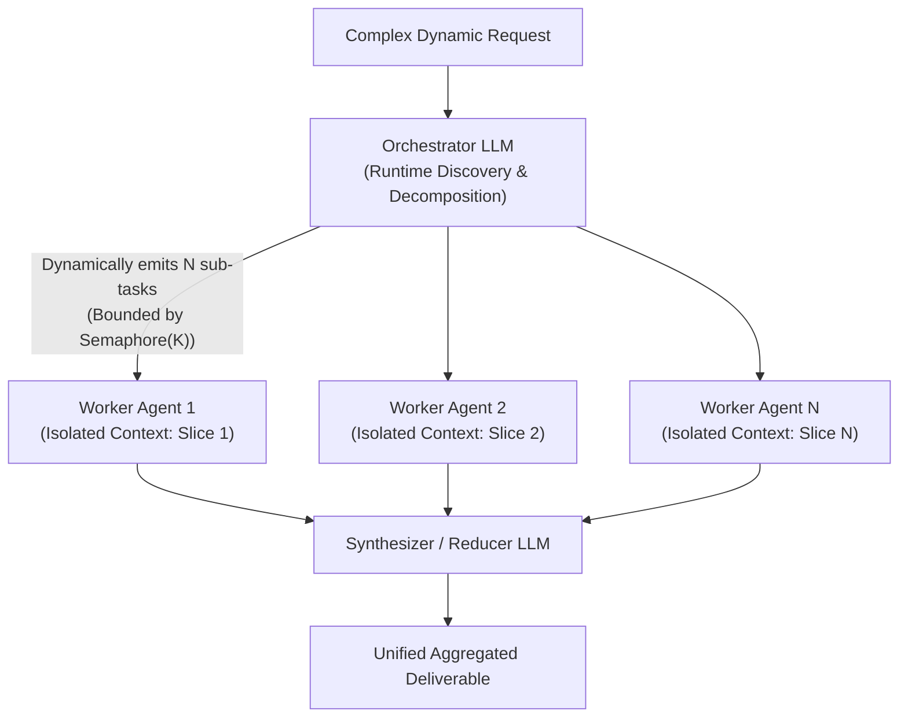
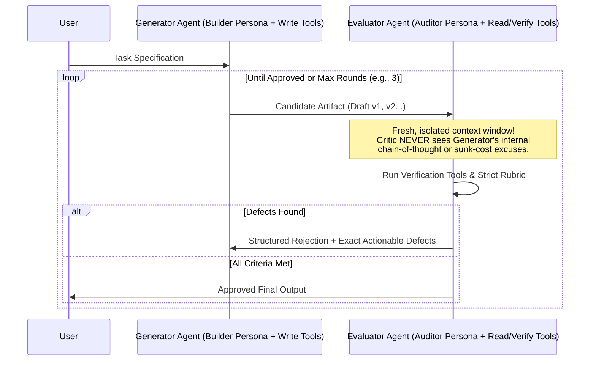
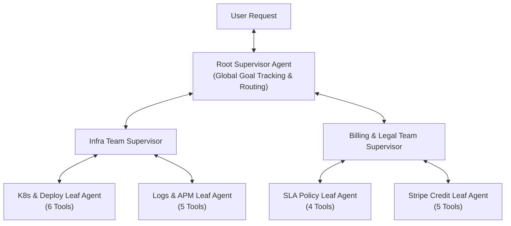

# Chapter 4 (Intermediate — Part 2): Dynamic & Hierarchical Multi-Agent Orchestration

[⬅️ Previous: Chapter 3 — Deterministic Workflows](./chapter-03-deterministic-multi-agent-workflows.md) | [📚 Book Index](./README.md) | [Next: Chapter 5 — Decentralized & Emergent Topologies ➡️](./chapter-05-decentralized-and-emergent-topologies.md)

---

In Chapter 3, application code knew the exact graph structure at compile time. What happens when **the number of parallel sub-tasks, the sequence of domain specialists, or the number of revision cycles cannot be known until runtime**? We cross into **Dynamic Multi-Agent Orchestration**, where an LLM acts as the runtime orchestrator, critic, or supervisor.

---

## Pattern 3.1: Orchestrator–Workers (Dynamic Map-Reduce)
*An Orchestrator LLM dynamically decomposes a problem at runtime into $N$ independent sub-tasks and spawns isolated Worker Agents in parallel.*

### Architecture
While visually similar to Parallelization (Pattern 2.2), **Orchestrator–Workers** differs in one fundamental way: **the parallel branches are not hardcoded at compile time**. The **Orchestrator LLM** inspects the problem (often after a preliminary discovery tool call), decides dynamically whether there are 2, 7, or 20 sub-tasks, dispatches a **Worker Agent** per sub-task under a bounded concurrency semaphore, and aggregates their structured outputs in a **Reducer / Synthesizer**.



### Why This Architecture?
* **Why use it over Static Parallelization (Pattern 2.2):** In static parallelization, you hardcode `asyncio.gather(log_agent, deploy_agent, billing_agent)`. But if a user says *"Audit every microservice that depends on `auth-service`"*, or *"Refactor every file in our repository that imports `legacy_db`"*, you don't know which or how many services/files exist until the Orchestrator discovers them at runtime.
* **Defeats the $O(K^2)$ Context Tax:** If one agent tried to refactor 15 files sequentially in one prompt window, by File #12 its context window would hold 80,000 tokens of prior diffs and test logs. Spawning 15 isolated **Worker Agents** gives each file a pristine 4,000-token context window.
* **Trade-offs & Failure Modes:**
  * **Runaway Fan-Out Bomb:** Without a hard `max_subtasks` schema limit and an `asyncio.Semaphore` concurrency cap, an Orchestrator might hallucinate 200 sub-tasks and immediately exhaust your API rate limit (HTTP 429).

### Production-Grade Framework-Agnostic Pseudocode
```python
class DynamicDecomposition(BaseModel):
    # Hard schema cap prevents the LLM from spawning 500 workers at once
    subtasks: list[str] = Field(min_length=1, max_length=25)

async def orchestrator_workers(
    user_request: str, max_concurrent_workers: int = 5
) -> str:
    # 1. MAP: Orchestrator dynamically decomposes request into N independent sub-tasks
    plan: DynamicDecomposition = orchestrator_llm.generate_structured(
        f"Decompose into independent parallel worker tasks: {user_request}",
        schema=DynamicDecomposition,
    )
    # 2. EXECUTE: Bounded concurrency via Semaphore prevents API rate-limit exhaustion
    sem = asyncio.Semaphore(max_concurrent_workers)

    async def run_bounded_worker(subtask: str) -> str:
        async with sem:
            return await worker_agent.run_async(subtask)

    worker_reports = await asyncio.gather(
        *[run_bounded_worker(task) for task in plan.subtasks],
        return_exceptions=True,
    )
    # 3. REDUCE: Synthesize all worker outputs
    return await synthesizer_llm.generate_async(
        f"Request: {user_request}\nWorker Reports: {list(zip(plan.subtasks, worker_reports))}"
    )
```

### Runtime Execution Trace (Running Scenario Evolution)
* **Evolved Scenario:** *"All 4 of my regional clusters (`us-east`, `us-west`, `eu-central`, `ap-south`) reported intermittent 503s over the last 24 hours. Find the root cause in each region and compute my total SLA credit."*
1. **Orchestrator (Map):** Emits 4 dynamic regional investigation tasks (`subtasks = ["Investigate us-east 503s", "Investigate us-west 503s", "Investigate eu-central 503s", "Investigate ap-south 503s"]`).
2. **Workers (Execute):** 4 isolated Worker Agents run concurrently—each querying logs and deploys *only* for its assigned region so logs never mix across regions.
3. **Synthesizer (Reduce):** Receives 4 concise regional reports (`us-east`: 42m DB pool issue; `eu-central`: 12m BGP flap; `us-west` & `ap-south`: 0m server 503s, client-side firewall block) and calculates the exact regional SLA credits.

---

## Pattern 3.2: Evaluator–Optimizer (Generator–Critic / Adversarial Loop)
*Two distinct agents—a Builder (Generator) and an Adversarial Auditor (Evaluator)—iterating in a loop with isolated context windows.*

### Architecture
While Pattern 1.3 (Reflexion) asks a single agent to critique its own work, **Evaluator–Optimizer** separates the **Generator Agent** and the **Evaluator (Critic) Agent** into two completely distinct agents with **separate context windows**, **opposing system personas**, **asymmetric tool permissions**, and often **different model families**.



### Why This Architecture?
* **Why use two separate agents instead of Single-Agent Self-Reflection (Pattern 1.3)?**
  1. **Zero Self-Confirmation Bias:** When a single LLM sees its own prior chain-of-thought reasoning in the message history, attention priors bias it to defend its initial assumptions. A separate **Critic Agent** receives *only* the specification and the candidate artifact in a clean context window.
  2. **Asymmetric Least-Privilege Tools:** The Generator can be given code-writing or drafting tools, while the Critic is given read-only audit tools (`verify_log_timestamp`, `run_security_scanner`, `check_legal_clause`).
  3. **Heterogeneous Model Auditing:** Running the Generator on Model Family A (e.g., Gemini) and the Critic on Model Family B (e.g., Claude) catches correlated model blind spots.
* **Trade-offs & Failure Modes:**
  * **Nitpicking Loop:** Without an explicit severity threshold (e.g., *"Approve if `blocking_defects == []`, even if minor style suggestions remain"*), an overly pedantic Critic will reject every draft until `max_rounds` is exhausted.

### Production-Grade Framework-Agnostic Pseudocode
```python
class AuditVerdict(BaseModel):
    blocking_defects: list[str]  # Empty list means APPROVED
    minor_suggestions: list[str]

def evaluator_optimizer(task_spec: str, max_rounds: int = 3) -> str:
    candidate = generator_agent.run(f"Create artifact meeting spec:\n{task_spec}")

    for round_idx in range(max_rounds):
        # Critic runs in a FRESH context: sees ONLY task_spec + candidate
        verdict: AuditVerdict = critic_agent.run_structured(
            f"Strictly audit this candidate against spec.\nSpec: {task_spec}\nCandidate:\n{candidate}",
            schema=AuditVerdict,
        )
        if not verdict.blocking_defects:  # Approved! Stop iterating even if minor notes exist
            return candidate

        candidate = generator_agent.run(
            f"Spec: {task_spec}\nPrevious Draft:\n{candidate}\n"
            f"Fix these MANDATORY blocking defects:\n{verdict.blocking_defects}"
        )
    raise RuntimeError(f"Artifact failed Critic audit after {max_rounds} rounds.")
```

---

## Pattern 3.3: Hierarchical Supervisor (Hub-and-Spoke & Multi-Level Trees)
*A central Supervisor Agent acts as a dynamic project manager coordinating a team of domain-specialist sub-agents.*

### Architecture
Instead of application code hardcoding the order of specialists (like Chapter 3), a **Supervisor Agent** owns the high-level orchestration loop. At each turn, the Supervisor inspects the current state, decides which **Specialist Sub-Agent** to invoke next, evaluates that specialist's structured report, and decides whether to invoke another specialist or synthesize the final response. For enterprise systems with $50\text{–}100+$ tools, this scales into a **Multi-Level Tree** (`Root Supervisor -> Team Supervisors -> Leaf Specialist Agents`).



### Two Architectural Implementation Patterns for a Supervisor

| Implementation Style | How It Works | Pros | Cons |
| :--- | :--- | :--- | :--- |
| **1. Agents-as-Tools (`AgentTool`)** | Each specialist sub-agent is wrapped as a callable tool (`call_infra_agent(task: str) -> str`). The Supervisor is simply a standard ReAct agent whose tools happen to be other agents. | Can call multiple sub-agents in parallel in a single turn; sub-agent's internal tool calls are 100% hidden from the Supervisor. | Sub-agent cannot easily talk directly to the end-user without passing back through the Supervisor. |
| **2. State-Graph Router Node** | Supervisor is a graph node that inspects shared `State` and emits `next_node: Literal["infra", "billing", "FINISH"]`. Every specialist node has a return edge back to `Supervisor`. | All nodes read/write directly to a shared typed `State` object (preventing lossy text summarization). | Requires explicit graph state definitions (`LangGraph` style). |

### Why This Architecture?
* **Handles Emergent Cross-Domain Dependencies:** When `InfraAgent` investigates a 503 error and discovers the root cause wasn't a code bug at all, but an **expired credit card that triggered an automatic quota suspension**, a hardcoded pipeline fails. A **Supervisor** reads `InfraAgent`'s report and dynamically pivots to `BillingAgent`!
* **Scales Past the 20-Tool Barrier:** By grouping 80 tools into 10 leaf agents (8 tools each) under 3 team supervisors, no single LLM ever sees more than 8–10 tools in its prompt.
* **Critic's Fix — Defeating the "Telephone Game" (Lossy Summarization):**
  * *The Trap:* In a 3-level hierarchy, if a Leaf Agent returns free-text prose to a Mid-Level Supervisor, which re-summarizes it in prose for the Root Supervisor, critical constraints, exact timestamps, or citations get lost or distorted ("Telephone Game").
  * *The Solution:* Combine Supervisor routing with a **Typed Shared State (Scratchpad)**. Leaf agents write verified structured facts (`state.verified_facts["downtime_mins"] = 42`) directly to the shared state dictionary so the Root Supervisor reads lossless structured data.

### Production-Grade Framework-Agnostic Pseudocode
```python
class SharedIncidentState(BaseModel):
    user_query: str
    verified_facts: dict[str, Any] = {}   # Lossless structured store prevents "Telephone Game"
    execution_log: list[str] = []

class SupervisorStep(BaseModel):
    next_specialist: Literal["infra_agent", "billing_agent", "FINISH"]
    task_instruction: str
    final_answer: Optional[str] = None

def hierarchical_supervisor(query: str, specialists: dict, max_turns: int = 6) -> str:
    state = SharedIncidentState(user_query=query)

    for _ in range(max_turns):
        step: SupervisorStep = supervisor_llm.generate_structured(
            f"State: {state.model_dump_json()}\nChoose next specialist or FINISH.",
            schema=SupervisorStep,
        )
        if step.next_specialist == "FINISH":
            return step.final_answer

        # Specialist executes in isolated scope and returns both prose summary + structured facts
        worker = specialists[step.next_specialist]
        summary, facts_delta = worker.run_with_facts(step.task_instruction, state.verified_facts)
        state.verified_facts.update(facts_delta)  # Lossless state update!
        state.execution_log.append(f"[{step.next_specialist}]: {summary}")

    raise RuntimeError("Supervisor exceeded maximum orchestration turns.")
```

---

## Chapter 4 Summary Comparison

| Dynamic Pattern | Who Decides Topology at Runtime? | Concurrency Profile | Best Used When... | Critical Production Guardrail |
| :--- | :--- | :--- | :--- | :--- |
| **3.1 Orchestrator–Workers** | Orchestrator LLM (Dynamic Map-Reduce) | High ($N$ parallel workers) | $N$ homogenous or sliced sub-tasks are discovered at runtime (multi-file refactor, multi-region audit). | Schema `max_length` on subtasks + `asyncio.Semaphore(K)` concurrency cap. |
| **3.2 Evaluator–Optimizer** | Adversarial Critic LLM | Serial iterative loop | High-compliance or bug-free output needed where single-agent reflection suffers from confirmation bias. | Separate context window for Critic + explicit `blocking_defects` pass condition. |
| **3.3 Hierarchical Supervisor** | Central Supervisor LLM | Serial or Parallel (`AgentTool`) | Multi-domain workflows ($>20\text{–}100$ tools) where Step 2's domain depends on Step 1's findings. | Shared structured state dictionary to prevent "Telephone Game" information loss. |

---

[⬅️ Previous: Chapter 3 — Deterministic Workflows](./chapter-03-deterministic-multi-agent-workflows.md) | [📚 Book Index](./README.md) | [Next: Chapter 5 — Decentralized & Emergent Topologies ➡️](./chapter-05-decentralized-and-emergent-topologies.md)
