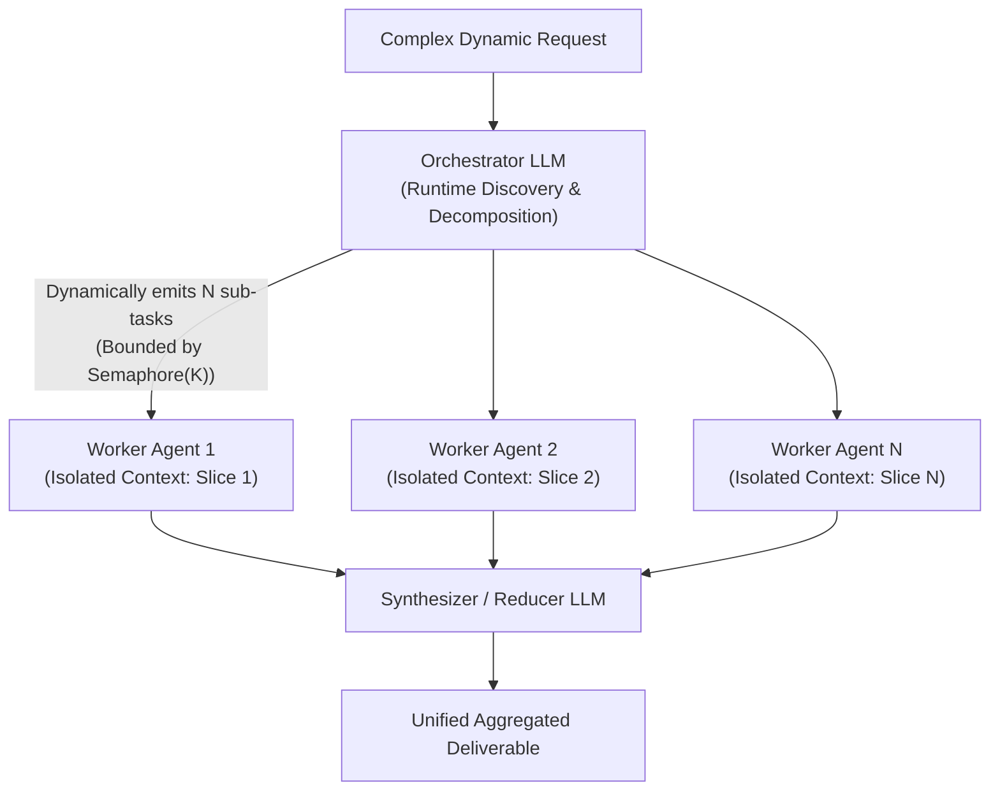
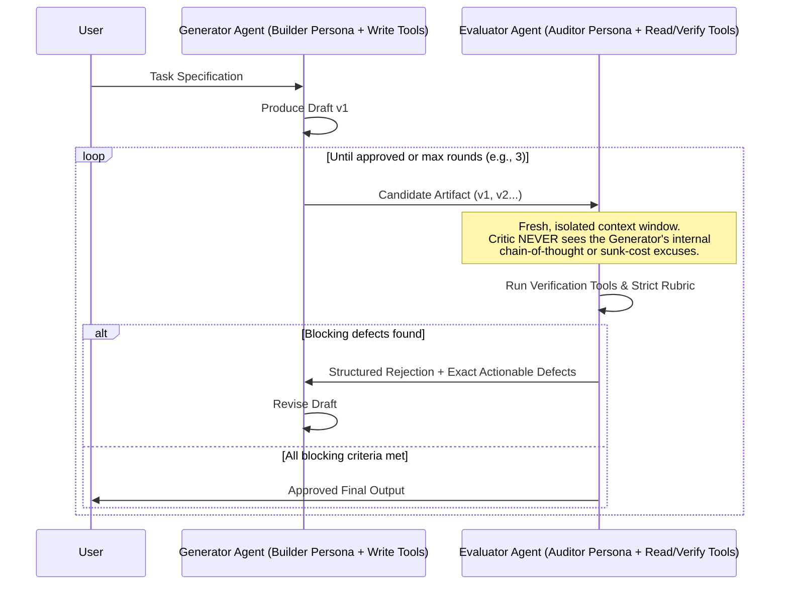
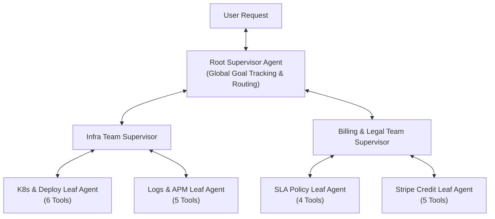

# Chapter 4 (Intermediate — Part 2): Dynamic & Hierarchical Multi-Agent Orchestration

[⬅️ Previous: Chapter 3 — Deterministic Workflows](./chapter-03-deterministic-multi-agent-workflows.md) | [📚 Book Index](./README.md) | [Next: Chapter 5 — Decentralized & Emergent Topologies ➡️](./chapter-05-decentralized-and-emergent-topologies.md)

---

In Chapter 3, application code knew the exact graph structure at compile time. But what if the number of parallel sub-tasks, the sequence of domain specialists, or the number of revision cycles **can't be known until runtime**? Then we cross into **Dynamic Multi-Agent Orchestration**, where an LLM acts as the runtime orchestrator, critic, or supervisor.

Patterns 3.1 and 3.2 are the two remaining workflows from Anthropic's *"Building Effective Agents"* (Dec 2024): **orchestrator–workers** and **evaluator–optimizer**. Pattern 3.3 generalizes orchestrator–workers into a multi-turn, multi-domain **supervisor**.

---

## Pattern 3.1: Orchestrator–Workers (Dynamic Map-Reduce)
*An Orchestrator LLM decomposes a problem at runtime into $N$ independent sub-tasks and spawns isolated Worker Agents in parallel.*

### Architecture
Orchestrator–Workers looks like Parallelization (Pattern 2.2), but differs in one fundamental way: **the parallel branches are not hardcoded at compile time**. The **Orchestrator LLM**:
1. Inspects the problem, often after a preliminary discovery tool call.
2. Decides at runtime whether there are 2, 7, or 20 sub-tasks.
3. Dispatches a **Worker Agent** per sub-task, under a bounded concurrency semaphore.
4. Aggregates the workers' structured outputs in a **Reducer / Synthesizer**.



### Why This Architecture?
* **Why use it over Static Parallelization (Pattern 2.2):** In static parallelization, you hardcode `asyncio.gather(log_agent, deploy_agent, billing_agent)`. Now suppose a user says *"Audit every microservice that depends on `auth-service`"* or *"Refactor every file in our repository that imports `legacy_db`"*. You don't know which services or files exist, or how many, until the Orchestrator discovers them at runtime.
* **Defeats the $O(K^2)$ Context Tax:** Suppose one agent refactors 15 files sequentially in a single context window. By File #12, that window holds ~80,000 tokens of prior diffs and test logs. Spawning 15 isolated **Worker Agents** gives each file a clean context of just a few thousand tokens.
* **Delegation quality is the bottleneck:** Vague sub-task strings ("research X") produce duplicated or missed work. Have the orchestrator emit, for each worker, an **objective**, a **scope boundary** (what *not* to touch), an **expected output format**, and **tool/source guidance**. Anthropic reports these as key lessons from its research system.
* **Trade-offs & Failure Modes:**
  * **Runaway Fan-Out Bomb:** Without a hard `max_length` schema limit, an `asyncio.Semaphore` concurrency cap, and an overall token budget, an Orchestrator might emit 200 sub-tasks and immediately exhaust your API rate limit (HTTP 429) and budget.
  * **Conflicting Implicit Decisions (write-heavy tasks):** Workers that *write* in parallel, such as editing different files of the same refactor, each make unshared choices about naming, interfaces, and error handling. Those choices often clash at merge time. See the reality check below.

### Production-Grade Framework-Agnostic Pseudocode
```python
class Subtask(BaseModel):
    objective: str
    scope: str            # The slice this worker owns (region, file, service...)
    output_format: str    # What the worker must return

class DynamicDecomposition(BaseModel):
    # Hard schema cap: >25 items FAILS validation (it is not silently truncated),
    # so the caller can re-plan with a "merge related subtasks" hint.
    subtasks: list[Subtask] = Field(min_length=1, max_length=25)

WORKER_TIMEOUT_S = 300

async def orchestrator_workers(user_request: str, max_concurrent_workers: int = 5) -> str:
    # 1. MAP: Orchestrator dynamically decomposes request into N independent sub-tasks
    plan: DynamicDecomposition = await orchestrator_llm.generate_structured_async(
        f"Decompose into independent, non-overlapping worker tasks: {user_request}",
        schema=DynamicDecomposition,
    )
    # 2. EXECUTE: Semaphore bounds concurrency (rate limits); timeout bounds slow workers
    sem = asyncio.Semaphore(max_concurrent_workers)

    async def run_bounded_worker(task: Subtask) -> str:
        async with sem:
            try:
                return await asyncio.wait_for(
                    worker_agent.run_async(task.model_dump_json()), timeout=WORKER_TIMEOUT_S
                )
            except Exception as exc:
                return f"[FAILED: {type(exc).__name__}]"

    worker_reports = await asyncio.gather(*(run_bounded_worker(t) for t in plan.subtasks))

    # 3. REDUCE: Synthesize all worker outputs, flagging failed slices explicitly
    report_block = "\n\n".join(
        f"### {t.scope}\n{report}" for t, report in zip(plan.subtasks, worker_reports)
    )
    return await synthesizer_llm.generate_async(
        f"Request: {user_request}\n\nWorker reports:\n{report_block}\n"
        "Call out any FAILED slice instead of guessing its result."
    )
```

> [!TIP]
> **Framework equivalents:** In **LangGraph**, a conditional edge returns a list of `Send("worker", payload)` objects (the map step). A state field with a reducer such as `Annotated[list, operator.add]` collects the results (the reduce step). In **agents-as-tools** SDKs, such as OpenAI Agents SDK's `agent.as_tool(...)`, Claude Agent SDK subagents, or Google ADK's `AgentTool`, the orchestrator model issues one tool call per sub-task, possibly in parallel.

### Runtime Execution Trace (Running Scenario Evolution)
* **Evolved Scenario:** *"All 4 of my regional clusters (`us-east`, `us-west`, `eu-central`, `ap-south`) reported intermittent 503s over the last 24 hours. Find the root cause in each region and compute my total SLA credit."*
1. **Orchestrator (Map):** Emits 4 dynamic regional investigation tasks, e.g., `Subtask(objective="Find root cause and downtime of 503s", scope="us-east only", output_format="RCAReport JSON")`.
2. **Workers (Execute):** 4 isolated Worker Agents run concurrently. Each queries logs and deploys *only* for its assigned region, so logs never mix across regions.
3. **Synthesizer (Reduce):** Receives 4 concise regional reports:
   * `us-east`: 42m DB pool issue.
   * `eu-central`: 12m BGP flap.
   * `us-west` & `ap-south`: 0m of server-side downtime; the 503s came from a client-side firewall block.

   It then hands the per-region numbers to a **deterministic function** that computes the SLA credits. Don't ask an LLM to do contract arithmetic.

### Production Reality Check (Advanced): When Orchestrator–Workers Pays Off
* **The evidence for breadth-first, read-heavy work:** In *"How we built our multi-agent research system"* (June 2025), Anthropic reported the following on its internal research eval:
  * A Claude Opus 4 lead agent with Claude Sonnet 4 subagents outperformed single-agent Opus 4 by **90.2%**.
  * The cost is steep: agents used about **4×** the tokens of a chat interaction, and the multi-agent system about **15×**.
  * In their BrowseComp analysis, token usage alone explained about **80%** of the performance variance.

  Takeaway: much of the gain comes from spending more tokens in parallel. Reserve the pattern for high-value tasks.
* **The counter-argument for write-heavy work:** Cognition's *"Don't Build Multi-Agents"* (Walden Yan, June 2025) shows how parallel workers with fragmented context make conflicting implicit decisions. Its prescription: share full context and traces, and keep consequential actions on a single thread.
* **Practical rule:**
  * Use orchestrator–workers freely for **read-only fan-out**: research, audits, log investigations, and per-region diagnostics.
  * For **parallel writes** (multi-file refactors), give every worker the same written contract: interface signatures, naming, and error-handling conventions. Then run an **integration verification step** (full build + test suite) after the reduce. Alternatively, keep the writes on a single agent and parallelize only the analysis.
  * Scale the fan-out to the task: simple questions should get 1 worker, not 10.

---

## Pattern 3.2: Evaluator–Optimizer (Generator–Critic / Adversarial Loop)
*Two distinct agents, a Builder (Generator) and an Adversarial Auditor (Evaluator), iterating in a loop with isolated context windows.*

### Architecture
Pattern 1.3 (Self-Refinement / Reflexion, Chapter 2) asks a single agent to critique its own work. **Evaluator–Optimizer** instead splits the **Generator Agent** and the **Evaluator (Critic) Agent** into two completely distinct agents, with:
* **separate context windows**,
* **opposing system personas**,
* **asymmetric tool permissions**, and
* often **different model families**.



### Why This Architecture?
* **Why use two separate agents instead of Single-Agent Self-Reflection (Pattern 1.3)?**
  1. **Less Self-Confirmation Bias:** When a single LLM sees its own prior reasoning in the message history, it tends to defend its initial assumptions. A separate **Critic Agent** receives *only* the specification and the candidate artifact, in a clean context window.
  2. **Asymmetric Least-Privilege Tools:** The Generator can be given code-writing or drafting tools, while the Critic is given read-only audit tools (`verify_log_timestamp`, `run_security_scanner`, `check_legal_clause`).
  3. **Heterogeneous Model Auditing:** LLM judges show **self-preference bias**: they recognize and favor their own generations (Panickssery, Bowman & Feng, NeurIPS 2024). Running the Generator on one model family and the Critic on another (e.g., generate with a GPT-class model and audit with a Claude- or Gemini-class model, or with an open-weight Llama/Qwen/Mistral model) reduces both self-preference and correlated blind spots. It doesn't remove them.
* **Ground the Critic, or it adds little:** *"Large Language Models Cannot Self-Correct Reasoning Yet"* (Huang et al., ICLR 2024) found that *intrinsic* self-correction often fails to improve reasoning, and can even degrade it. "Intrinsic" means the model revises its own answer without any external feedback. The Critic's real power comes from **external signals**: unit tests, compilers, schema validators, retrieval-backed citation checks, and policy engines. Run those deterministic checks first and hand their results to the Critic. Modern reasoning ("thinking") models already self-check internally, so an *ungrounded* same-model critique pass adds even less than it used to.
* **Trade-offs & Failure Modes:**
  * **Nitpicking Loop:** An overly pedantic Critic will reject every draft until `max_rounds` is exhausted, unless you set an explicit severity threshold (e.g., *"Approve if `blocking_defects == []`, even if minor style suggestions remain"*).
  * **Oscillation:** Fixing defect A can reintroduce defect B. Pass the defect history to the Generator, and keep the best-scoring candidate as a fallback.

### Production-Grade Framework-Agnostic Pseudocode
```python
class AuditVerdict(BaseModel):
    blocking_defects: list[str]  # Empty list means APPROVED
    minor_suggestions: list[str]

def evaluator_optimizer(task_spec: str, max_rounds: int = 3) -> str:
    candidate = generator_agent.run(f"Create artifact meeting spec:\n{task_spec}")

    for round_idx in range(max_rounds):
        # Ground the Critic: deterministic checks first (tests, linters, schema, citations)
        check_results = run_deterministic_checks(candidate)

        # Critic runs in a FRESH context: sees ONLY task_spec + candidate + check results
        verdict: AuditVerdict = critic_agent.run_structured(
            f"Strictly audit this candidate against spec.\nSpec: {task_spec}\n"
            f"Automated check results:\n{check_results}\nCandidate:\n{candidate}",
            schema=AuditVerdict,
        )
        if not verdict.blocking_defects:  # Approved! Stop iterating even if minor notes exist
            return candidate
        if round_idx == max_rounds - 1:   # Don't pay for a revision nobody will audit
            break

        candidate = generator_agent.run(
            f"Spec: {task_spec}\nPrevious Draft:\n{candidate}\n"
            f"Fix these MANDATORY blocking defects:\n{verdict.blocking_defects}"
        )
    raise RuntimeError(f"Artifact failed Critic audit after {max_rounds} rounds.")
```

> [!NOTE]
> **Framework equivalents:** In LangGraph, this is a two-node cycle with a conditional edge back to the generator. Google ADK's `LoopAgent(sub_agents=[generator, critic], max_iterations=3)` runs this loop; the critic ends it early by calling an exit tool that sets `tool_context.actions.escalate = True`. In minimalist SDKs without a loop primitive (e.g., OpenAI Agents SDK, Claude Agent SDK), it is simply the plain loop above wrapped around two agent calls.

---

## Pattern 3.3: Hierarchical Supervisor (Hub-and-Spoke & Multi-Level Trees)
*A central Supervisor Agent acts as a dynamic project manager coordinating a team of domain-specialist sub-agents.*

### Architecture
In Chapter 3, application code hardcoded the order of specialists. Here, a **Supervisor Agent** owns the high-level orchestration loop instead. At each turn, the Supervisor:
1. Inspects the current state.
2. Decides which **Specialist Sub-Agent** to invoke next.
3. Evaluates that specialist's structured report.
4. Either invokes another specialist or synthesizes the final response.

For enterprise systems with $50\text{–}100+$ tools, this scales into a **Multi-Level Tree** (`Root Supervisor -> Team Supervisors -> Leaf Specialist Agents`).



### Two Architectural Implementation Patterns for a Supervisor

| Implementation Style | How It Works | Pros | Cons |
| :--- | :--- | :--- | :--- |
| **1. Agents-as-Tools** | Each specialist sub-agent is wrapped as a callable tool (`call_infra_agent(task: str) -> str`). The Supervisor is simply a standard ReAct agent whose tools happen to be other agents. Examples: OpenAI Agents SDK `agent.as_tool(...)`, LangChain's "subagents as tools" approach, Google ADK `AgentTool(agent)`. | Can call several sub-agents in one turn (parallel tool calls); sub-agent's internal tool calls stay hidden from the Supervisor's context. | Sub-agent cannot easily talk directly to the end-user without passing back through the Supervisor; returns are usually text unless you enforce a schema. |
| **2. State-Graph Router Node** | Supervisor is a graph node that inspects shared `State` and emits `next_node: Literal["infra", "billing", "FINISH"]`. In LangGraph 1.x, it does this via a conditional edge or by returning `Command(goto="infra", update={...})`. Every specialist node has a return edge back to `Supervisor`. | All nodes read/write a shared typed `State` object (avoiding lossy text summarization); easy to checkpoint and interrupt for HITL. | Requires explicit graph state definitions and reducers for concurrent writes. |

> [!NOTE]
> A third style, in which the supervisor **transfers control** to a specialist that then talks to the user directly, is a *handoff*. Examples: OpenAI Agents SDK `handoffs=[...]`, Microsoft Agent Framework's `HandoffBuilder`, and Google ADK's `sub_agents` with LLM-driven `transfer_to_agent`. Handoffs are covered as Pattern 4.1 in [Chapter 5](./chapter-05-decentralized-and-emergent-topologies.md). Rule of thumb: use **agents-as-tools** when the supervisor must keep ownership and synthesize, and use **handoffs** when the specialist should own the rest of the conversation.

### Why This Architecture?
* **Handles Emergent Cross-Domain Dependencies:** Suppose `InfraAgent` investigates a 503 error and finds the root cause wasn't a code bug at all. It was an **expired credit card that triggered an automatic quota suspension**. A hardcoded pipeline fails here. A **Supervisor** reads `InfraAgent`'s report and dynamically pivots to `BillingAgent`!
* **Scales Past Tool Overload:** Group 80 tools into 10 leaf agents (8 tools each) under 3 team supervisors. Then no single LLM sees more than roughly 8–10 tools in its prompt. The trade-off is extra LLM hops (latency and cost) for every level you add, so prefer the shallowest tree that works.
* **Critic's Fix — Defeating the "Telephone Game" (Lossy Summarization):**
  * *The Trap:* In a 3-level hierarchy, a Leaf Agent returns free-text prose to a Mid-Level Supervisor, which re-summarizes it in prose for the Root Supervisor. Along the way, critical constraints, exact timestamps, or citations get lost or distorted (the "Telephone Game").
  * *The Solution:* Combine Supervisor routing with a **Typed Shared State (Scratchpad)**. Leaf agents write structured facts (`state.verified_facts["downtime_mins"] = 42`) to the shared state, so the Root Supervisor reads exact values instead of paraphrases.
  * *Caveat:* Structured state is only as good as what is written into it. Validate each update before merging: allow only the keys a specialist owns, check types and ranges, and record provenance (which agent, which tool call). Otherwise a hallucinated "fact" becomes lossless and authoritative.

### Production-Grade Framework-Agnostic Pseudocode
```python
class SharedIncidentState(BaseModel):
    user_query: str
    verified_facts: dict[str, Any] = Field(default_factory=dict)  # Structured store prevents "Telephone Game"
    execution_log: list[str] = Field(default_factory=list)

class SupervisorStep(BaseModel):
    next_specialist: Literal["infra_agent", "billing_agent", "FINISH"]
    task_instruction: str
    final_answer: Optional[str] = None

def hierarchical_supervisor(query: str, specialists: dict, max_turns: int = 6) -> str:
    state = SharedIncidentState(user_query=query)

    for _ in range(max_turns):
        step: SupervisorStep = supervisor_llm.generate_structured(
            f"State: {state.model_dump_json()}\nChoose next specialist or FINISH.",
            schema=SupervisorStep,
        )
        if step.next_specialist == "FINISH":
            return step.final_answer or synthesize_from_state(state)

        # Specialist executes in isolated scope and returns both prose summary + structured facts
        worker = specialists[step.next_specialist]
        summary, facts_delta = worker.run_with_facts(step.task_instruction, state.verified_facts)
        # Validate before merging: owned keys only, typed values, provenance attached
        facts_delta = validate_facts(facts_delta, owner=step.next_specialist)
        state.verified_facts.update(facts_delta)
        state.execution_log.append(f"[{step.next_specialist}]: {summary}")

    raise RuntimeError("Supervisor exceeded maximum orchestration turns.")
```

---

## Chapter 4 Summary Comparison

| Dynamic Pattern | Who Decides Topology at Runtime? | Concurrency Profile | Best Used When... | Critical Production Guardrail |
| :--- | :--- | :--- | :--- | :--- |
| **3.1 Orchestrator–Workers** | Orchestrator LLM (Dynamic Map-Reduce) | High ($N$ parallel workers) | $N$ homogeneous or sliced sub-tasks are discovered at runtime (multi-region audit, broad research, multi-file analysis). | Schema `max_length` on subtasks + `asyncio.Semaphore(K)` + per-worker timeouts + token budget; shared contract + integration tests for parallel writes. |
| **3.2 Evaluator–Optimizer** | Adversarial Critic LLM | Serial iterative loop | High-compliance or bug-free output needed where single-agent reflection suffers from confirmation bias. | Separate context window for Critic + grounded deterministic checks + explicit `blocking_defects` pass condition. |
| **3.3 Hierarchical Supervisor** | Central Supervisor LLM | Serial or Parallel (agents-as-tools) | Multi-domain workflows ($>20\text{–}100$ tools) where Step 2's domain depends on Step 1's findings. | Validated, shared structured state to prevent "Telephone Game" information loss + `max_turns` cap. |

---

[⬅️ Previous: Chapter 3 — Deterministic Workflows](./chapter-03-deterministic-multi-agent-workflows.md) | [📚 Book Index](./README.md) | [Next: Chapter 5 — Decentralized & Emergent Topologies ➡️](./chapter-05-decentralized-and-emergent-topologies.md)
