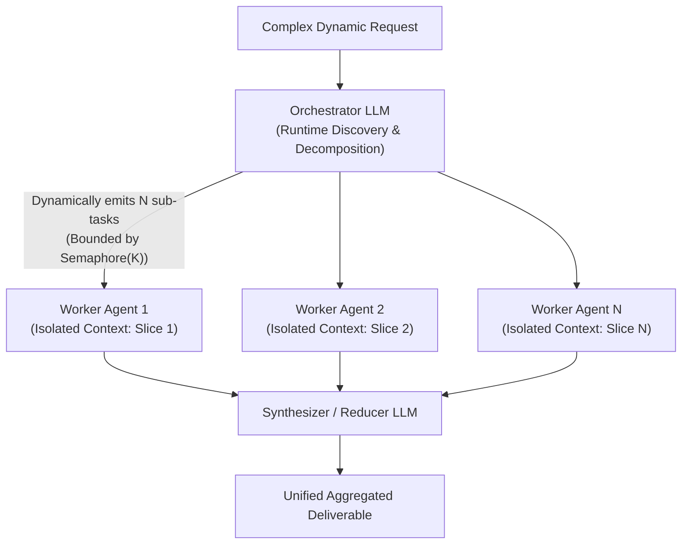
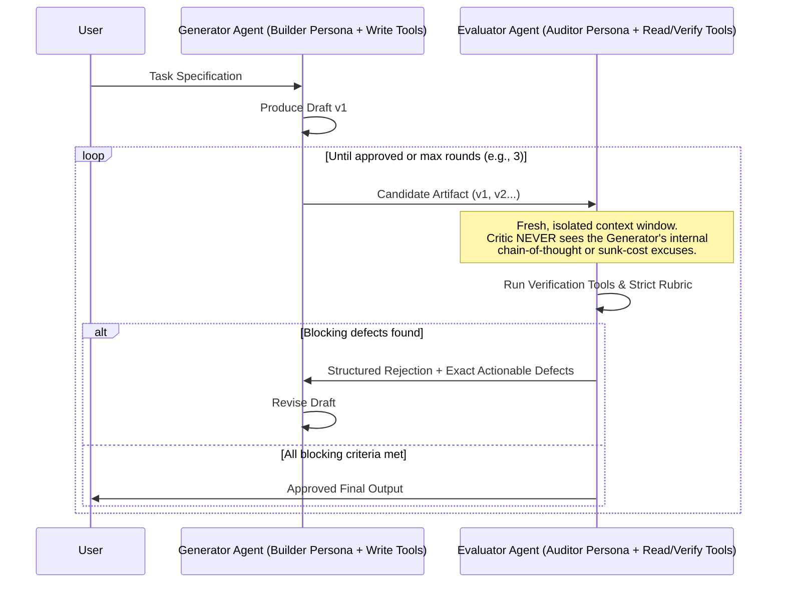
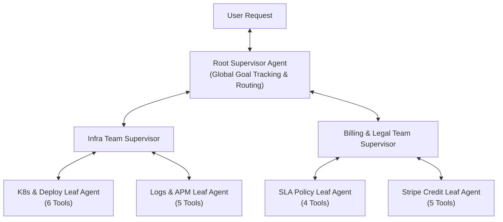

# Chapter 4 (Intermediate, Part 2): Dynamic and Hierarchical Multi-Agent Orchestration

[← Previous: Chapter 3 — Deterministic Workflows](./chapter-03-deterministic-multi-agent-workflows.md) | [Book Index](./README.md) | [Next: Chapter 5 — Decentralized & Emergent Topologies →](./chapter-05-decentralized-and-emergent-topologies.md)

---

In Chapter 3, application code knew the exact graph at compile time. Sometimes you can't know that in advance: the number of parallel sub-tasks, the order of domain specialists, or the number of revision cycles only becomes clear at runtime. That's where **dynamic multi-agent orchestration** comes in, with an LLM acting as the runtime orchestrator, critic, or supervisor.

Patterns 3.1 and 3.2 are the two remaining workflows from Anthropic's *"Building Effective Agents"* (Dec 2024): orchestrator–workers and evaluator–optimizer. Pattern 3.3 extends orchestrator–workers into a multi-turn, multi-domain supervisor.

---

## Pattern 3.1: Orchestrator–workers (dynamic map-reduce)
*An orchestrator LLM breaks a problem into $N$ independent sub-tasks at runtime and spawns isolated worker agents in parallel.*

### Architecture
Orchestrator–workers looks like parallelization (Pattern 2.2), with one fundamental difference: the parallel branches aren't hardcoded at compile time. The orchestrator LLM:
1. Inspects the problem, often after a preliminary discovery tool call.
2. Decides at runtime whether there are 2, 7, or 20 sub-tasks.
3. Dispatches a worker agent per sub-task, under a bounded concurrency semaphore.
4. Aggregates the workers' structured outputs in a reducer or synthesizer.



### Why it works
With static parallelization you hardcode `asyncio.gather(log_agent, deploy_agent, billing_agent)`. That breaks down when a user says *"Audit every microservice that depends on `auth-service`"* or *"Refactor every file in our repository that imports `legacy_db`"*. You don't know which services or files exist, or how many, until the orchestrator discovers them at runtime.

It also avoids the $O(K^2)$ context tax. If one agent refactors 15 files sequentially in a single context window, by file #12 that window holds ~80,000 tokens of prior diffs and test logs. Fifteen isolated workers each get a clean context of a few thousand tokens.

In practice, delegation quality is the bottleneck. Vague sub-task strings like "research X" produce duplicated or missed work. Have the orchestrator give each worker an objective, a scope boundary (what not to touch), an expected output format, and guidance on tools and sources. Anthropic reports these as key lessons from its research system.

Two failure modes need guarding against. The first is a runaway fan-out: without a hard `max_length` schema limit, an `asyncio.Semaphore` concurrency cap, and an overall token budget, an orchestrator might emit 200 sub-tasks and immediately exhaust your API rate limit (HTTP 429) and your budget. The second shows up on write-heavy tasks. Workers that write in parallel, say editing different files in the same refactor, each make their own unshared choices about naming, interfaces, and error handling, and those choices often clash at merge time. The reality check below covers this.

### Framework-agnostic pseudocode
```python
class Subtask(BaseModel):
    objective: str
    scope: str            # The slice this worker owns (region, file, service...)
    output_format: str    # What the worker must return

class DynamicDecomposition(BaseModel):
    # Hard schema cap: >25 items FAILS validation (it is not silently truncated),
    # so the caller can re-plan with a "merge related subtasks" hint.
    subtasks: list[Subtask] = Field(min_length=1, max_length=25)

WORKER_TIMEOUT_S = 300

async def orchestrator_workers(user_request: str, max_concurrent_workers: int = 5) -> str:
    # 1. MAP: Orchestrator dynamically decomposes request into N independent sub-tasks
    plan: DynamicDecomposition = await orchestrator_llm.generate_structured_async(
        f"Decompose into independent, non-overlapping worker tasks: {user_request}",
        schema=DynamicDecomposition,
    )
    # 2. EXECUTE: Semaphore bounds concurrency (rate limits); timeout bounds slow workers
    sem = asyncio.Semaphore(max_concurrent_workers)

    async def run_bounded_worker(task: Subtask) -> str:
        async with sem:
            try:
                return await asyncio.wait_for(
                    worker_agent.run_async(task.model_dump_json()), timeout=WORKER_TIMEOUT_S
                )
            except Exception as exc:
                return f"[FAILED: {type(exc).__name__}]"

    worker_reports = await asyncio.gather(*(run_bounded_worker(t) for t in plan.subtasks))

    # 3. REDUCE: Synthesize all worker outputs, flagging failed slices explicitly
    report_block = "\n\n".join(
        f"### {t.scope}\n{report}" for t, report in zip(plan.subtasks, worker_reports)
    )
    return await synthesizer_llm.generate_async(
        f"Request: {user_request}\n\nWorker reports:\n{report_block}\n"
        "Call out any FAILED slice instead of guessing its result."
    )
```

In LangGraph, the map step is a conditional edge that returns a list of `Send("worker", payload)` objects, and a state field with a reducer such as `Annotated[list, operator.add]` collects the results (the reduce step). In agents-as-tools SDKs, such as OpenAI Agents SDK's `agent.as_tool(...)`, Claude Agent SDK subagents, or Google ADK's `AgentTool`, the orchestrator model issues one tool call per sub-task, possibly in parallel.

### Trace through the running scenario
The scenario grows: *"All 4 of my regional clusters (`us-east`, `us-west`, `eu-central`, `ap-south`) reported intermittent 503s over the last 24 hours. Find the root cause in each region and compute my total SLA credit."*
1. Orchestrator (map): emits 4 regional investigation tasks, e.g., `Subtask(objective="Find root cause and downtime of 503s", scope="us-east only", output_format="RCAReport JSON")`.
2. Workers (execute): 4 isolated worker agents run concurrently. Each queries logs and deploys only for its own region, so logs never mix across regions.
3. Synthesizer (reduce): receives 4 short regional reports:
   * `us-east`: 42m DB pool issue.
   * `eu-central`: 12m BGP flap.
   * `us-west` & `ap-south`: 0m of server-side downtime; the 503s came from a client-side firewall block.

   It then passes the per-region numbers to a deterministic function that computes the SLA credits. Don't ask an LLM to do contract arithmetic.

### Reality check (advanced): when orchestrator–workers pays off
For breadth-first, read-heavy work, the evidence is favorable. In *"How we built our multi-agent research system"* (June 2025), Anthropic reported these results on its internal research eval:
* A Claude Opus 4 lead agent with Claude Sonnet 4 subagents outperformed single-agent Opus 4 by 90.2%.
* The cost is steep: agents used about 4× the tokens of a chat interaction, and the multi-agent system about 15×.
* In their BrowseComp analysis, token usage alone explained about 80% of the performance variance.

So much of the gain comes from spending more tokens in parallel. Save the pattern for high-value tasks.

Write-heavy work is a different story. Cognition's *"Don't Build Multi-Agents"* (Walden Yan, June 2025) shows how parallel workers with fragmented context end up making conflicting implicit decisions. Its prescription is to share full context and traces and keep consequential actions on a single thread.

My rule of thumb follows from both:
* Use orchestrator–workers freely for read-only fan-out: research, audits, log investigations, per-region diagnostics.
* For parallel writes such as multi-file refactors, give every worker the same written contract (interface signatures, naming, error-handling conventions), then run an integration verification step (full build + test suite) after the reduce. Or keep the writes on a single agent and parallelize only the analysis.
* Scale the fan-out to the task. A simple question should get 1 worker, not 10.

---

## Pattern 3.2: Evaluator–optimizer (generator and critic)
*Two separate agents, a builder (generator) and an adversarial auditor (evaluator), iterate in a loop with isolated context windows.*

### Architecture
Pattern 1.3 (Self-Refinement / Reflexion, Chapter 2) asks one agent to critique its own work. Evaluator–optimizer splits that job between a **generator agent** and an **evaluator (critic) agent** that are fully separate. They have separate context windows, opposing system personas, and asymmetric tool permissions, and they often run on different model families.



### Why it works
Why bother with two agents instead of single-agent self-reflection (Pattern 1.3)? There are three reasons.

First, there's less self-confirmation bias. When an LLM sees its own earlier reasoning in the message history, it tends to defend its initial assumptions. A separate critic gets only the specification and the candidate artifact, in a clean context window.

Second, you can give each side least-privilege tools. The generator gets code-writing or drafting tools; the critic gets read-only audit tools (`verify_log_timestamp`, `run_security_scanner`, `check_legal_clause`).

Third, you can audit across model families. LLM judges show self-preference bias: they recognize and favor their own generations (Panickssery, Bowman & Feng, NeurIPS 2024). Running the generator on one model family and the critic on another (e.g., generate with a GPT-class model and audit with a Claude- or Gemini-class model, or with an open-weight Llama/Qwen/Mistral model) reduces both self-preference and correlated blind spots, though it doesn't remove them.

> [!IMPORTANT]
> Ground the critic, or it adds little. *"Large Language Models Cannot Self-Correct Reasoning Yet"* (Huang et al., ICLR 2024) found that intrinsic self-correction, where the model revises its own answer without any external feedback, often fails to improve reasoning and can even make it worse. A critic earns its keep from external signals: unit tests, compilers, schema validators, retrieval-backed citation checks, and policy engines. Run those deterministic checks first and hand the results to the critic. Modern reasoning ("thinking") models already self-check internally, so an ungrounded same-model critique pass adds even less than it used to.

Watch for two failure modes. An overly pedantic critic will reject every draft until `max_rounds` runs out unless you set an explicit severity threshold (e.g., *"Approve if `blocking_defects == []`, even if minor style suggestions remain"*). And the loop can oscillate, with a fix for defect A reintroducing defect B. Pass the defect history to the generator and keep the best-scoring candidate as a fallback.

### Framework-agnostic pseudocode
```python
class AuditVerdict(BaseModel):
    blocking_defects: list[str]  # Empty list means APPROVED
    minor_suggestions: list[str]

def evaluator_optimizer(task_spec: str, max_rounds: int = 3) -> str:
    candidate = generator_agent.run(f"Create artifact meeting spec:\n{task_spec}")

    for round_idx in range(max_rounds):
        # Ground the Critic: deterministic checks first (tests, linters, schema, citations)
        check_results = run_deterministic_checks(candidate)

        # Critic runs in a FRESH context: sees ONLY task_spec + candidate + check results
        verdict: AuditVerdict = critic_agent.run_structured(
            f"Strictly audit this candidate against spec.\nSpec: {task_spec}\n"
            f"Automated check results:\n{check_results}\nCandidate:\n{candidate}",
            schema=AuditVerdict,
        )
        if not verdict.blocking_defects:  # Approved! Stop iterating even if minor notes exist
            return candidate
        if round_idx == max_rounds - 1:   # Don't pay for a revision nobody will audit
            break

        candidate = generator_agent.run(
            f"Spec: {task_spec}\nPrevious Draft:\n{candidate}\n"
            f"Fix these MANDATORY blocking defects:\n{verdict.blocking_defects}"
        )
    raise RuntimeError(f"Artifact failed Critic audit after {max_rounds} rounds.")
```

In LangGraph, this is a two-node cycle with a conditional edge back to the generator. Google ADK's `LoopAgent(sub_agents=[generator, critic], max_iterations=3)` runs the loop, and the critic ends it early by calling an exit tool that sets `tool_context.actions.escalate = True`. Minimalist SDKs without a loop primitive (e.g., OpenAI Agents SDK, Claude Agent SDK) just use the plain loop above around two agent calls.

---

## Pattern 3.3: Hierarchical supervisor (hub-and-spoke and multi-level trees)
*A central supervisor agent works as a dynamic project manager for a team of domain-specialist sub-agents.*

### Architecture
In Chapter 3, application code hardcoded the order of specialists. Here a supervisor agent owns the high-level orchestration loop instead. On each turn, the supervisor:
1. Inspects the current state.
2. Decides which specialist sub-agent to call next.
3. Evaluates that specialist's structured report.
4. Either calls another specialist or synthesizes the final response.

For enterprise systems with $50\text{–}100+$ tools, this grows into a multi-level tree (`Root Supervisor -> Team Supervisors -> Leaf Specialist Agents`).



### Two ways to implement a supervisor

| Style | How it works | Pros | Cons |
| :--- | :--- | :--- | :--- |
| 1. Agents-as-tools | Each specialist sub-agent is wrapped as a callable tool (`call_infra_agent(task: str) -> str`). The supervisor is just a standard ReAct agent whose tools happen to be other agents. Examples: OpenAI Agents SDK `agent.as_tool(...)`, LangChain's "subagents as tools" approach, Google ADK `AgentTool(agent)`. | Can call several sub-agents in one turn (parallel tool calls); sub-agent's internal tool calls stay hidden from the supervisor's context. | Sub-agent cannot easily talk directly to the end-user without passing back through the supervisor; returns are usually text unless you enforce a schema. |
| 2. State-graph router node | Supervisor is a graph node that inspects shared `State` and emits `next_node: Literal["infra", "billing", "FINISH"]`. In LangGraph 1.x, it does this via a conditional edge or by returning `Command(goto="infra", update={...})`. Every specialist node has a return edge back to `Supervisor`. | All nodes read/write a shared typed `State` object (avoiding lossy text summarization); easy to checkpoint and interrupt for HITL. | Requires explicit graph state definitions and reducers for concurrent writes. |

> [!NOTE]
> There's a third style, a *handoff*, in which the supervisor transfers control to a specialist that then talks to the user directly. Examples include OpenAI Agents SDK `handoffs=[...]`, Microsoft Agent Framework's `HandoffBuilder`, and Google ADK's `sub_agents` with LLM-driven `transfer_to_agent`. Handoffs are Pattern 4.1 in [Chapter 5](./chapter-05-decentralized-and-emergent-topologies.md). As a rule of thumb, use agents-as-tools when the supervisor needs to keep ownership and synthesize, and use handoffs when the specialist should own the rest of the conversation.

### Why it works
A supervisor handles cross-domain dependencies that only emerge mid-task. Say `InfraAgent` investigates a 503 error and finds the root cause wasn't a code bug at all: an expired credit card triggered an automatic quota suspension. A hardcoded pipeline has nowhere to go. A supervisor reads `InfraAgent`'s report and pivots to `BillingAgent`.

It also scales past tool overload. Group 80 tools into 10 leaf agents (8 tools each) under 3 team supervisors, and no single LLM sees more than roughly 8–10 tools in its prompt. Every level you add costs extra LLM hops in latency and money, so prefer the shallowest tree that works.

The main hazard in deep trees is the "Telephone Game", or lossy summarization. In a 3-level hierarchy, a leaf agent returns free-text prose to a mid-level supervisor, which re-summarizes it in prose for the root supervisor. Along the way, important constraints, exact timestamps, or citations get dropped or distorted. The fix is to combine supervisor routing with a typed shared state (a scratchpad). Leaf agents write structured facts (`state.verified_facts["downtime_mins"] = 42`) to the shared state, and the root supervisor reads exact values instead of paraphrases.

Structured state is only as good as what gets written into it, though. Validate each update before merging: allow only the keys a specialist owns, check types and ranges, and record provenance (which agent, which tool call). Otherwise a hallucinated "fact" just becomes lossless and authoritative.

### Framework-agnostic pseudocode
```python
class SharedIncidentState(BaseModel):
    user_query: str
    verified_facts: dict[str, Any] = Field(default_factory=dict)  # Structured store prevents "Telephone Game"
    execution_log: list[str] = Field(default_factory=list)

class SupervisorStep(BaseModel):
    next_specialist: Literal["infra_agent", "billing_agent", "FINISH"]
    task_instruction: str
    final_answer: Optional[str] = None

def hierarchical_supervisor(query: str, specialists: dict, max_turns: int = 6) -> str:
    state = SharedIncidentState(user_query=query)

    for _ in range(max_turns):
        step: SupervisorStep = supervisor_llm.generate_structured(
            f"State: {state.model_dump_json()}\nChoose next specialist or FINISH.",
            schema=SupervisorStep,
        )
        if step.next_specialist == "FINISH":
            return step.final_answer or synthesize_from_state(state)

        # Specialist executes in isolated scope and returns both prose summary + structured facts
        worker = specialists[step.next_specialist]
        summary, facts_delta = worker.run_with_facts(step.task_instruction, state.verified_facts)
        # Validate before merging: owned keys only, typed values, provenance attached
        facts_delta = validate_facts(facts_delta, owner=step.next_specialist)
        state.verified_facts.update(facts_delta)
        state.execution_log.append(f"[{step.next_specialist}]: {summary}")

    raise RuntimeError("Supervisor exceeded maximum orchestration turns.")
```

---

## Chapter 4 summary

| Pattern | Who decides topology at runtime | Concurrency | Use it when | Production guardrail |
| :--- | :--- | :--- | :--- | :--- |
| 3.1 Orchestrator–workers | Orchestrator LLM (dynamic map-reduce) | High ($N$ parallel workers) | $N$ homogeneous or sliced sub-tasks are discovered at runtime (multi-region audit, broad research, multi-file analysis). | Schema `max_length` on subtasks + `asyncio.Semaphore(K)` + per-worker timeouts + token budget; shared contract + integration tests for parallel writes. |
| 3.2 Evaluator–optimizer | Adversarial critic LLM | Serial iterative loop | High-compliance or bug-free output needed where single-agent reflection suffers from confirmation bias. | Separate context window for critic + grounded deterministic checks + explicit `blocking_defects` pass condition. |
| 3.3 Hierarchical supervisor | Central supervisor LLM | Serial or parallel (agents-as-tools) | Multi-domain workflows ($>20\text{–}100$ tools) where Step 2's domain depends on Step 1's findings. | Validated, shared structured state to prevent "Telephone Game" information loss + `max_turns` cap. |

---

[← Previous: Chapter 3 — Deterministic Workflows](./chapter-03-deterministic-multi-agent-workflows.md) | [Book Index](./README.md) | [Next: Chapter 5 — Decentralized & Emergent Topologies →](./chapter-05-decentralized-and-emergent-topologies.md)
