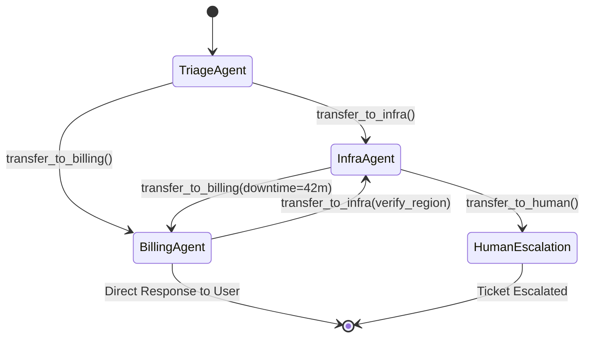
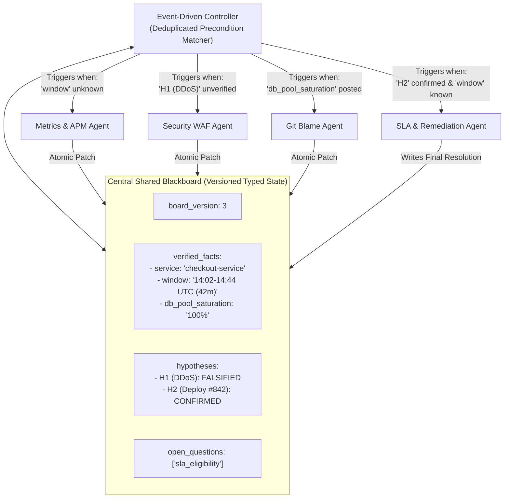
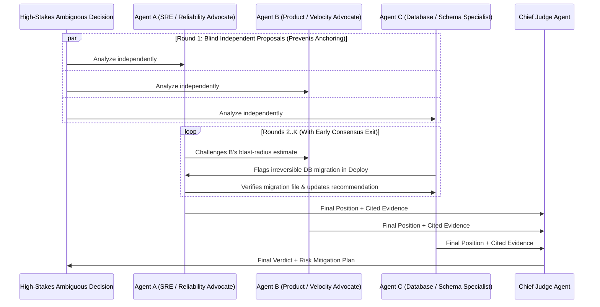

# Chapter 5 (Advanced): Decentralized and Emergent Multi-Agent Topologies

[← Previous: Chapter 4 — Dynamic & Hierarchical Orchestration](./chapter-04-dynamic-and-hierarchical-orchestration.md) | [Book Index](./README.md) | [Next: Chapter 6 — Tool Calling & Action Engineering →](./chapter-06-tool-calling-and-action-engineering.md)

---

In Chapter 4, every dynamic decision went through a central brain, either an Orchestrator or a Supervisor. This chapter covers the Advanced case: **decentralized and emergent topologies**, which remove the central supervisor or shrink it. You reach for them when you need low-latency multi-turn conversations, asynchronous collaborative diagnostics, or a consensus drawn from several perspectives on a high-stakes call.

A note on numbering: pattern numbers follow the book's multi-agent pattern catalog (1.x single-agent loops, 2.x deterministic workflows, 3.x dynamic/hierarchical, 4.x decentralized), not the chapter number.

> [!WARNING]
> Before you decentralize, a 2025 reality check. Removing the hub doesn't remove the coordination problem. It moves it into handoff notes, shared state, and termination rules. Cognition's essay *"Don't Build Multi-Agents"* (Walden Yan, June 2025) argues that agents working from fragmented context make conflicting implicit decisions. Anthropic's *"How we built our multi-agent research system"* (June 2025) shows multi-agent setups winning on breadth-first, read-heavy research, at a much higher token cost. The MAST taxonomy (*"Why Do Multi-Agent LLM Systems Fail?"*, Cemri et al., 2025) sorts observed failures into system-design/specification issues, inter-agent misalignment (information withholding, ignored peer input), and task verification and termination failures. Each pattern below comes with an explicit guardrail for at least one of these.

---

## Pattern 4.1: Peer-to-peer handoffs (decentralized swarm)
*Specialist agents pass active execution control straight to a peer specialist, without routing back through a central hub.*

### Architecture
At any moment exactly one specialist holds the active pointer (think of it as the microphone) and talks directly to the user or the environment. Besides its domain tools, each agent gets **handoff tools** such as `transfer_to_billing_agent` or `transfer_to_infra_agent`. When the active agent decides another specialist is needed, it calls a handoff tool. The runtime then updates `active_agent` and passes the shared session state (conversation history plus a structured handoff note) directly to the peer.



### When it beats a hierarchical supervisor
Compared with a Hierarchical Supervisor (Pattern 3.3), a swarm can roughly halve per-turn latency and cost in conversational apps. With a supervisor, every user message in a 6-turn troubleshooting chat travels $\text{User} \rightarrow \text{Supervisor} \rightarrow \text{Specialist} \rightarrow \text{Supervisor} \rightarrow \text{User}$, which is typically 2–3 LLM calls per turn. In a peer-to-peer swarm, once `TriageAgent` transfers to `InfraAgent`, the user talks to `InfraAgent` directly for the next 6 turns, at one agent loop per turn plus whatever tool calls that agent makes.

There's also a softer benefit. The user feels they're speaking with the specialist, not with a middleman paraphrasing someone else's answers.

### Failure modes and fixes
The classic failure is infinite handoff ping-pong (an $A \leftrightarrow B$ cycle). `InfraAgent` decides an error is a billing quota problem and calls `transfer_to_billing()`; `BillingAgent` decides it's a server bug and calls `transfer_to_infra()`; and round it goes.

Break the cycle in code, not in the prompt. Track `visited_edges: set[tuple[str, str]]` within a single user turn. If a directed edge `(source_agent, target_agent)` repeats within that turn without new user input, block the handoff and force the agent to synthesize an answer or escalate. A single legitimate round trip ($A \rightarrow B \rightarrow A$) is still allowed; only a *repeated* directed edge gets blocked.

The second problem is that nobody owns the overall goal once control has moved twice. Mitigate it with a typed handoff note (goal, findings so far, open questions) and a human-escalation agent that every node can reach.

### What context does the receiving agent see?
This is the most under-specified design decision in swarms. You have three options, from most context to least.

- **Full shared history** is the default in most frameworks. You get maximum continuity, but the receiver also inherits the sender's tool noise and persona instructions, which inflates tokens and sometimes confuses the new agent.
- **Filtered history** strips prior tool calls and outputs, or internal scratchpads, before the transfer. The OpenAI Agents SDK does this with `handoff(agent, input_filter=...)` and built-ins such as `handoff_filters.remove_all_tools`.
- **A summary-only handoff note** is the cheapest. But every summary is lossy, and that's exactly the context fragmentation Cognition warns about. Keep the raw history retrievable even if you don't inject it.

### Framework mapping (verify against your installed version)
| Framework | Peer handoff mechanism |
| :--- | :--- |
| OpenAI Agents SDK (successor to the experimental 2024 *Swarm* library) | `Agent(handoffs=[billing_agent, infra_agent])`; each handoff is exposed to the model as a tool named `transfer_to_<agent_name>` by default; customize via `handoff(..., tool_name_override=..., input_filter=...)`. |
| LangGraph | A tool or node returns `Command(goto="billing_agent", update={...})`; the prebuilt `langgraph-swarm` package (`create_swarm`, `create_handoff_tool`) tracks `active_agent` across turns with a checkpointer. |
| Google ADK | `LlmAgent(sub_agents=[...])` lets the model call `transfer_to_agent(agent_name=...)`; constrain the graph with `disallow_transfer_to_parent` / `disallow_transfer_to_peers`. |
| Microsoft Agent Framework | Built-in handoff orchestration (alongside sequential, concurrent, group-chat, and Magentic orchestrations), succeeding AutoGen's `Swarm` team. |

### Framework-agnostic pseudocode
```python
def swarm_turn_runner(
    user_message: str,
    active_agent: Agent,
    session_state: dict,
    max_handoffs_per_turn: int = 4,
) -> tuple[str, Agent]:
    session_state["messages"].append({"role": "user", "content": user_message})
    visited_edges: set[tuple[str, str]] = set()

    while True:
        # Active agent runs its local tool loop (appending its messages/tool calls to
        # session_state["messages"]) until it either answers or calls a handoff tool.
        step_result = active_agent.execute(session_state)

        if step_result.handoff_target is None:
            # No handoff requested: respond and keep this agent active for the user's NEXT turn.
            return step_result.response_text, active_agent

        edge = (active_agent.name, step_result.handoff_target.name)
        if edge in visited_edges or len(visited_edges) >= max_handoffs_per_turn:
            # Ping-pong cycle or hop budget exhausted: BLOCK the transfer and force the current
            # agent to answer with what it has (or route to a human-escalation agent instead).
            final = active_agent.execute(session_state, allow_handoffs=False)
            return final.response_text, active_agent
        visited_edges.add(edge)

        # Direct peer-to-peer transfer with a structured, typed handoff note
        session_state["handoff_context"] = step_result.handoff_note
        active_agent = step_result.handoff_target
```
The loop always terminates. Every iteration either returns or adds a new edge, and the edge set is capped at `max_handoffs_per_turn`.

### Runtime trace (running scenario)
1. The user sends a ticket $\rightarrow$ `TriageAgent` is active $\rightarrow$ it immediately calls `transfer_to_infra(note="Investigate 503s after yesterday's deploy; user also asked about SLA credit")`.
2. `InfraAgent` becomes active $\rightarrow$ calls `get_deployments` and `query_logs` $\rightarrow$ writes `session_state["downtime_mins"] = 42` and `session_state["root_cause"] = "Deploy #842 DB pool=5"` $\rightarrow$ calls `transfer_to_billing(note="Infra RCA complete (42m downtime). Compute SLA eligibility and respond to user")`.
3. `BillingAgent` becomes active $\rightarrow$ checks the SLA policy (`42m < 45m`) and replies to the user directly with both the infra root cause and the SLA determination. If the user then asks *"Can I appeal the SLA decision?"*, `BillingAgent` is still the active agent and answers in one hop.

---

## Pattern 4.2: Blackboard architecture (shared memory, event-driven pub-sub)
*Agents never message each other. They read from and write structured evidence to a central shared blackboard, and the board's schema is their only coupling.*

### Architecture
The idea comes from classic AI (the HEARSAY-II speech-understanding system, CMU, 1970s) and shows up again in modern event-driven systems. It has three parts.

The **blackboard** is a central, versioned, strongly typed state store holding `verified_facts`, `active_hypotheses`, `evidence_artifacts`, and `open_questions`.

The **knowledge sources** are independent specialist agents. Each declares a trigger precondition: the state that must exist on the board before it can contribute.

The **controller** (or scheduler) inspects the board after each state change, finds every specialist whose precondition has just become true, runs them concurrently, and merges their state patches onto the board. It can be a set of deterministic rules, which is cheap and auditable, or an LLM that picks which knowledge source to activate next. The LLM version is more flexible but quietly reintroduces a soft central brain.



### What the blackboard buys you
The main win is getting rid of $O(N^2)$ point-to-point coupling. Say 10 specialist agents need to collaborate on an unstructured problem, like diagnosing a messy multi-system outage. Fully meshed point-to-point handoffs allow up to $10 \times 9 = 90$ directed transition edges. With a blackboard, agents don't need to know the others exist; each is coupled only to the board schema, which is $O(N)$. You can add an 11th specialist (`DNS_BGP_Agent`) without touching the code or prompts of the other 10, provided the schema already has a place for its findings. Schema changes become the new coupling point, so version the schema.

Collaboration also becomes opportunistic and driven by data. A finding posted by one agent can trigger a different specialist on the next cycle, so the execution order falls out of the evidence instead of a fixed plan.

### Failure modes and fixes
Three things go wrong in naive implementations. If `MetricsAgent`'s precondition is `board.service is not None`, a simple loop will re-run `MetricsAgent` on every cycle, forever. Running specialists concurrently invites races when two of them write the same key. And a last-writer-wins merge silently throws away contradictory evidence.

The fixes, in order:

1. Track `fired_signatures: set[tuple[str, str]]` of `(specialist_name, precondition_hash)` so each specialist fires only once per unique input state.
2. Give every specialist in a cycle the same frozen snapshot, and apply results through merge reducers (`board.apply_patch(delta)`) that record conflicting writes as first-class `conflicts` instead of overwriting.
3. If the controller is distributed, use optimistic concurrency (compare-and-set on `board_version`) in the backing store: a version-checked `UPDATE` in Postgres, Redis `WATCH`/`MULTI`, DynamoDB conditional writes, Cosmos DB ETags, or Firestore transactions.

### Framework-agnostic pseudocode
```python
class BlackboardState(BaseModel):
    ticket: str
    version: int = 0
    facts: dict[str, Any] = Field(default_factory=dict)
    hypotheses: dict[str, Literal["OPEN", "CONFIRMED", "FALSIFIED"]] = Field(default_factory=dict)
    conflicts: list[dict[str, Any]] = Field(default_factory=list)
    resolution: Optional[str] = None

    def apply_patch(self, patch: dict[str, Any], author: str) -> None:
        for key, value in patch.get("facts", {}).items():
            if key in self.facts and self.facts[key] != value:
                # Never silently last-writer-wins: surface contradictions on the board
                self.conflicts.append({"key": key, "old": self.facts[key], "new": value, "by": author})
                continue
            self.facts[key] = value
        self.hypotheses.update(patch.get("hypotheses", {}))
        if patch.get("resolution") is not None:
            self.resolution = patch["resolution"]
        self.version += 1

async def run_blackboard(ticket: str, specialists: list[Specialist], max_cycles: int = 8) -> str:
    board = BlackboardState(ticket=ticket, hypotheses={"ddos": "OPEN", "bad_deploy": "OPEN"})
    fired_signatures: set[tuple[str, str]] = set()

    for _ in range(max_cycles):
        # Select specialists whose preconditions are met AND haven't fired on this exact input
        ready = []
        for s in specialists:
            sig = (s.name, s.precondition_signature(board))
            if s.can_trigger(board) and sig not in fired_signatures:
                fired_signatures.add(sig)
                ready.append(s)

        if not ready:
            break  # Quiescence reached (no specialist can contribute anything new)

        # Every specialist in this cycle reads the SAME frozen version of the board
        snapshot = board.model_copy(deep=True)
        results = await asyncio.gather(
            *[s.contribute_async(snapshot) for s in ready], return_exceptions=True
        )
        for s, result in zip(ready, results):
            if isinstance(result, BaseException):
                log.warning("specialist %s failed: %r", s.name, result)  # one failure must not abort the cycle
                continue
            board.apply_patch(result, author=s.name)

        if board.resolution is not None:
            return board.resolution

    raise RuntimeError("Blackboard reached quiescence or max_cycles without a resolution; escalate to a human.")
```

---

## Pattern 4.3: Multi-agent debate (society of minds)
*Several agents independently propose competing analyses, cross-examine each other's evidence over $K$ rounds, and a judge renders the final verdict.*

The core idea comes from Du et al., *"Improving Factuality and Reasoning in Language Models through Multiagent Debate"* (2023; ICML 2024): several copies of a model answer, read each other's answers, and revise over a number of rounds. The variant with a judge (or moderator) and deliberately opposed debaters comes from Liang et al., *"Encouraging Divergent Thinking in Large Language Models through Multi-Agent Debate"* (2023).

### Architecture
Debate is built for high-stakes, highly ambiguous reasoning where no deterministic test runner exists. It runs in three phases.

1. **Round 1, blind proposals.** $M$ proposer agents, set up with orthogonal perspectives or personas (or drawn from different model families), analyze the problem independently and in parallel. None of them sees the others' initial output.
2. **Rounds $2 \dots K$, cross-examination.** Each agent reads its peers' arguments, challenges unsupported assumptions with tool or document evidence, and refines its own position. If they reach unanimous consensus, the loop stops early.
3. **Final adjudication.** An independent judge (or aggregator) agent weighs the final arguments, checks the cited evidence, and outputs a decision along with any dissenting risk notes.



### What debate buys you
It reduces anchoring bias. A single generation tends to commit early to one framing and then rationalize it. Extended "thinking" models soften this somewhat but don't eliminate it. Making Round 1 blind forces genuinely independent hypotheses before any cross-examination starts.

It also surfaces subtle edge cases, because adversarial peers go looking for the unstated assumptions in each other's proposals. That's most valuable when they can *verify* claims with tools or documents rather than just argue.

### Costs and failure modes
Debate has the highest token and latency multiplier in this chapter: $M \text{ agents} \times K \text{ rounds} + 1 \text{ Judge}$. Three agents over three rounds plus a judge is about $10\times$ the calls of a single agent, and more in practice because transcripts grow each round. Don't use it for routine tasks. Save it for high-consequence architectural, medical, financial, or incident-remediation decisions.

At equal compute, debate often doesn't beat voting. Choi, Zhu & Li, *"Debate or Vote: Which Yields Better Decisions in Multi-Agent Large Language Models?"* (NeurIPS 2025) report that across seven NLP benchmarks, majority voting over independent answers accounts for most of the gains usually credited to debate. So benchmark debate against a cheaper parallel-sample-and-vote baseline (Pattern 2.2) before paying for cross-examination rounds. Debate earns its keep mainly when peers bring *new evidence*: tools, documents, different models.

Then there's the echo chamber. Debaters built on the same model and prompt make correlated errors, converge quickly, and add little beyond voting. Worse, an agent may cave to a confident or majority peer even when that peer is wrong. Counter this with orthogonal system personas (say, *Pro-Rollback Advocate* vs. *Pro-Hotfix Advocate*) or multi-model ensembles, anonymize peer identities in the transcript, and require evidence for any change of position.

### Framework-agnostic pseudocode
```python
class DebatePosition(BaseModel):
    option_id: str                 # constrain to the enumerated options (Literal/enum) so consensus is checkable
    supporting_evidence: list[str]
    critique_of_peers: Optional[str] = None

async def multi_agent_debate(
    problem: str, options: list[str], debaters: list[Agent], judge: Agent, max_rounds: int = 3
) -> str:
    # Round 1: Blind parallel proposals (CRITICAL: debaters cannot see each other yet)
    positions: list[DebatePosition] = await asyncio.gather(
        *[d.run_structured_async(f"Problem: {problem}\nOptions: {options}", schema=DebatePosition)
          for d in debaters]
    )

    for round_num in range(2, max_rounds + 1):
        # Early consensus exit: unanimous agreement (including independent agreement after blind Round 1)
        if len({p.option_id for p in positions}) == 1:
            break

        # Anonymized transcript reduces deference to "authoritative" personas
        transcript = "\n".join(
            f"[Debater {i + 1}]: Option={p.option_id} | Evidence={p.supporting_evidence}"
            for i, p in enumerate(positions)
        )
        positions = await asyncio.gather(
            *[
                d.run_structured_async(
                    f"Problem: {problem}\nOptions: {options}\n"
                    f"Round {round_num - 1} Peer Positions:\n{transcript}\n"
                    "Challenge flawed peer assumptions with evidence. Change your position ONLY if "
                    "refuted by evidence, not because others disagree.",
                    schema=DebatePosition,
                )
                for d in debaters
            ]
        )

    final_positions = "\n".join(f"[Debater {i + 1}]: {p.model_dump_json()}" for i, p in enumerate(positions))
    return await judge.run_async(f"Problem: {problem}\nFinal Debate Positions:\n{final_positions}")
```

---

## Chapter 5 summary

| Topology | How agents communicate | Latency and cost | Best used when | Required guardrails |
| :--- | :--- | :--- | :--- | :--- |
| 4.1 Peer-to-peer swarm | Direct active-pointer transfer (`transfer_to_X`) | Low ($1$ agent loop/turn) | A multi-turn interactive chat moves across domain specialists. | Directed-edge cycle detection (`visited_edges`), `max_handoffs_per_turn`, and an explicit handoff-context policy. |
| 4.2 Blackboard | Reads and writes to a central, versioned, typed state | Medium–High (async parallel) | Complex diagnostic or research problems with $>5$ decoupled specialists contributing opportunistically. | Trigger-signature deduplication (`fired_signatures`), snapshot reads, and conflict-recording patch reducers. |
| 4.3 Multi-agent debate | Blind Round 1 $\rightarrow$ cross-examination $\rightarrow$ judge | Highest ($M \times K + 1$) | High-stakes, ambiguous decisions with no deterministic verifier (M&A, incident remediation, diagnosis), and only after it beats a vote baseline. | Blind Round 1, orthogonal personas, evidence-required position changes, and early consensus termination. |

---

[← Previous: Chapter 4 — Dynamic & Hierarchical Orchestration](./chapter-04-dynamic-and-hierarchical-orchestration.md) | [Book Index](./README.md) | [Next: Chapter 6 — Tool Calling & Action Engineering →](./chapter-06-tool-calling-and-action-engineering.md)
