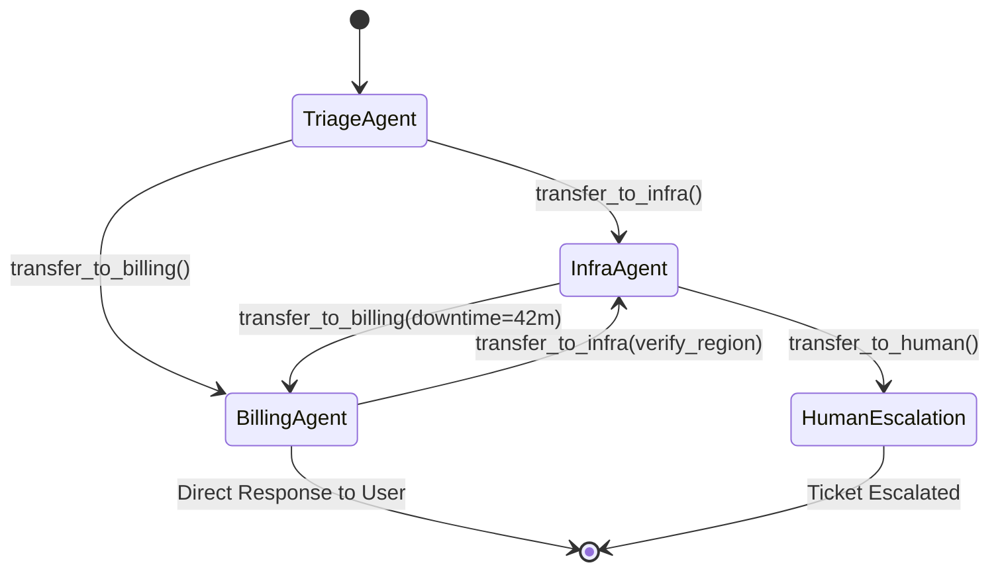
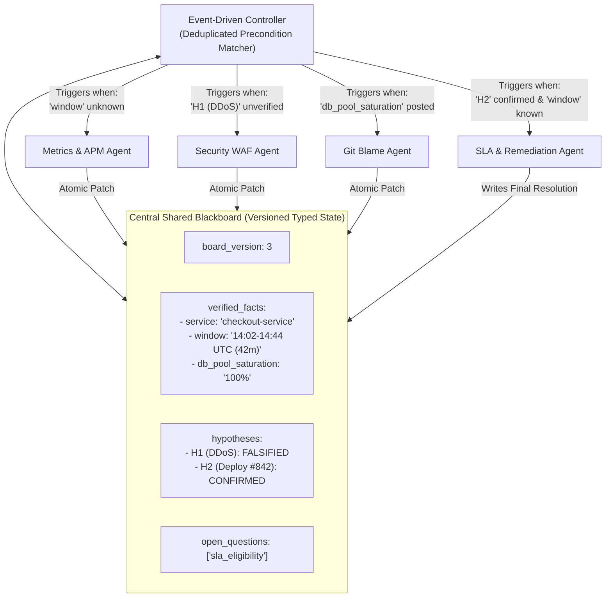
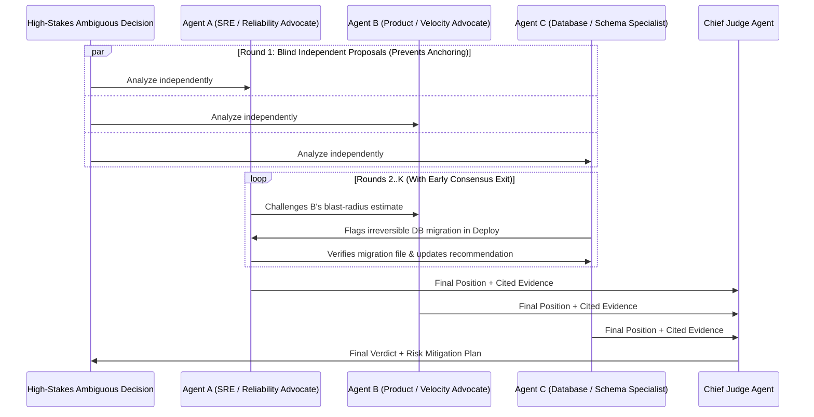

# Chapter 5 (Advanced): Decentralized & Emergent Multi-Agent Topologies

[⬅️ Previous: Chapter 4 — Dynamic & Hierarchical Orchestration](./chapter-04-dynamic-and-hierarchical-orchestration.md) | [📚 Book Index](./README.md) | [Next: Chapter 6 — Tool Calling & Action Engineering ➡️](./chapter-06-tool-calling-and-action-engineering.md)

---

In Chapter 4, every dynamic decision flowed through a central brain (an Orchestrator or Supervisor). At the **Advanced** level, we explore **Decentralized and Emergent Topologies**—architectures that remove (or shrink) the central supervisor for low-latency multi-turn conversations, asynchronous collaborative diagnostics, or high-stakes multi-perspective consensus.

> **Numbering note:** Pattern numbers follow the book's multi-agent pattern catalog (1.x single-agent loops → 2.x deterministic workflows → 3.x dynamic/hierarchical → **4.x decentralized**), not the chapter number.

> **Before you decentralize — a 2025 reality check:** Removing the hub does not remove the coordination problem; it moves it into handoff notes, shared state, and termination rules. Cognition's essay *"Don't Build Multi-Agents"* (Walden Yan, June 2025) argues that agents working from fragmented context make conflicting implicit decisions, while Anthropic's *"How we built our multi-agent research system"* (June 2025) shows multi-agent wins on breadth-first, read-heavy research—at a much higher token cost. The MAST taxonomy (*"Why Do Multi-Agent LLM Systems Fail?"*, Cemri et al., 2025) groups observed failures into **system-design/specification issues**, **inter-agent misalignment** (e.g., information withholding, ignored peer input), and **task verification & termination** failures. Every pattern below includes an explicit guardrail for at least one of these.

---

## Pattern 4.1: Peer-to-Peer Handoffs / Decentralized Swarm
*Specialist agents transfer active execution control directly to peer specialists without routing back through a central hub.*

### Architecture
At any point in time, exactly **one specialist agent holds the active pointer** (the "microphone") and interacts directly with the user or environment. Alongside its domain tools, each agent is given **Handoff Tools** (e.g., `transfer_to_billing_agent`, `transfer_to_infra_agent`). When the active agent determines another specialist is needed, it invokes a handoff tool; the runtime updates `active_agent` and passes the shared session state (conversation history plus a structured handoff note) directly to the peer.



### Why This Architecture?
* **Why use it over a Hierarchical Supervisor (Pattern 3.3):**
  1. **Can Roughly Halve Per-Turn Latency & Cost in Conversational Apps:** In a Supervisor architecture, every user message in a 6-turn troubleshooting chat travels $\text{User} \rightarrow \text{Supervisor} \rightarrow \text{Specialist} \rightarrow \text{Supervisor} \rightarrow \text{User}$ (typically 2–3 LLM calls per turn). In a **Peer-to-Peer Swarm**, once `TriageAgent` transfers to `InfraAgent`, the user talks **directly** to `InfraAgent` for the next 6 turns at **1 agent loop per turn** (plus any tool calls that agent makes).
  2. **Natural Specialist Persona Continuity:** The user experiences speaking directly with a specialist rather than a middleman paraphrasing answers.
* **Trade-offs & Failure Modes:**
  * **Infinite Handoff Ping-Pong ($A \leftrightarrow B$ Cycle):** `InfraAgent` thinks an error is a billing quota problem and calls `transfer_to_billing()`, while `BillingAgent` thinks it is a server bug and calls `transfer_to_infra()` in an infinite loop.
  * **Critic's Fix — Cycle Breaker in Code:** Track `visited_edges: set[tuple[str, str]]` within a single user turn; if a directed edge `(source_agent, target_agent)` repeats within the same turn without new user input, block the handoff and force synthesis or escalation. Note that a single legitimate round trip ($A \rightarrow B \rightarrow A$) is allowed; only a *repeated* directed edge is blocked.
  * **No Global Owner of the Goal:** Nobody is accountable for the *overall* task once control has moved twice. Mitigate with a typed handoff note (goal, findings so far, open questions) and a human-escalation agent reachable from every node.

### What Context Does the Receiving Agent See?
This is the most under-specified design decision in swarms. Options, from most to least context:
* **Full shared history (default in most frameworks):** Maximum continuity, but the receiver inherits the sender's tool noise and persona instructions, inflating tokens and sometimes confusing the new agent.
* **Filtered history:** Strip prior tool calls/outputs or internal scratchpads before transfer (e.g., the OpenAI Agents SDK's `handoff(agent, input_filter=...)` with built-ins such as `handoff_filters.remove_all_tools`).
* **Summary-only handoff note:** Cheapest, but every summary is lossy—exactly the context fragmentation Cognition warns about. Keep the raw history retrievable even if you don't inject it.

### Framework Mapping (verify against your installed version)
| Framework | Peer handoff mechanism |
| :--- | :--- |
| **OpenAI Agents SDK** (successor to the experimental 2024 *Swarm* library) | `Agent(handoffs=[billing_agent, infra_agent])`; each handoff is exposed to the model as a tool named `transfer_to_<agent_name>` by default; customize via `handoff(..., tool_name_override=..., input_filter=...)`. |
| **LangGraph** | A tool or node returns `Command(goto="billing_agent", update={...})`; the prebuilt `langgraph-swarm` package (`create_swarm`, `create_handoff_tool`) tracks `active_agent` across turns with a checkpointer. |
| **Google ADK** | `LlmAgent(sub_agents=[...])` lets the model call `transfer_to_agent(agent_name=...)`; constrain the graph with `disallow_transfer_to_parent` / `disallow_transfer_to_peers`. |
| **Microsoft Agent Framework** | Built-in **handoff orchestration** (alongside sequential, concurrent, group-chat, and Magentic orchestrations), succeeding AutoGen's `Swarm` team. |

### Production-Grade Framework-Agnostic Pseudocode
```python
def swarm_turn_runner(
    user_message: str,
    active_agent: Agent,
    session_state: dict,
    max_handoffs_per_turn: int = 4,
) -> tuple[str, Agent]:
    session_state["messages"].append({"role": "user", "content": user_message})
    visited_edges: set[tuple[str, str]] = set()

    while True:
        # Active agent runs its local tool loop (appending its messages/tool calls to
        # session_state["messages"]) until it either answers or calls a handoff tool.
        step_result = active_agent.execute(session_state)

        if step_result.handoff_target is None:
            # No handoff requested: respond and keep this agent active for the user's NEXT turn.
            return step_result.response_text, active_agent

        edge = (active_agent.name, step_result.handoff_target.name)
        if edge in visited_edges or len(visited_edges) >= max_handoffs_per_turn:
            # Ping-pong cycle or hop budget exhausted: BLOCK the transfer and force the current
            # agent to answer with what it has (or route to a human-escalation agent instead).
            final = active_agent.execute(session_state, allow_handoffs=False)
            return final.response_text, active_agent
        visited_edges.add(edge)

        # Direct peer-to-peer transfer with a structured, typed handoff note
        session_state["handoff_context"] = step_result.handoff_note
        active_agent = step_result.handoff_target
```
The loop always terminates: every iteration either returns or adds a new edge, and the edge set is capped at `max_handoffs_per_turn`.

### Runtime Execution Trace (Running Scenario)
1. **User** sends ticket $\rightarrow$ **`TriageAgent`** is active $\rightarrow$ immediately invokes `transfer_to_infra(note="Investigate 503s after yesterday's deploy; user also asked about SLA credit")`.
2. **`InfraAgent`** becomes active $\rightarrow$ calls `get_deployments` and `query_logs` $\rightarrow$ writes `session_state["downtime_mins"] = 42` and `session_state["root_cause"] = "Deploy #842 DB pool=5"` $\rightarrow$ invokes `transfer_to_billing(note="Infra RCA complete (42m downtime). Compute SLA eligibility and respond to user")`.
3. **`BillingAgent`** becomes active $\rightarrow$ checks SLA policy (`42m < 45m`) and replies directly to the user with both the Infra root cause and SLA determination. If the user replies *"Can I appeal the SLA decision?"*, **`BillingAgent` is still the active agent** and answers immediately in 1 hop!

---

## Pattern 4.2: Blackboard Architecture (Shared Memory / Event-Driven Pub-Sub)
*Agents are decoupled from each other: they never message each other directly, instead reading from and writing structured evidence to a central Shared Blackboard. Their only coupling is to the board's schema.*

### Architecture
Originating in classic AI (the HEARSAY-II speech-understanding system, CMU, 1970s) and echoed in modern event-driven systems:
* **The Blackboard:** A central, versioned, strongly-typed shared state store containing `verified_facts`, `active_hypotheses`, `evidence_artifacts`, and `open_questions`.
* **Knowledge Sources (Specialist Agents):** Independent domain agents that declare a **Trigger Precondition** (what state must exist on the board before they can contribute).
* **The Controller / Scheduler:** Inspects the Blackboard after each state mutation, identifies all specialists whose preconditions are newly satisfied, runs them concurrently, and merges their state patches onto the board. The controller can be deterministic rules (cheap, auditable) or an LLM that chooses which knowledge source to activate next (flexible, but reintroduces a soft central brain).



### Why This Architecture?
* **Eliminates $O(N^2)$ Point-to-Point Coupling:** If 10 specialist agents need to collaborate on an unstructured problem (like diagnosing a complex multi-system outage), fully meshed point-to-point handoffs allow up to $10 \times 9 = 90$ directed transition edges. With a **Blackboard**, agents don't need to know other agents exist ($O(N)$ coupling to the board schema). You can add an 11th specialist (`DNS_BGP_Agent`) without editing the code or prompts of the existing 10—*provided* the board schema already has a place for its findings (schema changes are the new coupling point, so version the schema).
* **Opportunistic, Data-Driven Collaboration:** Any agent's discovery on the board can dynamically unlock a different specialist on the next cycle; the execution order emerges from the evidence rather than a fixed plan.
* **Critic's Fix — Preventing Infinite Re-Triggering, Write Races & Silent Overwrites:**
  * *The Trap:* If `MetricsAgent`'s precondition is `board.service is not None`, a naive loop will re-run `MetricsAgent` on every single cycle forever! Furthermore, running multiple specialists concurrently can cause races if they overwrite the same key, and a "last writer wins" merge silently destroys contradictory evidence.
  * *The Solution:* (1) Track `fired_signatures: set[tuple[str, str]]` of `(specialist_name, precondition_hash)` so each specialist only fires once per unique input state; (2) give every specialist in a cycle the **same frozen snapshot** and apply results via **merge reducers** (`board.apply_patch(delta)`) that record conflicting writes as first-class `conflicts` instead of overwriting; (3) if the controller is distributed, use optimistic concurrency (compare-and-set on `board_version`) in the backing store.

### Production-Grade Framework-Agnostic Pseudocode
```python
class BlackboardState(BaseModel):
    ticket: str
    version: int = 0
    facts: dict[str, Any] = Field(default_factory=dict)
    hypotheses: dict[str, Literal["OPEN", "CONFIRMED", "FALSIFIED"]] = Field(default_factory=dict)
    conflicts: list[dict[str, Any]] = Field(default_factory=list)
    resolution: Optional[str] = None

    def apply_patch(self, patch: dict[str, Any], author: str) -> None:
        for key, value in patch.get("facts", {}).items():
            if key in self.facts and self.facts[key] != value:
                # Never silently last-writer-wins: surface contradictions on the board
                self.conflicts.append({"key": key, "old": self.facts[key], "new": value, "by": author})
                continue
            self.facts[key] = value
        self.hypotheses.update(patch.get("hypotheses", {}))
        if patch.get("resolution") is not None:
            self.resolution = patch["resolution"]
        self.version += 1

async def run_blackboard(ticket: str, specialists: list[Specialist], max_cycles: int = 8) -> str:
    board = BlackboardState(ticket=ticket, hypotheses={"ddos": "OPEN", "bad_deploy": "OPEN"})
    fired_signatures: set[tuple[str, str]] = set()

    for _ in range(max_cycles):
        # Select specialists whose preconditions are met AND haven't fired on this exact input
        ready = []
        for s in specialists:
            sig = (s.name, s.precondition_signature(board))
            if s.can_trigger(board) and sig not in fired_signatures:
                fired_signatures.add(sig)
                ready.append(s)

        if not ready:
            break  # Quiescence reached (no specialist can contribute anything new)

        # Every specialist in this cycle reads the SAME frozen version of the board
        snapshot = board.model_copy(deep=True)
        results = await asyncio.gather(
            *[s.contribute_async(snapshot) for s in ready], return_exceptions=True
        )
        for s, result in zip(ready, results):
            if isinstance(result, BaseException):
                log.warning("specialist %s failed: %r", s.name, result)  # one failure must not abort the cycle
                continue
            board.apply_patch(result, author=s.name)

        if board.resolution is not None:
            return board.resolution

    raise RuntimeError("Blackboard reached quiescence or max_cycles without a resolution; escalate to a human.")
```

---

## Pattern 4.3: Multi-Agent Debate / Society of Minds (Consensus)
*Multiple agents independently propose competing analyses, cross-examine each other's evidence over $K$ rounds, and a Judge renders the final verdict.*

The core idea comes from Du et al., *"Improving Factuality and Reasoning in Language Models through Multiagent Debate"* (2023; ICML 2024), where several copies of a model answer, read each other's answers, and revise over rounds. The **Judge/Moderator** variant with deliberately opposed debaters comes from Liang et al., *"Encouraging Divergent Thinking in Large Language Models through Multi-Agent Debate"* (2023).

### Architecture
Designed for **high-stakes, high-ambiguity reasoning** where no deterministic test runner exists:
1. **Round 1 (Blind Independent Proposals):** $M$ Proposer Agents (configured with orthogonal perspectives/personas or distinct model families) analyze the problem **independently in parallel** without seeing each other's initial output.
2. **Rounds $2 \dots K$ (Adversarial Cross-Examination & Early Consensus Check):** Each agent inspects its peers' arguments, challenges unsupported assumptions with tool/document evidence, and refines its position. If unanimous consensus is reached, the debate loop terminates immediately.
3. **Final Adjudication:** An independent **Judge / Aggregator Agent** weighs the final arguments, verifies cited evidence, and outputs the decision alongside any dissenting risk notes.



### Why This Architecture?
* **Reduces Anchoring Bias:** A single generation tends to commit early to one framing and then rationalize it (extended "thinking" models mitigate this somewhat, but do not eliminate it). **Blind Round 1 generation** forces genuinely independent hypotheses before cross-examination begins.
* **Exposes Subtle Edge Cases:** Adversarial peers actively hunt for unstated assumptions in each other's proposals—most valuable when they can *verify* claims with tools or documents rather than just argue.
* **Trade-offs & Failure Modes:**
  * **Highest Token & Latency Multiplier ($M \text{ agents} \times K \text{ rounds} + 1 \text{ Judge}$):** e.g., 3 agents × 3 rounds + 1 judge ≈ $10\times$ the calls of a single agent (more as transcripts grow each round). Never use Multi-Agent Debate for routine tasks; reserve it for high-consequence architectural, medical, financial, or incident-remediation decisions.
  * **Debate Often Doesn't Beat Voting at Equal Compute:** Choi, Zhu & Li, *"Debate or Vote: Which Yields Better Decisions in Multi-Agent Large Language Models?"* (NeurIPS 2025) report that across seven NLP benchmarks, **majority voting over independent answers accounts for most of the gains** usually attributed to debate. Always benchmark debate against a cheaper **parallel sample + vote** baseline (Pattern 2.2) before paying for cross-examination rounds; debate earns its keep mainly when peers bring *new evidence* (tools, documents, different models).
  * **Echo Chamber & Conformity:** Debaters with the same model and prompt make correlated errors, converge quickly, and add little beyond voting; worse, agents may capitulate to a confident or majority peer even when that peer is wrong. Enforce **orthogonal system personas** (e.g., *Pro-Rollback Advocate* vs. *Pro-Hotfix Advocate*) or **multi-model ensembles**, anonymize peer identities in the transcript, and require evidence for any position change.

### Production-Grade Framework-Agnostic Pseudocode
```python
class DebatePosition(BaseModel):
    option_id: str                 # constrain to the enumerated options (Literal/enum) so consensus is checkable
    supporting_evidence: list[str]
    critique_of_peers: Optional[str] = None

async def multi_agent_debate(
    problem: str, options: list[str], debaters: list[Agent], judge: Agent, max_rounds: int = 3
) -> str:
    # Round 1: Blind parallel proposals (CRITICAL: debaters cannot see each other yet)
    positions: list[DebatePosition] = await asyncio.gather(
        *[d.run_structured_async(f"Problem: {problem}\nOptions: {options}", schema=DebatePosition)
          for d in debaters]
    )

    for round_num in range(2, max_rounds + 1):
        # Early consensus exit: unanimous agreement (including independent agreement after blind Round 1)
        if len({p.option_id for p in positions}) == 1:
            break

        # Anonymized transcript reduces deference to "authoritative" personas
        transcript = "\n".join(
            f"[Debater {i + 1}]: Option={p.option_id} | Evidence={p.supporting_evidence}"
            for i, p in enumerate(positions)
        )
        positions = await asyncio.gather(
            *[
                d.run_structured_async(
                    f"Problem: {problem}\nOptions: {options}\n"
                    f"Round {round_num - 1} Peer Positions:\n{transcript}\n"
                    "Challenge flawed peer assumptions with evidence. Change your position ONLY if "
                    "refuted by evidence, not because others disagree.",
                    schema=DebatePosition,
                )
                for d in debaters
            ]
        )

    final_positions = "\n".join(f"[Debater {i + 1}]: {p.model_dump_json()}" for i, p in enumerate(positions))
    return await judge.run_async(f"Problem: {problem}\nFinal Debate Positions:\n{final_positions}")
```

---

## Chapter 5 Summary Comparison

| Advanced Topology | Communication Mechanism | Latency & Cost | Best Used When... | Mandatory Production Guardrail |
| :--- | :--- | :--- | :--- | :--- |
| **4.1 Peer-to-Peer Swarm** | Direct active-pointer transfer (`transfer_to_X`) | **Low** ($1$ agent loop/turn) | Multi-turn interactive user chat switching across domain specialists. | Directed edge cycle detection (`visited_edges`) + `max_handoffs_per_turn` + explicit handoff-context policy. |
| **4.2 Blackboard** | Read/Write to central versioned Typed State | Medium–High (Async parallel) | Complex diagnostic/research problems with $>5$ decoupled specialists contributing opportunistically. | Trigger signature deduplication (`fired_signatures`) + snapshot reads + conflict-recording patch reducers. |
| **4.3 Multi-Agent Debate** | Blind Round 1 $\rightarrow$ Cross-Exam $\rightarrow$ Judge | **Highest** ($M \times K + 1$) | High-stakes, ambiguous decisions with no deterministic verifier (M&A, incident remediation, diagnosis)—and only after beating a vote baseline. | Blind Round 1 + orthogonal personas + evidence-required position changes + early consensus termination. |

---

[⬅️ Previous: Chapter 4 — Dynamic & Hierarchical Orchestration](./chapter-04-dynamic-and-hierarchical-orchestration.md) | [📚 Book Index](./README.md) | [Next: Chapter 6 — Tool Calling & Action Engineering ➡️](./chapter-06-tool-calling-and-action-engineering.md)
