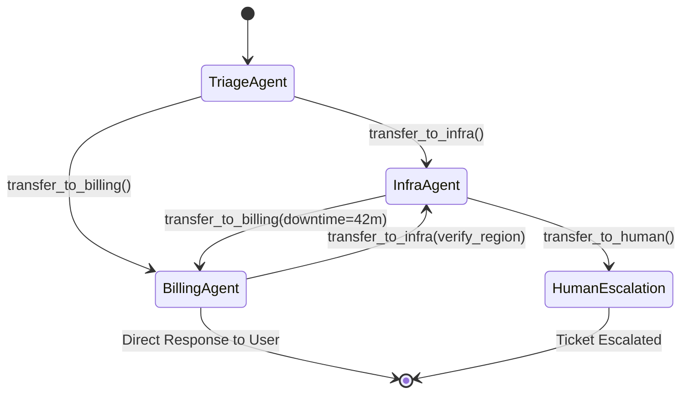
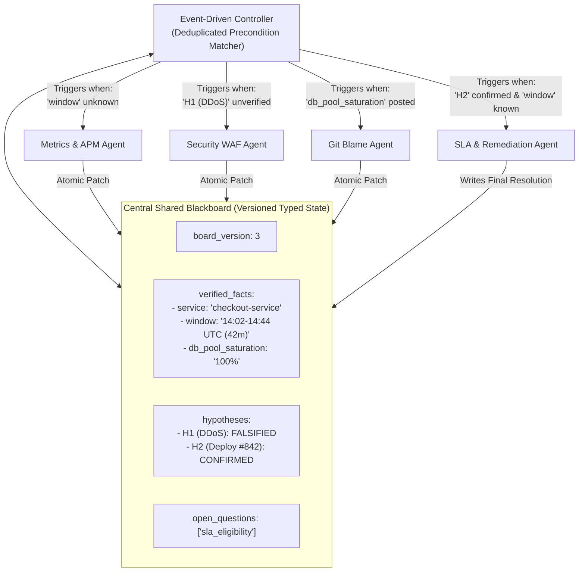
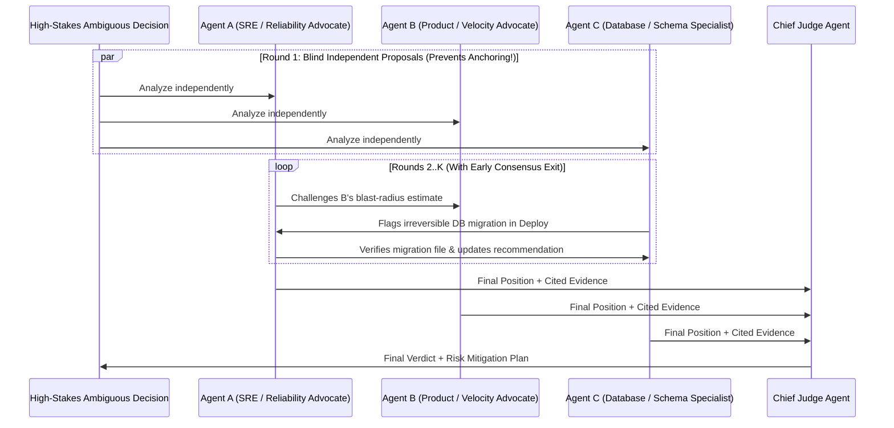

# Chapter 5 (Advanced): Decentralized & Emergent Multi-Agent Topologies

[⬅️ Previous: Chapter 4 — Dynamic & Hierarchical Orchestration](./chapter-04-dynamic-and-hierarchical-orchestration.md) | [📚 Book Index](./README.md) | [Next: Chapter 6 — Tool Calling & Action Engineering ➡️](./chapter-06-tool-calling-and-action-engineering.md)

---

In Chapter 4, every dynamic decision flowed through a central brain (an Orchestrator or Supervisor). At the **Advanced** level, we explore **Decentralized and Emergent Topologies**—architectures designed to eliminate the central supervisor bottleneck for low-latency multi-turn conversations, asynchronous collaborative diagnostics, or high-stakes multi-perspective consensus.

---

## Pattern 4.1: Peer-to-Peer Handoffs / Decentralized Swarm
*Specialist agents transfer active execution control directly to peer specialists without routing back through a central hub.*

### Architecture
At any point in time, exactly **one specialist agent holds the active pointer** (the "microphone") and interacts directly with the user or environment. Alongside its domain tools, each agent is given **Handoff Tools** (e.g., `transfer_to_billing_agent`, `transfer_to_infra_agent`). When the active agent determines another specialist is needed, it invokes a handoff tool, updating `active_agent` and passing the shared session state directly to its peer.



### Why This Architecture?
* **Why use it over a Hierarchical Supervisor (Pattern 3.3):**
  1. **Cuts Per-Turn Latency & Cost by ~50% in Conversational Apps:** In a Supervisor architecture, every user message in a 6-turn troubleshooting chat travels $\text{User} \rightarrow \text{Supervisor} \rightarrow \text{Specialist} \rightarrow \text{Supervisor} \rightarrow \text{User}$ (2–3 LLM calls per turn). In a **Peer-to-Peer Swarm**, once `TriageAgent` transfers to `InfraAgent`, the user talks **directly** to `InfraAgent` for the next 6 turns at **1 LLM call per turn**.
  2. **Natural Specialist Persona Continuity:** The user experiences speaking directly with a specialist rather than a middleman paraphrasing answers.
* **Trade-offs & Failure Modes:**
  * **Infinite Handoff Ping-Pong ($A \leftrightarrow B$ Cycle):** `InfraAgent` thinks an error is a billing quota problem and calls `transfer_to_billing()`, while `BillingAgent` thinks it is a server bug and calls `transfer_to_infra()` in an infinite loop.
  * **Critic's Fix — Cycle Breaker in Code:** Track `visited_handoffs: set[tuple[str, str]]` within a single user turn; if a directed edge `(source_agent, target_agent)` repeats within the same turn without new user input, block the handoff and force synthesis or escalation.

### Production-Grade Framework-Agnostic Pseudocode
```python
def swarm_turn_runner(
    user_message: str,
    active_agent: Agent,
    session_state: dict,
    max_handoffs_per_turn: int = 4,
) -> tuple[str, Agent]:
    session_state["messages"].append({"role": "user", "content": user_message})
    visited_edges: set[tuple[str, str]] = set()

    for _ in range(max_handoffs_per_turn):
        # Active agent runs its local tool loop until it either answers or calls a handoff tool
        step_result = active_agent.execute(session_state)

        if step_result.handoff_target is None:
            # No handoff requested: return response and keep current active_agent for next turn!
            return step_result.response_text, active_agent

        edge = (active_agent.name, step_result.handoff_target.name)
        if edge in visited_edges:
            raise RuntimeError(f"Cycle detected: Ping-pong handoff on edge {edge}!")
        visited_edges.add(edge)

        # Direct peer-to-peer transfer
        session_state["handoff_context"] = step_result.handoff_note
        active_agent = step_result.handoff_target

    raise RuntimeError(f"Exceeded max handoffs ({max_handoffs_per_turn}) in a single turn.")
```

### Runtime Execution Trace (Running Scenario)
1. **User** sends ticket $\rightarrow$ **`TriageAgent`** is active $\rightarrow$ immediately invokes `transfer_to_infra(note="Investigate 503s after yesterday's deploy; user also asked about SLA credit")`.
2. **`InfraAgent`** becomes active $\rightarrow$ calls `get_deployments` and `query_logs` $\rightarrow$ writes `session_state["downtime_mins"] = 42` and `session_state["root_cause"] = "Deploy #842 DB pool=5"` $\rightarrow$ invokes `transfer_to_billing(note="Infra RCA complete (42m downtime). Compute SLA eligibility and respond to user")`.
3. **`BillingAgent`** becomes active $\rightarrow$ checks SLA policy (`42m < 45m`) and replies directly to the user with both the Infra root cause and SLA determination. If the user replies *"Can I appeal the SLA decision?"*, **`BillingAgent` is still the active agent** and answers immediately in 1 hop!

---

## Pattern 4.2: Blackboard Architecture (Shared Memory / Event-Driven Pub-Sub)
*Agents are 100% decoupled; they never message each other directly, instead reading from and writing structured evidence to a central Shared Blackboard.*

### Architecture
Originating in classic distributed AI (HEARSAY-II) and modern event-driven systems:
* **The Blackboard:** A central, versioned, strongly-typed shared state store containing `verified_facts`, `active_hypotheses`, `evidence_artifacts`, and `open_questions`.
* **Knowledge Sources (Specialist Agents):** Independent domain agents that declare a **Trigger Precondition** (what state must exist on the board before they can contribute).
* **The Controller / Scheduler:** Inspects the Blackboard after each state mutation, identifies all specialists whose preconditions are newly satisfied, runs them concurrently, and atomically merges their state patches onto the board.



### Why This Architecture?
* **Eliminates $O(N^2)$ Point-to-Point Coupling:** If 10 specialist agents need to collaborate on an unstructured problem (like diagnosing a complex multi-system outage), point-to-point handoffs require $10 \times 9 = 90$ potential transition edges. With a **Blackboard**, agents don't even know other agents exist ($O(N)$ coupling to the board schema). You can add an 11th specialist (`DNS_BGP_Agent`) without modifying a single line of code or prompt in the existing 10 agents!
* **Opportunistic Forward & Backward Chaining:** Any agent's discovery on the board can dynamically unlock a different specialist on the next cycle.
* **Critic's Fix — Preventing Infinite Re-Triggering & Write Races:**
  * *The Trap:* If `MetricsAgent`'s precondition is `board.service is not None`, a naive loop will re-run `MetricsAgent` on every single cycle forever! Furthermore, running multiple specialists concurrently can cause race conditions if they overwrite the same dictionary key.
  * *The Solution:* (1) Track `executed_triggers: set[tuple[str, str]]` mapping `(specialist_name, precondition_hash)` so each specialist only fires once per unique input state, and (2) apply updates via **append/merge reducers** (`board.apply_patch(delta)`).

### Production-Grade Framework-Agnostic Pseudocode
```python
class BlackboardState(BaseModel):
    ticket: str
    facts: dict[str, Any] = {}
    hypotheses: dict[str, Literal["OPEN", "CONFIRMED", "FALSIFIED"]] = {}
    resolution: Optional[str] = None

    def apply_patch(self, patch: dict[str, Any]) -> None:
        self.facts.update(patch.get("facts", {}))
        self.hypotheses.update(patch.get("hypotheses", {}))
        if "resolution" in patch:
            self.resolution = patch["resolution"]

async def run_blackboard(ticket: str, specialists: list[Specialist], max_cycles: int = 8) -> str:
    board = BlackboardState(ticket=ticket, hypotheses={"ddos": "OPEN", "bad_deploy": "OPEN"})
    fired_signatures: set[tuple[str, str]] = set()

    for _ in range(max_cycles):
        if board.resolution is not None:
            return board.resolution

        # Select specialists whose preconditions are met AND haven't fired on this exact input
        ready = []
        for s in specialists:
            sig = (s.name, s.precondition_signature(board))
            if s.can_trigger(board) and sig not in fired_signatures:
                fired_signatures.add(sig)
                ready.append(s)

        if not ready:
            break  # Quiescence reached (no new agents can contribute)

        # Execute all eligible specialists concurrently and merge patches atomically
        patches = await asyncio.gather(*[s.contribute_async(board) for s in ready])
        for patch in patches:
            board.apply_patch(patch)

    raise RuntimeError("Blackboard reached quiescence or max_cycles without resolution.")
```

---

## Pattern 4.3: Multi-Agent Debate / Society of Minds (Consensus)
*Multiple agents independently propose competing analyses, cross-examine each other's evidence over $K$ rounds, and a Judge renders the final verdict (Du et al., 2023).*

### Architecture
Designed for **high-stakes, high-ambiguity reasoning** where no deterministic test runner exists:
1. **Round 1 (Blind Independent Proposals):** $M$ Proposer Agents (configured with orthogonal perspectives/personas or distinct model families) analyze the problem **independently in parallel** without seeing each other's initial output.
2. **Rounds $2 \dots K$ (Adversarial Cross-Examination & Early Consensus Check):** Each agent inspects its peers' arguments, challenges unsupported assumptions with tool/document evidence, and refines its position. If unanimous consensus is reached early, the debate loop terminates immediately.
3. **Final Adjudication:** An independent **Judge / Aggregator Agent** weighs the final arguments, verifies cited evidence, and outputs the decision alongside any dissenting risk notes.



### Why This Architecture?
* **Defeats Anchoring Bias & Sycophancy:** A single LLM commits to whatever framing appears in its first 50 generated tokens and spends the rest of its response rationalizing that choice. **Blind Round 1 generation** forces genuine diversity of thought before cross-examination begins.
* **Exposes Subtle Edge Cases:** Adversarial peers actively hunt for unstated assumptions in each other's proposals.
* **Trade-offs & Failure Modes:**
  * **Highest Token & Latency Multiplier ($M \text{ agents} \times K \text{ rounds} + 1 \text{ Judge}$):** Costs $6\times\text{–}15\times$ a single agent call. Never use Multi-Agent Debate for routine tasks; reserve it strictly for high-consequence architectural, medical, financial, or incident-remediation decisions.
  * **Echo Chamber / Mode Collapse:** If all debaters use the exact same system prompt and model, they agree in Round 1 and add zero value. Always enforce **orthogonal system personas** (e.g., *Pro-Rollback Advocate* vs. *Pro-Hotfix Advocate*) or **multi-model ensembles**.

### Production-Grade Framework-Agnostic Pseudocode
```python
class DebatePosition(BaseModel):
    recommended_option: str
    supporting_evidence: list[str]
    critique_of_peers: Optional[str] = None

async def multi_agent_debate(
    problem: str, debaters: list[Agent], max_rounds: int = 3
) -> str:
    # Round 1: Blind parallel proposals (CRITICAL: debaters cannot see each other yet)
    positions: list[DebatePosition] = await asyncio.gather(
        *[d.run_structured_async(f"Problem: {problem}", schema=DebatePosition) for d in debaters]
    )

    for round_num in range(2, max_rounds + 1):
        # Early Consensus Check: if all debaters already agree on the exact option after Round 1+, stop!
        if len({p.recommended_option for p in positions}) == 1 and round_num > 2:
            break

        transcript = "\n".join(
            f"[{d.name}]: Option={p.recommended_option} | Evidence={p.supporting_evidence}"
            for d, p in zip(debaters, positions)
        )
        positions = await asyncio.gather(
            *[
                d.run_structured_async(
                    f"Problem: {problem}\nRound {round_num - 1} Peer Positions:\n{transcript}\n"
                    "Challenge flawed peer assumptions with evidence, or update your position if refuted.",
                    schema=DebatePosition,
                )
                for d in debaters
            ]
        )
    return await judge_agent.run_async(
        f"Problem: {problem}\nFinal Debate Positions:\n{list(zip([d.name for d in debaters], positions))}"
    )
```

---

## Chapter 5 Summary Comparison

| Advanced Topology | Communication Mechanism | Latency & Cost | Best Used When... | Mandatory Production Guardrail |
| :--- | :--- | :--- | :--- | :--- |
| **4.1 Peer-to-Peer Swarm** | Direct active-pointer transfer (`transfer_to_X`) | **Low** ($1$ call/turn) | Multi-turn interactive user chat switching across domain specialists. | Directed edge cycle detection (`visited_edges`) + `max_handoffs_per_turn`. |
| **4.2 Blackboard** | Read/Write to central versioned Typed State | Medium–High (Async parallel) | Complex diagnostic/research problems with $>5$ decoupled specialists contributing opportunistically. | Trigger signature deduplication (`fired_signatures`) + atomic patch reducers. |
| **4.3 Multi-Agent Debate** | Blind Round 1 $\rightarrow$ Cross-Exam $\rightarrow$ Judge | **Highest** ($M \times K + 1$) | High-stakes, ambiguous decisions with no deterministic verifier (M&A, incident remediation, diagnosis). | Blind Round 1 + orthogonal personas + early consensus termination. |

---

[⬅️ Previous: Chapter 4 — Dynamic & Hierarchical Orchestration](./chapter-04-dynamic-and-hierarchical-orchestration.md) | [📚 Book Index](./README.md) | [Next: Chapter 6 — Tool Calling & Action Engineering ➡️](./chapter-06-tool-calling-and-action-engineering.md)
