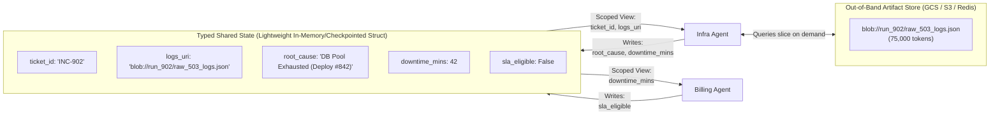
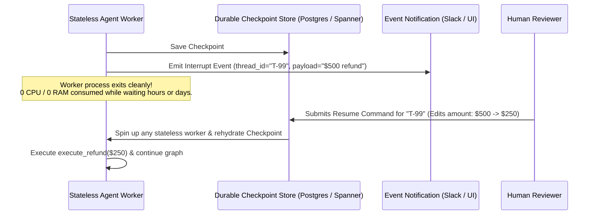
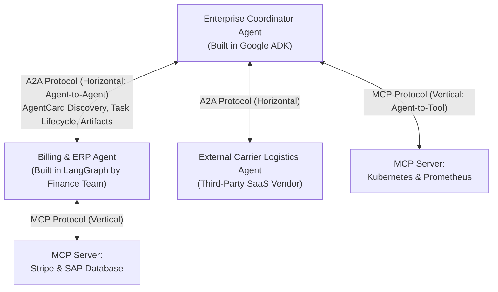

# Chapter 6 (Production Engineering): State, HITL, Sagas, Guardrails, Observability & Protocols

[⬅️ Previous: Chapter 5 — Decentralized Topologies](./chapter-05-decentralized-and-emergent-topologies.md) | [📚 Book Index](./README.md) | [Next: Chapter 7 — Decision Matrix & Framework Survey ➡️](./chapter-07-decision-matrix-and-framework-survey.md)

---

Choosing a graph topology (Chapters 2–5) is only half of agent orchestration. In production, multi-agent systems succeed or fail based on **six cross-cutting systems engineering mechanics**: Context & State Engineering, Durable Human-in-the-Loop Checkpointing, Compensating Transactions (Sagas), Hard Code Guardrails, Trajectory Observability, and Inter-Agent Protocols (MCP vs. A2A).

---

## 6.1 Context & State Passing Strategies Across Agents

When Agent A transitions to Agent B, **what exact tokens should enter Agent B's context window?**

| Strategy | Mechanism | Pros | Cons / Production Failure Mode |
| :--- | :--- | :--- | :--- |
| **1. Full History Broadcast** | Every agent reads and appends to a single shared `messages: list[Message]` transcript. | Zero setup; every agent sees everything. | **$O(K^2)$ Token Explosion & Attention Dilution:** Agent B gets confused by Agent A's internal tool calls and stack traces. |
| **2. Scoped Task String (`AgentTool`)** | Supervisor passes Agent B a synthesized instruction string; Agent B returns only its final summary string. | Cleanest context isolation; Agent B's raw tool logs are garbage-collected on return. | **"Telephone Game":** Supervisor may forget to include a critical constraint when prompting Agent B. |
| **3. Typed Shared State + Scoped Views + Artifact Pointers (Recommended)** | Agents read/write to a strongly-typed state schema (`IncidentState`). Each agent's prompt builder renders *only* the state keys relevant to its role, while large payloads are stored out-of-band by reference URI. | **Zero information loss + Zero context bloat.** | Requires explicit upfront schema design (`Pydantic` / `TypedDict`). |



### Runtime Context Compaction (Preventing "Context Rot")
Even within a single long-running agent session, prompts eventually approach context limits or suffer from middle-context attention degradation ("Context Rot"). Production orchestrators implement **three compaction strategies**:
1. **Observation Truncation / Masking:** Replace old raw tool outputs (from $>3$ turns ago) with a placeholder (`"[Tool output archived to artifact://turn_2; summary: found 42m downtime]"`) while keeping the LLM's reasoning turns intact.
2. **Rolling Summary Window:** Keep the system prompt + pinned facts + the most recent $M$ turns verbatim, while asynchronously summarizing turns $1 \dots (T - M)$ into a rolling `conversation_summary` block.
3. **Sub-Agent Context Offloading:** Any exploratory sub-task that requires $>3$ tool calls is spawned as an isolated sub-agent so its working memory is reclaimed immediately upon returning its structured result.

---

## 6.2 Human-in-the-Loop (HITL), Durable Checkpointing & Time-Travel

When an agentic workflow proposes a high-consequence action (issuing a \$5,000 refund, rolling back a production cluster, deleting customer data), you **cannot** block a Python thread with `input()` or `time.sleep()` waiting hours for a human in Slack.

Production orchestrators implement **Durable Checkpointing & Interrupts**:



### Three Standard HITL Primitives
1. **Approve / Reject Gate:** Suspend execution immediately prior to a mutating tool call; resume on approval or inject a rejection observation so the agent can choose an alternative path.
2. **Edit State & Resume:** Allow the human operator to modify tool arguments or shared state fields (e.g., editing a drafted email or changing a refund amount) before resuming from the checkpoint.
3. **Time-Travel (Replay & Fork):** If an agent makes a bad decision at Step 5 of an 8-step trace, load Checkpoint #4 in a debugging UI, modify the state or prompt at Step 4, and fork a new execution branch from Step 4 without re-running Steps 1–3.

---

## 6.3 The Agentic Saga Pattern & Idempotency (Handling Partial Write Failures)

What happens in a multi-agent workflow when:
1. `Agent 1` successfully provisions a new cloud database (`create_db_instance`),
2. `Agent 2` successfully updates DNS records (`update_dns`), and
3. `Agent 3` **fails permanently** when configuring the firewall (`PermissionDeniedError`)?

If the orchestrator simply raises an exception and exits, your production environment is left with an orphaned, billable database and broken DNS!

### 1. Idempotency Keys on Every Mutating Tool
Whenever an LLM retries a timed-out tool call (or re-runs from a checkpoint), calling `issue_refund(user_id=42, amount=100)` twice without an idempotency key will **double-refund the customer**.
* **Rule:** Every mutating tool call must inject a deterministic `idempotency_key = hash(thread_id + step_id + tool_name + canonical_args)` managed by the **orchestrator runtime** (never trusted to the LLM to generate randomly).

### 2. The Agentic Saga Pattern (Compensating Rollbacks)
In distributed systems, when a multi-step workflow spans external APIs that do not share a two-phase ACID database lock, you use a **Saga**: every forward mutating action $A_i$ registers a corresponding **Compensating Action (Undo/Rollback) $C_i$** on a rollback stack. If Step $k$ fails unrecoverably, the orchestrator pops and executes $C_{k-1} \rightarrow C_{k-2} \dots \rightarrow C_1$ in reverse order.

```python
class CompensatingStep(BaseModel):
    step_name: str
    undo_fn: Callable[[], Awaitable[None]]

async def execute_agentic_saga(steps: list[Tuple[Callable, Callable]]) -> None:
    rollback_stack: list[CompensatingStep] = []
    try:
        for forward_action, compensating_undo in steps:
            result = await forward_action()
            # Register compensating undo action immediately after forward success
            rollback_stack.append(CompensatingStep(
                step_name=forward_action.__name__,
                undo_fn=lambda res=result, undo=compensating_undo: undo(res)
            ))
    except Exception as exc:
        # Execute compensating transactions in reverse (LIFO) order!
        for comp in reversed(rollback_stack):
            await comp.undo_fn()
        raise RuntimeError(f"Workflow failed ({exc}); all prior mutations rolled back cleanly.")
```

---

## 6.4 Production Guardrails & Fault-Tolerant Circuit Breakers

Never rely on system prompt text (*"Please do not loop more than 5 times"*) to enforce operational safety. Enforce these **5 Hard Guardrails in Orchestrator Code**:

1. **Step & Handoff Budgets:** Hard caps on `max_steps_per_agent` (e.g., 10) and `max_handoffs_per_turn` (e.g., 4).
2. **State/Action Cycle Detection:** Hash `(active_agent, tool_name, canonical_args)`; if the exact same call repeats twice without intervening state changes, abort the loop.
3. **Token & Dollar Budget Circuit Breaker:** Track cumulative `prompt_tokens + completion_tokens` across all sub-agents in the parent `InvocationContext`; abort if cost exceeds `max_budget_usd` (e.g., \$0.50 per ticket).
4. **Least-Privilege Tool Scoping:** Diagnostic/Research agents receive strictly **read-only** credentials; write/mutating tools are isolated inside dedicated execution agents gated by schema validators or HITL checkpoints.
5. **Model Fallback Chains:** Wrap LLM calls with automatic fallback routing (e.g., if primary model returns `HTTP 429 / 503` after exponential backoff, fail over transparently to a secondary region or fallback model).

---

## 6.5 Agentic Observability, Distributed Tracing & Trajectory Evaluation

In a deterministic web app, a stack trace tells you which line threw an exception. In a 5-agent system, the final output might be polite, well-formatted, and **completely wrong** because Agent 2 silently misread a metric 4 steps earlier.

### 1. OpenTelemetry Distributed Tracing for Agents
Every production orchestrator must emit hierarchical trace spans using OpenTelemetry conventions (`gen_ai.*` semantic attributes):
* **Root Trace (`Invocation / Thread ID`):** Total wall-clock latency, total token bill, final outcome.
  * **Child Span (`Agent_A Run`):** System prompt version hash, input state snapshot, output state delta.
    * **Grandchild Span (`LLM Generation`):** Model ID, temperature, input/output tokens, time-to-first-token (TTFT).
    * **Grandchild Span (`Tool Call: query_logs`):** Arguments, latency, status, truncated response.

### 2. Evaluating Multi-Agent Systems: Final Response vs. Trajectory Evaluation
Evaluating only the final output string is insufficient—an agent might guess the right answer for the wrong reason or call 15 unnecessary tools. Production evaluation suites (like Google ADK Eval / LangSmith / Vertex GenAI Eval) measure **two orthogonal axes**:

| Evaluation Axis | Metrics Measured | What It Catches |
| :--- | :--- | :--- |
| **1. Trajectory & Tool-Use Accuracy (Process Eval)** | • **Exact Trajectory Match:** Did agents/tools fire in the exact golden sequence?<br/>• **In-Order / Any-Order Match:** Were all required tools (`get_deployments`, `check_sla`) called at least once?<br/>• **Tool Argument Precision:** Were arguments schema-valid and accurate?<br/>• **Step Efficiency:** Ratio of minimum required steps to actual steps taken. | Catches redundant tool loops, skipped policy checks, wrong sub-agent routing, and infinite handoff ping-pongs. |
| **2. Outcome & Groundedness Quality (Output Eval)** | • **Factual Faithfulness (Hallucination Check):** Are all claims grounded strictly in tool observations?<br/>• **Completeness Rubric:** Did it answer *all* parts of a multi-intent query?<br/>• **Safety & PII:** Zero leaked internal IPs, secrets, or policy violations. | Catches "Telephone Game" information loss across supervisors and ungrounded synthesis. |

---

## 6.6 Interoperability Protocols: MCP vs. A2A

As enterprise agent ecosystems grow, two complementary open protocols standardize how agents connect to **tools** (Vertical) and to **other agents** (Horizontal):

* **MCP (Model Context Protocol):** Standardizes **Vertical Integration (Agent $\leftrightarrow$ Tools, Data Resources, & Prompt Templates)**. An MCP Server exposes tools (e.g., Postgres queries, GitHub PR actions, Kubernetes APIs) over a uniform JSON-RPC schema so any MCP-compliant agent can discover and invoke them without custom wrapper code.
* **A2A (Agent2Agent Protocol):** Standardizes **Horizontal Integration (Agent $\leftrightarrow$ Agent across organizational/framework boundaries)**. Instead of exposing internal tools or memory, an A2A-compliant agent publishes an **`AgentCard`** (`/.well-known/agent.json`) declaring its high-level capabilities, authentication requirements, and input/output modalities, and communicates via asynchronous task lifecycles (`Task`, `Artifact`, streaming `StatusUpdate`, and push notifications).



| Dimension | MCP (Model Context Protocol) | A2A (Agent2Agent Protocol) |
| :--- | :--- | :--- |
| **Integration Direction** | **Vertical:** Agent $\leftrightarrow$ Tool / Resource. | **Horizontal:** Client Agent $\leftrightarrow$ Remote Peer Agent. |
| **Target Abstraction** | Deterministic functions, APIs, DB schemas, file resources. | Autonomous, stateful, multi-turn reasoning partners. |
| **State & Execution** | Typically stateless, synchronous RPC tool calls. | Stateful task lifecycle (`submitted`, `working`, `input-required`, `completed`) supporting long-running async work. |
| **Opacity Boundary** | Agent sees the exact tool schema and raw tool output. | **Opaque:** Client agent never sees the remote agent's internal system prompt, model, reasoning trace, or private tools. |

---

[⬅️ Previous: Chapter 5 — Decentralized Topologies](./chapter-05-decentralized-and-emergent-topologies.md) | [📚 Book Index](./README.md) | [Next: Chapter 7 — Decision Matrix & Framework Survey ➡️](./chapter-07-decision-matrix-and-framework-survey.md)
