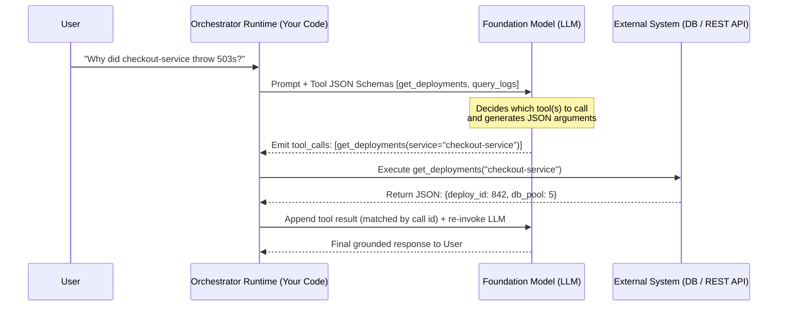
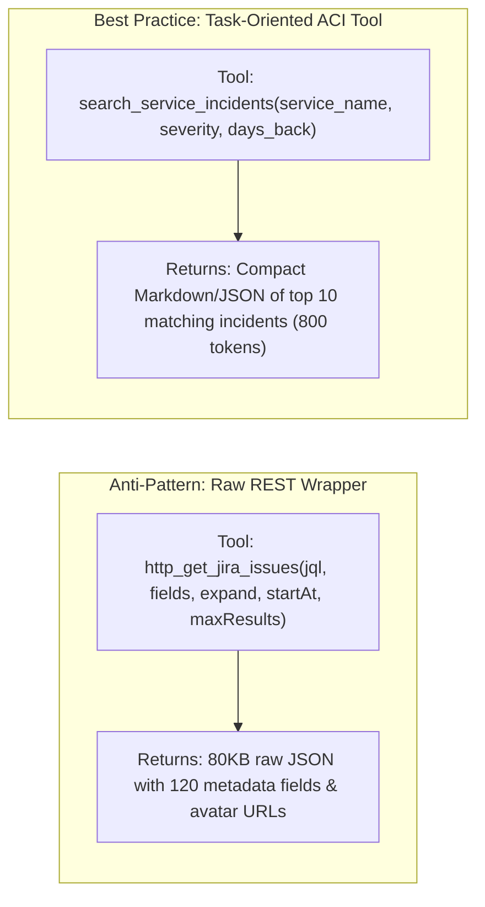
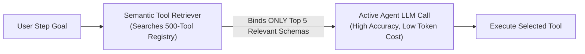

# Chapter 6: Tool Calling and Action Engineering (Beginner to Advanced)

[← Previous: Chapter 5 — Decentralized Topologies](./chapter-05-decentralized-and-emergent-topologies.md) | [Book Index](./README.md) | [Next: Chapter 7 — Agentic RAG & Knowledge Grounding →](./chapter-07-agentic-rag-and-knowledge-grounding.md)

---

Without tools, an LLM is a passive text generator stuck behind its training cutoff. **Tool calling** (also called function calling) is what turns a language model into an agent that can read real-time state and change things in the outside world.

The chapter moves from Beginner material (how tool calling actually works) to Intermediate (designing the agent–computer interface and schemas that help the model recover from its own mistakes) and then to Advanced topics: dynamic tool retrieval at scale, `CodeAct` sandboxes, OAuth credential scoping, idempotency, and agentic sagas.

---

## 6.1 Beginner: How tool calling works

### LLMs never execute tools directly
A common beginner assumption is that the LLM connects to your database or API itself. It doesn't. Tool calling is a strict two-party handshake between the LLM (the brain) and your application runtime (the hands):

1. **Declaration.** Your application sends the user prompt *plus* a list of JSON Schema tool declarations (function name, description, parameter types, required fields) to the LLM.
2. **Selection and argument generation.** The LLM doesn't run any code. It emits a structured tool-call request. Under the hood these are special tokens, which the provider's API parses into a `tool_calls` object with a unique call `id`, for example `{"id": "call_1", "name": "get_deployments", "arguments": {"service": "checkout-service", "days": 2}}`.
3. **Execution.** Your runtime intercepts the request, validates the arguments, runs the actual Python/Go/API function inside your infrastructure, and serializes the return value.
4. **Observation injection.** Your application appends a tool-result message, linked to the call `id`, to the conversation history and calls the LLM again. The wire format varies by provider. OpenAI Chat Completions uses a `role="tool"` message with `tool_call_id`. Anthropic uses a `tool_result` content block (with `tool_use_id`) inside the next `user` message. Gemini uses a `functionResponse` part. Open-weight models (Llama, Qwen, Mistral) served through OpenAI-compatible servers such as vLLM or Ollama usually follow the OpenAI shape. Agent frameworks and gateways paper over these differences, but your history store must preserve the call-id linkage.



### Controlling tool use with `tool_choice` and strict schemas
Every major API lets you control *whether* the model calls a tool through `tool_choice`. You can let it decide (`auto`), force it to call some tool (`required` in OpenAI, `any` in Anthropic, `ANY` mode in Gemini), force one specific function, or forbid tools entirely (`none`). Forcing a tool is handy for deterministic first steps, such as always classifying intent first. Inside agent loops, `auto` is the norm.

Strict modes go further. With `"strict": true` on OpenAI function definitions (and, since late 2025, on Anthropic tool definitions), the model's arguments are generated under a grammar compiled from your JSON Schema, so they're guaranteed to parse and match the schema. They aren't guaranteed to be *correct*. A perfectly valid `service` string can still name the wrong service, so keep your runtime validation and business-rule checks.

### Parallel vs. sequential tool calls
Modern models can emit several `tool_calls` in one turn, and whether they should depends on whether the calls depend on each other.

If a user asks *"Compare weather in Tokyo and Paris"*, the two lookups are independent. The LLM emits both in Turn 1, `[get_weather("Tokyo"), get_weather("Paris")]`, the runtime runs them concurrently, and it returns all results (each matched to its call `id`) in the next request. That saves a full model round trip and overlaps the tools' latencies.

If the user asks *"Find who deployed `checkout-service` yesterday and message them on Slack"*, the second call needs the first one's output. The LLM has to emit `get_deployments` in Turn 1, wait for the observation (`author="alice"`), and only then emit `send_slack_message(user="alice")` in Turn 2.

One caveat: when tools have side effects that depend on ordering, turn parallelism off (OpenAI `parallel_tool_calls=false`, Anthropic `disable_parallel_tool_use`) or serialize mutating calls in your runtime.

```python
async def execute_tool_calls(tool_calls: list[ToolCall], registry: dict[str, Tool]) -> list[dict]:
    async def run_one(call: ToolCall) -> dict:
        try:
            tool = registry[call.name]                                # unknown tool -> KeyError
            args = tool.args_model.model_validate_json(call.arguments)  # bad args -> ValidationError
            output = await tool.fn(args)
        except Exception as exc:
            # A failing tool becomes an error OBSERVATION the model can react to, not a crashed turn
            output = f"ToolError: {type(exc).__name__}: {exc}"
        return {"role": "tool", "tool_call_id": call.id, "content": str(output)}

    # gather() preserves input order; per-call try/except means one failure never cancels the others
    return await asyncio.gather(*(run_one(c) for c in tool_calls))
```

### Tool calling vs. structured outputs
Use tool calling when the LLM needs to interact with an external environment mid-loop and look at the returned observation before it finishes.

Use structured outputs when the LLM already has everything it needs in context and you just want its final output to conform to a strict JSON schema that downstream code can consume. Options include OpenAI `response_format` / `text.format` with a JSON Schema, Anthropic JSON outputs, Gemini `response_schema`, or grammar-constrained decoding for self-hosted open-weight models via vLLM or llama.cpp. Constrained decoding guarantees the *shape*. You still have to handle refusals, truncation (max tokens), and values that are well-formed but semantically wrong.

### Thinking models and tool calls
Reasoning ("thinking") models can reason *between* tool calls, which is called interleaved thinking. That cuts down on the hand-written "think step by step" scaffolding tool loops used to need. The operational catch is that the provider may return opaque reasoning state alongside a tool call, and you have to send it back unmodified with the tool result. That covers Anthropic `thinking` blocks, Gemini `thoughtSignature` fields (Gemini 3 rejects function-calling turns with missing signatures), and OpenAI Responses API reasoning items. A custom history store that keeps only `name` + `arguments` will silently break or degrade multi-step tool use.

---

## 6.2 Intermediate: Agent–computer interface and schema design

Human software depends on good human–computer interfaces (HCI/UX). Agents depend on a well-designed **agent–computer interface (ACI)**, a term popularized by the SWE-agent paper (Yang et al., NeurIPS 2024). That paper showed that redesigning the interface alone substantially changed a fixed model's SWE-bench performance. Anthropic reports that while building its SWE-bench agent it *"spent more time optimizing our tools than the overall prompt"* (*Building Effective Agents*, Dec 2024). Better tool design is often a bigger win than a bigger model.

### Principle 1: Don't expose raw low-level REST APIs
The anti-pattern is a thin API wrapper: a raw Kubernetes or Jira REST endpoint exposed as-is, with 45 nested query parameters, pagination cursors, and cryptic integer status codes (`status_id=10004`). The LLM wastes tokens guessing parameter combinations, and its context window overflows when the API dumps a 2MB raw JSON response.

Instead, consolidate low-level APIs into high-level, task-oriented tools. They should accept human-readable arguments (`status: Literal["OPEN", "RESOLVED"]`), do the joins and filtering in Python, and return only the compact fields the agent actually needs.



### Principle 2: Engineer the docstring and parameter schema
Everything the LLM knows about a tool comes from its name, description, and parameter schema. A production tool definition should cover the following:

1. When to use it, and when not to. For example: *"Use to fetch live service error logs. Do NOT use for billing invoice history—use `get_billing_events` instead."*
2. Strict types and `Literal` enums. Replace a vague `str` parameter with `Literal["us-east", "us-west", "eu-central"]` so the model can't hallucinate an invalid region name. Strict mode enforces this at generation time; otherwise it's caught at validation time.
3. Format examples in `Field(description=...)`. State the expected format explicitly (`"ISO-8601 UTC date, e.g., '2026-10-15T14:00:00Z'"`).
4. Mistake-proof ("poka-yoke") arguments. Design parameters so errors are hard to make. Anthropic, for instance, switched its file tools to require absolute paths after the agent mishandled relative ones.
5. Namespaced, non-overlapping names. Prefix by service or resource (`jira_search_issues`, `pagerduty_list_incidents`) so tools from many servers, such as several MCP servers (see [Chapter 9](./chapter-09-mcp-and-a2a-interoperability.md)), don't collide or blur together.
6. Verbosity the agent controls. Offer a `response_format: Literal["concise", "detailed"]` (or pagination and filters) so the agent can fetch IDs cheaply and pull detail only when it needs it. Anthropic recommends this in *Writing effective tools for agents* (Sept 2025).

MCP tools can also declare behavior hints such as `readOnlyHint`, `destructiveHint`, `idempotentHint`, and `openWorldHint`. Use them to drive approval UX and retry policy, but treat them as untrusted hints from the server, not as security guarantees.

### Principle 3: Return errors as actionable observations
When a tool fails or finds nothing, don't return an empty string `""` or let an exception escape. Return a corrective hint so the LLM knows how to recover on its next turn. Argument `ValidationError`s should come back the same way (see `execute_tool_calls` above). MCP follows the same idea: tool execution errors are returned as results with `isError: true`, not as protocol errors.

```python
from typing import Literal
from pydantic import BaseModel, Field

class QueryLogsArgs(BaseModel):
    service: str = Field(description="Exact microservice name, e.g. 'checkout-service'")
    status_code: Literal[400, 401, 403, 404, 500, 502, 503, 504]
    window_minutes: int = Field(default=60, ge=1, le=1440)

def query_logs(args: QueryLogsArgs) -> str:
    if args.service not in KNOWN_SERVICES:
        # Actionable recovery hint inside the observation!
        matches = get_closest_service_names(args.service)
        return f"ToolError: Unknown service '{args.service}'. Did you mean one of: {matches}?"
    rows = log_db.fetch(args.service, args.status_code, args.window_minutes)
    if not rows:
        return f"0 logs found for {args.service} with status {args.status_code} in last {args.window_minutes}m. Try expanding window_minutes or checking upstream dependencies."
    return format_compact_table(rows[:25])  # Always cap output rows to prevent context blowup!
```

It helps to sort errors into three kinds. Retryable errors (timeouts, 429s) should be retried in the runtime with backoff, invisibly to the model. Model-correctable errors (bad arguments, unknown entity) should come back as a hint. Fatal errors (permission denied) should tell the model to stop and escalate.

---

## 6.3 Advanced: Tool discovery, `CodeAct` sandboxes, and transactional safety

The techniques so far assume a modest toolset and simple calls. Things change when your enterprise platform has 300 tools, or when an agent has to compose data transformations across five tool outputs.

### 1. Dynamic tool retrieval (scaling past ~20 tools)
As discussed in Chapter 3, a common rule of thumb is that binding more than roughly $15\text{–}20$ tool schemas directly into the prompt starts to hurt tool-selection accuracy. The exact threshold depends on the model and on how distinct the tools are. It also burns thousands of input tokens on every turn. When a single agent needs a catalog of $100\text{–}500$ tools, retrieve tools the way you'd retrieve documents.

Two-stage semantic tool retrieval (Tool-RAG) works like this:

1. Index all 500 tool descriptions in a lightweight vector or hybrid index.
2. Give the agent a meta-tool, `search_available_tools(query: str)`, or run a semantic filter before each turn. It retrieves the top $K \approx 5$ relevant tool schemas for the current step and binds only those into the active LLM call. Keep a small, stable "core" toolset always loaded.

There's also a provider-native option. Anthropic's Tool Search Tool (Nov 2025) does this server-side: you mark catalog tools with `defer_loading: true`, and the model searches (regex or BM25 variants) and loads matching definitions on demand.

Watch out for prompt caching. Tool definitions sit at the *front* of the prompt, so swapping the bound toolset every turn invalidates the provider's prefix cache. Prefer append-only or deferred loading, or a stable core set, and measure cost with caching turned on (see [Chapter 13](./chapter-13-agentic-finops-and-tokenomics.md)).



### 2. `CodeAct` (code as the action)
With standard JSON tool calling, an agent that needs to fetch 50 customer records and check each against a formula has two bad choices: emit 50 JSON tool calls, or push a huge list through its tokens.

**CodeAct** (Wang et al., *"Executable Code Actions Elicit Better LLM Agents"*, ICML 2024) takes a different route. The agent writes a short Python script that calls the provided tool functions, runs `for` loops, filters and aggregates the data (in pandas, say), and prints only the final summary. The script runs inside an isolated sandbox: a container (e.g., gVisor), WebAssembly, or a microVM (e.g., Firecracker). The paper reported up to ~20% higher success rates than JSON/text actions on its benchmarks, with fewer turns.

It works because many turns of JSON tool ping-pong collapse into one turn of code execution. Loops and arithmetic run deterministically in the interpreter (though the generated code is still LLM-written and can be wrong), and intermediate data stays out of the context window.

The idea showed up in several products in 2025: Hugging Face `smolagents` (`CodeAgent`); Anthropic's Programmatic Tool Calling and its *"Code execution with MCP"* post (Nov 2025), which reports one example workflow dropping from ~150k to ~2k tokens; and Cloudflare's "Code Mode", which exposes MCP tools as a TypeScript API inside a sandbox.

The cost is that you're now executing untrusted, LLM-generated code. Sandboxing, network egress control, and resource limits are mandatory (see [Chapter 12](./chapter-12-agentic-security-identity-and-sandboxing.md)). Per-call approval and policy checks also get harder when many tool calls happen inside one script, so enforce authorization inside the tool functions themselves.

### 3. Production security: least privilege, idempotency, and sagas
Once tools mutate production state, the following controls are mandatory.

1. **Least-privilege credential injection.** Secrets never pass through the LLM. It must never see API keys, database passwords, or raw user OAuth tokens, whether in its prompt or in tool arguments. The orchestrator runtime injects the caller's scoped identity token inside the tool execution wrapper (`ctx.auth_token`) and enforces role-based access control (RBAC) in code.
2. **Tool outputs are untrusted input.** Web pages, tickets, emails, and file contents returned by tools can carry indirect prompt injections. Never let tool output alone authorize a sensitive action (see the "lethal trifecta" and CaMeL in [Chapter 12](./chapter-12-agentic-security-identity-and-sandboxing.md)), and put destructive or irreversible tools behind human approval ([Chapter 17](./chapter-17-production-state-hitl-and-frameworks.md)).
3. **Deterministic idempotency keys.** Every mutating tool call (`issue_refund`, `create_ticket`, `deploy_service`) must compute an idempotency key in the runtime wrapper, e.g. `sha256(json.dumps([thread_id, step_index, tool_name, canonical_args]))`. Use a canonical, delimited encoding rather than raw string concatenation to avoid collisions. That way network retries and checkpoint replays never run a mutation twice. Two caveats. First, the downstream system has to honor the key (Stripe's `Idempotency-Key` header, for example), or you need your own `key → result` ledger. Second, checkpoint the model's tool-call decision *before* executing it, so a replay reuses the same arguments instead of re-sampling new ones, which would produce a new key.
4. **Agentic sagas (compensating actions).** When a multi-tool workflow mutates external systems $A \rightarrow B \rightarrow C$, register a compensating undo action (`cancel_A`, `revert_B`) after each forward step succeeds. If Step $C$ fails permanently, run the compensations in reverse (LIFO) order:

```python
async def execute_transactional_tool_saga(
    steps: list[tuple[Callable[[], Awaitable[Any]], Callable[[Any], Awaitable[None]]]]
) -> list[Any]:
    compensations: list[Callable[[], Awaitable[None]]] = []
    results: list[Any] = []
    try:
        for forward_tool, compensating_undo_tool in steps:
            res = await forward_tool()
            results.append(res)
            # Default args bind the CURRENT loop values (avoids Python's late-binding closure bug)
            compensations.append(lambda r=res, undo=compensating_undo_tool: undo(r))
        return results
    except Exception as exc:
        failed: list[Exception] = []
        for compensate in reversed(compensations):  # Unwind completed mutations in LIFO order
            try:
                await compensate()  # Compensations must themselves be idempotent and retry-safe
            except Exception as comp_exc:
                failed.append(comp_exc)  # Keep unwinding: never stop half-way through
        if failed:
            raise RuntimeError(
                f"Saga aborted ({exc!r}); {len(failed)} compensation(s) FAILED. Manual repair required."
            ) from exc
        raise RuntimeError(f"Saga aborted ({exc!r}); all completed steps compensated.") from exc
```

> [!IMPORTANT]
> A compensation is a *semantic* undo, not a database rollback. A refund isn't the same as never having charged the customer, and a sent email can't be unsent. Put non-compensable steps last (or behind approval). For long-running sagas, use durable execution and checkpointing so the unwind survives a process crash ([Chapter 17](./chapter-17-production-state-hitl-and-frameworks.md)).

---

## Chapter 6 summary

| Level | Capability | Problem solved | Key takeaway |
| :--- | :--- | :--- | :--- |
| Beginner | JSON Schema function calling (sequential and parallel, `tool_choice`, strict mode) | Connects a stateless LLM to live external data and actions. | The LLM *selects* the tool and emits JSON args; your runtime code executes it and returns results matched by call `id`. |
| Intermediate | ACI design, constrained schemas, and error-as-observation | Fixes hallucinated args, context blowups, and unhandled crashes. | Build task-oriented, namespaced, mistake-proof tools instead of thin REST wrappers, cap output size, and return actionable error hints. |
| Advanced | Dynamic Tool-RAG / Tool Search, `CodeAct` sandboxes, idempotency, and sagas | Scales to 500+ tools, multi-step data processing, and safe writes. | Retrieve the top-$K$ tools dynamically (cache-aware), use sandboxed code for loops, and wrap mutations in idempotent, compensable sagas. |

---

[← Previous: Chapter 5 — Decentralized Topologies](./chapter-05-decentralized-and-emergent-topologies.md) | [Book Index](./README.md) | [Next: Chapter 7 — Agentic RAG & Knowledge Grounding →](./chapter-07-agentic-rag-and-knowledge-grounding.md)
