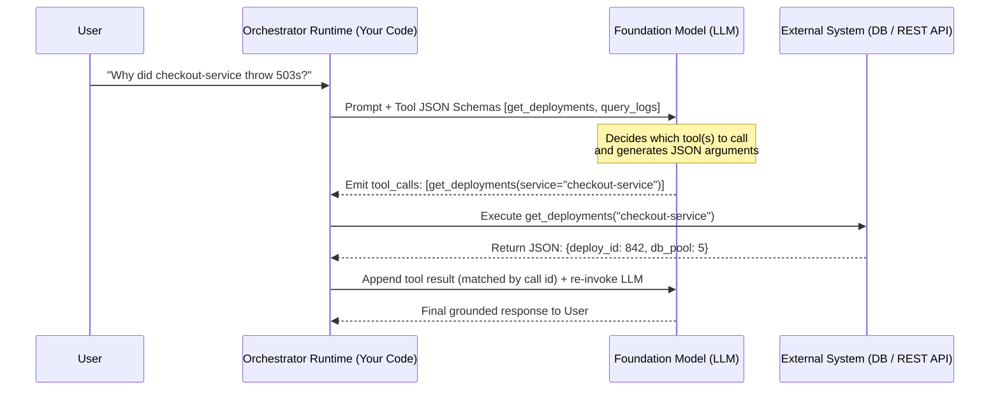
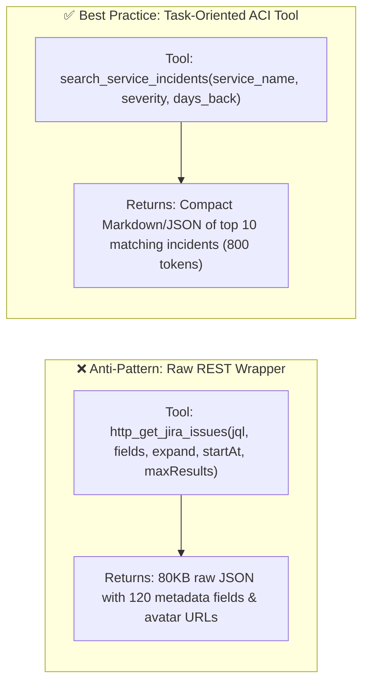
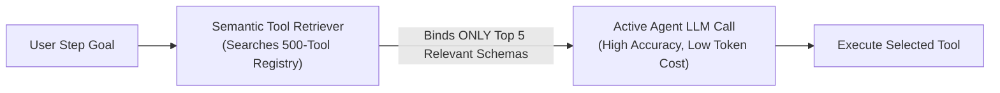

# Chapter 6: Tool Calling & Action Engineering (Beginner to Advanced)

[⬅️ Previous: Chapter 5 — Decentralized Topologies](./chapter-05-decentralized-and-emergent-topologies.md) | [📚 Book Index](./README.md) | [Next: Chapter 7 — Agentic RAG & Knowledge Grounding ➡️](./chapter-07-agentic-rag-and-knowledge-grounding.md)

---

Without tools, an LLM is a passive text generator trapped inside its training cutoff. **Tool Calling (Function Calling)** is the bridge that transforms a language model into an **agent** capable of sensing real-time state and mutating the external world.

This chapter progresses from **Beginner** (how tool calling actually works under the hood) to **Intermediate** (Agent–Computer Interface design and self-healing schemas) to **Advanced** (dynamic tool retrieval at scale, `CodeAct` sandboxes, OAuth credential scoping, idempotency, and Agentic Sagas).

---

## 6.1 Beginner: How Tool Calling Works Under the Hood

### The Fundamental Rule: LLMs Never Execute Tools Directly
A common beginner misconception is that the LLM connects to your database or API itself. In reality, tool calling is a strict **two-party handshake** between the **LLM (Brain)** and the **Application Runtime (Hands)**:

1. **Declaration:** Your application sends the user prompt *plus* a list of JSON Schema tool declarations (function name, description, parameter types, and required fields) to the LLM.
2. **Selection & Argument Generation:** The LLM does **not** run code. Instead, it emits a structured tool-call request—under the hood, special tokens that the provider's API parses into a `tool_calls` object with a unique call `id`, e.g., `{"id": "call_1", "name": "get_deployments", "arguments": {"service": "checkout-service", "days": 2}}`.
3. **Execution:** Your application runtime intercepts that request, validates the arguments, executes the actual Python/Go/API function inside your infrastructure, and serializes the return value.
4. **Observation Injection:** Your application appends a tool-result message **linked to the call `id`** back into the conversation history and calls the LLM again. The wire format differs by provider: OpenAI Chat Completions uses a `role="tool"` message with `tool_call_id`; Anthropic uses a `tool_result` content block (with `tool_use_id`) inside the next `user` message; Gemini uses a `functionResponse` part. Open-weight models (Llama, Qwen, Mistral) served through OpenAI-compatible servers such as vLLM or Ollama typically follow the OpenAI shape. Agent frameworks and gateways normalize these differences, but your history store must preserve the call-id linkage.



### Controlling Tool Use: `tool_choice` and Strict Schemas
* **`tool_choice`:** Every major API lets you constrain *whether* the model calls a tool: let it decide (`auto`), force it to call some tool (`required` in OpenAI, `any` in Anthropic, `ANY` mode in Gemini), force a specific function, or forbid tools (`none`). Forcing a tool is useful for deterministic first steps (e.g., always classify intent first); leaving it on `auto` is the norm inside agent loops.
* **Strict / constrained decoding:** With provider strict modes (e.g., `"strict": true` on OpenAI function definitions and, since late 2025, on Anthropic tool definitions), the model's arguments are generated under a grammar compiled from your JSON Schema, so they are guaranteed to *parse and match the schema*. They are **not** guaranteed to be *correct* (a valid `service` string can still be the wrong service), so keep runtime validation and business-rule checks.

### Parallel Tool Calling vs. Sequential Tool Calling
Modern models support emitting **multiple `tool_calls` in a single turn**:
* **Parallel Tool Calls (Independent Queries):** If a user asks *"Compare weather in Tokyo and Paris"*, the LLM emits two tool calls in Turn 1: `[get_weather("Tokyo"), get_weather("Paris")]`. The runtime executes both concurrently and returns **all** results (each matched to its call `id`) in the next request—saving a full model round trip and overlapping the tools' latencies.
* **Sequential Tool Calls (Dependent Queries):** If a user asks *"Find who deployed `checkout-service` yesterday and message them on Slack"*, the LLM must emit `get_deployments` in Turn 1, wait for the observation (`author="alice"`), and only then emit `send_slack_message(user="alice")` in Turn 2.
* **Caveat:** When tools have ordering-sensitive side effects, disable parallelism (e.g., OpenAI `parallel_tool_calls=false`, Anthropic `disable_parallel_tool_use`) or serialize mutating calls in your runtime.

```python
async def execute_tool_calls(tool_calls: list[ToolCall], registry: dict[str, Tool]) -> list[dict]:
    async def run_one(call: ToolCall) -> dict:
        try:
            tool = registry[call.name]                                # unknown tool -> KeyError
            args = tool.args_model.model_validate_json(call.arguments)  # bad args -> ValidationError
            output = await tool.fn(args)
        except Exception as exc:
            # A failing tool becomes an error OBSERVATION the model can react to, not a crashed turn
            output = f"ToolError: {type(exc).__name__}: {exc}"
        return {"role": "tool", "tool_call_id": call.id, "content": str(output)}

    # gather() preserves input order; per-call try/except means one failure never cancels the others
    return await asyncio.gather(*(run_one(c) for c in tool_calls))
```

### Tool Calling vs. Structured Outputs (JSON-Schema-Constrained Responses)
* **Use Tool Calling** when the LLM needs to **interact with an external environment** mid-loop and inspect the returned observation before finishing.
* **Use Structured Outputs** (e.g., OpenAI `response_format` / `text.format` with a JSON Schema, Anthropic JSON outputs, Gemini `response_schema`, or grammar-constrained decoding for self-hosted open-weight models via vLLM or llama.cpp) when the LLM already has all the information it needs in context and you want its **final output** to conform to a strict JSON schema for downstream code consumption. With constrained decoding the *shape* is guaranteed; still handle refusals, truncation (max tokens), and semantically wrong values.

### Thinking Models & Tool Calls
Reasoning ("thinking") models can reason *between* tool calls (interleaved thinking), which reduces the need for hand-written "think step by step" scaffolding in tool loops. The operational gotcha: the provider may return opaque reasoning state alongside a tool call that **you must send back unmodified** with the tool result—Anthropic `thinking` blocks, Gemini `thoughtSignature` fields (Gemini 3 rejects function-calling turns with missing signatures), and OpenAI Responses API reasoning items. Custom history stores that keep only `name` + `arguments` silently break or degrade multi-step tool use.

---

## 6.2 Intermediate: Agent–Computer Interface (ACI) & Schema Engineering

Just as human software relies on good **Human–Computer Interfaces (HCI/UX)**, agents rely on well-designed **Agent–Computer Interfaces (ACI)**—a term popularized by the SWE-agent paper (Yang et al., NeurIPS 2024), which showed that redesigning the interface alone substantially changed a fixed model's SWE-bench performance. Anthropic reports that while building its SWE-bench agent it *"spent more time optimizing our tools than the overall prompt"* (*Building Effective Agents*, Dec 2024). Tool design is often a higher-leverage fix than a bigger model.

### Principle 1: Never Expose Raw Low-Level REST APIs Directly
* **Anti-Pattern (Thin API Wrapper):** Exposing a raw Kubernetes or Jira REST endpoint with 45 nested query parameters, pagination cursors, and cryptic integer status codes (`status_id=10004`). The LLM wastes tokens guessing parameter combinations and overflows its context window when the API dumps a 2MB raw JSON response.
* **Best Practice (Task-Oriented Tool Consolidation):** Wrap low-level APIs into high-level, domain-meaningful tools that accept human-readable arguments (`status: Literal["OPEN", "RESOLVED"]`), perform joins/filtering in Python, and return **only the compact fields the agent actually needs**.



### Principle 2: Docstring & Parameter Schema Engineering
The LLM's *only* understanding of a tool comes from its name, description, and parameter schema. Every production tool definition should specify:
1. **When to use it AND when NOT to use it** (e.g., *"Use to fetch live service error logs. Do NOT use for billing invoice history—use `get_billing_events` instead."*).
2. **Strict Types & `Literal` Enums:** Replace vague `str` parameters with `Literal["us-east", "us-west", "eu-central"]` so the model cannot hallucinate invalid region names (enforced at generation time under strict mode, and at validation time otherwise).
3. **Format Examples in `Field(description=...)`:** Explicitly state expected formats (`"ISO-8601 UTC date, e.g., '2026-10-15T14:00:00Z'"`).
4. **Mistake-Proof ("Poka-Yoke") Arguments:** Design parameters so errors are hard to make—e.g., Anthropic switched its file tools to require **absolute paths** after the agent mishandled relative paths.
5. **Namespaced, Non-Overlapping Names:** Prefix by service/resource (`jira_search_issues`, `pagerduty_list_incidents`) so tools from many servers (e.g., multiple MCP servers—see [Chapter 9](./chapter-09-mcp-and-a2a-interoperability.md)) don't collide or blur together.
6. **Agent-Controlled Verbosity:** Offer a `response_format: Literal["concise", "detailed"]` (or pagination/filters) so the agent can fetch IDs cheaply and pull detail only when needed (recommended in Anthropic's *Writing effective tools for agents*, Sept 2025).

> **MCP tool annotations:** MCP tools can declare behavior hints such as `readOnlyHint`, `destructiveHint`, `idempotentHint`, and `openWorldHint`. Use them to drive approval UX and retry policy—but treat them as *untrusted hints* from the server, not security guarantees.

### Principle 3: Actionable Error-as-Observation Formatting
When a tool fails or returns 0 results, never return an empty string `""` or raise an uncaught exception. Return a **corrective hint** so the LLM knows how to recover on the next turn (argument `ValidationError`s should be returned the same way—see `execute_tool_calls` above; in MCP, tool execution errors are returned as results with `isError: true` rather than protocol errors):

```python
from typing import Literal
from pydantic import BaseModel, Field

class QueryLogsArgs(BaseModel):
    service: str = Field(description="Exact microservice name, e.g. 'checkout-service'")
    status_code: Literal[400, 401, 403, 404, 500, 502, 503, 504]
    window_minutes: int = Field(default=60, ge=1, le=1440)

def query_logs(args: QueryLogsArgs) -> str:
    if args.service not in KNOWN_SERVICES:
        # Actionable recovery hint inside the observation!
        matches = get_closest_service_names(args.service)
        return f"ToolError: Unknown service '{args.service}'. Did you mean one of: {matches}?"
    rows = log_db.fetch(args.service, args.status_code, args.window_minutes)
    if not rows:
        return f"0 logs found for {args.service} with status {args.status_code} in last {args.window_minutes}m. Try expanding window_minutes or checking upstream dependencies."
    return format_compact_table(rows[:25])  # Always cap output rows to prevent context blowup!
```

Distinguish **retryable** errors (timeouts, 429s—retry in the runtime with backoff, invisibly to the model) from **model-correctable** errors (bad arguments, unknown entity—return a hint) and **fatal** errors (permission denied—tell the model to stop and escalate).

---

## 6.3 Advanced: Dynamic Tool Discovery, `CodeAct` Sandboxes & Transactional Safety

What happens when your enterprise platform has **300 tools**, or when an agent needs to compose complex data transformations across 5 tool outputs?

### 1. Dynamic Tool Retrieval (Scaling Past ~20 Tools)
As discussed in Chapter 3, a common rule of thumb is that binding more than roughly $15\text{–}20$ tool schemas directly into the LLM prompt starts to degrade tool-selection accuracy (the exact threshold depends on the model and on how distinct the tools are) and burns thousands of input tokens on every turn. When a single agent must access a catalog of $100\text{–}500$ tools:
* **Two-Stage Semantic Tool Retrieval (Tool-RAG):**
  1. Index all 500 tool descriptions in a lightweight vector/hybrid index.
  2. Equip the agent with a meta-tool `search_available_tools(query: str)` (or run a pre-turn semantic filter) that retrieves the **top $K \approx 5$ relevant tool schemas** for the current step and binds only those schemas into the active LLM call. Keep a small, stable "core" toolset always loaded.
* **Provider-native option:** Anthropic's Tool Search Tool (Nov 2025) implements this server-side: you mark catalog tools with `defer_loading: true`, and the model searches (regex or BM25 variants) and loads matching definitions on demand.
* **Prompt-caching caveat:** Tool definitions sit at the *front* of the prompt, so swapping the bound toolset every turn invalidates the provider's prefix cache. Prefer append-only/deferred loading or a stable core set, and measure cost with caching on (see [Chapter 13](./chapter-13-agentic-finops-and-tokenomics.md)).



### 2. `CodeAct` (Executable Code-as-Action Sandboxes)
In standard JSON tool calling, if an agent needs to fetch 50 customer records and check each one against a formula, it either has to emit 50 JSON tool calls or process a huge list in tokens.
* **The `CodeAct` Pattern (Wang et al., *"Executable Code Actions Elicit Better LLM Agents"*, ICML 2024):** Instead of emitting JSON tool calls one by one, the agent writes a short **Python script** that calls the provided tool functions, runs `for` loops, filters/aggregates data (e.g., in pandas), and prints only the final summary—executed inside an isolated **container (e.g., gVisor), WebAssembly, or microVM (e.g., Firecracker) sandbox**. The paper reported up to ~20% higher success rates than JSON/text actions on its benchmarks, with fewer turns.
* **Why it works:** Can consolidate many turns of JSON tool ping-pong into **one** turn of code execution: loops and arithmetic run deterministically in the interpreter (the *generated code* is still LLM-written and can be wrong), and intermediate data stays out of the LLM context window.
* **2025 incarnations:** Hugging Face `smolagents` (`CodeAgent`), Anthropic's **Programmatic Tool Calling** and its *"Code execution with MCP"* post (Nov 2025; reports one example workflow dropping from ~150k to ~2k tokens), and Cloudflare's **"Code Mode"** (MCP tools exposed as a TypeScript API inside a sandbox).
* **Trade-offs:** You are now executing untrusted, LLM-generated code—sandboxing, network egress control, and resource limits are mandatory (see [Chapter 12](./chapter-12-agentic-security-identity-and-sandboxing.md)). Per-call approval and policy checks are harder when many tool calls happen inside one script, so enforce authorization inside the tool functions themselves.

### 3. Production Security: Least-Privilege Scoping, Idempotency & Agentic Sagas
When tools mutate production state, these architectural controls are mandatory:
1. **Least-Privilege Credential Injection (Never Pass Secrets via LLM):** The LLM must **never** see API keys, database passwords, or raw user OAuth tokens in its prompt or tool arguments. The **Orchestrator Runtime** injects the caller's scoped identity token inside the tool execution wrapper (`ctx.auth_token`) and enforces Role-Based Access Control (RBAC) in code.
2. **Treat Tool Outputs as Untrusted Input:** Web pages, tickets, emails, and file contents returned by tools can carry indirect prompt injections. Never let tool output alone authorize a sensitive action (see the "lethal trifecta" and CaMeL in [Chapter 12](./chapter-12-agentic-security-identity-and-sandboxing.md)); gate destructive or irreversible tools behind human approval ([Chapter 17](./chapter-17-production-state-hitl-and-frameworks.md)).
3. **Deterministic Idempotency Keys:** Every mutating tool call (`issue_refund`, `create_ticket`, `deploy_service`) must compute an idempotency key in the runtime wrapper—e.g., `sha256(json.dumps([thread_id, step_index, tool_name, canonical_args]))` (use a canonical, delimited encoding, not raw string concatenation, to avoid collisions)—so network retries or checkpoint replays never execute duplicate mutations. Two caveats: (a) the downstream system must honor the key (e.g., Stripe's `Idempotency-Key` header), or you must keep your own `key → result` ledger; and (b) checkpoint the model's tool-call decision *before* executing it, so a replay reuses the same arguments instead of re-sampling new ones (which would produce a new key).
4. **The Agentic Saga Pattern (Compensating Actions):** When a multi-tool workflow mutates external systems $A \rightarrow B \rightarrow C$, register a compensating undo action (`cancel_A`, `revert_B`) after each forward step succeeds. If Step $C$ fails permanently, execute the compensating stack in reverse (LIFO) order:

```python
async def execute_transactional_tool_saga(
    steps: list[tuple[Callable[[], Awaitable[Any]], Callable[[Any], Awaitable[None]]]]
) -> list[Any]:
    compensations: list[Callable[[], Awaitable[None]]] = []
    results: list[Any] = []
    try:
        for forward_tool, compensating_undo_tool in steps:
            res = await forward_tool()
            results.append(res)
            # Default args bind the CURRENT loop values (avoids Python's late-binding closure bug)
            compensations.append(lambda r=res, undo=compensating_undo_tool: undo(r))
        return results
    except Exception as exc:
        failed: list[Exception] = []
        for compensate in reversed(compensations):  # Unwind completed mutations in LIFO order
            try:
                await compensate()  # Compensations must themselves be idempotent and retry-safe
            except Exception as comp_exc:
                failed.append(comp_exc)  # Keep unwinding: never stop half-way through
        if failed:
            raise RuntimeError(
                f"Saga aborted ({exc!r}); {len(failed)} compensation(s) FAILED. Manual repair required."
            ) from exc
        raise RuntimeError(f"Saga aborted ({exc!r}); all completed steps compensated.") from exc
```

> **Nuance:** A compensation is a *semantic* undo, not a database rollback—a refund is not the same as "never charged," and a sent email cannot be unsent. Order non-compensable steps last (or behind approval), and for long-running sagas use durable execution/checkpointing so the unwind survives process crashes ([Chapter 17](./chapter-17-production-state-hitl-and-frameworks.md)).

---

## Chapter 6 Summary Progression

| Level | Tool Calling Capability | Problem Solved | Key Architectural Takeaway |
| :--- | :--- | :--- | :--- |
| **🟢 Beginner** | **JSON Schema Function Calling** (Sequential & Parallel, `tool_choice`, strict mode) | Connects a stateless LLM to live external data & actions. | The LLM *selects* the tool and emits JSON args; **your runtime code** executes it and returns results matched by call `id`. |
| **🟡 Intermediate** | **ACI Design, Constrained Schemas & Error-as-Observation** | Fixes hallucinated args, context blowups, and unhandled crashes. | Design task-oriented, namespaced, mistake-proof tools (not thin REST wrappers), cap output size, and return actionable error hints. |
| **🔴 Advanced** | **Dynamic Tool-RAG / Tool Search, `CodeAct` Sandboxes, Idempotency & Sagas** | Scales to 500+ tools, multi-step data processing, and safe writes. | Retrieve top-$K$ tools dynamically (cache-aware), use sandboxed code for loops, and wrap mutations in idempotent, compensable Sagas. |

---

[⬅️ Previous: Chapter 5 — Decentralized Topologies](./chapter-05-decentralized-and-emergent-topologies.md) | [📚 Book Index](./README.md) | [Next: Chapter 7 — Agentic RAG & Knowledge Grounding ➡️](./chapter-07-agentic-rag-and-knowledge-grounding.md)
