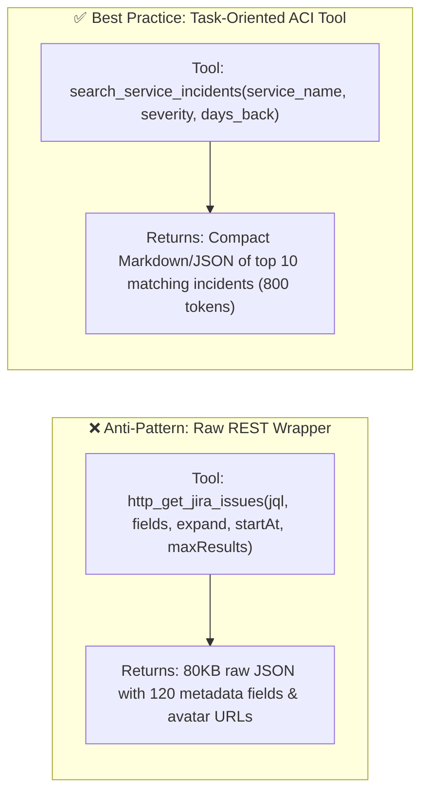
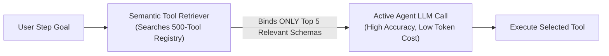

# Chapter 6: Tool Calling & Action Engineering (Beginner to Advanced)

[⬅️ Previous: Chapter 5 — Decentralized Topologies](./chapter-05-decentralized-and-emergent-topologies.md) | [📚 Book Index](./README.md) | [Next: Chapter 7 — Agentic RAG & Knowledge Grounding ➡️](./chapter-07-agentic-rag-and-knowledge-grounding.md)

---

Without tools, an LLM is a passive text generator trapped inside its training cutoff. **Tool Calling (Function Calling)** is the bridge that transforms a language model into an **agent** capable of sensing real-time state and mutating the external world.

This chapter progresses from **Beginner** (how tool calling actually works under the hood) to **Intermediate** (Agent–Computer Interface design and self-healing schemas) to **Advanced** (dynamic tool retrieval at scale, `CodeAct` sandboxes, OAuth credential scoping, idempotency, and Agentic Sagas).

---

## 6.1 Beginner: How Tool Calling Works Under the Hood

### The Fundamental Rule: LLMs Never Execute Tools Directly
A common beginner misconception is that the LLM connects to your database or API itself. In reality, tool calling is a strict **two-party handshake** between the **LLM (Brain)** and the **Application Runtime (Hands)**:

1. **Declaration:** Your application sends the user prompt *plus* a list of JSON Schema tool declarations (function name, description, parameter types, and required fields) to the LLM.
2. **Selection & Argument Generation:** The LLM does **not** run code. Instead, it emits a special structured token sequence: `tool_call(name="get_deployments", args={"service": "checkout-service", "days": 2})`.
3. **Execution:** Your application runtime intercepts those tokens, validates the arguments, executes the actual Python/Go/API function inside your infrastructure, and serializes the return value.
4. **Observation Injection:** Your application appends a `role="tool"` message containing the output back into the conversation history and calls the LLM again.


### Parallel Tool Calling vs. Sequential Tool Calling
Modern models support emitting **multiple `tool_calls` in a single turn**:
* **Parallel Tool Calls (Independent Queries):** If a user asks *"Compare weather in Tokyo and Paris"*, the LLM emits two tool calls in Turn 1: `[get_weather("Tokyo"), get_weather("Paris")]`. The runtime executes both concurrently via `asyncio.gather()` and returns both observations in Turn 2—cutting latency in half.
* **Sequential Tool Calls (Dependent Queries):** If a user asks *"Find who deployed `checkout-service` yesterday and message them on Slack"*, the LLM must emit `get_deployments` in Turn 1, wait for the observation (`author="alice"`), and only then emit `send_slack_message(user="alice")` in Turn 2.

### Tool Calling vs. Structured Outputs (`response_schema`)
* **Use Tool Calling** when the LLM needs to **interact with an external environment** mid-loop and inspect the returned observation before finishing.
* **Use Structured Outputs (`response_schema = PydanticModel`)** when the LLM already has all the information it needs in context and you want its **final output** guaranteed to conform to a strict JSON schema for downstream code consumption.

---

## 6.2 Intermediate: Agent–Computer Interface (ACI) & Schema Engineering

Just as human software relies on good **Human–Computer Interfaces (HCI/UX)**, agents rely on well-designed **Agent–Computer Interfaces (ACI)**. Research from SWE-bench and production agent benchmarks shows that **refactoring tool definitions often improves agent accuracy more than switching to a larger model**.

### Principle 1: Never Expose Raw Low-Level REST APIs Directly
* **Anti-Pattern (Thin API Wrapper):** Exposing a raw Kubernetes or Jira REST endpoint with 45 nested query parameters, pagination cursors, and cryptic integer status codes (`status_id=10004`). The LLM wastes tokens guessing parameter combinations and overflows its context window when the API dumps a 2MB raw JSON response.
* **Best Practice (Task-Oriented Tool Consolidation):** Wrap low-level APIs into high-level, domain-meaningful tools that accept human-readable arguments (`status: Literal["OPEN", "RESOLVED"]`), perform joins/filtering in Python, and return **only the compact fields the agent actually needs**.



### Principle 2: Docstring & Parameter Schema Engineering
The LLM's *only* understanding of a tool comes from its name, docstring, and parameter types. Every production tool definition should specify:
1. **When to use it AND when NOT to use it** (e.g., *"Use to fetch live service error logs. Do NOT use for billing invoice history—use `get_billing_events` instead."*).
2. **Strict Types & `Literal` Enums:** Replace vague `str` parameters with `Literal["us-east1", "us-west1", "eu-central1"]` so the model cannot hallucinate invalid region names.
3. **Format Examples in `Field(description=...)`:** Explicitly state expected formats (`"ISO-8601 UTC date, e.g., '2026-10-15T14:00:00Z'"`).

### Principle 3: Actionable Error-as-Observation Formatting
When a tool fails or returns 0 results, never return an empty string `""` or raise an uncaught exception. Return a **corrective hint** so the LLM knows how to recover on the next turn:

```python
from typing import Literal
from pydantic import BaseModel, Field

class QueryLogsArgs(BaseModel):
    service: str = Field(description="Exact microservice name, e.g. 'checkout-service'")
    status_code: Literal[400, 401, 403, 404, 500, 502, 503, 504]
    window_minutes: int = Field(default=60, ge=1, le=1440)

def query_logs(args: QueryLogsArgs) -> str:
    if args.service not in KNOWN_SERVICES:
        # Actionable recovery hint inside the observation!
        matches = get_closest_service_names(args.service)
        return f"ToolError: Unknown service '{args.service}'. Did you mean one of: {matches}?"
    rows = log_db.fetch(args.service, args.status_code, args.window_minutes)
    if not rows:
        return f"0 logs found for {args.service} with status {args.status_code} in last {args.window_minutes}m. Try expanding window_minutes or checking upstream dependencies."
    return format_compact_table(rows[:25])  # Always cap output rows to prevent context blowup!
```

---

## 6.3 Advanced: Dynamic Tool Discovery, `CodeAct` Sandboxes & Transactional Safety

What happens when your enterprise platform has **300 tools**, or when an agent needs to compose complex data transformations across 5 tool outputs?

### 1. Dynamic Tool Retrieval (Scaling Past the 20-Tool Limit)
As established in Chapter 3, binding $>15\text{–}20$ tool schemas directly into the LLM prompt degrades tool-selection accuracy and burns thousands of input tokens on every turn. When a single agent must access a catalog of $100\text{–}500$ tools:
* **Two-Stage Semantic Tool Retrieval (Tool-RAG):**
  1. Index all 500 tool descriptions in a lightweight vector/hybrid index.
  2. Equip the agent with a meta-tool `search_available_tools(query: str)` (or run a pre-turn semantic filter) that retrieves the **top $K=5$ relevant tool schemas** for the current step and binds only those 5 schemas into the active LLM call.



### 2. `CodeAct` (Executable Code-as-Action Sandboxes)
In standard JSON tool calling, if an agent needs to fetch 50 customer records and check each one against a formula, it either has to emit 50 JSON tool calls or process a huge list in tokens.
* **The `CodeAct` Pattern (Wang et al., 2024):** Instead of emitting JSON tool calls one by one, the agent writes a short **Python script** that imports the provided SDK tools, runs `for` loops, filters/aggregates data in pandas, and prints the exact final summary inside an isolated **gVisor / WebAssembly / Container Sandbox**.
* **Why it works:** Consolidates 10 turns of JSON tool ping-pong into **1 turn** of deterministic Python execution while keeping intermediate data out of the LLM context window.

### 3. Production Security: Least-Privilege Scoping, Idempotency & Agentic Sagas
When tools mutate production state, three architectural controls are mandatory:
1. **Least-Privilege Credential Injection (Never Pass Secrets via LLM):** The LLM must **never** see API keys, database passwords, or raw user OAuth tokens in its prompt or tool arguments. The **Orchestrator Runtime** injects the caller's scoped identity token inside the tool execution wrapper (`ctx.auth_token`) and enforces Role-Based Access Control (RBAC) in code.
2. **Deterministic Idempotency Keys:** Every mutating tool call (`issue_refund`, `create_ticket`, `deploy_service`) must compute `idempotency_key = sha256(thread_id + step_index + tool_name + canonical_args)` in the runtime wrapper so network retries or checkpoint replays never execute duplicate mutations.
3. **The Agentic Saga Pattern (Compensating Rollbacks):** When a multi-tool workflow mutates external systems $A \rightarrow B \rightarrow C$, register a compensating undo action (`cancel_A`, `revert_B`) after each forward step succeeds. If Step $C$ fails permanently, execute the compensating stack in reverse (LIFO) order:

```python
async def execute_transactional_tool_saga(
    steps: list[tuple[Callable[[], Awaitable[Any]], Callable[[Any], Awaitable[None]]]]
) -> list[Any]:
    completed_rollbacks: list[Callable[[], Awaitable[None]]] = []
    results: list[Any] = []
    try:
        for forward_tool, compensating_undo_tool in steps:
            res = await forward_tool()
            results.append(res)
            completed_rollbacks.append(lambda r=res, undo=compensating_undo_tool: undo(r))
        return results
    except Exception as exc:
        # Unwind completed mutations in reverse (LIFO) order
        for rollback in reversed(completed_rollbacks):
            await rollback()
        raise RuntimeError(f"Tool workflow aborted ({exc}); all prior writes rolled back.")
```

---

## Chapter 6 Summary Progression

| Level | Tool Calling Capability | Problem Solved | Key Architectural Takeaway |
| :--- | :--- | :--- | :--- |
| **🟢 Beginner** | **JSON Schema Function Calling** (Sequential & Parallel) | Connects a stateless LLM to live external data & actions. | The LLM *selects* the tool and emits JSON args; **your runtime code** executes it. |
| **🟡 Intermediate** | **ACI Design, Constrained Schemas & Error-as-Observation** | Fixes hallucinated args, context blowups, and unhandled crashes. | Design task-oriented tools (not thin REST wrappers), cap output size, and return actionable error hints. |
| **🔴 Advanced** | **Dynamic Tool-RAG, `CodeAct` Sandboxes, Idempotency & Sagas** | Scales to 500+ tools, multi-step data processing, and safe writes. | Retrieve top-$K$ tools dynamically, use sandboxed Python for loops, and wrap mutations in idempotent Sagas. |

---

[⬅️ Previous: Chapter 5 — Decentralized Topologies](./chapter-05-decentralized-and-emergent-topologies.md) | [📚 Book Index](./README.md) | [Next: Chapter 7 — Agentic RAG & Knowledge Grounding ➡️](./chapter-07-agentic-rag-and-knowledge-grounding.md)
