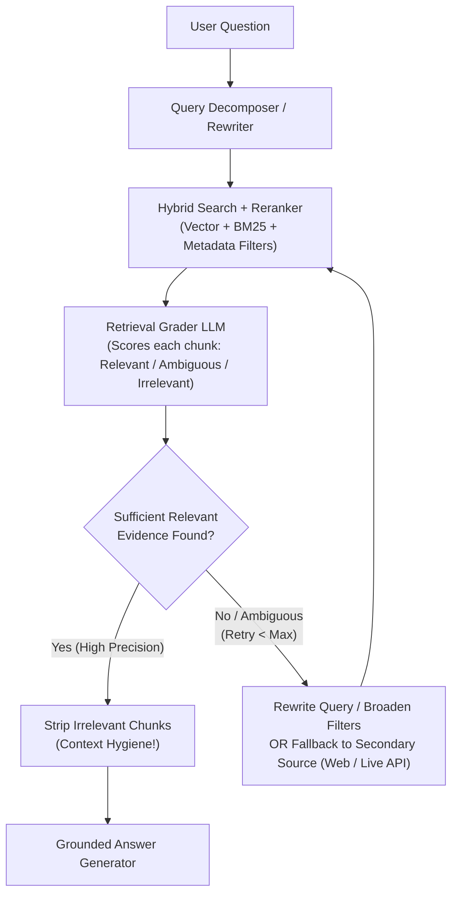
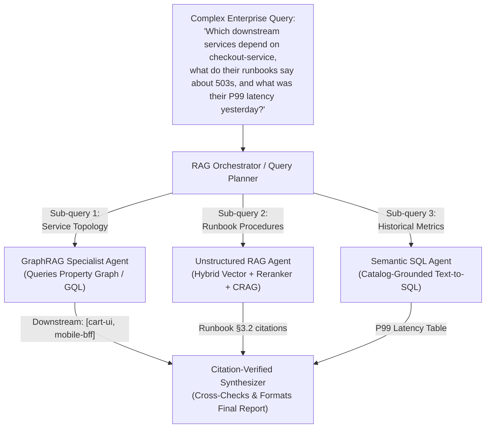

# Chapter 7: Agentic RAG & Knowledge Grounding (Beginner to Advanced)

[⬅️ Previous: Chapter 6 — Tool Calling & Action Engineering](./chapter-06-tool-calling-and-action-engineering.md) | [📚 Book Index](./README.md) | [Next: Chapter 8 — Agent Skills & Procedural Memory ➡️](./chapter-08-agent-skills-and-procedural-memory.md)

---

**Retrieval-Augmented Generation (RAG)** grounds LLMs in authoritative enterprise data. However, traditional "Naive RAG" is a rigid, single-pass pipeline that blindly retrieves $K$ chunks once and hopes the answer is inside them. **Agentic RAG** replaces that static pipeline with an **autonomous retrieval loop**—capable of rewriting queries, decomposing multi-hop questions, grading document relevance, querying multiple heterogeneous stores (Vector + Graph + SQL), and verifying citations before answering.

---

## 7.1 Beginner: From Naive RAG to Hybrid Search & Tool-Driven Retrieval

### Why Naive Single-Pass RAG Fails in Production
In **Naive RAG**, application code takes the user's raw string, embeds it into a dense vector, runs a single top-$K$ cosine similarity search, stuffs those $K$ chunks into the prompt, and generates an answer:

$$\text{User Query} \longrightarrow \text{Dense Vector Top-}K \longrightarrow \text{Single LLM Call}$$

This breaks immediately in four common scenarios:
1. **Exact Keyword / Identifier Mismatch:** Dense embeddings struggle with exact error codes (`ERR_POOL_842`), SKU numbers, or function names.
2. **Vocabulary / Framing Mismatch:** A user asks *"Why did my checkout break?"*, while the runbook is titled *"HTTP 503 Mitigation for Connection Pool Exhaustion"*.
3. **Multi-Hop Questions:** *"Compare the SLA uptime guarantee of the service deployed by Alice yesterday against our Enterprise Tier contract."* No single document contains both facts!
4. **Irrelevant Retrieval Pollution:** If top-$K$ returns 5 irrelevant chunks, a naive RAG prompt still tries to synthesize an answer from them—causing confident hallucinations.

### Step 1 Upgrade: Hybrid Retrieval + Cross-Encoder Reranking
Before adding agentic loops, every production retrieval tool should combine **Lexical Search (BM25 / Sparse)** + **Semantic Vector Search (Dense)** fused via **Reciprocal Rank Fusion (RRF)**, followed by a **Cross-Encoder Reranker** (e.g., Vertex AI Ranking API / Cohere Rerank) to score the top $50$ candidates down to the top $5\text{–}10$ high-precision chunks.

### Step 2 Upgrade: Basic Agentic RAG (Retrieval-as-a-Tool)
Instead of hardcoding retrieval before every LLM call, expose the retriever as a **Tool** (`search_runbooks(query, filters)`). Now the LLM can:
* **Skip retrieval** when the user says *"Format the table above as JSON"*.
* **Formulate a clean search query** (stripping conversational filler and adding technical keywords).
* **Search multiple times** with different queries if the first search returns nothing useful.

---

## 7.2 Intermediate: Adaptive Query Decomposition, Corrective RAG (CRAG) & Self-RAG

At the intermediate level, we surround retrieval with explicit **pre-retrieval planning** and **post-retrieval verification loops**.

### 1. Pre-Retrieval Query Transformation Patterns
Instead of searching with the user's raw prompt, an Agentic RAG node transforms the query using one of three patterns:
* **Multi-Hop Sub-Query Decomposition:** Splits a compound question (*"How does Deploy #842's DB pool setting compare to our Production Readiness Checklist?"*) into two independent sub-queries: `["Deploy #842 DB pool configuration", "Production Readiness Checklist minimum DB pool size"]` and executes them in parallel (Pattern 2.2 / 3.1).
* **Step-Back Prompting:** Generates a broader conceptual query alongside the specific query so both foundational principles and specific facts are retrieved.
* **HyDE (Hypothetical Document Embeddings):** For zero-shot semantic search, prompts a fast LLM to draft a hypothetical ideal answer document and embeds that document to match target document phrasing.

### 2. Corrective RAG (CRAG — Yan et al., 2024)
What if your vector database simply does not contain the answer, or your first query phrasing retrieved noisy chunks? **Corrective RAG** inserts an explicit **Retrieval Grader** between retrieval and generation:



### 3. Self-RAG (Self-Reflective Retrieval-Augmented Generation — Asai et al., 2023)
**Self-RAG** extends verification to the **generated response itself** by checking three reflection gates:
1. **`[Retrieve?]` Gate:** Does this claim require external factual grounding?
2. **`[IsRel]` Gate (Chunk Relevance):** Are the retrieved passages actually relevant to the question?
3. **`[IsSup]` & `[IsUse]` Gates (Hallucination & Completeness Check):** Is every factual sentence in the generated draft **fully supported** by the retrieved passages, and does the draft **fully answer** the user's question? If `[IsSup]` fails, regenerate with strict citation constraints.

### Production-Grade Framework-Agnostic Pseudocode (CRAG + Self-RAG Loop)
```python
class ChunkGrade(BaseModel):
    chunk_id: str
    is_relevant: bool

class GroundednessCheck(BaseModel):
    all_claims_supported_by_chunks: bool
    fully_answers_query: bool
    unsupported_claims: list[str]

async def corrective_self_rag(user_query: str, max_retrieval_attempts: int = 3) -> str:
    search_query = query_rewriter_llm.generate(f"Optimize search query for: {user_query}")
    relevant_chunks: list[str] = []

    # Loop 1: Corrective Retrieval (CRAG)
    for attempt in range(max_retrieval_attempts):
        raw_chunks = await hybrid_search_and_rerank(search_query, top_k=8)
        grades: list[ChunkGrade] = grader_llm.generate_structured(
            f"Query: {user_query}\nGrade relevance of chunks:\n{raw_chunks}",
            schema=list[ChunkGrade],
        )
        relevant_chunks = [c for c, g in zip(raw_chunks, grades) if g.is_relevant]
        if len(relevant_chunks) >= 2:
            break
        # Corrective fallback: rewrite query or broaden metadata filters
        search_query = query_rewriter_llm.generate(
            f"Query '{search_query}' returned insufficient relevant docs for '{user_query}'. "
            "Formulate an alternative search query or broader keywords:"
        )

    if not relevant_chunks:
        return "I could not find verified documentation to answer this question accurately."

    # Loop 2: Self-RAG Generation & Hallucination Check
    draft = generator_llm.generate(
        f"Answer strictly using these verified chunks with [chunk_id] citations:\n{relevant_chunks}\n"
        f"Question: {user_query}"
    )
    check: GroundednessCheck = verifier_llm.generate_structured(
        f"Query: {user_query}\nSource Chunks: {relevant_chunks}\nDraft: {draft}",
        schema=GroundednessCheck,
    )
    if not check.all_claims_supported_by_chunks:
        draft = generator_llm.generate(
            f"Source Chunks: {relevant_chunks}\nRemove or fix these unsupported claims: "
            f"{check.unsupported_claims}\nOriginal Draft: {draft}"
        )
    return draft
```

---

## 7.3 Advanced: Multi-Agent Heterogeneous RAG & GraphRAG

In enterprise environments, knowledge is rarely locked inside plain text paragraphs alone. Answering complex operational or financial questions requires synthesizing across **three distinct knowledge modalities**:
1. **Unstructured Text (Vector + BM25 Search):** Runbooks, RFCs, policy PDFs, Slack threads.
2. **Relational / Analytical Data (Text-to-SQL / Semantic Layer):** Live metrics, billing tables, customer orders in BigQuery/Postgres governed by a Semantic Catalog (e.g., Dataplex Knowledge Catalog).
3. **Connected Topology & Multi-Hop Relationships (GraphRAG / Property Graphs):** Service dependency graphs (`checkout-service -> auth-service -> redis-cluster`), organizational hierarchies, or supply-chain networks queried via `ISO GQL` / Cypher or hierarchical community summaries.

### Architecture: Multi-Agent Federated RAG (Orchestrator–Retrievers)
Instead of forcing one agent to master Vector search, SQL generation, AND Graph queries in a single prompt, an **Orchestrator / Query Planner** decomposes the user's question and fans out in parallel to **Modal-Specialist Retriever Agents**:



### Why GraphRAG Complements Vector RAG
* **Where Vector RAG Fails:** Vector search retrieves local text chunks based on semantic similarity. It cannot answer **global sensemaking questions** (*"What are the top 5 recurring failure themes across all 2,000 post-mortems from 2025?"*) or **multi-hop topological questions** (*"If database node `db-04` goes down, which Tier-1 customer APIs are transitively impacted 3 hops away?"*).
* **How GraphRAG Solves Both:**
  1. **Topological Graph Traversal:** Extracts entities (`Service`, `Database`, `Team`, `Incident`) and edges (`DEPENDS_ON`, `CAUSED_BY`, `OWNED_BY`) into a Property Graph so multi-hop impact queries are answered deterministically.
  2. **Hierarchical Community Summaries (Leiden Clustering):** Pre-computes summaries of densely connected entity communities at indexing time, allowing global corpus-wide questions to be answered via Map-Reduce over community summaries.

---

## Chapter 7 Summary Progression

| Level | RAG Architecture | Retrieval Control | Hallucination Defense | Best Used When... |
| :--- | :--- | :--- | :--- | :--- |
| **🟢 Beginner** | **Hybrid RAG + Reranking + Retrieval Tool** | Single tool call chosen by LLM | Prompt instruction only | Simple single-topic lookup over a clean documentation corpus. |
| **🟡 Intermediate** | **Corrective RAG (CRAG) + Self-RAG + Query Decomposition** | Iterative loop: Decompose $\rightarrow$ Retrieve $\rightarrow$ Grade $\rightarrow$ Rewrite | Chunk relevance filter (`[IsRel]`) + Claim support gate (`[IsSup]`) | Noisy corpora, multi-hop questions, and customer-facing compliance bots requiring zero unsupported claims. |
| **🔴 Advanced** | **Multi-Agent Federated RAG + GraphRAG** | Orchestrator fans out to Vector, Graph (`GQL`), and Semantic SQL agents | Cross-source reconciliation + deterministic citation verification | Enterprise intelligence spanning unstructured docs, relational warehouses, and multi-hop dependency graphs. |

---

[⬅️ Previous: Chapter 6 — Tool Calling & Action Engineering](./chapter-06-tool-calling-and-action-engineering.md) | [📚 Book Index](./README.md) | [Next: Chapter 8 — Agent Skills & Procedural Memory ➡️](./chapter-08-agent-skills-and-procedural-memory.md)
