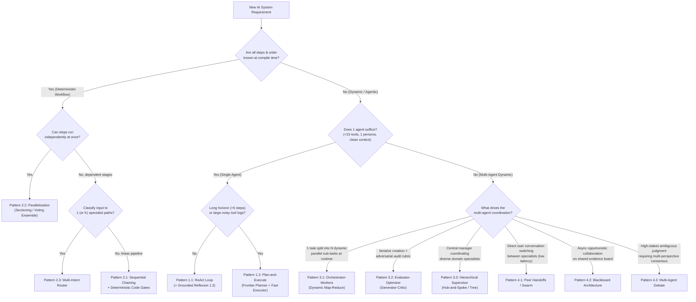

# Chapter 7: Master Decision Matrix & Deep-Dive Framework Survey

[⬅️ Previous: Chapter 6 — Production Mechanics & Protocols](./chapter-06-production-mechanics-and-protocols.md) | [📚 Book Index](./README.md) | [Next: Chapter 8 — MCQ Assessment & Case Studies ➡️](./chapter-08-mcq-assessment-and-case-studies.md)

---

## 7.1 The Master Architecture Decision Tree

Use this decision tree to select the simplest, most reliable orchestration pattern for any problem:



---

## 7.2 Master Pattern Comparison Matrix

Let $L$ be the average latency of a single LLM call, $K$ be the number of loop iterations, and $M$ be the number of specialist agents:

| Chapter & Level | Pattern | Control Flow Owner | Typical Latency | Token Cost Scaling | Context Isolation | Primary Failure Mode & Required Guardrail |
| :--- | :--- | :--- | :--- | :--- | :--- | :--- |
| **Ch 2: Beginner** | **1.1 ReAct Loop** | Single LLM | $K \cdot L$ | $O(K^2)$ (Shared window) | Low | **Myopia & Context Bloat:** Cap `max_steps`; return tool exceptions as observations. |
| **Ch 2: Beginner** | **1.2 Plan-and-Execute** | Planner LLM + Code Loop | $(2 + K) \cdot L$ | $O(K)$ (Scoped steps) | High | **Stale Plan:** Always include a Replanner after each step summary. |
| **Ch 2: Beginner** | **1.3 Grounded Reflexion** | Actor + Verifier Loop | $(1\text{–}3) \cdot 2L$ | $O(\text{trials})$ | Medium | **Sycophantic Flip-Flop:** Run deterministic verifiers (AST/tests/regex) before LLM critique. |
| **Ch 3: Interm. I** | **2.1 Sequential Chain** | Application Code | $\sum_{i=1}^M L_i$ | $O(M)$ | High | **Compound Error Decay ($r^M$):** Insert deterministic `Pydantic`/business-rule gates between stages. |
| **Ch 3: Interm. I** | **2.2 Parallelization** | Application Code | $\max_i(L_i) + L_{\text{synth}}$ | $O(M)$ | High | **Hidden Data Dependencies & Failure Cancellation:** Ensure true independence; use `return_exceptions=True`. |
| **Ch 3: Interm. I** | **2.3 Intent Router** | Fast Classifier + Code | $L_{\text{fast}} + L_{\text{branch}}$ | **Lowest** ($O(1)$) | High | **Dropped Compound Intents:** Use multi-label `list[Intent]` schema to detect multi-part queries. |
| **Ch 4: Interm. II** | **3.1 Orchestrator–Workers** | Orchestrator LLM | $2L + \max_i(L_{\text{worker}})$ | $O(N_{\text{workers}})$ | High | **Fan-Out Rate-Limit Bomb:** Enforce `max_length` on subtasks + `asyncio.Semaphore(K)`. |
| **Ch 4: Interm. II** | **3.2 Evaluator–Optimizer** | Generator + Critic LLMs | $(1\text{–}3) \cdot 2L$ | $O(\text{rounds})$ | **High** (Clean Critic) | **Endless Nitpicking:** Separate `blocking_defects` from `minor_suggestions` in Critic schema. |
| **Ch 4: Interm. II** | **3.3 Hierarchical Supervisor** | Central Supervisor LLM | $2K \cdot L$ (Hub hops) | $O(K \cdot M)$ | High | **"Telephone Game" Lossy Summaries:** Write structured facts directly to Typed Shared State. |
| **Ch 5: Advanced** | **4.1 Peer Handoffs / Swarm** | Active Specialist LLM | **$1 \cdot L$ per turn** | $O(1)$ per turn | Medium | **Ping-Pong Handoff Cycle ($A \leftrightarrow B$):** Track `visited_edges` per turn + `max_handoffs`. |
| **Ch 5: Advanced** | **4.2 Blackboard** | Event Controller + Board | $C_{\text{cycles}} \cdot \max(L_i)$ | $O(\text{triggers})$ | High | **Infinite Re-Triggering & Write Races:** Deduplicate `(agent, precondition_hash)` + atomic patch reducers. |
| **Ch 5: Advanced** | **4.3 Multi-Agent Debate** | Debaters + Judge LLM | $(K_{\text{rounds}} + 1) \cdot L$ | **Highest** ($O(M \cdot K)$) | High | **Anchoring & Echo Chamber:** Enforce blind Round-1 parallel generation + orthogonal personas + early exit. |

---

## 7.3 Deep-Dive Framework Survey: Mapping Concepts to Real Code Idioms

Once you understand the conceptual patterns, every major framework is simply a different ergonomic API over **Agents**, **Control Edges**, and **Shared State**. Below is how the top 5 frameworks implement these patterns in practice.

---

### 1. Google ADK (Agent Development Kit)
* **Core Philosophy:** Composable hierarchy combining **Deterministic Workflow Agents** (`SequentialAgent`, `ParallelAgent`, `LoopAgent`) with dynamic **`LlmAgent`** nodes, shared `session.state`, and native **MCP + A2A** support.
* **Key Architectural Idioms:**
  1. **State Piping via `output_key`:** When an `LlmAgent` defines `output_key="rca_report"`, ADK automatically writes its output into `session.state["rca_report"]`, which the next agent in a `SequentialAgent` can reference directly in its instruction template (`{rca_report}`).
  2. **Deterministic Orchestration Containers:** `SequentialAgent`, `ParallelAgent`, and `LoopAgent` execute without spending an LLM call on orchestration routing.
  3. **Two Dynamic Delegation Modes:**
     * **Peer Handoffs (`sub_agents`):** Passing `sub_agents=[infra_agent, billing_agent]` to an `LlmAgent` enables dynamic control transfer (`transfer_to_agent`).
     * **Supervisor (`AgentTool`):** Wrapping a specialist with `AgentTool(agent=infra_agent)` lets a Supervisor call the sub-agent like a standard function and get the result back.
  4. **Custom Orchestration (`BaseAgent`):** Subclassing `BaseAgent` and implementing `async def _run_async_impl(self, ctx: InvocationContext) -> AsyncGenerator[Event, None]` allows arbitrary Python control flow (e.g., Blackboard controllers or dynamic Map-Reduce).

```python
from google.adk.agents import LlmAgent, SequentialAgent, ParallelAgent, LoopAgent
from google.adk.tools.agent_tool import AgentTool

# 1. Specialist Agents writing to session.state via output_key
log_agent = LlmAgent(name="LogAgent", model="gemini-2.5-flash", tools=[query_logs], output_key="log_findings")
deploy_agent = LlmAgent(name="DeployAgent", model="gemini-2.5-flash", tools=[get_deploys], output_key="deploy_findings")

# 2. Pattern 2.2 (Parallel Fan-Out) -> Pattern 2.1 (Sequential Pipeline)
parallel_diag = ParallelAgent(name="ParallelDiagnostics", sub_agents=[log_agent, deploy_agent])
sla_agent = LlmAgent(
    name="SLAAgent",
    model="gemini-2.5-pro",
    instruction="Given {log_findings} and {deploy_findings}, check SLA policy.",
    tools=[check_sla_policy],
)
incident_pipeline = SequentialAgent(name="IncidentPipeline", sub_agents=[parallel_diag, sla_agent])

# 3. Pattern 3.3 (Supervisor via AgentTool) OR Pattern 4.1 (Handoffs via sub_agents)
supervisor = LlmAgent(
    name="SupportSupervisor",
    model="gemini-2.5-pro",
    tools=[AgentTool(agent=incident_pipeline)],  # Calls pipeline as a scoped tool!
    sub_agents=[human_escalation_agent],         # Or transfers control via handoff!
)
```

---

### 2. LangGraph (LangChain Ecosystem)
* **Core Philosophy:** Low-level **Directed Cyclic State Machine (`StateGraph`)** with explicit **Typed State Reducers**, first-class durable **Checkpointers**, and dynamic `Send` / `Command` primitives.
* **Key Architectural Idioms:**
  1. **Typed State Reducers (`Annotated[list, operator.add]`):** When parallel nodes run concurrently, returning `{"evidence": [new_item]}` appends atomically to the shared state list instead of overwriting sibling outputs.
  2. **Dynamic Orchestrator–Workers (`Send` API):** A conditional edge can return `[Send("worker_node", {"task": t}) for t in state["subtasks"]]` to dynamically spawn $N$ parallel worker nodes at runtime.
  3. **Peer-to-Peer Handoffs (`Command` API):** Any node can return `Command(update={"downtime": 42}, goto="billing_agent")` to mutate state and jump directly to a peer node in one step.
  4. **Durable HITL (`interrupt()`):** Calling `human_input = interrupt({"Action": "Approve $500 refund?"})` inside a node persists state to Postgres/SQLite and halts execution until resumed with `Command(resume=...)`.

```python
import operator
from typing import Annotated, TypedDict
from langgraph.graph import StateGraph, START, END
from langgraph.types import Send, Command

class IncidentState(TypedDict):
    ticket: str
    subtasks: list[str]
    # Reducer: parallel workers append to 'reports' atomically without race overwrites!
    reports: Annotated[list[str], operator.add]
    final_answer: str

# Pattern 3.1 (Orchestrator-Workers using Send API)
def route_to_workers(state: IncidentState) -> list[Send]:
    return [Send("worker_node", {"subtask": task}) for task in state["subtasks"]]

builder = StateGraph(IncidentState)
builder.add_node("orchestrator", orchestrator_node)
builder.add_node("worker_node", isolated_worker_node)
builder.add_node("synthesizer", synthesizer_node)

builder.add_edge(START, "orchestrator")
builder.add_conditional_edges("orchestrator", route_to_workers, ["worker_node"])
builder.add_edge("worker_node", "synthesizer")
builder.add_edge("synthesizer", END)
graph = builder.compile(checkpointer=postgres_checkpointer)
```

---

### 3. CrewAI (`Crews` + `Flows`)
* **Core Philosophy:** Two-layer architecture combining **CrewAI Flows** (deterministic, event-driven state machines using `@start`, `@listen`, `@router`) on the outside with **Crews** (collaborative role-playing agent teams with `Process.sequential` or `Process.hierarchical`) on the inside.
* **Best For:** Teams that want declarative YAML definitions of `Agents` (`role`, `goal`, `backstory`) and `Tasks` (`description`, `expected_output`, `context`) wrapped inside event-driven Python workflows.

---

### 4. Microsoft AutoGen (AG2) & Microsoft Agent Framework
* **Core Philosophy:** Asynchronous, event-driven multi-agent conversation topologies. (Note: Microsoft has unified **AutoGen** and **Semantic Kernel** into the **Microsoft Agent Framework**, while the open-source community also maintains **AG2**).
* **Key Architectural Idioms:**
  * `RoundRobinGroupChat` (Sequential / Debate loops),
  * `SelectorGroupChat` (Central Supervisor selecting next speaker),
  * `Swarm` (Handoff messages between specialists), and
  * `MagenticOneGroupChat` (A sophisticated **Plan-and-Execute + Blackboard Ledger** orchestrator that maintains a "Task Ledger" of facts/guesses and a "Progress Ledger" that detects stalls and replans automatically).

---

### 5. OpenAI Agents SDK (Successor to Swarm)
* **Core Philosophy:** Minimalist, Python-native library with almost zero new abstractions—use standard Python `for`, `if/else`, and `asyncio.gather` for deterministic workflows, and use two primitives for multi-agent orchestration:
  1. **`handoffs=[billing_agent, infra_agent]`** for Peer-to-Peer Swarm control transfer (Pattern 4.1).
  2. **`agent.as_tool()`** for Hierarchical Supervisor delegation (Pattern 3.3).
  3. **Parallel Input/Output Guardrails (`@input_guardrail`)** that run concurrently alongside the primary agent and trip a `GuardrailFunctionOutput(tripwire_triggered=True)` exception to halt execution immediately if safety checks fail.

---

## 7.4 Summary: Which Framework Should You Pick?

| Your Team's Primary Requirement | Recommended Framework | Why |
| :--- | :--- | :--- |
| **Google Cloud / Vertex AI / Gemini native deployment, clean hierarchical + deterministic composition (`Sequential`/`Parallel`/`Loop`), and native A2A + MCP** | **Google ADK** | Purpose-built for composable agent hierarchies, deterministic workflow containers, built-in trajectory evaluation, and one-command Vertex AI Agent Engine deployment. |
| **Complex cyclic graphs, custom Blackboard state machines, fine-grained time-travel checkpointing, and model-agnostic flexibility** | **LangGraph** | Exposes the raw state-machine primitives (`StateGraph`, Reducers, `Send`, `Command`, `interrupt`) without opinionated role wrappers. |
| **Rapid role-based prototyping (Researcher + Analyst + Writer) with declarative YAML configs** | **CrewAI** | Fastest path from role/task mental model to working multi-agent prototype using `Flows` + `Crews`. |
| **Multi-agent group chats, code-execution sandboxes, or Magentic-One ledger orchestration (especially in Azure/.NET/Python shops)** | **Microsoft Agent Framework / AutoGen (AG2)** | Best-in-class conversational group-chat and ledger-based multi-agent abstractions. |
| **Lightweight Python-first codebase with minimal framework lock-in and fast peer-to-peer handoffs** | **OpenAI Agents SDK** | Tiny surface area; standard Python handles workflows while `handoffs` and `as_tool()` handle multi-agent transitions. |

---

[⬅️ Previous: Chapter 6 — Production Mechanics & Protocols](./chapter-06-production-mechanics-and-protocols.md) | [📚 Book Index](./README.md) | [Next: Chapter 8 — MCQ Assessment & Case Studies ➡️](./chapter-08-mcq-assessment-and-case-studies.md)
