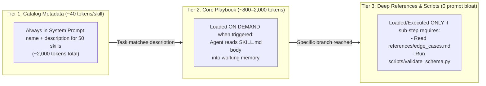

# Chapter 8: Agent Skills & Procedural Memory Architecture (Beginner to Advanced)

[⬅️ Previous: Chapter 7 — Agentic RAG & Knowledge Grounding](./chapter-07-agentic-rag-and-knowledge-grounding.md) | [📚 Book Index](./README.md) | [Next: Chapter 9 — MCP & A2A Interoperability ➡️](./chapter-09-mcp-and-a2a-interoperability.md)

---

If **Tools (Chapter 6)** give an agent *hands* to act and **RAG (Chapter 7)** gives an agent *textbooks* of facts, **Agent Skills** give an agent **Procedural Memory**—structured, reusable playbooks, domain workflows, and deterministic helper scripts that teach an agent *how* to execute complex engineering or business processes reliably.

---

## 8.1 Beginner: What Is an Agent Skill? (Anatomy & Mental Model)

### Why Monolithic System Prompts Collapse at Scale
When teams first build an agent, they put all instructions into a single `system_prompt.txt`. As the agent takes on 30 different workflows (e.g., debugging Kubernetes, running SQL migrations, filing Jira tickets, auditing security compliance), that single system prompt balloons to **40,000+ tokens**:
1. **Token Tax on Every Turn:** You pay for all 40,000 tokens of instructions even when the user asks a 1-line question.
2. **Instruction Interference ("Lost in the Middle"):** Rules for workflow #4 conflict with or dilute attention from workflow #19.
3. **Zero Reusability:** You cannot share a 40,000-token monolithic prompt cleanly across different agents or teams.

### The Solution: Modular Agent Skills (`SKILL.md` Standard)
An **Agent Skill** is a self-contained folder packaging **procedural instructions (`SKILL.md`)** alongside optional **helper scripts (`scripts/`)**, **deep reference docs (`references/`)**, and **golden examples (`examples/`)**:

```text
skills/
└── incident-root-cause-analysis/
    ├── SKILL.md                  # Required: YAML frontmatter (name, description) + core workflow
    ├── scripts/                  # Optional: Tested CLI/Python utilities the agent can invoke
    │   └── correlate_503_logs.py
    ├── references/               # Optional: Detailed schemas/runbooks read ONLY when needed
    │   └── sla_policy_matrix.md
    └── examples/                 # Optional: Few-shot input/output exemplars
        └── sample_postmortem.md
```

### Anatomy of a `SKILL.md` File
Every `SKILL.md` has two critical sections:
1. **YAML Frontmatter (`name` and `description`):** Always loaded in the agent's catalog. The `description` acts as the **trigger specification**—explicitly stating *what* the skill does, *when* to activate it, and *when NOT to activate it*.
2. **Markdown Body:** Step-by-step Standard Operating Procedures (SOPs), decision trees, exact CLI flags, and verification checklists loaded *only* when the skill is triggered.

```markdown
---
name: incident-rca-playbook
description: >
  Diagnoses HTTP 5xx production incidents across Kubernetes and databases, correlates
  deployments with error spikes, and generates a verified Root Cause Analysis (RCA).
  Use when the user reports 500/502/503 outages or latency spikes.
  Don't use for pure billing invoice questions (use billing-support skill instead).
---

# Incident Root Cause Analysis (RCA) Workflow

## Step 1: Verify Deployment Correlation First
Always run `scripts/correlate_503_logs.py --service <name>` before querying raw logs...

## Step 2: Check Upstream Dependencies
If no deployment occurred within 2 hours of the spike, inspect...

## Step 3: Mandatory Verification Checklist
Before presenting the RCA, read `references/sla_policy_matrix.md` and verify...
```

### Skills vs. System Prompts vs. Tools/MCP vs. RAG

| Component | Memory Tier | Question It Answers | Loaded When? |
| :--- | :--- | :--- | :--- |
| **Base System Prompt** | Core Identity | *"Who am I, and what are my global safety/tone rules?"* | Every turn (100% of the time). |
| **Tools / MCP** | Action Interface | *"What atomic functions/APIs can I execute?"* | Schema bound per agent/step. |
| **RAG** | Semantic Memory | *"What facts exist in our unstructured/structured data?"* | Queried dynamically for facts. |
| **Agent Skills** | **Procedural Memory** | *"What is the step-by-step expert playbook for this specific task type?"* | **Progressively disclosed on trigger.** |

---

## 8.2 Intermediate: Progressive Disclosure & Context Economics

The defining architectural innovation of Agent Skills (used in Google ADK Skills, Claude Code, Jetski, and modern coding agents) is **3-Tier Progressive Disclosure**.

Instead of loading all 50 playbooks upfront, the agent reveals procedural context in three strict tiers:



### The Token Math of Progressive Disclosure
Suppose your engineering agent supports **50 distinct domain workflows**, and each workflow has a 2,000-token guide plus 5,000 tokens of reference tables ($7,000 \text{ tokens} \times 50 = 350,000 \text{ tokens total}$):
* **Without Skills (Monolithic Prompt):** $350,000$ tokens on every turn $\rightarrow$ impossible or prohibitively expensive.
* **With 3-Tier Progressive Disclosure:**
  * **Tier 1 (Idle Catalog):** $50 \text{ skills} \times 45 \text{ tokens (frontmatter)} = \mathbf{2,250\text{ tokens}}$.
  * **Tier 2 (1 Skill Activated):** $+1,500\text{ tokens}$ (`SKILL.md` body).
  * **Tier 3 (1 Reference File Read):** $+800\text{ tokens}$.
  * **Total Active Context:** **$4,550\text{ tokens}$ — a $98.7\%$ reduction in prompt token overhead!**

### Runtime Execution Trace (How an Agent Activates a Skill)
1. **User:** *"Why did `checkout-service` throw 503s after yesterday's deploy?"*
2. **Tier 1 Match:** The LLM scans the `<skills>` catalog in its system prompt, matches `incident-rca-playbook` based on its `description`, and calls `read_file("skills/incident-rca-playbook/SKILL.md")` (or `activate_skill("incident-rca-playbook")`).
3. **Tier 2 Execution:** With `SKILL.md` now in working memory, the agent follows Step 1 of the playbook rigorously instead of guessing which tool to call first.
4. **Tier 3 Deep Dive:** When the user also asks about SLA credits, Step 3 of `SKILL.md` directs the agent to read `references/sla_policy_matrix.md`.

---

## 8.3 Advanced: Router Skills, Script Offloading, Semantic Discovery & Ablation Evals

At the advanced level, skills evolve from simple markdown files into **hierarchical skill graphs**, **deterministic script bundles**, and **quantitatively benchmarked assets**.

### 1. Router Skills (Hierarchical Skill Trees)
When a domain (such as an experimentation platform, cloud infrastructure suite, or ERP system) has 15 sub-workflows, exposing all 15 in the global Tier-1 catalog clutters the root catalog.
* **The Router Skill Pattern:** Expose a single top-level **Router Skill** (e.g., `cloud-ops-router`) in the global catalog. Its `SKILL.md` contains a compact decision table mapping sub-domains to specialized child skills (`k8s-triage/SKILL.md`, `db-lock-debug/SKILL.md`, `finops-audit/SKILL.md`). This creates a **2-level B-tree of procedural memory**.

### 2. Deterministic Offloading via Bundled `scripts/`
LLMs are probabilistic token predictors—they should not be trusted to manually construct 15-flag shell pipelines, compute cryptographic hashes, or parse 50MB CSVs in tokens.
* **Best Practice:** Bundle tested, deterministic Python or Go CLI scripts inside `skills/<skill-name>/scripts/` and instruct the agent in `SKILL.md`:
  > *"Do NOT manually parse raw log files. Run `python3 skills/incident-rca/scripts/correlate_deploys.py --service=<service>` which outputs a verified JSON summary."*
* This combines **LLM judgment** (knowing *when* and *why* to run the analysis) with **100% deterministic code execution** (zero syntax hallucinations).

### 3. Semantic Skill Search (`skill_search` Tool) for 500+ Skills
When an enterprise skill registry grows past $50\text{–}100$ skills, even Tier-1 frontmatter descriptions exceed optimal prompt budgets:
1. Pre-load only the **top 10–20 core skills** in the system prompt catalog.
2. Provide a **`skill_search(query: str)`** semantic search tool indexed over the `name` + `description` embeddings of all $1,000+$ organizational skills so the agent can discover specialized skills dynamically at the start of an unfamiliar task.

### 4. Engineering High-Quality Skills: Description Tuning & Ablation Evals
How do you know if a skill actually improves agent performance or just wastes tokens?
* **Trigger Precision/Recall Testing:** Test synthetic prompts against your skill catalog to verify **False Negative Rate** (agent failed to load the skill when needed) and **False Positive Rate** (agent loaded the skill on an unrelated query because the `description` was too broad). Always include explicit **`Use when: ...`** and **`Don't use for: ...`** clauses in frontmatter!
* **With-Skill vs. Without-Skill Ablation Benchmarks:** Run your evaluation suite (Chapter 10) twice—once with the skill enabled and once with the skill removed:

```python
async def run_skill_ablation_eval(eval_cases: list[EvalCase], skill_path: str) -> dict:
    # Baseline: Agent with standard tools, NO skill
    baseline_scores = [await evaluate_agent(case, skills=[]) for case in eval_cases]
    # Treatment: Agent with the candidate SKILL.md enabled
    treatment_scores = [await evaluate_agent(case, skills=[skill_path]) for case in eval_cases]

    return {
        "pass_rate_delta": mean(treatment_scores.passed) - mean(baseline_scores.passed),
        "avg_steps_delta": mean(treatment_scores.steps) - mean(baseline_scores.steps),
        "token_cost_delta": mean(treatment_scores.tokens) - mean(baseline_scores.tokens),
    }
```

> [!TIP]
> **Rule of Thumb for Skill Curation:** Keep `SKILL.md` under **300–500 lines**. Push detailed API tables, long examples, and edge-case catalogs into `references/` files so they only consume context when a task specifically hits that branch.

---

## Chapter 8 Summary Progression

| Level | Skill Capability | Context Footprint | Key Architectural Takeaway |
| :--- | :--- | :--- | :--- |
| **🟢 Beginner** | **Modular `SKILL.md` Playbooks** | Replaces monolithic system prompts | Separates *how to execute a workflow* (Procedural Memory) from *atomic tools* and *RAG facts*. |
| **🟡 Intermediate** | **3-Tier Progressive Disclosure** | $\sim 45\text{ tokens/skill}$ at rest; full body loaded on trigger | Scales an agent to 50+ expert workflows while cutting idle prompt tokens by $>95\%$. |
| **🔴 Advanced** | **Router Skills, `scripts/` Offloading, `skill_search` & Ablation Evals** | Scales to $1,000+$ organizational skills | Offload fragile logic to bundled `scripts/`, organize large catalogs via Router Skills, and prove ROI via With-vs-Without ablation benchmarks. |

---

[⬅️ Previous: Chapter 7 — Agentic RAG & Knowledge Grounding](./chapter-07-agentic-rag-and-knowledge-grounding.md) | [📚 Book Index](./README.md) | [Next: Chapter 9 — MCP & A2A Interoperability ➡️](./chapter-09-mcp-and-a2a-interoperability.md)
