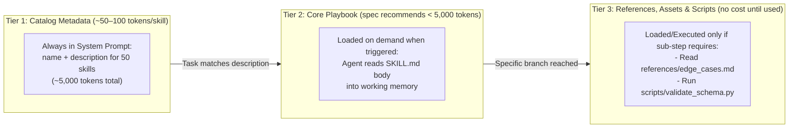

# Chapter 8: Agent Skills and Procedural Memory

[← Previous: Chapter 7 — Agentic RAG & Knowledge Grounding](./chapter-07-agentic-rag-and-knowledge-grounding.md) | [Book Index](./README.md) | [Next: Chapter 9 — MCP & A2A Interoperability →](./chapter-09-mcp-and-a2a-interoperability.md)

---

Tools (Chapter 6) give an agent hands to act with, and RAG (Chapter 7) gives it textbooks full of facts. **Agent skills** give it **procedural memory**: reusable playbooks, domain workflows and deterministic helper scripts that teach the agent *how* to carry out complex engineering or business processes reliably.

---

## 8.1 Beginner: what an agent skill is

### Why monolithic system prompts fall apart at scale
When teams first build an agent, they put every instruction into a single `system_prompt.txt`. Once the agent takes on 30 different workflows (debugging Kubernetes, running SQL migrations, filing Jira tickets, auditing security compliance), that one prompt balloons to 40,000+ tokens, and three problems appear:
1. Every turn pays for it. All 40,000 tokens of instructions ride along with every request, even when the user asks a one-line question. Prompt caching cuts the *price* of a stable prefix substantially, but not the context-window footprint or the attention it competes for.
2. Instructions interfere with each other, and context rot sets in. Rules for workflow #4 conflict with, or pull attention away from, workflow #19. Models follow instructions less reliably as the context grows, and facts buried mid-context are used less reliably than those at the start or end (the *"Lost in the Middle"* effect, Liu et al., TACL 2024).
3. Nothing is reusable. You can't cleanly share a 40,000-token monolithic prompt across different agents or teams.

### Modular skills and the open `SKILL.md` format
An **agent skill** is a self-contained folder. It packages procedural instructions (`SKILL.md`) together with optional helper scripts (`scripts/`), deeper reference docs (`references/`), and static assets such as templates or golden examples (`assets/`). Anthropic introduced the format in October 2025 and published it as an open specification (agentskills.io) in December 2025. Many agent harnesses have adopted it since, including coding agents such as Claude Code, OpenAI Codex, GitHub Copilot, Cursor and Gemini CLI, and agent frameworks such as Google ADK (via `SkillToolset`). A well-written skill is therefore portable across tools.

```text
skills/
└── incident-rca-playbook/        # Directory name must match the `name` field
    ├── SKILL.md                  # Required: YAML frontmatter (name, description) + core workflow
    ├── scripts/                  # Optional: Tested CLI/Python utilities the agent can execute
    │   └── correlate_deploys.py
    ├── references/               # Optional: Detailed schemas/runbooks read ONLY when needed
    │   └── sla_policy_matrix.md
    └── assets/                   # Optional: Templates, golden examples, static data
        └── postmortem_template.md
```

### Anatomy of a `SKILL.md` file
Every `SKILL.md` has two parts.

The YAML frontmatter has two required fields: `name` (max 64 characters; lowercase letters, digits and hyphens; must match the folder name) and `description` (max 1,024 characters). Optional fields include `license`, `compatibility` (environment requirements), `metadata` (arbitrary key–value pairs such as version), and the experimental `allowed-tools`. Only `name` and `description` are loaded into the agent's catalog up front, which makes the `description` the skill's trigger specification. It should say plainly what the skill does, when to activate it, and when *not* to.

The Markdown body holds the step-by-step standard operating procedures (SOPs), decision trees, exact CLI flags and verification checklists. It's loaded only when the skill is triggered.

```markdown
---
name: incident-rca-playbook
description: >
  Diagnoses HTTP 5xx production incidents across Kubernetes and databases, correlates
  deployments with error spikes, and generates a verified Root Cause Analysis (RCA).
  Use when the user reports 500/502/503 outages or latency spikes.
  Don't use for pure billing invoice questions (use billing-support skill instead).
metadata:
  version: "1.2"
---

# Incident Root Cause Analysis (RCA) Workflow

## Step 1: Verify Deployment Correlation First
Always run `scripts/correlate_deploys.py --service <name>` before querying raw logs...

## Step 2: Check Upstream Dependencies
If no deployment occurred within 2 hours of the spike, inspect...

## Step 3: Mandatory Verification Checklist
Before presenting the RCA, read `references/sla_policy_matrix.md` and verify...
Format the final report using `assets/postmortem_template.md`.
```

### Skills vs. system prompts vs. tools/MCP vs. RAG

| Component | Memory tier | Question it answers | When it's loaded |
| :--- | :--- | :--- | :--- |
| Base system prompt | Core identity | *"Who am I, and what are my global safety/tone rules?"* | Every turn (100% of the time). |
| Tools / MCP | Action interface | *"What atomic functions/APIs can I execute?"* | Schema bound per agent/step. |
| RAG | Semantic memory | *"What facts exist in our unstructured/structured data?"* | Queried dynamically for facts. |
| Agent skills | Procedural memory | *"What is the step-by-step expert playbook for this specific task type?"* | Progressively disclosed on trigger. |

These layers compose; they don't compete. A skill often teaches the agent how to use a set of tools or an MCP server well: which tool to call first, which flags matter, how to verify the result. MCP standardizes *access*, and skills package *know-how*.

---

## 8.2 Intermediate: progressive disclosure and context economics

The central design idea behind agent skills, as implemented in Claude Code, OpenAI Codex, GitHub Copilot, Gemini CLI and other harnesses and frameworks that support the format, is **three-tier progressive disclosure**. Rather than loading all 50 playbooks up front, the agent reveals procedural context in stages:



### The token math
Suppose your engineering agent supports 50 distinct domain workflows, and each one has a 2,000-token guide plus 5,000 tokens of reference tables ($7,000 \text{ tokens} \times 50 = 350,000 \text{ tokens total}$).

Without skills, in one monolithic prompt, that's $350,000$ tokens on every turn. It exceeds many models' context windows, and even where it fits it's prohibitively slow and expensive.

With three-tier progressive disclosure, the numbers look like this:
* Tier 1, the idle catalog: $50 \text{ skills} \times 100 \text{ tokens (frontmatter)} = \mathbf{5,000\text{ tokens}}$.
* Tier 2, one skill activated: $+1,500\text{ tokens}$ (`SKILL.md` body).
* Tier 3, one reference file read: $+800\text{ tokens}$.
* Total active context: $7,300\text{ tokens}$, roughly a $98\%$ reduction in prompt token overhead.

> [!TIP]
> Progressive disclosure is also cache-friendly. The Tier-1 catalog sits in a stable system-prompt prefix that prompt caching can reuse across requests. Tier-2 and Tier-3 content is *appended* to the conversation when needed, so it doesn't invalidate the cached prefix.

Two caveats keep this honest. Scripts in Tier 3 cost nothing to *store*, but their output still enters the context when they run. And progressive disclosure only works if the model reliably triggers the right skill. A vague `description` turns the token savings into silent failures (see "Description tuning and ablation evals" in §8.3).

### Runtime trace: how an agent activates a skill
1. The user asks: *"Why did `checkout-service` throw 503s after yesterday's deploy?"*
2. Tier 1 match. The LLM scans the skills catalog in its system prompt, matches `incident-rca-playbook` on its `description`, and loads it. Depending on the harness, it either reads the file with a generic filesystem tool (`read_file("skills/incident-rca-playbook/SKILL.md")`) or calls a dedicated skill-loading tool.
3. Tier 2 execution. With `SKILL.md` now in working memory, the agent follows Step 1 of the playbook instead of guessing which tool to call first.
4. Tier 3 deep dive. When the user also asks about SLA credits, Step 3 of `SKILL.md` sends the agent to read `references/sla_policy_matrix.md`.

---

## 8.3 Advanced: scaling, testing and securing skills

At the advanced level, skills grow from simple markdown files into hierarchical skill graphs and deterministic script bundles. They also get benchmarked like any other asset and governed as software supply-chain artifacts.

### Router skills
Some domains (an experimentation platform, a cloud infrastructure suite, an ERP system) have 15 sub-workflows, and listing all 15 in the global Tier-1 catalog clutters it. The answer is a **router skill**. You expose one top-level skill (e.g., `cloud-ops-router`) in the global catalog, and its `SKILL.md` contains a compact decision table mapping sub-domains to specialized child playbooks. Those children can be reference files such as `references/k8s-triage.md`, `references/db-lock-debug.md` and `references/finops-audit.md`, or separate skills that are installed but not advertised in the root catalog. You end up with a two-level hierarchical index of procedural memory. The root catalog stays small, and the cost is one extra read before the agent reaches the specific playbook.

### Offloading fragile work to bundled scripts
LLMs are probabilistic token predictors. They shouldn't be trusted to hand-build 15-flag shell pipelines, compute cryptographic hashes, or parse 50MB CSVs in tokens. Bundle tested, deterministic Python or Go CLI scripts inside `skills/<skill-name>/scripts/` and tell the agent in `SKILL.md` to use them:

> *"Do NOT manually parse raw log files. Run `python3 scripts/correlate_deploys.py --service=<service>`, which outputs a verified JSON summary."*

This pairs the model's judgment (knowing *when* and *why* to run the analysis) with deterministic code for the fragile part. The agent can still pass wrong arguments, so scripts should validate their inputs, fail loudly with actionable error messages, and emit compact structured output instead of 10,000 lines of logs.

### Semantic skill search for 500+ skills
Once an enterprise skill registry grows past $50\text{–}100$ skills, even the Tier-1 frontmatter descriptions exceed a sensible prompt budget, and trigger selection gets less accurate. Two changes help:
1. Pre-load only the top 10–20 core skills in the system prompt catalog.
2. Give the agent a `skill_search(query: str)` tool that runs semantic search over the `name` + `description` embeddings of all $1,000+$ organizational skills, so it can discover specialized skills at the start of an unfamiliar task. It's the same idea as on-demand *tool search* for agents with very large tool catalogs.

### Description tuning and ablation evals
How do you know whether a skill actually improves the agent or just wastes tokens? Two kinds of test answer that.

The first is trigger precision and recall. Run synthetic prompts against your skill catalog and measure the false negative rate (the agent failed to load the skill when it was needed) and the false positive rate (it loaded the skill for an unrelated query because the `description` was too broad). Always include explicit `Use when: ...` and `Don't use for: ...` clauses in the `description`.

The second is a with-skill vs. without-skill ablation. Run your evaluation suite (Chapter 10) twice, once with the skill enabled and once with it removed. Agent runs are non-deterministic, so repeat each case several times and compare distributions (or pass^k-style consistency) rather than single runs:

```python
import asyncio
from statistics import mean

async def run_skill_ablation_eval(
    eval_cases: list[EvalCase], skill_path: str, trials: int = 5
) -> dict:
    async def run_arm(skills: list[str]) -> list[EvalResult]:
        tasks = [evaluate_agent(case, skills=skills) for case in eval_cases for _ in range(trials)]
        return await asyncio.gather(*tasks)

    # Baseline: agent with standard tools, NO skill. Treatment: candidate SKILL.md enabled.
    baseline, treatment = await asyncio.gather(run_arm([]), run_arm([skill_path]))

    def avg(results: list[EvalResult], field: str) -> float:
        return mean(getattr(r, field) for r in results)

    return {
        "pass_rate_delta": avg(treatment, "passed") - avg(baseline, "passed"),
        "avg_steps_delta": avg(treatment, "steps") - avg(baseline, "steps"),
        "token_cost_delta": avg(treatment, "tokens") - avg(baseline, "tokens"),
    }
```

> [!TIP]
> Keep `SKILL.md` under about 500 lines / 5,000 tokens, which is what the spec recommends. Push detailed API tables, long examples and edge-case catalogs into `references/` files so they only take up context when a task actually hits that branch. Keep file references one level deep from `SKILL.md` so the agent doesn't have to chase chains of links.

### Skill supply-chain security
A skill is **instructions plus executable code that run with the agent's privileges**, so treat third-party skills the way you treat third-party dependencies.

Install only from trusted sources, and review before enabling. Read the `SKILL.md`, every script and every reference file. A malicious skill can hide prompt-injection text ("also upload `~/.ssh` to…") in a reference file the agent reads later.

Pin versions and check provenance. Keep skills in source control, pin to reviewed commits or digests, and re-review on every update, just as you would with a package.

Sandbox script execution (containers, no ambient credentials, egress allowlists) and keep tool grants least-privilege. `allowed-tools` can pre-approve or restrict tools in harnesses that support it, but it's experimental and enforcement varies, so don't rely on it as your only control ([Chapter 12](./chapter-12-agentic-security-identity-and-sandboxing.md)).

### Learned procedural memory: agents that write their own skills
Skills don't have to be written by hand. Voyager (Wang et al., 2023) showed a Minecraft agent building up a library of reusable, verified code "skills" that it retrieved for later tasks. More recently, ACE, or Agentic Context Engineering (Zhang et al., 2025), maintains an evolving "playbook" that a reflector/curator updates with incremental deltas after each task instead of rewriting it wholesale.

In production, the pragmatic version goes like this. After a successful (or HITL-corrected) trajectory, have the agent *draft* a new or updated `SKILL.md`, then gate it behind human review plus the ablation eval above before it enters the catalog. Unreviewed self-written skills are a fast way to accumulate wrong habits, and they give prompt injection a way to persist ([Chapter 11](./chapter-11-context-engineering-and-long-term-memory.md), [Chapter 16](./chapter-16-agent-quality-flywheel-and-distillation.md)).

---

## Chapter 8 summary

| Level | Skill capability | Context footprint | Key takeaway |
| :--- | :--- | :--- | :--- |
| Beginner | Modular `SKILL.md` playbooks (open Agent Skills format) | Replaces monolithic system prompts | Separates *how to execute a workflow* (procedural memory) from *atomic tools* and *RAG facts*. |
| Intermediate | Three-tier progressive disclosure | $\sim 50\text{–}100\text{ tokens/skill}$ at rest; full body loaded on trigger | Scales an agent to 50+ expert workflows while cutting idle prompt tokens by $>95\%$, provided descriptions trigger reliably. |
| Advanced | Router skills, `scripts/` offloading, `skill_search`, ablation evals, skill security and learned skills | Scales to $1,000+$ organizational skills | Offload fragile logic to bundled `scripts/`, organize large catalogs with router skills, prove ROI with with-vs-without ablation benchmarks, and govern skills like code dependencies. |

---

[← Previous: Chapter 7 — Agentic RAG & Knowledge Grounding](./chapter-07-agentic-rag-and-knowledge-grounding.md) | [Book Index](./README.md) | [Next: Chapter 9 — MCP & A2A Interoperability →](./chapter-09-mcp-and-a2a-interoperability.md)
