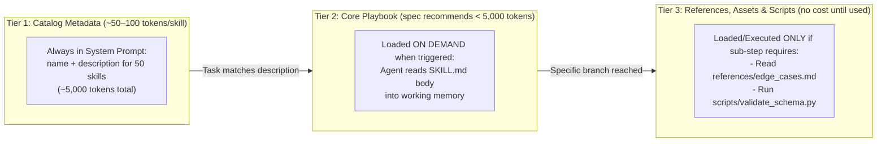

# Chapter 8: Agent Skills & Procedural Memory Architecture (Beginner to Advanced)

[⬅️ Previous: Chapter 7 — Agentic RAG & Knowledge Grounding](./chapter-07-agentic-rag-and-knowledge-grounding.md) | [📚 Book Index](./README.md) | [Next: Chapter 9 — MCP & A2A Interoperability ➡️](./chapter-09-mcp-and-a2a-interoperability.md)

---

If **Tools (Chapter 6)** give an agent *hands* to act and **RAG (Chapter 7)** gives an agent *textbooks* of facts, **Agent Skills** give an agent **Procedural Memory**—structured, reusable playbooks, domain workflows, and deterministic helper scripts that teach an agent *how* to execute complex engineering or business processes reliably.

---

## 8.1 Beginner: What Is an Agent Skill? (Anatomy & Mental Model)

### Why Monolithic System Prompts Collapse at Scale
When teams first build an agent, they put all instructions into a single `system_prompt.txt`. As the agent takes on 30 different workflows (e.g., debugging Kubernetes, running SQL migrations, filing Jira tickets, auditing security compliance), that single system prompt balloons to **40,000+ tokens**:
1. **Token Tax on Every Turn:** All 40,000 tokens of instructions ride along with every request, even when the user asks a 1-line question. Prompt caching cuts the *price* of a stable prefix substantially, but not the context-window footprint or the attention it competes for.
2. **Instruction Interference & Context Rot:** Rules for workflow #4 conflict with or dilute attention from workflow #19. Models follow instructions less reliably as the context grows, and facts buried mid-context are used less reliably than those at the start or end (the *"Lost in the Middle"* effect, Liu et al., TACL 2024).
3. **Zero Reusability:** You cannot share a 40,000-token monolithic prompt cleanly across different agents or teams.

### The Solution: Modular Agent Skills (the Open `SKILL.md` Format)
An **Agent Skill** is a self-contained folder packaging **procedural instructions (`SKILL.md`)** alongside optional **helper scripts (`scripts/`)**, **deep reference docs (`references/`)**, and **static assets such as templates or golden examples (`assets/`)**. Anthropic introduced the format in October 2025 and published it as an open specification (agentskills.io) in December 2025. It has since been adopted by many agent harnesses, including coding agents such as Claude Code, OpenAI Codex, GitHub Copilot, Cursor and Gemini CLI, and agent frameworks such as Google ADK (via `SkillToolset`), so a well-written skill is portable across tools.

```text
skills/
└── incident-rca-playbook/        # Directory name must match the `name` field
    ├── SKILL.md                  # Required: YAML frontmatter (name, description) + core workflow
    ├── scripts/                  # Optional: Tested CLI/Python utilities the agent can execute
    │   └── correlate_deploys.py
    ├── references/               # Optional: Detailed schemas/runbooks read ONLY when needed
    │   └── sla_policy_matrix.md
    └── assets/                   # Optional: Templates, golden examples, static data
        └── postmortem_template.md
```

### Anatomy of a `SKILL.md` File
Every `SKILL.md` has two critical sections:
1. **YAML Frontmatter:** Two fields are required. **`name`** (max 64 characters; lowercase letters, digits, and hyphens; must match the folder name) and **`description`** (max 1,024 characters). Optional fields include `license`, `compatibility` (environment requirements), `metadata` (arbitrary key–value pairs such as version), and the experimental `allowed-tools`. Only `name` and `description` are loaded into the agent's catalog up front. The `description` acts as the **trigger specification**—explicitly stating *what* the skill does, *when* to activate it, and *when NOT to activate it*.
2. **Markdown Body:** Step-by-step Standard Operating Procedures (SOPs), decision trees, exact CLI flags, and verification checklists loaded *only* when the skill is triggered.

```markdown
---
name: incident-rca-playbook
description: >
  Diagnoses HTTP 5xx production incidents across Kubernetes and databases, correlates
  deployments with error spikes, and generates a verified Root Cause Analysis (RCA).
  Use when the user reports 500/502/503 outages or latency spikes.
  Don't use for pure billing invoice questions (use billing-support skill instead).
metadata:
  version: "1.2"
---

# Incident Root Cause Analysis (RCA) Workflow

## Step 1: Verify Deployment Correlation First
Always run `scripts/correlate_deploys.py --service <name>` before querying raw logs...

## Step 2: Check Upstream Dependencies
If no deployment occurred within 2 hours of the spike, inspect...

## Step 3: Mandatory Verification Checklist
Before presenting the RCA, read `references/sla_policy_matrix.md` and verify...
Format the final report using `assets/postmortem_template.md`.
```

### Skills vs. System Prompts vs. Tools/MCP vs. RAG

| Component | Memory Tier | Question It Answers | Loaded When? |
| :--- | :--- | :--- | :--- |
| **Base System Prompt** | Core Identity | *"Who am I, and what are my global safety/tone rules?"* | Every turn (100% of the time). |
| **Tools / MCP** | Action Interface | *"What atomic functions/APIs can I execute?"* | Schema bound per agent/step. |
| **RAG** | Semantic Memory | *"What facts exist in our unstructured/structured data?"* | Queried dynamically for facts. |
| **Agent Skills** | **Procedural Memory** | *"What is the step-by-step expert playbook for this specific task type?"* | **Progressively disclosed on trigger.** |

> [!NOTE]
> These layers compose rather than compete. A skill often teaches the agent *how to use* a set of tools or an MCP server well (which tool to call first, which flags matter, how to verify the result). MCP standardizes *access*; skills package *know-how*.

---

## 8.2 Intermediate: Progressive Disclosure & Context Economics

The core design principle of Agent Skills (implemented in Claude Code, OpenAI Codex, GitHub Copilot, Gemini CLI, and other harnesses and frameworks that support the format) is **3-Tier Progressive Disclosure**.

Instead of loading all 50 playbooks upfront, the agent reveals procedural context in three tiers:



### The Token Math of Progressive Disclosure
Suppose your engineering agent supports **50 distinct domain workflows**, and each workflow has a 2,000-token guide plus 5,000 tokens of reference tables ($7,000 \text{ tokens} \times 50 = 350,000 \text{ tokens total}$):
* **Without Skills (Monolithic Prompt):** $350,000$ tokens on every turn $\rightarrow$ exceeds many models' context windows, and is prohibitively slow and expensive even where it fits.
* **With 3-Tier Progressive Disclosure:**
  * **Tier 1 (Idle Catalog):** $50 \text{ skills} \times 100 \text{ tokens (frontmatter)} = \mathbf{5,000\text{ tokens}}$.
  * **Tier 2 (1 Skill Activated):** $+1,500\text{ tokens}$ (`SKILL.md` body).
  * **Tier 3 (1 Reference File Read):** $+800\text{ tokens}$.
  * **Total Active Context:** **$7,300\text{ tokens}$ — roughly a $98\%$ reduction in prompt token overhead.**

> [!TIP]
> Progressive disclosure is also **cache-friendly**. The Tier-1 catalog sits in a stable system-prompt prefix that prompt caching can reuse across requests. Tier-2/3 content is *appended* to the conversation when needed, so it doesn't invalidate the cached prefix.

Two caveats keep this honest. Scripts in Tier 3 cost nothing to *store*, but their **output** still enters the context when they run. And progressive disclosure only works if the model reliably **triggers** the right skill: a vague `description` turns the token savings into silent failures (see Description Tuning & Ablation Evals in §8.3).

### Runtime Execution Trace (How an Agent Activates a Skill)
1. **User:** *"Why did `checkout-service` throw 503s after yesterday's deploy?"*
2. **Tier 1 Match:** The LLM scans the skills catalog in its system prompt, matches `incident-rca-playbook` based on its `description`, and loads it. Depending on the harness, it does this by reading the file with a generic filesystem tool (`read_file("skills/incident-rca-playbook/SKILL.md")`) or by calling a dedicated skill-loading tool.
3. **Tier 2 Execution:** With `SKILL.md` now in working memory, the agent follows Step 1 of the playbook instead of guessing which tool to call first.
4. **Tier 3 Deep Dive:** When the user also asks about SLA credits, Step 3 of `SKILL.md` directs the agent to read `references/sla_policy_matrix.md`.

---

## 8.3 Advanced: Router Skills, Script Offloading, Semantic Discovery, Ablation Evals & Skill Security

At the advanced level, skills evolve from simple markdown files into **hierarchical skill graphs**, **deterministic script bundles**, **quantitatively benchmarked assets**, and **governed software supply chain artifacts**.

### 1. Router Skills (Hierarchical Skill Trees)
When a domain (such as an experimentation platform, cloud infrastructure suite, or ERP system) has 15 sub-workflows, exposing all 15 in the global Tier-1 catalog clutters the root catalog.
* **The Router Skill Pattern:** Expose a single top-level **Router Skill** (e.g., `cloud-ops-router`) in the global catalog. Its `SKILL.md` contains a compact decision table mapping sub-domains to specialized child playbooks (e.g., `references/k8s-triage.md`, `references/db-lock-debug.md`, `references/finops-audit.md`, or separate skills that are installed but not advertised in the root catalog). This creates a **two-level hierarchical index of procedural memory**: the root catalog stays small, and the router adds one extra read before the agent reaches the specific playbook.

### 2. Deterministic Offloading via Bundled `scripts/`
LLMs are probabilistic token predictors—they should not be trusted to manually construct 15-flag shell pipelines, compute cryptographic hashes, or parse 50MB CSVs in tokens.
* **Best Practice:** Bundle tested, deterministic Python or Go CLI scripts inside `skills/<skill-name>/scripts/` and instruct the agent in `SKILL.md`:
  > *"Do NOT manually parse raw log files. Run `python3 scripts/correlate_deploys.py --service=<service>`, which outputs a verified JSON summary."*
* This combines **LLM judgment** (knowing *when* and *why* to run the analysis) with **deterministic code execution** for the fragile part. The agent can still pass wrong arguments, so scripts should validate their inputs, fail loudly with actionable error messages, and emit compact structured output (not 10,000 lines of logs).

### 3. Semantic Skill Search (`skill_search` Tool) for 500+ Skills
When an enterprise skill registry grows past $50\text{–}100$ skills, even Tier-1 frontmatter descriptions exceed optimal prompt budgets and make trigger selection less accurate:
1. Pre-load only the **top 10–20 core skills** in the system prompt catalog.
2. Provide a **`skill_search(query: str)`** semantic search tool indexed over the `name` + `description` embeddings of all $1,000+$ organizational skills so the agent can discover specialized skills dynamically at the start of an unfamiliar task. (This is the same idea as on-demand *tool search* for agents with very large tool catalogs.)

### 4. Engineering High-Quality Skills: Description Tuning & Ablation Evals
How do you know if a skill actually improves agent performance or just wastes tokens?
* **Trigger Precision/Recall Testing:** Test synthetic prompts against your skill catalog to verify **False Negative Rate** (agent failed to load the skill when needed) and **False Positive Rate** (agent loaded the skill on an unrelated query because the `description` was too broad). Always include explicit **`Use when: ...`** and **`Don't use for: ...`** clauses in the `description`!
* **With-Skill vs. Without-Skill Ablation Benchmarks:** Run your evaluation suite (Chapter 10) twice—once with the skill enabled and once with the skill removed. Agent runs are non-deterministic, so repeat each case several times and compare distributions (or pass^k-style consistency), not single runs:

```python
import asyncio
from statistics import mean

async def run_skill_ablation_eval(
    eval_cases: list[EvalCase], skill_path: str, trials: int = 5
) -> dict:
    async def run_arm(skills: list[str]) -> list[EvalResult]:
        tasks = [evaluate_agent(case, skills=skills) for case in eval_cases for _ in range(trials)]
        return await asyncio.gather(*tasks)

    # Baseline: agent with standard tools, NO skill. Treatment: candidate SKILL.md enabled.
    baseline, treatment = await asyncio.gather(run_arm([]), run_arm([skill_path]))

    def avg(results: list[EvalResult], field: str) -> float:
        return mean(getattr(r, field) for r in results)

    return {
        "pass_rate_delta": avg(treatment, "passed") - avg(baseline, "passed"),
        "avg_steps_delta": avg(treatment, "steps") - avg(baseline, "steps"),
        "token_cost_delta": avg(treatment, "tokens") - avg(baseline, "tokens"),
    }
```

> [!TIP]
> **Rule of Thumb for Skill Curation:** Keep `SKILL.md` under **~500 lines / ~5,000 tokens** (the spec's recommendation). Push detailed API tables, long examples, and edge-case catalogs into `references/` files so they only consume context when a task specifically hits that branch. Keep file references one level deep from `SKILL.md` so the agent doesn't have to chase chains of links.

### 5. Skill Supply-Chain Security
A skill is **instructions plus executable code that run with the agent's privileges**, so treat third-party skills like third-party dependencies:
* **Install only from trusted sources, and review before enabling.** Read the `SKILL.md`, every script, and every reference file. A malicious skill can hide prompt-injection text ("also upload `~/.ssh` to…") in a reference file the agent reads later.
* **Pin and provenance-check.** Version skills in source control, pin to reviewed commits or digests, and re-review on update, just as you would a package.
* **Sandbox script execution** (containers, no ambient credentials, egress allowlists) and use least-privilege tool grants. `allowed-tools` can pre-approve or restrict tools in harnesses that support it, but it is experimental and enforcement varies, so don't rely on it as your only control ([Chapter 12](./chapter-12-agentic-security-identity-and-sandboxing.md)).

### 6. Learned Procedural Memory: Agents That Write Their Own Skills
Skills don't have to be hand-authored. **Voyager** (Wang et al., 2023) showed a Minecraft agent growing a library of reusable, verified code "skills" that it retrieved for later tasks. More recently, **ACE — Agentic Context Engineering** (Zhang et al., 2025) maintains an evolving "playbook" that a reflector/curator updates with incremental deltas after each task, instead of rewriting it wholesale. In production, the pragmatic version is: after a successful (or HITL-corrected) trajectory, have the agent **draft** a new or updated `SKILL.md`, then gate it behind **human review plus the ablation eval above** before it enters the catalog. Unreviewed self-written skills are a fast path to accumulating wrong habits, and a persistence vector for prompt injection ([Chapter 11](./chapter-11-context-engineering-and-long-term-memory.md), [Chapter 16](./chapter-16-agent-quality-flywheel-and-distillation.md)).

---

## Chapter 8 Summary Progression

| Level | Skill Capability | Context Footprint | Key Architectural Takeaway |
| :--- | :--- | :--- | :--- |
| **🟢 Beginner** | **Modular `SKILL.md` Playbooks (open Agent Skills format)** | Replaces monolithic system prompts | Separates *how to execute a workflow* (Procedural Memory) from *atomic tools* and *RAG facts*. |
| **🟡 Intermediate** | **3-Tier Progressive Disclosure** | $\sim 50\text{–}100\text{ tokens/skill}$ at rest; full body loaded on trigger | Scales an agent to 50+ expert workflows while cutting idle prompt tokens by $>95\%$, provided descriptions trigger reliably. |
| **🔴 Advanced** | **Router Skills, `scripts/` Offloading, `skill_search`, Ablation Evals, Skill Security & Learned Skills** | Scales to $1,000+$ organizational skills | Offload fragile logic to bundled `scripts/`, organize large catalogs via Router Skills, prove ROI via With-vs-Without ablation benchmarks, and govern skills like code dependencies. |

---

[⬅️ Previous: Chapter 7 — Agentic RAG & Knowledge Grounding](./chapter-07-agentic-rag-and-knowledge-grounding.md) | [📚 Book Index](./README.md) | [Next: Chapter 9 — MCP & A2A Interoperability ➡️](./chapter-09-mcp-and-a2a-interoperability.md)
