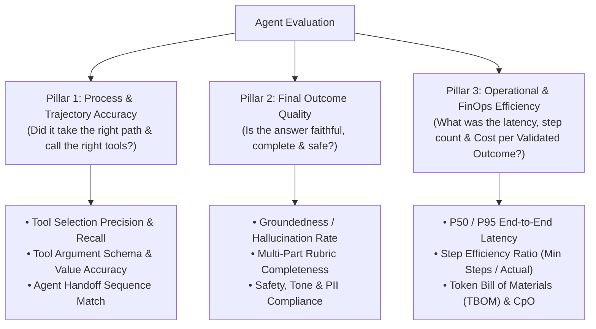
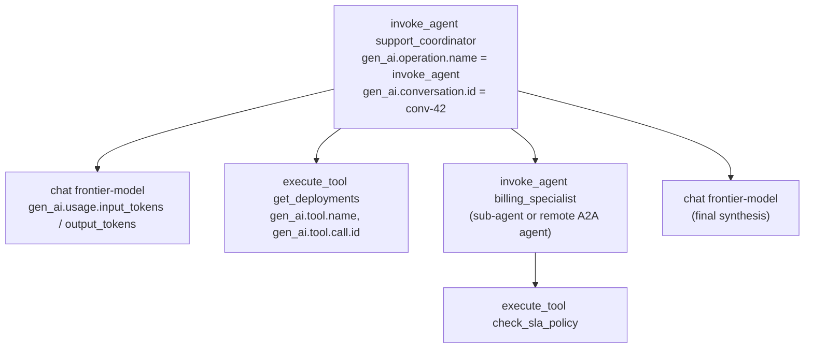
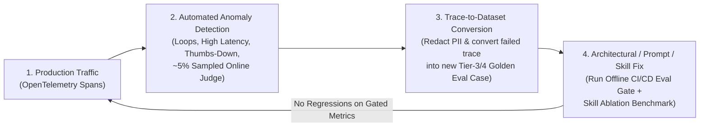

# Chapter 10: Agentic Evaluation (Evals), Observability, and the Quality Flywheel

[← Previous: Chapter 9 — MCP & A2A Interoperability](./chapter-09-mcp-and-a2a-interoperability.md) | [Book Index](./README.md) | [Next: Chapter 11 — Context Engineering & Long-Term Memory →](./chapter-11-context-engineering-and-long-term-memory.md)

---

You can't improve an agentic system you can't measure, and you certainly can't deploy it safely. Evaluating autonomous agents is also much harder than evaluating static LLM prompts. An agent may take 1 to 15 steps, invoke mutating tools, recover from transient errors, and reach the right answer via several valid paths. It can also reach the *right* answer through a *broken, prohibitively expensive* 12-step loop.

The chapter starts at the beginner level with the three pillars of agent evals. The intermediate section covers trajectory matching modes, 4-tier golden datasets, and LLM-as-a-judge. The advanced section moves on to `pass^k` reliability math, hermetic tool sandboxes, multi-turn user simulators, OpenTelemetry tracing, and the production quality flywheel.

---

## 10.1 Beginner: the three pillars of agent evaluation

Grading only an agent's final text is like grading a self-driving car on whether it eventually parked in the garage, while ignoring the four red lights it ran on the way.

Agent evaluation tooling generally scores agents along three complementary pillars. That holds for open-source libraries such as DeepEval, Ragas, or LangChain's AgentEvals; platforms such as LangSmith, Braintrust, Langfuse, or Arize Phoenix; framework-native evals such as Google ADK Evaluation; and managed cloud services such as Amazon Bedrock AgentCore Evaluations, Azure AI Foundry evaluations, and the Vertex AI Gen AI evaluation service.



### What each pillar catches
Each pillar exposes a failure the others miss.

A high outcome score with a low trajectory score usually means the agent guessed the right answer from pre-training memory *without* calling the mandatory `check_sla_policy` verification tool. That's a compliance problem waiting to happen. The same pattern shows up when the agent bounces between two sub-agents 8 times before answering.

A high trajectory score with a low outcome score means the agent called exactly the right tools (`get_deployments`, `query_logs`) but hallucinated or dropped a constraint while writing the final prose summary, the "Telephone Game" failure.

High trajectory and outcome scores with low efficiency describe an answer that is correct and well-grounded but uses 9× the tokens and 4× the latency of the baseline. At scale, that's unshippable. Pillar 3 metrics such as TBOM and CpO are developed fully in [Chapter 13](./chapter-13-agentic-finops-and-tokenomics.md).

The pillars aren't fully independent. A wasteful trajectory usually costs more, and a skipped verification tool often hurts groundedness. Report them side by side instead of collapsing them into one score too early.

---

## 10.2 Intermediate: trajectory metrics, golden datasets, and LLM judges

### Choosing a trajectory matching mode
When you compare an agent's actual tool-call sequence $T_{\text{actual}}$ against a golden reference trajectory $T_{\text{expected}}$, no single comparison works for every task. Most toolkits implement some variant of the modes below. LangChain's open-source AgentEvals offers `strict`, `unordered`, `subset`, and `superset` trajectory match modes. Google ADK's `tool_trajectory_avg_score` exposes `EXACT`, `IN_ORDER`, and `ANY_ORDER` match types. Managed services such as the Vertex AI Gen AI evaluation service offer `trajectory_exact_match`, `trajectory_in_order_match`, `trajectory_any_order_match`, `trajectory_precision`, and `trajectory_recall` metrics. The names in the table are generic.

| Mode | Definition | When to use it | Example |
| :--- | :--- | :--- | :--- |
| `EXACT_MATCH` | $T_{\text{actual}}$ must have the exact same tools in the exact same order with zero extra calls. | Strict compliance workflows where order is mandatory and extra calls are forbidden. | `[verify_identity, lock_card, issue_replacement]` |
| `IN_ORDER_MATCH` (subsequence) | All expected tools must appear in the specified relative order, but extra exploratory or self-healing tool calls are allowed between them. | The recommended default for sequential tasks. It lets the agent list tables or fix a query before running the core sequence. | Expected: `[get_deploy, check_sla]`; Actual: `[list_services, get_deploy, query_logs, check_sla]` ($\rightarrow$ PASS) |
| `ANY_ORDER_MATCH` (superset) | All expected tools must be called at least once, in any order (extra calls tolerated). | Parallelizable diagnostics where calling `query_logs` before `get_deploys` or vice versa is equally valid. | Expected set: `{query_logs, get_deploys, check_sla}` |
| `TOOL_PRECISION_RECALL` ($F_1$) | Continuous score: $\text{Recall} = \frac{\lvert T_{\text{act}} \cap T_{\text{exp}} \rvert}{\lvert T_{\text{exp}} \rvert}$, $\text{Precision} = \frac{\lvert T_{\text{act}} \cap T_{\text{exp}} \rvert}{\lvert T_{\text{act}} \rvert}$ (computed over multisets so repeated calls count). | Benchmarking open-ended research or debugging agents across large test suites. | Catching agents that achieve 100% recall by spamming 10 unnecessary tools (low precision). |

> [!TIP]
> Match on arguments as well as names. `refund(amount=50)` and `refund(amount=5000)` share a tool name but lead to very different outcomes. Compare critical arguments exactly (IDs, amounts, environments), compare free-text arguments semantically, and ignore volatile ones (timestamps, request IDs). Most frameworks let you configure this per tool.

### Designing a 4-tier golden dataset (`*.evalset.json`)
A common failure: the team builds an eval set of 50 easy "happy-path" prompts, scores 98%, and watches the agent fail in production on day 1. A useful starting heuristic is to stratify the set into four tiers. Tune the percentages to your real traffic and risk profile.

1. Tier 1, core happy path (~30% of the dataset): clear, single-intent queries that need 1–2 standard tool calls.
2. Tier 2, complex multi-hop and compound intents (~30%): queries spanning multiple domains or tools, like our running scenario (*Infra 503 RCA + Billing SLA credit*), that need parallel fan-out or sequential chaining.
3. Tier 3, adversarial inputs, edge cases, and error recovery (~25%): ambiguous entity names, empty tool results, simulated API errors (`500`/`Timeout`), prompt injection attempts, and out-of-policy requests. The last group checks that the agent refuses to issue an unauthorized refund.
4. Tier 4, multi-turn stateful context and handoffs (~15%): 4-to-8 turn conversations that test pronoun coreference (*"Now check the EU cluster for the same issue"*), requirements that change mid-conversation, and specialist handoffs.

Report scores per tier as well as in aggregate. A 95% overall score can hide a 40% pass rate on Tier 3.

### Building LLM judges you can trust
For open-ended prose outputs (Pillar 2), naive LLM judges (*"Score this answer from 1 to 10"*) are noisy and unreliable. Five practices make them much better:

1. Run deterministic checks first. Don't use an LLM judge to check JSON validity, regex patterns, forbidden IP leaks, or exact numeric values. Plain Python assertions do that better.
2. Prefer decomposed binary or 3-point rubrics to 1–10 scales. Fine-grained numeric scales are poorly calibrated, because judges (and humans) are inconsistent about what separates a "6/10" from a "7/10". Break the rubric into 4–5 binary (`YES`/`NO` or `0`/`1`) atomic questions instead, e.g., *1. Did the response cite Deploy #842? 2. Did it state 42 minutes of downtime? 3. Did it correctly deny automatic SLA credit?* Ask the judge for a brief rationale *before* each verdict, or use a reasoning model as the judge.
3. Grade against a reference. Pass the golden reference facts and the actual tool observations to the judge so it grades against verified truth instead of its own parametric memory.
4. Correct for known judge biases. In pairwise comparisons, swap candidate order `(A, B)` vs. `(B, A)` to cancel position bias. Penalize unnecessary fluff to counter verbosity bias. Prefer a judge from a different model family than the agent to reduce self-preference bias.
5. Calibrate the judge against humans. Have domain experts label a few hundred examples, measure judge–human agreement (accuracy, Cohen's $\kappa$), and iterate on the rubric until agreement is acceptable. Re-check whenever you change the judge model or prompt. An uncalibrated judge is just another unverified model.

---

## 10.3 Advanced: reliability math, sandboxes, and the quality flywheel

### Measuring consistency: `pass@k` vs. `pass^k`
LLM sampling and multi-step trajectories vary from run to run, so running an eval case once (`@1`) hides flakiness. Code-generation benchmarks popularized **`pass@k`** (Chen et al., 2021): the probability that *at least 1* of $k$ attempts succeeds.

For customer-facing agents, `pass@k` is the wrong headline metric. Your customer doesn't get to run your support agent 5 times and pick the best run. They experience 1 run, and repeat customers experience many.

The **`pass^k`** metric from τ-bench (Yao, Shinn, Razavi & Narasimhan, 2024; ICLR 2025) measures the probability that all $k$ independent trials of the same task succeed. If you treat each trial as an independent draw with per-trial success rate $p$ (estimated as $\hat{p} = c/n$ from $c$ successes in $n$ trials), the intuition is:

$$\text{pass@}k \approx 1 - (1 - \hat{p})^k \qquad \text{vs.} \qquad \mathbf{\text{pass}^k \approx \hat{p}^k}$$

Take an agent with an $80\%$ single-run pass rate ($\hat{p} = 0.80$):
* $\text{pass@5} = 1 - 0.20^5 \approx \mathbf{99.97\%}$, which looks almost perfect.
* $\text{pass}^5 = 0.80^5 \approx \mathbf{32.77\%}$, so only about 1 in 3 five-run batches is failure-free.

τ-bench doesn't actually use that simple power. Per task, it computes the unbiased combinatorial estimator $\binom{c}{k} / \binom{n}{k}$ (which requires $n \ge k$) and then averages across tasks. The distinction matters because tasks differ in difficulty: the average of per-task $p_i^k$ is *not* equal to $(\text{average } p)^k$. A few always-failing tasks plus many always-passing ones behave very differently from uniform 80% flakiness.

In production, track `pass^k` (e.g., $k = 3$ to $8$) alongside `pass@1` for high-stakes workflows, and gate releases on it when your eval budget allows multiple trials per case.

```python
from math import comb


def pass_at_k(n: int, c: int, k: int) -> float:
    """Unbiased per-task P(at least one of k trials succeeds) (Chen et al., 2021)."""
    if n - c < k:
        return 1.0
    return 1.0 - comb(n - c, k) / comb(n, k)


def pass_hat_k(n: int, c: int, k: int) -> float:
    """Unbiased per-task P(all k trials succeed) (tau-bench). comb(c, k) == 0 when c < k."""
    if n < k:
        raise ValueError(f"Need at least k={k} trials per task, got n={n}.")
    return comb(c, k) / comb(n, k)


def benchmark_pass_hat_k(per_task_results: dict[str, tuple[int, int]], k: int) -> float:
    """per_task_results maps case_id -> (n_trials, n_successes). Average per task, never pool trials."""
    scores = [pass_hat_k(n, c, k) for n, c in per_task_results.values()]
    return sum(scores) / len(scores)
```

> [!NOTE]
> Public agent benchmarks are useful reference points, within limits. They include τ-bench / τ²-bench (tool-using customer-service agents with policies and simulated users; τ² adds a "dual-control" setting where the user also acts), SWE-bench Verified (real GitHub issues), Terminal-Bench (command-line tasks), GAIA (general assistant tasks), WebArena and OSWorld (web and desktop computer use), and BFCL (function calling). Treat leaderboard numbers as coarse signals, since contamination, harness differences, and saturation are common. Your own domain eval set is what should gate releases.

### Hermetic tool sandboxes and stateful mocks
How do you run CI/CD evaluations on an agent that calls `issue_stripe_refund()` or `kubectl rollout undo` without touching production, and without tests breaking whenever an external API changes? Two techniques cover most cases.

The first is a stateful in-memory fake environment. Seed a lightweight in-memory database or state fixture at the start of each test case (`initial_db_state = {"deploy_842": {"pool": 5}, "sla_threshold": 45}`), bind the agent's tools to mutate that hermetic fixture, and assert on both the trajectory and the final mutated database state (`assert env.db["refunds_issued"] == []`). Comparing final state against an expected state is how τ-bench grades agents, and it holds up well when there are many valid paths.

The second is record-and-replay, using HTTP cassettes such as VCR.py, WireMock record mode, or gRPC record/replay interceptors. You record real tool responses during golden staging runs and replay them deterministically in CI/CD. The catch is that replay breaks as soon as the agent issues a request that was never recorded, such as a different query or a new argument order. Pair it with stateful fakes for exploratory paths, and re-record on a schedule.

### Persona-driven multi-turn user simulators
Static multi-turn test scripts break as soon as the agent phrases a clarifying question slightly differently on turn 2.

Dynamic user simulation avoids this. Pair the agent under test (the system under test, or SUT) with a simulated-user LLM initialized with a hidden scenario goal and persona, for example: *"You are a frustrated DevOps engineer whose `checkout-service` is returning 503s. You do not know the service name until asked; if denied an SLA credit, ask how to request a manual escalation."* Run the `UserSimulator <-> SUT_Agent` loop for up to $N=6$ turns, then grade the resulting transcript and the final environment state.

Simulators bring their own variance. They can be too cooperative or drift off-script. Pin the simulator model and temperature, give it explicit stop conditions, and spot-check simulated transcripts against real user conversations.


### OpenTelemetry tracing and the agent span tree
You can't evaluate production behavior you didn't record. The emerging standard is OpenTelemetry (OTel) with the GenAI semantic conventions. They define a vendor-neutral span shape that most agent frameworks and observability backends can emit or ingest, including Langfuse, Arize Phoenix, LangSmith, Braintrust, Datadog, Honeycomb, Grafana, and cloud-native tracing such as AWS X-Ray, Azure Monitor, and Google Cloud Trace.



Use one trace per user turn (or task) and one span per step: `invoke_agent` → model calls (`chat`) → `execute_tool`, with sub-agents nested as child `invoke_agent` spans. Key attributes include `gen_ai.operation.name`, `gen_ai.agent.name`, `gen_ai.request.model`, `gen_ai.usage.input_tokens` / `gen_ai.usage.output_tokens`, `gen_ai.tool.name`, and `gen_ai.conversation.id`.

Propagate context across boundaries. Pass W3C `traceparent` through HTTP calls, A2A requests, and MCP tool calls (the MCP `2026-07-28` spec documents `traceparent`/`tracestate`/`baggage` keys in `_meta`) so a multi-agent request renders as one trace instead of disconnected fragments.

A few cautions. The GenAI conventions are still marked Development (experimental), so attribute names can change; pin your instrumentation versions. Capturing prompt and completion content is opt-in for good reason. Redact PII and secrets before export, and apply retention limits.

### The production quality flywheel
Offline benchmarks never anticipate every production query. Teams that do this well close the loop with an agent quality flywheel, which [Chapter 16](./chapter-16-agent-quality-flywheel-and-distillation.md) covers in depth, including fault attribution and distillation.



```python
from pydantic import BaseModel


class EvalResult(BaseModel):
    case_id: str
    trajectory_in_order_match: bool
    tool_precision: float
    tool_recall: float
    rubric_pass: bool
    input_tokens: int          # Uncached input tokens
    cached_input_tokens: int   # Prompt-cache hits are billed at a discount
    output_tokens: int         # Includes thinking/reasoning tokens where billed as output
    latency_ms: float


def compute_cost_per_validated_outcome(
    results: list[EvalResult],
    usd_per_1m_input: float,
    usd_per_1m_cached_input: float,
    usd_per_1m_output: float,
) -> float:
    total_spend = sum(
        (r.input_tokens * usd_per_1m_input
         + r.cached_input_tokens * usd_per_1m_cached_input
         + r.output_tokens * usd_per_1m_output) / 1_000_000
        for r in results
    )
    validated_successes = sum(1 for r in results if r.trajectory_in_order_match and r.rubric_pass)
    if validated_successes == 0:
        return float("inf")
    # True north FinOps metric: total $ spent (including failed runs) / fully verified successes.
    return total_spend / validated_successes
```

---

For what public agent benchmarks (BFCL, τ-bench, SWE-bench, WebArena, OSWorld, GAIA, AgentDojo, and more) actually measure, how they are graded, and where their numbers mislead, see [Appendix C: Agent Benchmarks & Evaluation Datasets Reference](./appendix-c-agent-benchmarks-and-evaluation-datasets.md).

---

## Chapter 10 summary

| Level | Capability | What it measures | Takeaway |
| :--- | :--- | :--- | :--- |
| Beginner | The three pillars (trajectory, outcome, efficiency) | Path + answer + cost/latency | Never grade only the final text; always check whether mandatory tools were called. |
| Intermediate | Trajectory match modes, 4-tier datasets, calibrated binary-rubric judges | `IN_ORDER` / `ANY_ORDER` match + argument checks + decomposed `YES/NO` rubrics | Use `IN_ORDER_MATCH` to allow self-healing, stratify datasets across 4 tiers (report per tier), and calibrate binary-rubric judges against human labels. |
| Advanced | `pass^k` consistency, hermetic sandboxes, user simulators, OTel tracing, flywheel | Multi-trial reliability (per-task $\binom{c}{k}/\binom{n}{k}$), mutated env state, online trace capture | Track `pass^k` for high-stakes flows, test mutating tools against seeded mock state, instrument with OTel GenAI spans, and convert production failure traces into CI eval cases. |

---

[← Previous: Chapter 9 — MCP & A2A Interoperability](./chapter-09-mcp-and-a2a-interoperability.md) | [Book Index](./README.md) | [Next: Chapter 11 — Context Engineering & Long-Term Memory →](./chapter-11-context-engineering-and-long-term-memory.md)
