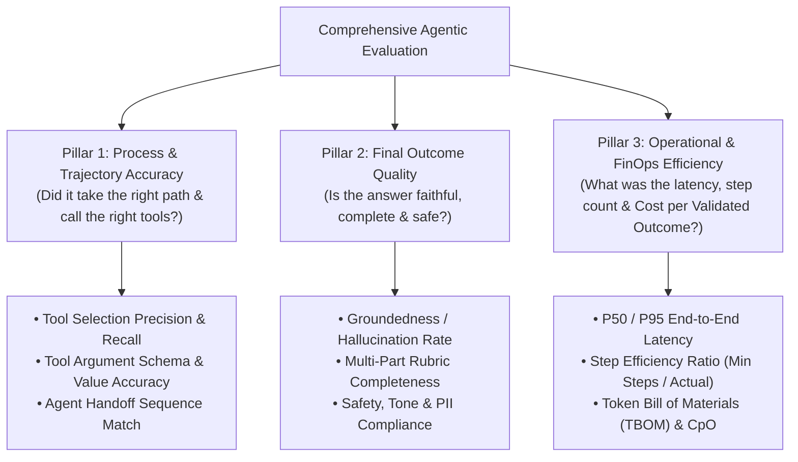
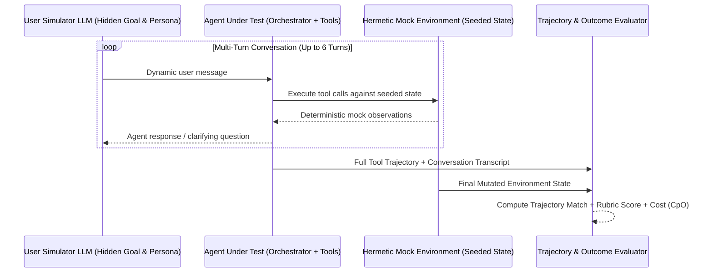
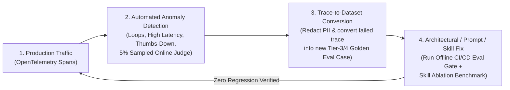

# Chapter 10: Agentic Evaluation (Evals), Observability & The Quality Flywheel (Beginner to Advanced)

[⬅️ Previous: Chapter 9 — MCP & A2A Interoperability](./chapter-09-mcp-and-a2a-interoperability.md) | [📚 Book Index](./README.md) | [Next: Chapter 11 — Production State, HITL & Framework Survey ➡️](./chapter-11-production-state-hitl-and-frameworks.md)

---

You cannot improve—or safely deploy—an agentic system that you cannot measure. Yet evaluating autonomous agents is fundamentally harder than evaluating static LLM prompts: an agent may take 1 to 15 steps, invoke mutating tools, recover from transient errors, and arrive at the right answer via multiple valid paths—or arrive at the *right* answer via a *broken, prohibitively expensive* 12-step loop.

This chapter covers **Agentic Evaluation & Observability** from **Beginner** (The 3 Pillars of Agent Evals) to **Intermediate** (Trajectory Matching Modes, 4-Tier Golden Datasets, and LLM-as-a-Judge) to **Advanced** (`pass^k` reliability math, Hermetic Tool Sandboxes, Multi-Turn User Simulators, OpenTelemetry Tracing, and the Production Quality Flywheel).

---

## 10.1 Beginner: The 3 Pillars of Agentic Evaluation

Evaluating only an agent's final text output is like grading a self-driving car solely on whether it eventually parked in the garage—ignoring whether it ran four red lights along the way.

Every agent evaluation framework (such as **Google ADK Evaluation**, **Vertex AI GenAI Eval**, **LangSmith**, or **Braintrust**) evaluates agents across **Three Orthogonal Pillars**:



### Why You Need All Three Pillars
* **High Outcome + Low Trajectory Score:** The agent guessed the right answer from pre-training memory *without* calling the mandatory `check_sla_policy` verification tool (a ticking compliance time bomb!), or bounced between two sub-agents 8 times before answering.
* **High Trajectory + Low Outcome Score:** The agent called the exact right tools (`get_deployments`, `query_logs`), but hallucinated or dropped a constraint when synthesizing the final prose summary ("Telephone Game").

---

## 10.2 Intermediate: Trajectory Metrics, 4-Tier Golden Datasets & LLM-as-a-Judge

### 1. Choosing the Right Trajectory Matching Mode
When comparing an agent's actual tool-call sequence $T_{\text{actual}}$ against a golden reference trajectory $T_{\text{expected}}$, one size does not fit all:

| Trajectory Match Mode | Definition | When to Use It | Example |
| :--- | :--- | :--- | :--- |
| **1. `EXACT_MATCH`** | $T_{\text{actual}}$ must have the exact same tools in the exact same order with zero extra calls. | Strict compliance workflows where order is mandatory and extra calls are forbidden. | `[verify_identity, lock_card, issue_replacement]` |
| **2. `IN_ORDER_MATCH` (Subsequence)** | All expected tools must appear in the specified relative order, but extra exploratory/self-healing tool calls are permitted between them. | **Recommended Default for Sequential Tasks:** Allows the agent to list tables or self-correct a query before executing the core sequence. | Expected: `[get_deploy, check_sla]`; Actual: `[list_services, get_deploy, query_logs, check_sla]` ($\rightarrow$ **PASS**) |
| **3. `ANY_ORDER_MATCH` (Superset)** | All expected tools must be called at least once, in any order. | Parallelizable diagnostics where calling `query_logs` before `get_deploys` or vice versa is equally valid. | Expected set: `{query_logs, get_deploys, check_sla}` |
| **4. `TOOL_PRECISION_RECALL` ($F_1$)** | Continuous score: $\text{Recall} = \frac{|T_{\text{act}} \cap T_{\text{exp}}|}{|T_{\text{exp}}|}$, $\text{Precision} = \frac{|T_{\text{act}} \cap T_{\text{exp}}|}{|T_{\text{act}}|}$. | Benchmarking open-ended research or debugging agents across large test suites. | Catching agents that achieve 100% recall by spamming 10 unnecessary tools (low precision). |

### 2. Designing a 4-Tier Stratified Golden Dataset (`*.evalset.json`)
A common failure mode is building an eval set of 50 easy "happy-path" prompts, getting a 98% score, and watching the agent fail in production on Day 1. Production golden datasets use **4-Tier Stratification**:

1. **Tier 1 — Core Happy Path (30% of dataset):** Clear, single-intent queries requiring 1–2 standard tool calls.
2. **Tier 2 — Complex Multi-Hop & Compound Intents (30%):** Queries spanning multiple domains/tools (like our Running Scenario: *Infra 503 RCA + Billing SLA credit*) requiring parallel fan-out or sequential chaining.
3. **Tier 3 — Adversarial, Edge Cases & Error Recovery (25%):** Ambiguous entity names, empty tool results, simulated API errors (`500`/`Timeout`), prompt injection attempts, and out-of-policy requests (testing that the agent **refuses** to issue an unauthorized refund!).
4. **Tier 4 — Multi-Turn Stateful Context & Handoffs (15%):** 4-to-8 turn conversations testing pronoun coreference (*"Now check the EU cluster for the same issue"*), mid-stream requirement changes, and specialist handoffs.

### 3. Engineering Reliable LLM-as-a-Judge Evaluators
When evaluating open-ended prose outputs (Pillar 2), naive LLM judges (*"Score this answer from 1 to 10"*) are noisy and unreliable. Follow these **4 Judge Engineering Rules**:
* **Rule 1 — Deterministic Checks First:** Never use an LLM judge to check JSON validity, regex patterns, forbidden IP leaks, or exact numeric values—use deterministic Python assertions.
* **Rule 2 — Decomposed Binary/3-Point Rubrics over 1–10 Scales:** LLMs cannot reliably distinguish a "6/10" from a "7/10". Instead, break the rubric into 4–5 **binary (`YES`/`NO` or `0`/`1`) atomic questions** (e.g., *1. Did the response cite Deploy #842? 2. Did it state 42 minutes of downtime? 3. Did it correctly deny automatic SLA credit?*).
* **Rule 3 — Reference-Guided Grading:** Pass the golden reference facts and the actual tool observations to the Judge so it grades against verified truth rather than its own parametric memory.
* **Rule 4 — Mitigate Judge Biases:** Swap candidate order `(A, B)` vs. `(B, A)` in pairwise comparisons to cancel **Position Bias**, and penalize unnecessary fluff to counter **Verbosity Bias**.

---

## 10.3 Advanced: `pass^k` Reliability Math, Hermetic Sandboxes, User Simulators & The Quality Flywheel

### 1. Measuring True Production Consistency: `pass@k` vs. `pass^k`
Because LLM sampling and multi-step trajectories have inherent variance, running an eval case once (`@1`) hides flakiness. Standard coding benchmarks report **`pass@k`**—the probability that *at least 1* of $k$ attempts succeeds.
* **Why `pass@k` is wrong for Enterprise Agents:** Your customer doesn't get to run your support agent 5 times and pick the best run—they experience 1 run!
* **The `pass^k` Metric ($\tau$-bench — Yao et al., 2024):** Measures the probability that **all $k$ independent trials succeed consistently**. If an agent succeeds on $c$ out of $n$ trials (per-trial success rate $\hat{p} = c/n$):

$$\text{pass@}k = 1 - (1 - \hat{p})^k \qquad \text{vs.} \qquad \mathbf{\text{pass}^k = \hat{p}^k}$$

* If an agent has an $80\%$ single-run pass rate ($\hat{p} = 0.80$):
  * $\text{pass@5} = 1 - 0.20^5 = \mathbf{99.97\%}$ (looks deceptively perfect!)
  * $\text{pass}^5 = 0.80^5 = \mathbf{32.77\%}$ (reveals that 2 out of 3 five-run batches experience a failure!).
* **Production Standard:** Always gate high-stakes enterprise workflows on **`pass^3` or `pass^5`**.

### 2. Hermetic Tool Sandboxes & Stateful Mocks
How do you run CI/CD evaluations on an agent that calls `issue_stripe_refund()` or `kubectl rollout undo` without touching production or failing when external APIs change?
* **Stateful In-Memory Fake Environments:** Seed a lightweight in-memory database/state fixture at the start of each test case (`initial_db_state = {"deploy_842": {"pool": 5}, "sla_threshold": 45}`), bind the agent's tools to mutate that hermetic fixture, and assert on **both the trajectory and the final mutated database state** (`assert env.db["refunds_issued"] == []`).
* **Record-and-Replay (`rpcreplay` / VCR):** Record real tool RPC responses during golden staging runs and replay them deterministically in CI/CD.

### 3. Persona-Driven Multi-Turn User Simulators
Static multi-turn test scripts break as soon as the agent phrases a clarifying question slightly differently on Turn 2.
* **Dynamic User Simulation:** Pair your System-Under-Test (SUT) Agent with a **Simulated User LLM** initialized with a hidden **Scenario Goal & Persona** (e.g., *"You are an frustrated DevOps engineer whose `checkout-service` is returning 503s. You do not know the service name until asked; if denied an SLA credit, ask how to request a manual escalation."*). Run the `UserSimulator <-> SUT_Agent` loop for up to $N=6$ turns and grade the resulting transcript + final environment state!



### 4. OpenTelemetry Tracing & The Production Quality Flywheel
Offline benchmarks never anticipate every production query. High-performing teams close the **Agent Quality Flywheel**:



```python
class EvalResult(BaseModel):
    case_id: str
    trajectory_in_order_match: bool
    tool_precision: float
    tool_recall: float
    rubric_pass: bool
    total_tokens: int
    latency_ms: float

def compute_cost_per_validated_outcome(results: list[EvalResult], cost_per_1k_tokens: float) -> float:
    total_spend = sum((r.total_tokens / 1000.0) * cost_per_1k_tokens for r in results)
    validated_successes = sum(1 for r in results if r.trajectory_in_order_match and r.rubric_pass)
    if validated_successes == 0:
        return float("inf")
    # True north FinOps metric: Total $ spent divided by fully verified successful outcomes!
    return total_spend / validated_successes
```

---

## Chapter 10 Summary Progression

| Level | Evaluation Capability | What It Measures | Key Architectural Takeaway |
| :--- | :--- | :--- | :--- |
| **🟢 Beginner** | **The 3 Pillars (Trajectory, Outcome, Efficiency)** | Path + Answer + Cost/Latency | Never grade only final text; always evaluate whether mandatory tools were called. |
| **🟡 Intermediate** | **Trajectory Match Modes, 4-Tier Datasets & Binary Rubric Judges** | `IN_ORDER` / `ANY_ORDER` match + decomposed `YES/NO` rubrics | Use `IN_ORDER_MATCH` to allow self-healing, stratify datasets across 4 tiers, and use binary rubrics over 1–10 scales. |
| **🔴 Advanced** | **`pass^k` Consistency, Hermetic Sandboxes, User Simulators & Flywheel** | Multi-trial reliability ($\hat{p}^k$), mutated env state & online trace capture | Gate production on `pass^k`, test mutating tools against seeded mock state, and convert production failure traces into CI eval cases. |

---

[⬅️ Previous: Chapter 9 — MCP & A2A Interoperability](./chapter-09-mcp-and-a2a-interoperability.md) | [📚 Book Index](./README.md) | [Next: Chapter 11 — Production State, HITL & Framework Survey ➡️](./chapter-11-production-state-hitl-and-frameworks.md)
