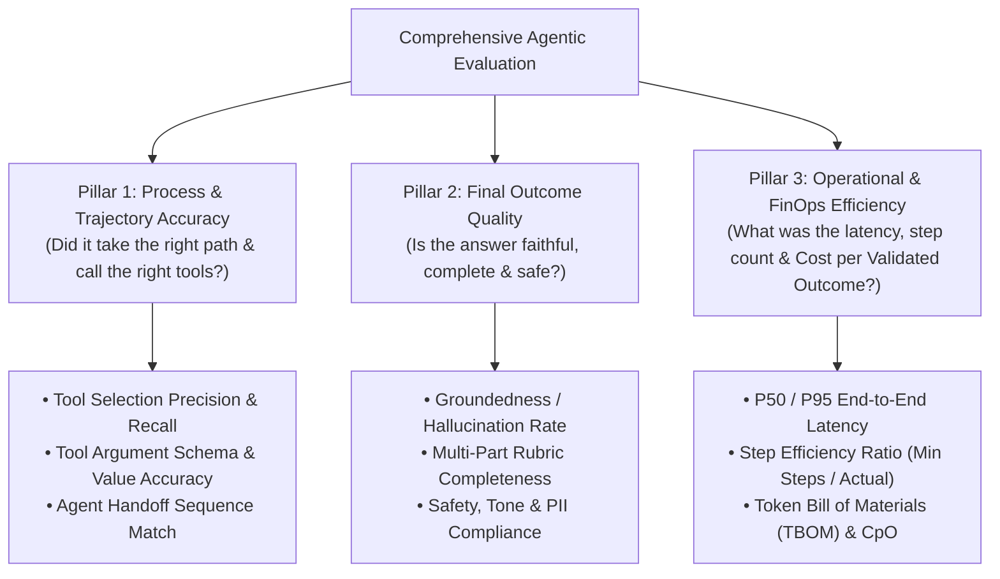
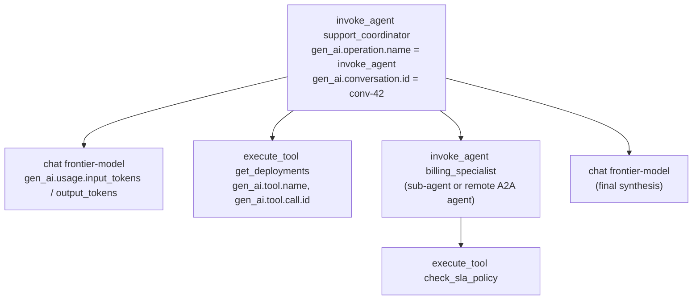
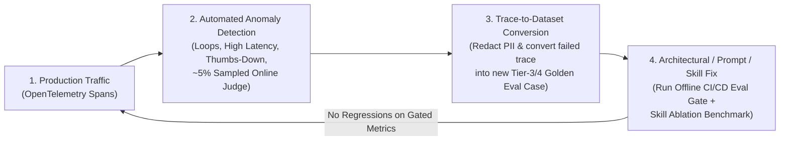

# Chapter 10: Agentic Evaluation (Evals), Observability & The Quality Flywheel (Beginner to Advanced)

[⬅️ Previous: Chapter 9 — MCP & A2A Interoperability](./chapter-09-mcp-and-a2a-interoperability.md) | [📚 Book Index](./README.md) | [Next: Chapter 11 — Context Engineering & Long-Term Memory ➡️](./chapter-11-context-engineering-and-long-term-memory.md)

---

You cannot improve—or safely deploy—an agentic system that you cannot measure. Yet evaluating autonomous agents is fundamentally harder than evaluating static LLM prompts: an agent may take 1 to 15 steps, invoke mutating tools, recover from transient errors, and arrive at the right answer via multiple valid paths—or arrive at the *right* answer via a *broken, prohibitively expensive* 12-step loop.

This chapter covers **Agentic Evaluation & Observability** from **Beginner** (The 3 Pillars of Agent Evals) to **Intermediate** (Trajectory Matching Modes, 4-Tier Golden Datasets, and LLM-as-a-Judge) to **Advanced** (`pass^k` reliability math, Hermetic Tool Sandboxes, Multi-Turn User Simulators, OpenTelemetry Tracing, and the Production Quality Flywheel).

---

## 10.1 Beginner: The 3 Pillars of Agentic Evaluation

Evaluating only an agent's final text output is like grading a self-driving car solely on whether it eventually parked in the garage—ignoring whether it ran four red lights along the way.

Agent evaluation tooling (open-source libraries such as **DeepEval**, **Ragas**, or LangChain's **AgentEvals**; platforms such as **LangSmith**, **Braintrust**, **Langfuse**, or **Arize Phoenix**; framework-native evals such as **Google ADK Evaluation**; or managed cloud services such as **Amazon Bedrock AgentCore Evaluations**, **Azure AI Foundry evaluations**, and the **Vertex AI Gen AI evaluation service**) generally scores agents along **three complementary pillars**:



### Why You Need All Three Pillars
* **High Outcome + Low Trajectory Score:** The agent guessed the right answer from pre-training memory *without* calling the mandatory `check_sla_policy` verification tool (a ticking compliance time bomb!), or bounced between two sub-agents 8 times before answering.
* **High Trajectory + Low Outcome Score:** The agent called the exact right tools (`get_deployments`, `query_logs`), but hallucinated or dropped a constraint when synthesizing the final prose summary ("Telephone Game").
* **High Trajectory + High Outcome + Low Efficiency:** Correct and well-grounded, but 9× the tokens and 4× the latency of the baseline, which makes it unshippable at scale. (Pillar 3 metrics such as TBOM and CpO are developed fully in [Chapter 13](./chapter-13-agentic-finops-and-tokenomics.md).)

> [!NOTE]
> The pillars are **not fully independent**: a wasteful trajectory usually costs more, and a skipped verification tool often hurts groundedness. Report them side by side rather than collapsing them into one score too early.

---

## 10.2 Intermediate: Trajectory Metrics, 4-Tier Golden Datasets & LLM-as-a-Judge

### 1. Choosing the Right Trajectory Matching Mode
When comparing an agent's actual tool-call sequence $T_{\text{actual}}$ against a golden reference trajectory $T_{\text{expected}}$, one size does not fit all. (Most toolkits implement some variant of these modes: LangChain's open-source AgentEvals offers `strict`, `unordered`, `subset`, and `superset` trajectory match modes; Google ADK's `tool_trajectory_avg_score` exposes `EXACT`, `IN_ORDER`, and `ANY_ORDER` match types; and managed services such as the Vertex AI Gen AI evaluation service offer `trajectory_exact_match`, `trajectory_in_order_match`, `trajectory_any_order_match`, `trajectory_precision`, and `trajectory_recall` metrics. The names below are generic.)

| Trajectory Match Mode | Definition | When to Use It | Example |
| :--- | :--- | :--- | :--- |
| **1. `EXACT_MATCH`** | $T_{\text{actual}}$ must have the exact same tools in the exact same order with zero extra calls. | Strict compliance workflows where order is mandatory and extra calls are forbidden. | `[verify_identity, lock_card, issue_replacement]` |
| **2. `IN_ORDER_MATCH` (Subsequence)** | All expected tools must appear in the specified relative order, but extra exploratory/self-healing tool calls are permitted between them. | **Recommended Default for Sequential Tasks:** Allows the agent to list tables or self-correct a query before executing the core sequence. | Expected: `[get_deploy, check_sla]`; Actual: `[list_services, get_deploy, query_logs, check_sla]` ($\rightarrow$ **PASS**) |
| **3. `ANY_ORDER_MATCH` (Superset)** | All expected tools must be called at least once, in any order (extra calls tolerated). | Parallelizable diagnostics where calling `query_logs` before `get_deploys` or vice versa is equally valid. | Expected set: `{query_logs, get_deploys, check_sla}` |
| **4. `TOOL_PRECISION_RECALL` ($F_1$)** | Continuous score: $\text{Recall} = \frac{\lvert T_{\text{act}} \cap T_{\text{exp}} \rvert}{\lvert T_{\text{exp}} \rvert}$, $\text{Precision} = \frac{\lvert T_{\text{act}} \cap T_{\text{exp}} \rvert}{\lvert T_{\text{act}} \rvert}$ (computed over **multisets** so repeated calls count). | Benchmarking open-ended research or debugging agents across large test suites. | Catching agents that achieve 100% recall by spamming 10 unnecessary tools (low precision). |

> [!TIP]
> **Match on arguments, not just names.** `refund(amount=50)` and `refund(amount=5000)` are the same tool name but very different outcomes. Compare critical arguments exactly (IDs, amounts, environments), compare free-text arguments semantically, and ignore volatile ones (timestamps, request IDs). Most frameworks let you configure this per tool.

### 2. Designing a 4-Tier Stratified Golden Dataset (`*.evalset.json`)
A common failure mode is building an eval set of 50 easy "happy-path" prompts, getting a 98% score, and watching the agent fail in production on Day 1. A useful starting heuristic is **4-Tier Stratification**. Tune the percentages to your real traffic and risk profile:

1. **Tier 1 — Core Happy Path (~30% of dataset):** Clear, single-intent queries requiring 1–2 standard tool calls.
2. **Tier 2 — Complex Multi-Hop & Compound Intents (~30%):** Queries spanning multiple domains/tools (like our Running Scenario: *Infra 503 RCA + Billing SLA credit*) requiring parallel fan-out or sequential chaining.
3. **Tier 3 — Adversarial, Edge Cases & Error Recovery (~25%):** Ambiguous entity names, empty tool results, simulated API errors (`500`/`Timeout`), prompt injection attempts, and out-of-policy requests (testing that the agent **refuses** to issue an unauthorized refund!).
4. **Tier 4 — Multi-Turn Stateful Context & Handoffs (~15%):** 4-to-8 turn conversations testing pronoun coreference (*"Now check the EU cluster for the same issue"*), mid-stream requirement changes, and specialist handoffs.

Report scores **per tier**, not just in aggregate. A 95% overall score can hide a 40% pass rate on Tier 3.

### 3. Engineering Reliable LLM-as-a-Judge Evaluators
When evaluating open-ended prose outputs (Pillar 2), naive LLM judges (*"Score this answer from 1 to 10"*) are noisy and unreliable. Follow these **5 Judge Engineering Rules**:
* **Rule 1 — Deterministic Checks First:** Never use an LLM judge to check JSON validity, regex patterns, forbidden IP leaks, or exact numeric values—use deterministic Python assertions.
* **Rule 2 — Decomposed Binary/3-Point Rubrics over 1–10 Scales:** Fine-grained numeric scales are poorly calibrated: judges (and humans) are inconsistent about what separates a "6/10" from a "7/10". Instead, break the rubric into 4–5 **binary (`YES`/`NO` or `0`/`1`) atomic questions** (e.g., *1. Did the response cite Deploy #842? 2. Did it state 42 minutes of downtime? 3. Did it correctly deny automatic SLA credit?*). Ask the judge for a brief rationale *before* each verdict, or use a reasoning model as the judge.
* **Rule 3 — Reference-Guided Grading:** Pass the golden reference facts and the actual tool observations to the Judge so it grades against verified truth rather than its own parametric memory.
* **Rule 4 — Mitigate Judge Biases:** Swap candidate order `(A, B)` vs. `(B, A)` in pairwise comparisons to cancel **Position Bias**, penalize unnecessary fluff to counter **Verbosity Bias**, and prefer a judge from a different model family than the agent to reduce **Self-Preference Bias**.
* **Rule 5 — Calibrate the Judge Against Humans:** Have domain experts label a few hundred examples, measure judge–human agreement (accuracy, Cohen's $\kappa$), and iterate on the rubric until agreement is acceptable. Re-check whenever you change the judge model or prompt. An uncalibrated judge is just another unverified model.

---

## 10.3 Advanced: `pass^k` Reliability Math, Hermetic Sandboxes, User Simulators & The Quality Flywheel

### 1. Measuring True Production Consistency: `pass@k` vs. `pass^k`
Because LLM sampling and multi-step trajectories have inherent variance, running an eval case once (`@1`) hides flakiness. Code-generation benchmarks popularized **`pass@k`** (Chen et al., 2021): the probability that *at least 1* of $k$ attempts succeeds.
* **Why `pass@k` is the wrong headline metric for customer-facing agents:** Your customer doesn't get to run your support agent 5 times and pick the best run. They experience 1 run, and repeat customers experience many.
* **The `pass^k` Metric (τ-bench — Yao, Shinn, Razavi & Narasimhan, 2024; ICLR 2025):** Measures the probability that **all $k$ independent trials of the same task succeed**. If you treat each trial as an independent draw with per-trial success rate $p$ (estimated as $\hat{p} = c/n$ from $c$ successes in $n$ trials), the intuition is:

$$\text{pass@}k \approx 1 - (1 - \hat{p})^k \qquad \text{vs.} \qquad \mathbf{\text{pass}^k \approx \hat{p}^k}$$

* If an agent has an $80\%$ single-run pass rate ($\hat{p} = 0.80$):
  * $\text{pass@5} = 1 - 0.20^5 \approx \mathbf{99.97\%}$ (looks deceptively perfect!)
  * $\text{pass}^5 = 0.80^5 \approx \mathbf{32.77\%}$ (only about 1 in 3 five-run batches is failure-free).
* **How τ-bench actually computes it:** per task, the unbiased combinatorial estimator $\binom{c}{k} / \binom{n}{k}$ (requires $n \ge k$), **averaged across tasks**. This matters because tasks differ in difficulty: the average of per-task $p_i^k$ is *not* equal to $(\text{average } p)^k$. A few always-failing tasks and many always-passing ones behave very differently from uniform 80% flakiness.
* **Production practice:** For high-stakes workflows, track `pass^k` (e.g., $k = 3$ to $8$) alongside `pass@1`, and gate releases on it when your eval budget allows multiple trials per case.

```python
from math import comb


def pass_at_k(n: int, c: int, k: int) -> float:
    """Unbiased per-task P(at least one of k trials succeeds) (Chen et al., 2021)."""
    if n - c < k:
        return 1.0
    return 1.0 - comb(n - c, k) / comb(n, k)


def pass_hat_k(n: int, c: int, k: int) -> float:
    """Unbiased per-task P(all k trials succeed) (tau-bench). comb(c, k) == 0 when c < k."""
    if n < k:
        raise ValueError(f"Need at least k={k} trials per task, got n={n}.")
    return comb(c, k) / comb(n, k)


def benchmark_pass_hat_k(per_task_results: dict[str, tuple[int, int]], k: int) -> float:
    """per_task_results maps case_id -> (n_trials, n_successes). Average per task, never pool trials."""
    scores = [pass_hat_k(n, c, k) for n, c in per_task_results.values()]
    return sum(scores) / len(scores)
```

> [!NOTE]
> **Public agent benchmarks & their limits.** Useful reference points include **τ-bench / τ²-bench** (tool-using customer-service agents with policies and simulated users; τ² adds a "dual-control" setting where the user also acts), **SWE-bench Verified** (real GitHub issues), **Terminal-Bench** (command-line tasks), **GAIA** (general assistant tasks), **WebArena** and **OSWorld** (web and desktop computer use), and **BFCL** (function calling). Treat leaderboard numbers as coarse signals: contamination, harness differences, and saturation are common. Your own domain eval set is what should gate releases.

### 2. Hermetic Tool Sandboxes & Stateful Mocks
How do you run CI/CD evaluations on an agent that calls `issue_stripe_refund()` or `kubectl rollout undo` without touching production or failing when external APIs change?
* **Stateful In-Memory Fake Environments:** Seed a lightweight in-memory database/state fixture at the start of each test case (`initial_db_state = {"deploy_842": {"pool": 5}, "sla_threshold": 45}`), bind the agent's tools to mutate that hermetic fixture, and assert on **both the trajectory and the final mutated database state** (`assert env.db["refunds_issued"] == []`). Comparing final state against an expected state is how τ-bench grades agents, and it's robust to many valid paths.
* **Record-and-Replay (HTTP cassettes such as VCR.py, WireMock record mode, or gRPC record/replay interceptors):** Record real tool responses during golden staging runs and replay them deterministically in CI/CD. Caveat: replay breaks as soon as the agent issues a request that was never recorded (a different query, a new argument order). Pair it with stateful fakes for exploratory paths and re-record on a schedule.

### 3. Persona-Driven Multi-Turn User Simulators
Static multi-turn test scripts break as soon as the agent phrases a clarifying question slightly differently on Turn 2.
* **Dynamic User Simulation:** Pair your System-Under-Test (SUT) Agent with a **Simulated User LLM** initialized with a hidden **Scenario Goal & Persona** (e.g., *"You are a frustrated DevOps engineer whose `checkout-service` is returning 503s. You do not know the service name until asked; if denied an SLA credit, ask how to request a manual escalation."*). Run the `UserSimulator <-> SUT_Agent` loop for up to $N=6$ turns and grade the resulting transcript + final environment state!
* **Caveat:** Simulators add their own variance and can be "too cooperative" or drift off-script. Pin the simulator model and temperature, give it explicit stop conditions, and spot-check simulated transcripts against real user conversations.


### 4. OpenTelemetry Tracing: The Agent Span Tree
You can't evaluate production behavior you didn't record. The emerging standard is **OpenTelemetry (OTel) with the GenAI semantic conventions**, which define a vendor-neutral span shape that most agent frameworks and observability backends (Langfuse, Arize Phoenix, LangSmith, Braintrust, Datadog, Honeycomb, Grafana, or cloud-native tracing such as AWS X-Ray, Azure Monitor, and Google Cloud Trace) can emit or ingest:



* **One trace per user turn (or task), one span per step:** `invoke_agent` → model calls (`chat`) → `execute_tool`, with sub-agents nested as child `invoke_agent` spans. Key attributes include `gen_ai.operation.name`, `gen_ai.agent.name`, `gen_ai.request.model`, `gen_ai.usage.input_tokens` / `gen_ai.usage.output_tokens`, `gen_ai.tool.name`, and `gen_ai.conversation.id`.
* **Propagate context across boundaries:** pass W3C `traceparent` through HTTP calls, A2A requests, and MCP tool calls (the MCP `2026-07-28` spec documents `traceparent`/`tracestate`/`baggage` keys in `_meta`), so a multi-agent request renders as **one** trace instead of disconnected fragments.
* **Cautions:** The GenAI conventions are still marked **Development** (experimental), so attribute names can change: pin your instrumentation versions. Prompt and completion **content capture is opt-in** for good reason. Redact PII and secrets before export, and apply retention limits.

### 5. The Production Quality Flywheel
Offline benchmarks never anticipate every production query. High-performing teams close the **Agent Quality Flywheel** (covered in depth, including fault attribution and distillation, in [Chapter 16](./chapter-16-agent-quality-flywheel-and-distillation.md)):



```python
from pydantic import BaseModel


class EvalResult(BaseModel):
    case_id: str
    trajectory_in_order_match: bool
    tool_precision: float
    tool_recall: float
    rubric_pass: bool
    input_tokens: int          # Uncached input tokens
    cached_input_tokens: int   # Prompt-cache hits are billed at a discount
    output_tokens: int         # Includes thinking/reasoning tokens where billed as output
    latency_ms: float


def compute_cost_per_validated_outcome(
    results: list[EvalResult],
    usd_per_1m_input: float,
    usd_per_1m_cached_input: float,
    usd_per_1m_output: float,
) -> float:
    total_spend = sum(
        (r.input_tokens * usd_per_1m_input
         + r.cached_input_tokens * usd_per_1m_cached_input
         + r.output_tokens * usd_per_1m_output) / 1_000_000
        for r in results
    )
    validated_successes = sum(1 for r in results if r.trajectory_in_order_match and r.rubric_pass)
    if validated_successes == 0:
        return float("inf")
    # True north FinOps metric: total $ spent (including failed runs) / fully verified successes.
    return total_spend / validated_successes
```

---

## Chapter 10 Summary Progression

| Level | Evaluation Capability | What It Measures | Key Architectural Takeaway |
| :--- | :--- | :--- | :--- |
| **🟢 Beginner** | **The 3 Pillars (Trajectory, Outcome, Efficiency)** | Path + Answer + Cost/Latency | Never grade only final text; always evaluate whether mandatory tools were called. |
| **🟡 Intermediate** | **Trajectory Match Modes, 4-Tier Datasets & Calibrated Binary Rubric Judges** | `IN_ORDER` / `ANY_ORDER` match + argument checks + decomposed `YES/NO` rubrics | Use `IN_ORDER_MATCH` to allow self-healing, stratify datasets across 4 tiers (report per tier), and calibrate binary-rubric judges against human labels. |
| **🔴 Advanced** | **`pass^k` Consistency, Hermetic Sandboxes, User Simulators, OTel Tracing & Flywheel** | Multi-trial reliability (per-task $\binom{c}{k}/\binom{n}{k}$), mutated env state & online trace capture | Track `pass^k` for high-stakes flows, test mutating tools against seeded mock state, instrument with OTel GenAI spans, and convert production failure traces into CI eval cases. |

---

[⬅️ Previous: Chapter 9 — MCP & A2A Interoperability](./chapter-09-mcp-and-a2a-interoperability.md) | [📚 Book Index](./README.md) | [Next: Chapter 11 — Context Engineering & Long-Term Memory ➡️](./chapter-11-context-engineering-and-long-term-memory.md)
