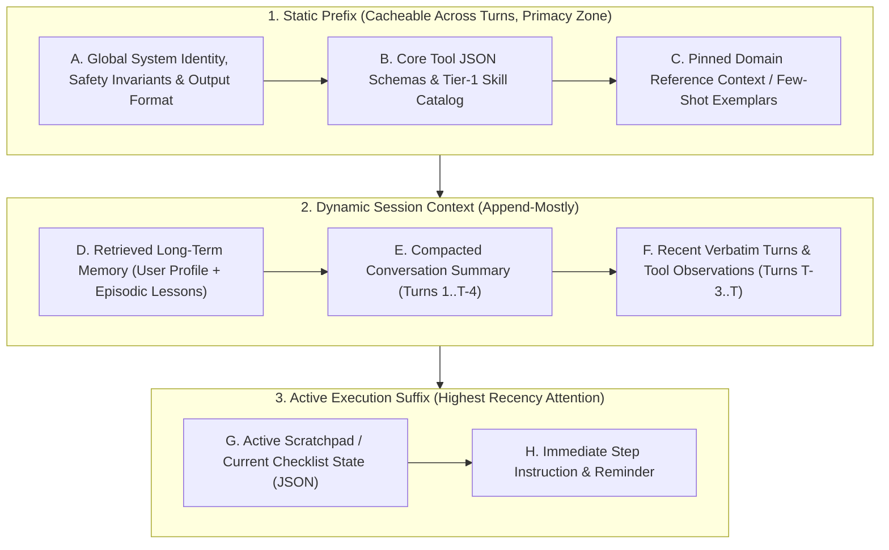

# Chapter 11: Context Engineering & Long-Term Memory Architectures (Beginner to Advanced)

[⬅️ Previous: Chapter 10 — Agentic Evaluation & Observability](./chapter-10-agentic-evaluation-and-observability.md) | [📚 Book Index](./README.md) | [Next: Chapter 12 — Agentic Security, Identity & Sandboxing ➡️](./chapter-12-agentic-security-identity-and-sandboxing.md)

---

In early LLM applications, developers practiced **Prompt Engineering**: crafting clever static instructions for a single-turn query. In multi-turn, multi-agent systems, static prompt phrasing is secondary to **Context Engineering**: the discipline of dynamically assembling, ordering, compacting, and evicting the exact tokens inside the LLM's working memory at each step $t$, while persisting durable knowledge across sessions in **Long-Term Memory Architectures**.

> [!NOTE]
> **Where the term comes from:** "Context engineering" became the mainstream name for this discipline in mid-2025 (popularized by Tobi Lütke and Andrej Karpathy, and formalized in Anthropic's *"Effective context engineering for AI agents"*, Sept 2025). LangChain's widely used taxonomy groups the techniques into four moves: **Write** (persist outside the window), **Select** (retrieve the right pieces in), **Compress** (summarize/trim), and **Isolate** (split across sub-agents or sandboxes). This chapter covers all four.

---

## 11.1 Beginner: From Prompt Engineering to Context Engineering

### Why a "1M–2M Token Context Window" Does Not Mean "Dump Everything In"
Even when a foundation model supports a 1M–2M token context window, indiscriminately stuffing raw logs, full chat histories, and 50 tool definitions into the window causes three classes of regression:
1. **"Lost in the Middle" Position Bias (Liu et al., TACL 2024; preprint 2023):** In multi-document QA, models showed a **U-shaped accuracy curve**: they used information at the **very beginning** (primacy) and **very end** (recency) of the prompt far better than information buried in the middle. For GPT-3.5-Turbo, accuracy dropped by **more than 20 points** when the answer document moved from the edges to the middle, sometimes falling *below* its no-documents (closed-book) baseline. Newer long-context models show a flatter curve on simple "needle" tests, but Chroma's *Context Rot* report (July 2025, 18 models) found that accuracy still **degrades non-uniformly as input length grows**, especially with distractors and when the question and the relevant passage share few words.
2. **Context Poisoning, Distraction & Clash:** A hallucinated "fact" or an outdated hypothesis from Turn 2 can remain in context at Turn 12 and get re-used as if true (*poisoning*); a huge accumulated history can pull the model toward repeating past actions instead of reasoning freshly (*distraction*); and contradictory information gathered over many turns can derail the answer (*clash*).
3. **Compounding Cost & TTFT Latency:** Every uncached input token adds prefill compute (raising Time-to-First-Token) and is billed again on **every** step of the loop. Because an agent re-sends its growing history each turn, total input tokens across a $K$-step loop grow roughly as $O(K^2)$ unless you cache or compact.

> [!TIP]
> **Nuance on failed attempts:** "Prune stale context" does not mean "hide every error." Manus's *"Context Engineering for AI Agents"* (2025) recommends **keeping failed actions and error messages in context** so the model sees the evidence and avoids repeating the same mistake. Remove *bulky, stale payloads* (old raw logs); keep *compact records of what failed and why*.

### Canonical Layout of an Engineered Context Window
To maximize **prompt/KV-cache hit rates** (Chapter 13) and exploit **primacy + recency**, assemble each agent turn's context window in a strict **static-to-dynamic ordering**:



> [!IMPORTANT]
> **Never inject dynamic values (timestamps, request IDs) at the top of your system prompt.** Provider prompt caches match on an **exact token prefix**: OpenAI caches automatically (prompts ≥1,024 tokens), Anthropic caches up to explicit `cache_control` breakpoints, and Gemini offers implicit and explicit context caching. Putting `Current Time: 2026-10-16T16:01:43Z` on line 1 changes the prefix on every request and **invalidates the cache for everything after it**. Keep the prefix byte-identical and put dynamic state in the suffix. The same logic applies to tools: **adding or removing tool definitions mid-session also breaks the cache**. Prefer keeping the tool list stable and constraining selection with `tool_choice`/allowed-tools settings or decoding-time masking (the "mask, don't remove" lesson from Manus).

> [!NOTE]
> **Reasoning models change the layout slightly.** With "thinking" models (configurable thinking budgets), you rarely need hand-written chain-of-thought scaffolding in the prompt. Spend those tokens on **clear goals, constraints, and high-signal context** instead. Also check your provider's rules for carrying prior reasoning blocks across tool-use turns, since some APIs require them to be passed back unchanged.

---

## 11.2 Intermediate: In-Session Context Compaction & Scratchpad Engineering

When an agent runs a 15-step debugging or coding loop within a single session, how do you prevent **Context Rot** without losing critical facts discovered in Step 2?

### The 4 In-Session Compaction Strategies

The savings figures below are **illustrative ranges** for tool-heavy loops. Measure them on your own traces.

| Compaction Strategy | How It Works | Typical Token Savings | Risk / Trade-off |
| :--- | :--- | :--- | :--- |
| **1. Observation Masking (Stale Tool Pruning)** | Keep the most recent $M=3$ tool observations verbatim; replace older raw tool outputs (`role="tool"`) with a 1-line pointer (`"[Archived 4KB log output -> artifact://step_2; found 42m 503 window]"`). Anthropic's API exposes this as built-in **context editing** (automatic clearing of old tool results). | High on tool-heavy loops (often well over half) | Low: the agent can re-read the artifact URI if it ever needs the raw lines. Masking edits history, so it **breaks the prompt cache from the first edited message onward**. Batch edits rather than editing every turn. |
| **2. Rolling Hierarchical Summarization (Compaction)** | When context exceeds a watermark (e.g., $24\text{k}$ tokens), compress the oldest ~$50\%$ of turns into a structured `session_summary` block while preserving the last $N$ turns verbatim. | High | Free-text summaries can drop exact IDs or numbers unless guided by a structured extraction schema. |
| **3. Structured Scratchpad / Todo Pinning (Note-Taking)** | Maintain a live JSON/Markdown checklist (`todo.md` or `ScratchpadState`), updated after each step, re-injected at the bottom of the prompt (recency zone) and/or persisted to a file the agent can re-read. | Indirect: improves focus more than it saves tokens | Requires the agent or orchestrator to update the scratchpad after each step. |
| **4. Sub-Agent Context Isolation** | Delegate any multi-step search/read task to an isolated worker sub-agent with its own context window. The parent only ever receives the worker's **condensed, structured answer**, never its raw exploration. | Very high **for the parent's window** | Adds a hand-off hop and **raises total spend**: Anthropic reported its multi-agent research system used roughly **15× the tokens of a chat** (vs. ~4× for a single agent). Worth it for parallelizable, breadth-first work; wasteful for tightly sequential tasks. |

### Production-Grade Framework-Agnostic Pseudocode (Observation Masking + Watermark Compaction)
```python
def compact_working_context(
    messages: list[dict],
    artifact_store: dict[str, str],
    keep_recent_observations: int = 3,
    max_token_watermark: int = 24_000,
) -> list[dict]:
    # Assumes messages[0] is the system prompt, and `count_tokens` and
    # `summarizer_llm` are provided by your stack.

    # Step 1: Observation Masking. Offload old, bulky tool outputs to the artifact store.
    tool_indices = [i for i, m in enumerate(messages) if m["role"] == "tool"]
    keep = tool_indices[-keep_recent_observations:] if keep_recent_observations > 0 else []
    stale_tool_indices = set(tool_indices) - set(keep)

    compacted = []
    for idx, msg in enumerate(messages):
        if idx in stale_tool_indices and len(msg["content"]) > 500:
            uri = f"artifact://obs_{idx}"
            artifact_store[uri] = msg["content"]
            # Keep the message (and its tool_call_id) so the call/result pairing stays valid.
            compacted.append({
                **msg,
                "content": f"[Raw output offloaded to {uri}. Preview: {msg['content'][:150]}...]",
            })
        else:
            compacted.append(msg)

    # Step 2: Watermark summarization if the total is still over budget.
    if count_tokens(compacted) > max_token_watermark:
        system_msg, history = compacted[0], compacted[1:]
        cut = len(history) // 2
        # Never split an assistant tool call from its tool result: move the cut
        # forward past any tool messages so the kept tail starts on a clean turn.
        while cut < len(history) and history[cut]["role"] == "tool":
            cut += 1
        if cut == 0 or cut >= len(history):
            return compacted  # nothing safe to summarize; fall back to masking only

        summary = summarizer_llm.generate(
            "Extract key verified facts, exact IDs/numbers, decisions, open questions, "
            "and failed approaches (with reasons) from these turns as structured JSON:\n"
            f"{history[:cut]}"
        )
        # Fold the summary into a user-role message: some providers don't accept
        # extra `system` messages mid-conversation.
        compacted = [
            system_msg,
            {"role": "user", "content": f"<prior_session_summary>\n{summary}\n</prior_session_summary>"},
            *history[cut:],
        ]
    return compacted
```

> [!WARNING]
> **Compaction is lossy and cache-hostile.** Each compaction rewrites history, so the next request pays full (uncached) price for everything after the static prefix. Trigger compaction at a **watermark**, not every turn, and always keep a full-fidelity log outside the context (trace store / artifact store) for debugging and evals (Chapter 10).

---

## 11.3 Advanced: Long-Term Cross-Session Memory Architectures

When a user returns three weeks later, **Working Memory** (the session's message history and scratch state, e.g., ADK's `session.state`) is gone. How do production agents remember user preferences, architectural topology changes, and lessons from past failures across hundreds of sessions?

### Memory Types: A Shared Vocabulary (CoALA, Sumers et al., 2023)

| Memory Type | What It Stores | Example | Typical Store |
| :--- | :--- | :--- | :--- |
| **Working** | The current context window and session scratch state | Last 4 turns, `todo.md` | Prompt + session store |
| **Semantic** | Facts about the user, world, or domain | *"Checkout-service runs on Cloud Spanner"* | Profile doc, KV store, knowledge graph |
| **Episodic** | Records of past experiences/trajectories | *"Last incident, restarting the pod didn't fix the 503s"* | Vector DB of episode summaries |
| **Procedural** | How to do things: instructions, skills, policies | A `SKILL.md` runbook, an updated system prompt | Files / prompt registry (Chapter 8) |

Most frameworks ship primitives for this. LangGraph separates **checkpointers** (per-thread short-term state) from a namespaced long-term **`Store`** (`put`/`get`/`search`). Google ADK separates `SessionService` from a `MemoryService` (`InMemoryMemoryService` for prototyping, `VertexAiMemoryBankService` for managed extraction), with `add_session_to_memory()` for ingestion and the `load_memory` / `PreloadMemoryTool` tools for recall. Anthropic's **memory tool** gives Claude a client-side, file-based `/memories` directory it can read and write across sessions.

### Architecture 1: OS-Inspired Virtual Memory (MemGPT / Letta Pattern; Packer et al., 2023)
Inspired by operating-system paging between fast **RAM** and large **Disk**, **MemGPT** (now the **Letta** framework) divides memory into:
1. **Core Memory (In-Context "RAM" Blocks):** Small, labeled, editable text blocks always pinned inside the prompt, each with a character limit (e.g., a `human` block for the user profile and a `persona` block for the agent's identity).
2. **Recall Memory (Indexed Conversation Log):** A searchable database of all historical messages, queried with `conversation_search`.
3. **Archival Memory (External Vector/Graph "Disk"):** Unbounded long-term storage, queried with `archival_memory_search`.
* **Self-Directed Memory Management Tools:** The agent is given explicit tools (`core_memory_append`, `core_memory_replace`, `archival_memory_insert`, `archival_memory_search`, `conversation_search`; newer Letta releases add generalized block-editing tools such as `memory_insert` / `memory_replace` / `memory_rethink`) and decides **by itself** when to page facts between archival storage and core memory.
* **Trade-off:** Self-editing memory is flexible, but every memory operation is an extra LLM tool call, and the agent can write wrong or **attacker-injected** facts into memory (see *memory poisoning* in Chapter 12).

### Architecture 2: Bi-Temporal Knowledge Graph Memory (Solving Contradictory Facts)
* **Why Naive Vector Memory Fails Over Time:** Suppose in January the user says *"Our checkout-service runs on Postgres 14"*, and in October they say *"We migrated checkout-service from Postgres 14 to Cloud Spanner today"*. A plain append-only vector store now contains **both** chunks, and semantic search for *"What database does checkout-service use?"* retrieves both contradictory facts.
* **Option A: LLM-Managed Memory Updates (e.g., Mem0, Chhikara et al., 2025):** For each newly extracted fact, retrieve similar existing memories and let an LLM choose an operation: **`ADD`**, **`UPDATE`**, **`DELETE`**, or **`NOOP`**. This is simple and keeps the store compact, but it overwrites history, so you can no longer answer *"what was true in March?"*
* **Option B: Bi-Temporal Knowledge Graph (e.g., Zep / Graphiti; Rasmussen et al., 2025):**
  * Extracts structured edges `(Entity_A, RELATIONSHIP, Entity_B)` annotated with **two timelines**: **valid time** (`t_valid` / `t_invalid`: when the fact was true in the real world) and **transaction time** (`t_created` / `t_expired`: when the system learned it and when the system retired it).
  * When the October message arrives, an entity-resolution & contradiction-detection pass **invalidates** (rather than deletes) `(checkout-service, USES_DB, Postgres 14)` by setting `t_invalid = 2026-10-16`, and inserts `(checkout-service, USES_DB, Cloud Spanner)` with `t_valid = 2026-10-16`, `t_invalid = NULL`. Both "what is true now?" and "what was true then?" queries stay answerable.


### Architecture 3: Hot-Path (Synchronous) vs. Background (Asynchronous) Memory Consolidation
Extracting entities, checking for contradictions, and updating episodic reflections can take seconds of LLM compute per turn.
* **Hot-Path Retrieval (Before Turn):** Load core memory and run a fast lookup (e.g., hybrid search over active graph facts, typically tens of milliseconds) and inject the results into the prompt.
* **Hot-Path Writes (During Turn, Optional):** Let the agent call a memory tool when the user explicitly says *"remember that…"*. This gives immediate consistency but adds latency.
* **Background Consolidation (After Turn):** Publish the completed turn transcript to an **asynchronous queue** (e.g., Pub/Sub, Celery) whose workers extract new facts, resolve temporal contradictions, and update episodic/semantic memory **off the user's critical path**.
* **Caveat (eventual consistency):** Background memory may not be ready by the very next turn. That is fine within a session, because the recent verbatim turns are still in working memory. Across sessions, design for a short consolidation lag.

> [!CAUTION]
> **Long-term memory is a persistent attack and privacy surface.** An injected instruction that gets "remembered" will re-trigger in every future session (OWASP Agentic **ASI06: Memory & Context Poisoning**, Chapter 12). Scope memory namespaces per user/tenant, record the **provenance** of every stored fact (which session, which source, trusted or untrusted), never auto-promote content from untrusted tool outputs into core/procedural memory, and support user-visible inspection and **deletion** (e.g., GDPR right to erasure).

---

## Chapter 11 Summary Progression

| Level | Context & Memory Capability | Problem Solved | Key Architectural Takeaway |
| :--- | :--- | :--- | :--- |
| **🟢 Beginner** | **Canonical Context Layout (Primacy/Recency + Static Prefix)** | Reduces "Lost in the Middle"/context-rot recall drops and broken prompt caches. | Keep static prefixes (system prompt, tool list) byte-identical at the top; place active scratchpads and instructions at the bottom. |
| **🟡 Intermediate** | **Observation Masking, Watermark Compaction, Note-Taking & Sub-Agent Isolation** | Prevents "Context Rot" and $O(K^2)$ token growth during long 15-step loops. | Offload stale tool outputs to artifact URIs, keep recent turns verbatim, compact at a watermark (never splitting tool-call/result pairs). |
| **🔴 Advanced** | **Memory Types, OS Virtual Memory (MemGPT/Letta), Bi-Temporal Graphs & Async Consolidation** | Persists evolving facts across sessions without contradictions or user-facing latency. | Use bi-temporal edges (`t_valid`/`t_invalid`) to retire outdated facts without losing history, consolidate memory asynchronously, and treat memory as a security boundary. |

---

[⬅️ Previous: Chapter 10 — Agentic Evaluation & Observability](./chapter-10-agentic-evaluation-and-observability.md) | [📚 Book Index](./README.md) | [Next: Chapter 12 — Agentic Security, Identity & Sandboxing ➡️](./chapter-12-agentic-security-identity-and-sandboxing.md)
