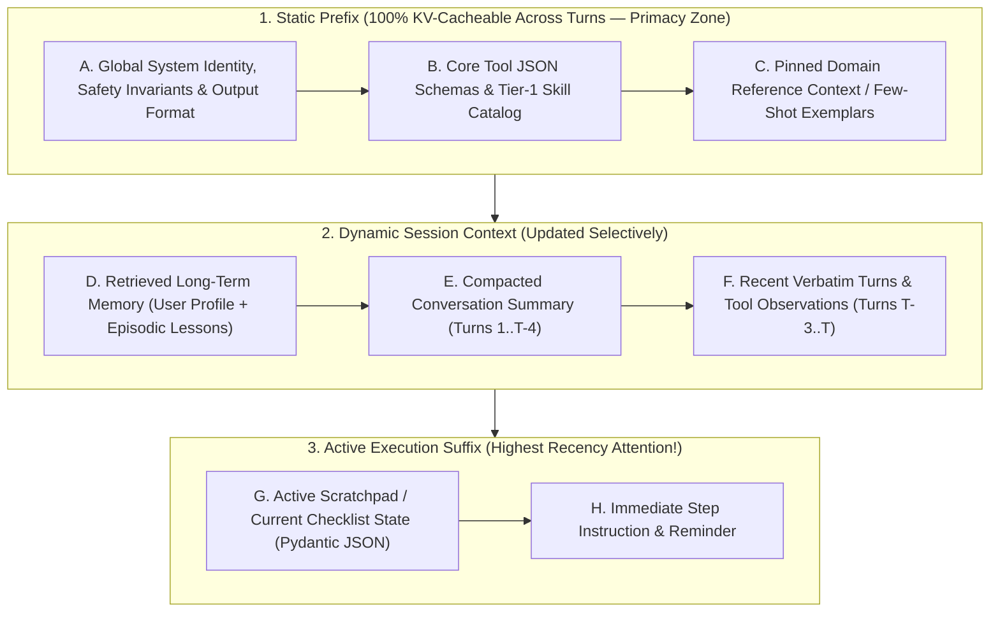
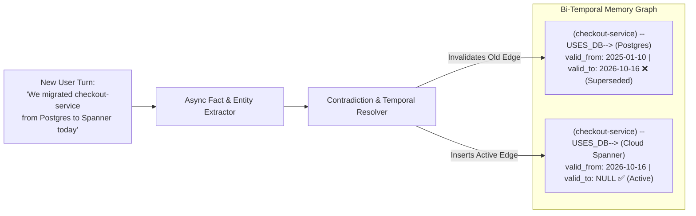

# Chapter 11: Context Engineering & Long-Term Memory Architectures (Beginner to Advanced)

[⬅️ Previous: Chapter 10 — Agentic Evaluation & Observability](./chapter-10-agentic-evaluation-and-observability.md) | [📚 Book Index](./README.md) | [Next: Chapter 12 — Agentic Security, Identity & Sandboxing ➡️](./chapter-12-agentic-security-identity-and-sandboxing.md)

---

In early LLM applications, developers practiced **Prompt Engineering**: crafting clever static instructions for a single-turn query. In multi-turn, multi-agent systems, static prompt phrasing is secondary to **Context Engineering**—the discipline of dynamically assembling, ordering, compacting, and evicting the exact tokens inside the LLM's working memory at each step $t$, while persisting durable knowledge across sessions in **Long-Term Memory Architectures**.

---

## 11.1 Beginner: From Prompt Engineering to Context Engineering

### Why "2 Million Context Window" Does Not Mean "Dump Everything In"
Even when a foundation model supports a 1M–2M token context window, indiscriminately stuffing raw logs, full chat histories, and 50 tool definitions into the window causes three severe regressions:
1. **"Lost in the Middle" Attention Degradation (Liu et al., 2023):** Transformer attention exhibits a **U-shaped recall curve**—models attend strongly to tokens at the **very beginning** (primacy bias) and **very end** (recency bias) of the prompt, while recall for facts buried in the middle drops by $20\%\text{–}40\%$.
2. **Context Poisoning & Distraction:** Outdated hypotheses or failed tool attempts from Turn 2 remain in context at Turn 12, distracting the model from the current sub-goal.
3. **Quadratic Cost & TTFT Latency:** Every uncached token increases Time-to-First-Token (TTFT) and multiplies per-turn cost across multi-step loops.

### Canonical Layout of an Engineered Context Window
To maximize **KV-Cache hit rates** (Chapter 13) and exploit **primacy + recency attention**, every agent turn should assemble its context window in a strict **static-to-dynamic ordering**:



> [!IMPORTANT]
> **Never Inject Dynamic Timestamps at Line 1 of Your System Prompt:** Putting `Current Time: 2026-10-16T16:01:43Z` at the very top of your system prompt invalidates the LLM provider's prefix KV-cache on every single second! Keep the top prefix 100% byte-identical and inject dynamic timestamps/state in the suffix.

---

## 11.2 Intermediate: In-Session Context Compaction & Scratchpad Engineering

When an agent runs a 15-step debugging or coding loop within a single session, how do you prevent **Context Rot** without losing critical facts discovered in Step 2?

### The 4 In-Session Compaction Strategies

| Compaction Strategy | How It Works | Token Savings | Risk / Trade-off |
| :--- | :--- | :--- | :--- |
| **1. Observation Masking (Stale Tool Pruning)** | Keep the recent $M=3$ tool observations verbatim; replace older raw tool outputs (`role="tool"`) with a 1-line summary pointer (`"[Archived 4KB log output -> artifact://step_2; found 42m 503 window]"`). | $70\%\text{–}90\%$ | Low — agent can re-read the artifact URI if it ever needs raw lines again. |
| **2. Rolling Hierarchical Summarization** | When context exceeds a watermark (e.g., $32\text{k}$ tokens), compress the oldest $50\%$ of conversational turns into a structured `session_summary` block while preserving the last $N$ turns verbatim. | $60\%\text{–}80\%$ | Free-text summaries can drop exact IDs or numbers unless guided by a structured extraction schema. |
| **3. Structured Scratchpad / Todo Pinning** | Maintain a live JSON/Markdown checklist (`todo.md` or `ScratchpadState`) updated after each step and injected at the very bottom of the prompt (recency zone). | High focus | Requires the agent or orchestrator to update the scratchpad state delta. |
| **4. Sub-Agent Context Offloading** | Spawn an isolated worker sub-agent for any multi-step search/read task; reclaim 100% of its working memory as soon as it returns its structured answer. | $80\%\text{–}95\%$ | Adds 1 sub-agent boundary hop. |

### Production-Grade Framework-Agnostic Pseudocode (Observation Masking + Watermark Compaction)
```python
def compact_working_context(
    messages: list[dict],
    artifact_store: dict[str, str],
    keep_recent_observations: int = 3,
    max_token_watermark: int = 24000,
) -> list[dict]:
    # Step 1: Observation Masking — offload old bulky tool outputs to Artifact Store
    tool_indices = [i for i, m in enumerate(messages) if m["role"] == "tool"]
    stale_tool_indices = set(tool_indices[:-keep_recent_observations])

    compacted = []
    for idx, msg in enumerate(messages):
        if idx in stale_tool_indices and len(msg["content"]) > 500:
            uri = f"artifact://obs_{idx}"
            artifact_store[uri] = msg["content"]
            compacted.append({
                **msg,
                "content": f"[Raw output offloaded to {uri}. Preview: {msg['content'][:150]}...]"
            })
        else:
            compacted.append(msg)

    # Step 2: Watermark Rolling Summarization if total tokens still exceed budget
    if count_tokens(compacted) > max_token_watermark:
        system_msg = compacted[0]
        midpoint = len(compacted) // 2
        summary = summarizer_llm.generate(
            "Summarize key verified facts, IDs, and decisions from these turns:\n"
            f"{compacted[1:midpoint]}"
        )
        compacted = [
            system_msg,
            {"role": "system", "content": f"Prior Session Summary:\n{summary}"},
            *compacted[midpoint:],
        ]
    return compacted
```

---

## 11.3 Advanced: Long-Term Cross-Session Memory Architectures

When a user returns three weeks later, **Working Memory** (`session.state`) is gone. How do production agents remember user preferences, architectural topology changes, and lessons from past failures across hundreds of sessions?

### Architecture 1: OS-Inspired Virtual Memory (MemGPT / Letta Pattern — Packer et al., 2023)
Inspired by operating system virtual memory paging between fast **RAM** and large **Disk**, **MemGPT** divides memory into:
1. **Core Memory (In-Context RAM Blocks):** Small, structured, editable text blocks permanently pinned inside the system prompt (e.g., `Block("user_profile", max_chars=2000)`, `Block("project_context", max_chars=2000)`).
2. **Recall Memory (Indexed Conversation Log):** Searchable database of all historical turns across sessions.
3. **Archival Memory (External Vector/Graph Disk):** Unbounded long-term storage.
* **Self-Directed Memory Management Tools:** The agent is given explicit tools (`core_memory_append`, `core_memory_replace`, `archival_memory_insert`, `archival_memory_search`) to page facts between Archival Disk and Core RAM autonomously!

### Architecture 2: Bi-Temporal Knowledge Graph Memory (Solving Contradictory Facts)
* **Why Pure Vector Memory Fails Over Time:** Suppose in January the user says *"Our primary database is Postgres 14"*, and in October they say *"We migrated our primary database from Postgres 14 to Cloud Spanner"*. A standard vector memory store now contains **both** chunks—and semantic search for *"What is our primary database?"* retrieves both contradictory facts!
* **Bi-Temporal Knowledge Graph Solution (e.g., Graphiti / Zep Architecture):**
  * Extracts structured triples `(Entity_A, Relationship, Entity_B)` annotated with **two timelines**: `t_valid_from / t_valid_to` (when the fact was true in the real world) and `t_ingested` (when the agent learned it).
  * When the October message arrives, an entity-resolution & contradiction-detection pass marks `(CheckoutService, USES_DB, Postgres14)` with `t_valid_to = "2026-10-01"` and inserts `(CheckoutService, USES_DB, CloudSpanner, t_valid_from="2026-10-01", t_valid_to=None)`.



### Architecture 3: Hot-Path (Synchronous) vs. Background (Subconscious) Memory Consolidation
Extracting entities, checking for contradictions, and updating episodic reflections takes 1–3 seconds of LLM compute.
* **Hot-Path Retrieval (Before Turn):** Query Core Memory + fast hybrid lookup of active Temporal Graph facts ($<80\text{ms}$ latency) and inject into the prompt.
* **Background Consolidation (After Turn):** Publish the completed turn transcript to an **asynchronous background queue** (Pub/Sub / Celery worker) that extracts new facts, resolves temporal contradictions, and updates Episodic/Semantic memory **zero-latency** off the user's critical path!

---

## Chapter 11 Summary Progression

| Level | Context & Memory Capability | Problem Solved | Key Architectural Takeaway |
| :--- | :--- | :--- | :--- |
| **🟢 Beginner** | **Canonical Context Layout (Primacy/Recency + Static Prefix)** | Fixes "Lost in the Middle" recall drops and broken KV-caches. | Keep static prefixes byte-identical at the top; place active scratchpads and instructions at the bottom. |
| **🟡 Intermediate** | **Observation Masking & Watermark Summarization** | Prevents "Context Rot" and $O(K^2)$ blowups during long 15-step loops. | Offload stale tool outputs $>3$ turns old to Artifact URIs while keeping recent turns verbatim. |
| **🔴 Advanced** | **OS Virtual Memory (MemGPT), Bi-Temporal Graphs & Async Consolidation** | Persists evolving facts across sessions without contradictions or user latency. | Use bi-temporal edges (`valid_from`/`valid_to`) to retire outdated facts, and consolidate memory asynchronously post-turn. |

---

[⬅️ Previous: Chapter 10 — Agentic Evaluation & Observability](./chapter-10-agentic-evaluation-and-observability.md) | [📚 Book Index](./README.md) | [Next: Chapter 12 — Agentic Security, Identity & Sandboxing ➡️](./chapter-12-agentic-security-identity-and-sandboxing.md)
