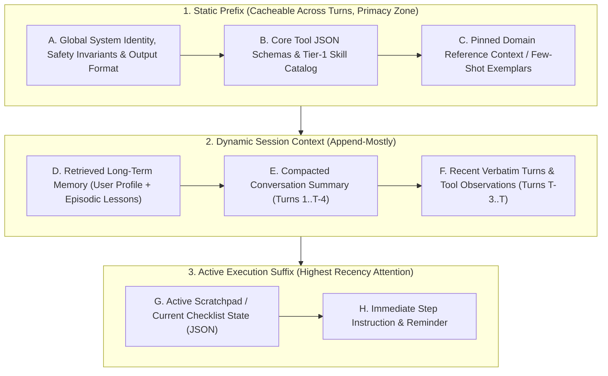
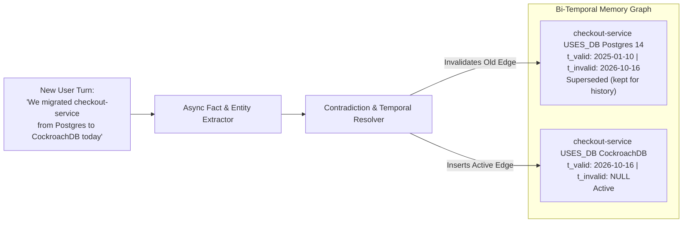

# Chapter 11: Context Engineering and Long-Term Memory (Beginner to Advanced)

[← Previous: Chapter 10 — Agentic Evaluation & Observability](./chapter-10-agentic-evaluation-and-observability.md) | [Book Index](./README.md) | [Next: Chapter 12 — Agentic Security, Identity & Sandboxing →](./chapter-12-agentic-security-identity-and-sandboxing.md)

---

Early LLM applications relied on **prompt engineering**: writing clever static instructions for a single-turn query. Once you have multi-turn, multi-agent systems, the exact wording of a static prompt matters less than **context engineering**, which is the work of deciding which tokens sit in the model's working memory at each step $t$. That means assembling them, ordering them, compacting them and evicting them as the run goes on. Knowledge that has to outlive a session goes into a **long-term memory architecture**.

> [!NOTE]
> "Context engineering" became the mainstream name for this discipline in mid-2025. Tobi Lütke and Andrej Karpathy popularized it, and Anthropic formalized it in *"Effective context engineering for AI agents"* (Sept 2025). LangChain's widely used taxonomy sorts the techniques into four moves: Write (persist outside the window), Select (retrieve the right pieces in), Compress (summarize or trim), and Isolate (split across sub-agents or sandboxes). This chapter covers all four.

---

## 11.1 Beginner: from prompts to context

### A big context window is not a license to dump everything in
A foundation model may support a 1M–2M token context window, but stuffing it with raw logs, full chat histories and 50 tool definitions still causes regressions. They come in three kinds.

1. **Position bias ("Lost in the Middle").** Liu et al. (TACL 2024; preprint 2023) found a U-shaped accuracy curve in multi-document QA. Models used information at the very beginning of the prompt (primacy) and the very end (recency) far better than anything buried in the middle. For GPT-3.5-Turbo, accuracy fell by more than 20 points when the answer document moved from the edges to the middle, sometimes dropping *below* its no-documents (closed-book) baseline. Newer long-context models show a flatter curve on simple "needle" tests. Even so, Chroma's *Context Rot* report (July 2025, 18 models) found that accuracy still degrades non-uniformly as input grows, particularly with distractors present or when the question and the relevant passage share few words.
2. **Poisoning, distraction and clash.** A hallucinated "fact" or an outdated hypothesis from Turn 2 can survive to Turn 12 and be reused as if it were true (*poisoning*). A huge accumulated history can pull the model toward repeating past actions instead of thinking afresh (*distraction*). And contradictory information picked up over many turns can derail the answer (*clash*).
3. **Compounding cost and TTFT latency.** Every uncached input token adds prefill compute, which raises Time-to-First-Token, and it is billed again on every step of the loop. Because an agent re-sends its growing history each turn, total input tokens across a $K$-step loop grow roughly as $O(K^2)$ unless you cache or compact.

One nuance: pruning stale context does not mean hiding every error. Manus's *"Context Engineering for AI Agents"* (2025) recommends keeping failed actions and their error messages in context, so the model can see the evidence and avoid repeating the mistake. Drop the bulky, stale payloads (old raw logs) and keep compact records of what failed and why.

### How to lay out the context window
Order each turn's context from static to dynamic. This maximizes prompt/KV-cache hit rates (Chapter 13) and puts primacy and recency to work for you:



> [!IMPORTANT]
> **Never inject dynamic values (timestamps, request IDs) at the top of your system prompt.** Provider prompt caches match on an exact token prefix. OpenAI caches automatically (prompts ≥1,024 tokens), Anthropic caches up to explicit `cache_control` breakpoints, Gemini offers implicit and explicit context caching, and self-hosted engines such as vLLM and SGLang reuse the KV cache for shared prefixes. Put `Current Time: 2026-10-16T16:01:43Z` on line 1 and the prefix changes on every request, which invalidates the cache for everything after it. Keep the prefix byte-identical and move dynamic state to the suffix.

Tools follow the same logic: adding or removing tool definitions mid-session also breaks the cache. Keep the tool list stable and constrain selection with `tool_choice` or allowed-tools settings, or with decoding-time masking. Manus calls this "mask, don't remove."

Reasoning models shift the layout a little. With "thinking" models (configurable thinking budgets), you rarely need hand-written chain-of-thought scaffolding in the prompt, so spend those tokens on clear goals, constraints and high-signal context. Check your provider's rules for carrying earlier reasoning blocks across tool-use turns too; some APIs require them to be passed back unchanged.

---

## 11.2 Intermediate: compaction and scratchpads within a session

Say an agent runs a 15-step debugging or coding loop in a single session. How do you keep context rot at bay without losing a key fact it found in Step 2?

### Four compaction strategies

The savings figures below are illustrative ranges for tool-heavy loops. Measure them on your own traces.

| Strategy | How it works | Typical token savings | Risks and trade-offs |
| :--- | :--- | :--- | :--- |
| 1. Observation masking (pruning stale tool output) | Keep the most recent $M=3$ tool observations verbatim; replace older raw tool outputs (`role="tool"`) with a one-line pointer (`"[Archived 4KB log output -> artifact://step_2; found 42m 503 window]"`). Anthropic's API offers this as built-in context editing (automatic clearing of old tool results). | High on tool-heavy loops (often well over half) | Low: the agent can re-read the artifact URI if it ever needs the raw lines. Masking edits history, though, so it breaks the prompt cache from the first edited message onward. Batch the edits instead of editing every turn. |
| 2. Rolling hierarchical summarization (compaction) | When context passes a watermark (e.g., $24\text{k}$ tokens), compress the oldest ~$50\%$ of turns into a structured `session_summary` block and keep the last $N$ turns verbatim. | High | Free-text summaries can drop exact IDs or numbers unless a structured extraction schema guides them. |
| 3. Structured scratchpad or todo pinning (note-taking) | Maintain a live JSON/Markdown checklist (`todo.md` or `ScratchpadState`), update it after each step, and re-inject it at the bottom of the prompt (recency zone) and/or persist it to a file the agent can re-read. | Indirect: it improves focus more than it saves tokens | The agent or orchestrator has to update the scratchpad after every step. |
| 4. Sub-agent context isolation | Hand any multi-step search or read task to an isolated worker sub-agent with its own context window. The parent only receives the worker's condensed, structured answer and never sees its raw exploration. | Very high for the parent's window | Adds a hand-off hop and raises total spend. Anthropic reported that its multi-agent research system used roughly 15× the tokens of a chat (vs. ~4× for a single agent). Worth it for parallelizable, breadth-first work; wasteful for tightly sequential tasks. |

### Framework-agnostic pseudocode: observation masking plus watermark compaction
```python
def compact_working_context(
    messages: list[dict],
    artifact_store: dict[str, str],
    keep_recent_observations: int = 3,
    max_token_watermark: int = 24_000,
) -> list[dict]:
    # Assumes messages[0] is the system prompt, and `count_tokens` and
    # `summarizer_llm` are provided by your stack.

    # Step 1: Observation Masking. Offload old, bulky tool outputs to the artifact store.
    tool_indices = [i for i, m in enumerate(messages) if m["role"] == "tool"]
    keep = tool_indices[-keep_recent_observations:] if keep_recent_observations > 0 else []
    stale_tool_indices = set(tool_indices) - set(keep)

    compacted = []
    for idx, msg in enumerate(messages):
        if idx in stale_tool_indices and len(msg["content"]) > 500:
            uri = f"artifact://obs_{idx}"
            artifact_store[uri] = msg["content"]
            # Keep the message (and its tool_call_id) so the call/result pairing stays valid.
            compacted.append({
                **msg,
                "content": f"[Raw output offloaded to {uri}. Preview: {msg['content'][:150]}...]",
            })
        else:
            compacted.append(msg)

    # Step 2: Watermark summarization if the total is still over budget.
    if count_tokens(compacted) > max_token_watermark:
        system_msg, history = compacted[0], compacted[1:]
        cut = len(history) // 2
        # Never split an assistant tool call from its tool result: move the cut
        # forward past any tool messages so the kept tail starts on a clean turn.
        while cut < len(history) and history[cut]["role"] == "tool":
            cut += 1
        if cut == 0 or cut >= len(history):
            return compacted  # nothing safe to summarize; fall back to masking only

        summary = summarizer_llm.generate(
            "Extract key verified facts, exact IDs/numbers, decisions, open questions, "
            "and failed approaches (with reasons) from these turns as structured JSON:\n"
            f"{history[:cut]}"
        )
        # Fold the summary into a user-role message: some providers don't accept
        # extra `system` messages mid-conversation.
        compacted = [
            system_msg,
            {"role": "user", "content": f"<prior_session_summary>\n{summary}\n</prior_session_summary>"},
            *history[cut:],
        ]
    return compacted
```

> [!WARNING]
> Compaction is lossy, and it works against the cache. Each compaction rewrites history, so the next request pays the full uncached price for everything after the static prefix. Trigger compaction at a watermark rather than every turn, and always keep a full-fidelity log outside the context (trace store or artifact store) for debugging and evals (Chapter 10).

---

## 11.3 Advanced: memory that lasts across sessions

When a user comes back three weeks later, **working memory** is gone. By working memory I mean the session's message history and scratch state, such as a LangGraph thread checkpoint or ADK's `session.state`. So how does a production agent remember user preferences, changes to the architecture it manages, and lessons from past failures over hundreds of sessions?

### Memory types (CoALA, Sumers et al., 2023)

These four categories give everyone a shared vocabulary.

| Type | What it stores | Example | Typical store |
| :--- | :--- | :--- | :--- |
| Working | The current context window and session scratch state | Last 4 turns, `todo.md` | Prompt + session store |
| Semantic | Facts about the user, world, or domain | *"Checkout-service runs on CockroachDB"* | Profile doc, KV store, knowledge graph |
| Episodic | Records of past experiences/trajectories | *"Last incident, restarting the pod didn't fix the 503s"* | Vector DB of episode summaries |
| Procedural | How to do things: instructions, skills, policies | A `SKILL.md` runbook, an updated system prompt | Files / prompt registry (Chapter 8) |

Most frameworks ship primitives for this. LangGraph separates checkpointers (per-thread short-term state) from a namespaced long-term `Store` (`put`/`get`/`search`). Google ADK separates `SessionService` from a `MemoryService` (`InMemoryMemoryService` for prototyping, `VertexAiMemoryBankService` for Google's managed extraction), with `add_session_to_memory()` for ingestion and the `load_memory` / `PreloadMemoryTool` tools for recall. Anthropic's memory tool gives Claude a client-side, file-based `/memories` directory it can read and write across sessions. Managed agent runtimes have comparable services (Amazon Bedrock AgentCore Memory, Azure AI Foundry Agent Service memory, Vertex AI Agent Engine Memory Bank). Open-source memory layers such as Mem0, Letta and Zep/Graphiti, all covered below, can be self-hosted on any stack.

### Architecture 1: virtual memory, OS-style (MemGPT / Letta; Packer et al., 2023)
**MemGPT**, now the Letta framework, borrows the way an operating system pages between fast RAM and a large disk. Memory is split into three tiers:

1. **Core memory**, the in-context "RAM": small, labeled, editable text blocks that are always pinned in the prompt, each with a character limit. Typical examples are a `human` block for the user profile and a `persona` block for the agent's identity.
2. **Recall memory**: a searchable, indexed log of every past message, queried with `conversation_search`.
3. **Archival memory**, the external vector/graph "disk": unbounded long-term storage, queried with `archival_memory_search`.

The agent manages this itself. It gets explicit tools (`core_memory_append`, `core_memory_replace`, `archival_memory_insert`, `archival_memory_search`, `conversation_search`; newer Letta releases add generalized block-editing tools such as `memory_insert` / `memory_replace` / `memory_rethink`) and decides on its own when to move facts between archival storage and core memory.

Self-editing memory is flexible, but you pay for it. Every memory operation is an extra LLM tool call, and the agent can write wrong or attacker-injected facts into memory (see memory poisoning in Chapter 12).

### Architecture 2: bi-temporal knowledge graphs for facts that change
Naive vector memory breaks down over time. Suppose that in January the user says *"Our checkout-service runs on Postgres 14"*, and in October they say *"We migrated checkout-service from Postgres 14 to CockroachDB today"*. A plain append-only vector store now holds both chunks, and a semantic search for *"What database does checkout-service use?"* pulls back two contradictory facts.

There are two common fixes. The first is to let an LLM manage updates, as Mem0 does (Chhikara et al., 2025). For each newly extracted fact, you retrieve similar existing memories and have an LLM pick one operation: `ADD`, `UPDATE`, `DELETE` or `NOOP`. It's simple and keeps the store compact, but it overwrites history, so you can no longer answer *"what was true in March?"*

The second is a bi-temporal knowledge graph, the approach behind Zep / Graphiti (Rasmussen et al., 2025). It extracts structured edges `(Entity_A, RELATIONSHIP, Entity_B)` and stamps each one with two timelines. Valid time (`t_valid` / `t_invalid`) records when the fact was true in the real world. Transaction time (`t_created` / `t_expired`) records when the system learned it and when the system retired it. When the October message arrives, an entity-resolution and contradiction-detection pass invalidates `(checkout-service, USES_DB, Postgres 14)` instead of deleting it, by setting `t_invalid = 2026-10-16`. It then inserts `(checkout-service, USES_DB, CockroachDB)` with `t_valid = 2026-10-16`, `t_invalid = NULL`. You can still answer both "what is true now?" and "what was true then?"



### Architecture 3: hot-path vs. background consolidation
Extracting entities, checking for contradictions and updating episodic reflections can cost seconds of LLM compute per turn. You don't want all of that in front of the user, so split the work by when it happens.

Before the turn, on the hot path, load core memory, run a fast lookup (for example hybrid search over active graph facts, which typically takes tens of milliseconds) and inject the results into the prompt. During the turn you can optionally let the agent call a memory tool when the user explicitly says *"remember that…"*. That gives immediate consistency at the cost of some latency.

After the turn, publish the completed transcript to an asynchronous queue (e.g., Kafka, RabbitMQ/Celery, Amazon SQS, Azure Service Bus, Google Cloud Pub/Sub). Workers on that queue extract new facts, resolve temporal contradictions, and update episodic and semantic memory off the user's critical path.

The catch is eventual consistency: background memory may not be ready by the very next turn. Within a session that's fine, because the recent verbatim turns are still in working memory. Across sessions, design for a short consolidation lag.

> [!CAUTION]
> **Long-term memory is a persistent attack and privacy surface.** An injected instruction that gets "remembered" will fire again in every future session (OWASP Agentic ASI06: Memory & Context Poisoning, Chapter 12). Scope memory namespaces per user or tenant. Record the provenance of every stored fact: which session, which source, trusted or untrusted. Never auto-promote content from untrusted tool outputs into core or procedural memory, and let users inspect and delete what's stored (e.g., GDPR right to erasure).

---

## Chapter 11 summary

| Level | Capability | Problem solved | Key takeaway |
| :--- | :--- | :--- | :--- |
| Beginner | Canonical context layout (primacy/recency + static prefix) | Reduces "Lost in the Middle"/context-rot recall drops and broken prompt caches. | Keep static prefixes (system prompt, tool list) byte-identical at the top; place active scratchpads and instructions at the bottom. |
| Intermediate | Observation masking, watermark compaction, note-taking and sub-agent isolation | Prevents context rot and $O(K^2)$ token growth during long 15-step loops. | Offload stale tool outputs to artifact URIs, keep recent turns verbatim, compact at a watermark (never splitting tool-call/result pairs). |
| Advanced | Memory types, OS-style virtual memory (MemGPT/Letta), bi-temporal graphs and async consolidation | Persists evolving facts across sessions without contradictions or user-facing latency. | Use bi-temporal edges (`t_valid`/`t_invalid`) to retire outdated facts without losing history, consolidate memory asynchronously, and treat memory as a security boundary. |

---

[← Previous: Chapter 10 — Agentic Evaluation & Observability](./chapter-10-agentic-evaluation-and-observability.md) | [Book Index](./README.md) | [Next: Chapter 12 — Agentic Security, Identity & Sandboxing →](./chapter-12-agentic-security-identity-and-sandboxing.md)
