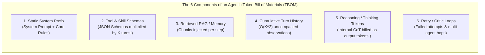
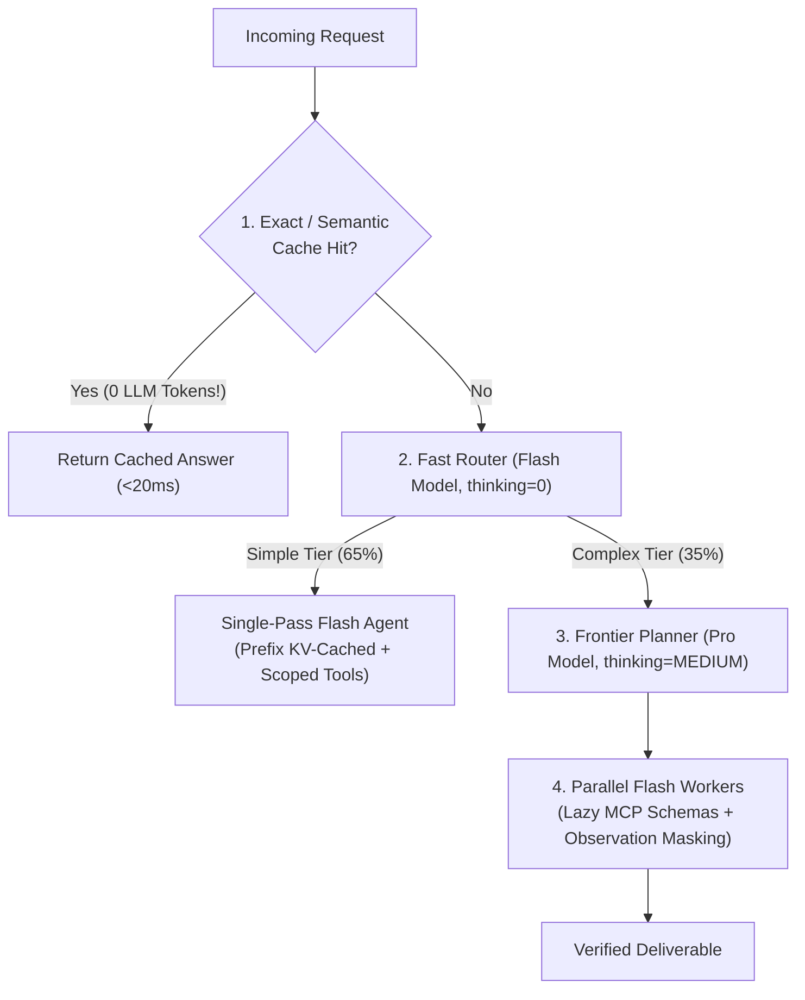

# Chapter 13: Agentic FinOps & Tokenomics — Cost, Latency & Throughput Engineering (Beginner to Advanced)

[⬅️ Previous: Chapter 12 — Agentic Security, Identity & Sandboxing](./chapter-12-agentic-security-identity-and-sandboxing.md) | [📚 Book Index](./README.md) | [Next: Chapter 14 — Multimodal, Computer-Use & Streaming Agents ➡️](./chapter-14-multimodal-computer-use-and-streaming-agents.md)

---

A single-turn chatbot might consume $1,000$ tokens per request. An unoptimized multi-agent workflow with 4 sub-agents, 60 bound tool schemas, and 8 reasoning turns can easily consume **$180,000$ tokens ($180\times$ more expensive)** for a single customer ticket!

**Agentic FinOps & Tokenomics** is the engineering discipline of decomposing an agent's **Token Bill of Materials (TBOM)**, optimizing **Cost per Validated Outcome (CpO)** without sacrificing accuracy, and engineering low-latency, high-throughput inference pipelines.

---

## 13.1 Beginner: The Token Bill of Materials (TBOM) & Cost per Validated Outcome (CpO)

### Why "Price per 1 Million Tokens" Is a Vanity Metric
Choosing a model solely because its API price per 1M tokens is $30\%$ cheaper often *increases* your total cloud bill if that weaker model takes 4 extra retry turns, calls redundant tools, or fails validation 25% of the time.

The true north metric of Agentic FinOps is **Cost per Validated Outcome ($\text{CpO}$)**:

$$\text{CpO} = \frac{\sum_{\text{all runs}} \left(\text{Uncached Input Cost} + \text{Cached Input Cost} + \text{Thinking/Output Cost} + \text{Tool/Search API Cost}\right)}{\text{Count of Runs Passing Trajectory + Outcome Verification}}$$

### Anatomy of an Agentic Token Bill of Materials (TBOM)
Every agent invocation consists of **6 distinct token cost components**:



> [!WARNING]
> **Hidden Multiplier — Thinking Tokens Are Billed as Output Tokens:** In reasoning models (where output tokens cost $3\times\text{–}8\times$ more than input tokens), an unconstrained internal `thinking_budget` of 8,000 tokens per step across a 6-step ReAct loop bills **48,000 output tokens**—often accounting for $>75\%$ of the total dollar cost!

### The 3 Core Latency Metrics in Agentic Systems
1. **TTFT (Time to First Token):** Dominated by **prefill compute** (proportional to uncached input prompt length).
2. **TPOT (Time Per Output Token) / ITL:** Dominated by **autoregressive decode bandwidth** (proportional to model parameter size).
3. **TCT (Task Completion Time):** End-to-end wall-clock latency across all $K$ serial LLM calls and external tool executions:
   $$\text{TCT} = \sum_{k=1}^{K} \left(\text{TTFT}_k + N_{\text{out}, k} \cdot \text{TPOT}_k + L_{\text{tool}, k}\right)$$

---

## 13.2 Intermediate: The 6 High-Leverage Tokenomics Optimization Levers

Applying the six architectural levers below routinely reduces **Cost per Validated Outcome (CpO) by $80\%\text{–}95\%$** while *improving* end-to-end latency:

| Lever | Architectural Mechanism | Typical CpO Reduction | Latency Impact |
| :--- | :--- | :---: | :---: |
| **1. Prefix KV-Caching** | Keep `[System Prompt + Core Tools + Static Docs]` 100% byte-identical across turns; never inject dynamic timestamps/UUIDs in the prefix. | $-50\%\text{ to }-75\%$ on input tokens | $-40\%\text{ to }-60\%$ TTFT |
| **2. Model Tiering & Routing** | Route 65% FAQ traffic to Flash/Nano RAG; use Frontier Pro/Opus *only* for Planner/Judge nodes and Flash for Step Executor loops. | $-60\%\text{ to }-80\%$ total spend | $2\times\text{–}4\times$ faster TPOT |
| **3. Adaptive Thinking Budgets** | Set `thinking_budget = 0` or `LOW` (256–512 tokens) for simple classification/tool routing, and reserve `HIGH` thinking budgets only for complex planning. | $-50\%\text{ to }-70\%$ on output tokens | Saves $1\text{–}4\text{s}$ per turn |
| **4. Progressive Tool & Skill Disclosure** | Lazy-load MCP tool schemas (Chapter 9) and `SKILL.md` playbooks (Chapter 8) instead of binding 80 schemas upfront. | $-70\%\text{ to }-90\%$ on schema tokens | Faster prefill |
| **5. Sub-Agent Context Scoping & Masking** | Offload noisy log/search steps to isolated sub-agents and mask tool observations $>3$ turns old (Chapter 11), turning $O(K^2)$ into $O(K)$. | $-65\%\text{ to }-85\%$ on long loops | Prevents late-turn slowdowns |
| **6. Semantic & Deterministic Caching** | Cache deterministic tool lookups and high-frequency canonical FAQ embeddings in Redis/Memorystore. | $100\%$ saved on cache hits | $< 20\text{ms}$ response |



---

## 13.3 Advanced: Token Budget Circuit Breakers, Provisioned Throughput & FinOps Telemetry

### 1. Enforcing Per-Invocation Token & Dollar Budgets in Code
In a multi-agent hierarchy, a bug in a child worker loop can silently burn \$15 of tokens on a single user request unless bounded by a shared **`TokenBudgetTracker`** attached to the root `InvocationContext`:

```python
class BudgetExceededError(RuntimeError):
    pass

class TokenBudgetEnforcer(BaseModel):
    max_budget_usd: float = 0.25
    max_total_tokens: int = 80_000
    spent_usd: float = 0.0
    spent_tokens: int = 0

    def record_llm_usage(
        self,
        uncached_in: int,
        cached_in: int,
        out_and_thinking: int,
        price_in_1m: float,
        price_cached_1m: float,
        price_out_1m: float,
    ) -> None:
        call_tokens = uncached_in + cached_in + out_and_thinking
        call_cost = (
            (uncached_in / 1e6) * price_in_1m
            + (cached_in / 1e6) * price_cached_1m
            + (out_and_thinking / 1e6) * price_out_1m
        )
        self.spent_tokens += call_tokens
        self.spent_usd += call_cost

        if self.spent_usd > self.max_budget_usd or self.spent_tokens > self.max_total_tokens:
            raise BudgetExceededError(
                f"Circuit Breaker Tripped: Spent ${self.spent_usd:.4f} ({self.spent_tokens} tokens), "
                f"exceeding cap of ${self.max_budget_usd:.4f}."
            )
```

### 2. Capacity Planning: Pay-As-You-Go (PAYGO) vs. Provisioned Throughput (PTU / GSU)
Multi-agent patterns like **Parallel Sectioning (Pattern 2.2)** and **Orchestrator–Workers (Pattern 3.1)** create **spiky micro-bursts**: a single user request might fan out into 8 concurrent LLM calls at the exact same millisecond.
* **The Burstiness Problem:** Standard Pay-As-You-Go (PAYGO) endpoints enforce Tokens-Per-Minute (TPM) and Requests-Per-Minute (RPM) rate limits, causing tail latency spikes when 8 workers hit `HTTP 429` backoff.
* **The Hybrid Capacity Architecture:**
  1. **Provisioned Throughput (Vertex AI PTU / Dedicated GSUs) for Base Load:** Reserve fixed throughput capacity sized to your steady-state P75 concurrency so core interactive traffic has guaranteed sub-second TTFT and zero rate-limit throttling.
  2. **PAYGO Spillover + Priority Queuing for Peaks:** Overflow bursty fan-out workers above the PTU ceiling onto PAYGO with priority headers (`X-Server-Timeout` / `flex-tier`), and run non-urgent background tasks (memory consolidation, nightly report generation, offline evals) on **Batch API endpoints ($50\%$ discount)**.

---

## Chapter 13 Summary Progression

| Level | FinOps Capability | Primary Metric Optimized | Key Architectural Takeaway |
| :--- | :--- | :--- | :--- |
| **🟢 Beginner** | **TBOM Decomposition & Cost per Validated Outcome (CpO)** | $\text{CpO} = \frac{\text{Total Spend}}{\text{Verified Successes}}$ | Optimize for *Cost per Validated Outcome*, not raw price per 1M tokens; track thinking tokens as output cost. |
| **🟡 Intermediate** | **The 6 Tokenomics Levers (Prefix Cache, Model Tiering, Lazy Schemas)** | $-80\%\text{ to }-95\%$ CpO & $-50\%$ TTFT | Keep prefixes byte-identical for KV-cache hits, tier models (Pro Planner + Flash Executor), and cap thinking budgets. |
| **🔴 Advanced** | **`TokenBudgetEnforcer` Circuit Breakers & Hybrid PTU + PAYGO Sizing** | Tail latency ($P99$) & runaway loop prevention | Enforce hard dollar/token caps in `InvocationContext`, size Provisioned Throughput for base load, and use Batch APIs ($50\%$ off) for async work. |

---

[⬅️ Previous: Chapter 12 — Agentic Security, Identity & Sandboxing](./chapter-12-agentic-security-identity-and-sandboxing.md) | [📚 Book Index](./README.md) | [Next: Chapter 14 — Multimodal, Computer-Use & Streaming Agents ➡️](./chapter-14-multimodal-computer-use-and-streaming-agents.md)
