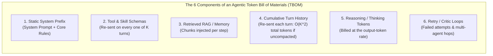
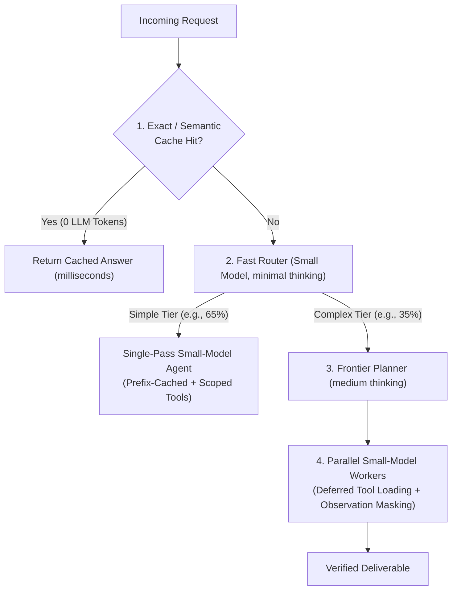

# Chapter 13: Agentic FinOps & Tokenomics — Cost, Latency & Throughput Engineering (Beginner to Advanced)

[⬅️ Previous: Chapter 12 — Agentic Security, Identity & Sandboxing](./chapter-12-agentic-security-identity-and-sandboxing.md) | [📚 Book Index](./README.md) | [Next: Chapter 14 — Multimodal, Computer-Use & Streaming Agents ➡️](./chapter-14-multimodal-computer-use-and-streaming-agents.md)

---

A single-turn chatbot might consume ~1,000 tokens per request. An unoptimized multi-agent workflow with 4 sub-agents, 60 bound tool schemas, and 8 reasoning turns can easily consume **well over 100,000 tokens** for a single customer ticket, because every turn re-sends the system prompt, every tool schema, and the ever-growing history. This is not a contrived example: Anthropic reported (*"How we built our multi-agent research system"*, June 2025) that its agents used roughly **4× more tokens than chat interactions**, and its multi-agent research system roughly **15× more**.

**Agentic FinOps & Tokenomics** is the engineering discipline of decomposing an agent's **Token Bill of Materials (TBOM)**, optimizing **Cost per Validated Outcome (CpO)** without sacrificing accuracy, and engineering low-latency, high-throughput inference pipelines.

> [!NOTE]
> "TBOM" and "CpO" are this book's working terms, not industry-standard acronyms. The underlying ideas (cost decomposition and cost per successful task) are standard FinOps practice.

---

## 13.1 Beginner: The Token Bill of Materials (TBOM) & Cost per Validated Outcome (CpO)

### Why "Price per 1 Million Tokens" Is a Vanity Metric
Choosing a model solely because its API price per 1M tokens is 30% cheaper often *increases* your total bill if that weaker model takes 4 extra retry turns, calls redundant tools, or fails validation 25% of the time.

The true north metric of Agentic FinOps is **Cost per Validated Outcome ($\text{CpO}$)**. The numerator includes the cost of *every* run, failed ones included; the denominator counts only runs that pass verification:

$$\text{CpO} = \frac{\sum_{\text{all runs}} \left(\text{Uncached Input} + \text{Cache Writes} + \text{Cache Reads} + \text{Thinking/Output} + \text{Tool/Search API}\right)}{\text{Count of Runs Passing Trajectory + Outcome Verification}}$$

### Anatomy of an Agentic Token Bill of Materials (TBOM)
Every agent invocation consists of **6 distinct token cost components**:



> [!WARNING]
> **Hidden Multiplier #1 — Thinking Tokens Are Billed as Output Tokens:** All major providers bill reasoning tokens at the output rate (OpenAI reports them as `reasoning_tokens` inside output usage; Gemini reports `thoughts_token_count`; Claude bills extended thinking as output tokens, and for models that return *summarized* thinking you still pay for the full thinking tokens generated). Output tokens commonly cost ~4×–8× more than input tokens, so a thinking budget of 8,000 tokens per step, **if fully used** across a 6-step ReAct loop, bills **48,000 output tokens**, which can easily dominate the dollar cost. A budget is a *cap*, not a target; measure actual usage.
>
> **Hidden Multiplier #2 — Long-Context Surcharges:** Some models charge a higher per-token rate once a prompt crosses a size threshold (for example, Gemini 2.5 Pro prices prompts above 200K tokens at a higher tier, as did the 1M-context beta of Claude Sonnet 4/4.5). Check your provider's price sheet. Unbounded history can silently move every call into the expensive tier.

### The 3 Core Latency Metrics in Agentic Systems
1. **TTFT (Time to First Token):** Queueing time plus **prefill compute**, which scales with the *uncached* input length (a cache hit on a long prefix skips most of the prefill work).
2. **TPOT (Time Per Output Token) / ITL (Inter-Token Latency):** Dominated by **memory-bandwidth-bound autoregressive decode**; it scales with the model's *active* parameter count (for Mixture-of-Experts models, active rather than total parameters), KV-cache size, and server load.
3. **TCT (Task Completion Time):** End-to-end wall-clock latency across all $K$ serial LLM calls and external tool executions:
   $$\text{TCT} = \sum_{k=1}^{K} \left(\text{TTFT}_k + N_{\text{out}, k} \cdot \text{TPOT}_k + L_{\text{tool}, k}\right)$$
   Here $N_{\text{out},k}$ *includes thinking tokens*: hidden reasoning adds directly to wall-clock time. The formula assumes strictly serial steps. With parallel tool calls or parallel sub-agents, each parallel group contributes the latency of its *slowest* branch (a `max`, not a sum), which is why fan-out is a latency lever as well as a cost risk.

---

## 13.2 Intermediate: The 6 High-Leverage Tokenomics Optimization Levers

Applied together, the six architectural levers below can cut **Cost per Validated Outcome (CpO)** substantially (teams frequently report reductions well above 50%) while often *improving* end-to-end latency. The ranges in the table are **illustrative orders of magnitude, not guarantees**: measure them on your own traces.

| Lever | Architectural Mechanism | Illustrative CpO Impact | Latency Impact |
| :--- | :--- | :---: | :---: |
| **1. Prefix (Prompt) Caching** | Keep `[Tool Schemas + System Prompt + Static Docs]` byte-identical at the *front* of every request and keep history append-only; never inject timestamps/UUIDs or re-order JSON keys in the prefix. | Cached input typically billed at ~10%–50% of the base input price (provider/model dependent) | Large TTFT reduction on long prefixes |
| **2. Model Tiering & Routing** | Route simple/FAQ traffic to small, fast models (mini/Haiku/Flash-class, or small open-weight Llama/Qwen/Mistral models); use frontier models *only* for Planner/Judge nodes and small models for Step Executor loops. | Often the single largest saving on total spend | Typically faster TPOT on small models |
| **3. Adaptive Thinking Budgets** | Use the lowest reasoning setting that passes your evals for classification/tool routing, and reserve high settings for complex planning. Parameter names differ by provider: OpenAI `reasoning_effort` (`minimal`/`low`/`medium`/`high`, `none` on some models), Claude extended thinking `budget_tokens` (minimum 1,024) or disable it, Gemini 2.5 `thinking_budget` (`0` disables thinking on Flash), Gemini 3 `thinking_level` (`"low"`/`"high"`, more levels on some models), and open-weight hybrid reasoners such as Qwen3 expose an `enable_thinking` switch in their chat template. | Large savings on output tokens | Saves seconds per turn |
| **4. Progressive Tool & Skill Disclosure** | Lazy-load MCP tool schemas (Chapter 9) and `SKILL.md` playbooks (Chapter 8) instead of binding 80 schemas upfront, *in a cache-friendly way* (see the note below). | Large savings on schema tokens | Faster prefill |
| **5. Sub-Agent Context Scoping & Masking** | Offload noisy log/search steps to isolated sub-agents and mask tool observations $>3$ turns old (Chapter 11), turning $O(K^2)$ cumulative tokens into roughly $O(K)$. | Large savings on long loops | Prevents late-turn slowdowns |
| **6. Semantic & Deterministic Caching** | Cache deterministic tool lookups and high-frequency canonical FAQ answers (keyed by exact match or embedding similarity) in an in-memory store (Redis/Valkey, self-hosted or managed, e.g., Amazon ElastiCache, Azure Managed Redis, Google Memorystore). | Near-100% of LLM cost saved on hits (an embedding lookup still costs a little) | Milliseconds on hits |

> [!IMPORTANT]
> **The levers interact — dynamic tool loading can destroy your prefix cache.** Tool definitions usually sit at the very front of the prompt, so adding or removing tools mid-session invalidates the cache for everything after them. The Manus team (*"Context Engineering for AI Agents: Lessons from Building Manus"*, 2025) called the KV-cache hit rate the single most important metric for a production agent and recommended **"mask, don't remove"**: keep the tool list stable and restrict which tools are callable via tool-choice constraints or logit masking. Provider features now help too: Anthropic's **Tool Search Tool** (Nov 2025) lets you mark tools with `defer_loading: true` so that discovered tools are appended later in the context instead of rewriting the cached prefix.

> [!CAUTION]
> **Semantic caches can return confidently wrong answers.** An embedding-similarity hit for *"How do I cancel my order?"* may be served for *"How do I cancel my subscription?"*. Use conservative similarity thresholds, scope cache keys by tenant/user permissions (never share personalized answers across users), set TTLs, and exclude anything stateful or time-sensitive.

### Prompt Caching Mechanics You Must Know
* **Prefix matching is exact.** Caches match the longest identical prefix; one changed byte invalidates everything after it. Order content from most static to most dynamic: tools → system prompt → static documents → conversation history → latest user turn.
* **Minimum sizes and TTLs apply.** Short prompts aren't cached (for example, OpenAI and many Claude models require ~1,024+ tokens), and entries expire after minutes to hours depending on provider and settings.
* **Pricing models differ:**
  * **OpenAI:** automatic caching; the cached-input discount ranges from 50% to 90% depending on the model.
  * **Anthropic:** explicit `cache_control` breakpoints. Cache *writes* cost more than base input (1.25× for the 5-minute TTL, 2× for the 1-hour TTL); cache *reads* cost 0.1×.
  * **Gemini:** implicit caching is on by default for recent models, and explicit context caches carry an additional per-hour storage charge.
  * **Cloud model platforms** (Amazon Bedrock, Azure OpenAI / AI Foundry, Google Vertex AI) offer prompt caching for supported models, with pricing that can differ from the model vendor's own API.
  * **Self-hosted:** open-source inference servers reuse KV cache across requests that share a prefix (vLLM automatic prefix caching, SGLang RadixAttention). There is no per-token discount, but you get the TTFT and GPU-throughput benefit.
* **Measure your hit rate** from usage metadata: OpenAI `usage.prompt_tokens_details.cached_tokens`, Anthropic `cache_read_input_tokens` / `cache_creation_input_tokens`, and Gemini `usage_metadata.cached_content_token_count`.



---

## 13.3 Advanced: Token Budget Circuit Breakers, Provisioned Throughput & FinOps Telemetry

### 1. Enforcing Per-Invocation Token & Dollar Budgets in Code
In a multi-agent hierarchy, a bug in a child worker loop can silently burn \$15 of tokens on a single user request unless a shared **`TokenBudgetEnforcer`** bounds it. Create one per user request and share it with the root agent and every sub-agent through request-scoped state (for example, a LangGraph state field, the OpenAI Agents SDK run context, ADK's `InvocationContext`/session state, or a Python `contextvar`). Check it **before** each call (worst case) and record actual usage **after** each call:

```python
import threading
from dataclasses import dataclass, field


class BudgetExceededError(RuntimeError):
    pass


@dataclass
class TokenBudgetEnforcer:
    """One instance per user request, shared by the root agent and all sub-agents."""

    max_budget_usd: float = 0.25
    max_total_tokens: int = 80_000
    spent_usd: float = 0.0
    spent_tokens: int = 0
    _lock: threading.Lock = field(default_factory=threading.Lock, repr=False)

    def _check(self, extra_usd: float = 0.0, extra_tokens: int = 0) -> None:
        if (self.spent_usd + extra_usd > self.max_budget_usd
                or self.spent_tokens + extra_tokens > self.max_total_tokens):
            raise BudgetExceededError(
                f"Circuit breaker tripped: ${self.spent_usd:.4f} / {self.spent_tokens} tokens spent "
                f"(caps: ${self.max_budget_usd:.2f} / {self.max_total_tokens} tokens)."
            )

    def preflight(self, est_input_tokens: int, max_output_tokens: int,
                  price_in_1m: float, price_out_1m: float) -> None:
        """Call BEFORE each LLM call. Pessimistic: assumes no cache hits and full max_output_tokens."""
        worst_usd = est_input_tokens / 1e6 * price_in_1m + max_output_tokens / 1e6 * price_out_1m
        with self._lock:
            self._check(worst_usd, est_input_tokens + max_output_tokens)

    def record_llm_usage(
        self,
        uncached_in: int,
        cache_read_in: int,
        cache_write_in: int,
        out_and_thinking: int,
        price_in_1m: float,
        price_cache_read_1m: float,
        price_cache_write_1m: float,
        price_out_1m: float,
    ) -> None:
        """Call AFTER each LLM call with the provider's reported usage."""
        call_tokens = uncached_in + cache_read_in + cache_write_in + out_and_thinking
        call_usd = (
            uncached_in / 1e6 * price_in_1m
            + cache_read_in / 1e6 * price_cache_read_1m
            + cache_write_in / 1e6 * price_cache_write_1m
            + out_and_thinking / 1e6 * price_out_1m
        )
        with self._lock:  # parallel workers may share this tracker
            self.spent_tokens += call_tokens
            self.spent_usd += call_usd
            self._check()
```

> [!TIP]
> Pass the *remaining* budget down as each call's `max_output_tokens` so that a single call can't overshoot. Under heavy fan-out, concurrent preflights can each pass before any usage is recorded. If you need a strict guarantee, *reserve* the worst-case amount atomically in `preflight` and reconcile it in `record_llm_usage`. Also use your framework's built-in loop caps as a second line of defense (for example, LangGraph's `recursion_limit`, OpenAI Agents SDK `Runner.run(..., max_turns=...)`, CrewAI's per-agent `max_iter`, or ADK `RunConfig(max_llm_calls=...)`).

### 2. Capacity Planning: Pay-As-You-Go (PAYGO) vs. Provisioned Throughput
Multi-agent patterns like **Parallelization / Sectioning (Pattern 2.2, Chapter 3)** and **Orchestrator–Workers (Pattern 3.1, Chapter 4)** create **spiky micro-bursts**: a single user request might fan out into 8 concurrent LLM calls in the same instant.
* **The Burstiness Problem:** Standard PAYGO endpoints enforce Tokens-Per-Minute (TPM) and Requests-Per-Minute (RPM) quotas, and shared capacity can return `HTTP 429` under load. Tail latency spikes when 8 workers all back off at once. At minimum, bound fan-out with a concurrency semaphore and retry with jittered exponential backoff that honors `retry-after`.
* **The Hybrid Capacity Architecture:**
  1. **Provisioned Throughput for Base Load:** Reserve fixed capacity sized to your steady-state load (e.g., P50–P75 concurrency). The products include **Azure OpenAI PTUs** (Provisioned Throughput Units), **Amazon Bedrock Provisioned Throughput**, and **Google Vertex AI Provisioned Throughput** (purchased in GSUs). If you self-host open-weight models (e.g., vLLM or TGI on reserved GPU nodes), the equivalent is a committed-use or reserved GPU pool. Reserved capacity removes most rate-limit throttling and gives more predictable latency. It reserves throughput; it does not hard-guarantee a TTFT.
  2. **Spillover + Service Tiers for Peaks:** Decide what happens to traffic above your reserved capacity: overflow to PAYGO, or reject it so you can queue or degrade gracefully. Each provider implements this differently. Azure OpenAI can **spill over** from a provisioned deployment to a standard deployment of the same model. On Google Vertex AI, traffic above Provisioned Throughput spills over to PAYGO by default, and the per-request `X-Vertex-AI-LLM-Request-Type` header (`dedicated` / `shared`) forces PT-only (returns 429 when exhausted) or PAYGO-only. On OpenAI, the `service_tier` parameter selects `priority` (premium price, lower and more consistent latency), `default`, or `flex` (Batch-rate pricing, slower, may return 429).
  3. **Batch for Async Work:** Run non-urgent background tasks (memory consolidation, nightly reports, offline evals) on **Batch APIs**. OpenAI Batch, Anthropic Message Batches, Amazon Bedrock batch inference, Azure OpenAI Batch, and Gemini/Vertex AI batch prediction are discounted by roughly 50% in exchange for asynchronous completion (typically within 24 hours).

### 3. FinOps Telemetry & Cost Attribution
You can't optimize what you can't attribute. Emit token usage on **every LLM span** (Chapter 10) using the OpenTelemetry GenAI semantic conventions, exported to whichever tracing backend you run (e.g., Langfuse, Arize Phoenix, Datadog, Grafana, or your cloud's native tracing service). These conventions are still evolving, so pin the version you depend on.
* **Per-call attributes:** `gen_ai.request.model`, `gen_ai.usage.input_tokens`, `gen_ai.usage.output_tokens`, plus cache attributes such as `gen_ai.usage.cache_read.input_tokens` where your instrumentation supports them.
* **Business dimensions:** Tag spans with `tenant_id`, `feature`, `agent_name`, and `route_tier`, so cost rolls up per customer, per sub-agent, and per workflow, not just per API key.
* **Dashboards & alerts:** Track CpO per workflow, **cache hit rate** (cached ÷ total input tokens), **thinking-token share** of output, **retries per validated success**, and P95/P99 cost per request. Alert on sudden drops in cache hit rate: it is usually the first sign that someone added a timestamp to the system prompt.

---

## Chapter 13 Summary Progression

| Level | FinOps Capability | Primary Metric Optimized | Key Architectural Takeaway |
| :--- | :--- | :--- | :--- |
| **🟢 Beginner** | **TBOM Decomposition & Cost per Validated Outcome (CpO)** | $\text{CpO} = \frac{\text{Total Spend}}{\text{Verified Successes}}$ | Optimize for *Cost per Validated Outcome*, not raw price per 1M tokens; track thinking tokens as output cost; remember that parallel branches cost tokens but save wall-clock time. |
| **🟡 Intermediate** | **The 6 Tokenomics Levers (Prefix Cache, Model Tiering, Thinking Budgets, Lazy Schemas)** | Large CpO reductions & lower TTFT | Keep prefixes byte-identical for cache hits (and load tools in a cache-friendly way), tier models (frontier Planner + small Executor), and cap thinking budgets. |
| **🔴 Advanced** | **`TokenBudgetEnforcer` Circuit Breakers, Hybrid Provisioned + PAYGO Capacity & OTel Cost Telemetry** | Tail latency ($P99$), runaway-loop prevention & cost attribution | Enforce pre-flight + post-call dollar/token caps in shared request-scoped state, size Provisioned Throughput for base load, push async work to Flex/Batch tiers (~50% off), and attribute every token via OTel GenAI spans. |

---

[⬅️ Previous: Chapter 12 — Agentic Security, Identity & Sandboxing](./chapter-12-agentic-security-identity-and-sandboxing.md) | [📚 Book Index](./README.md) | [Next: Chapter 14 — Multimodal, Computer-Use & Streaming Agents ➡️](./chapter-14-multimodal-computer-use-and-streaming-agents.md)
