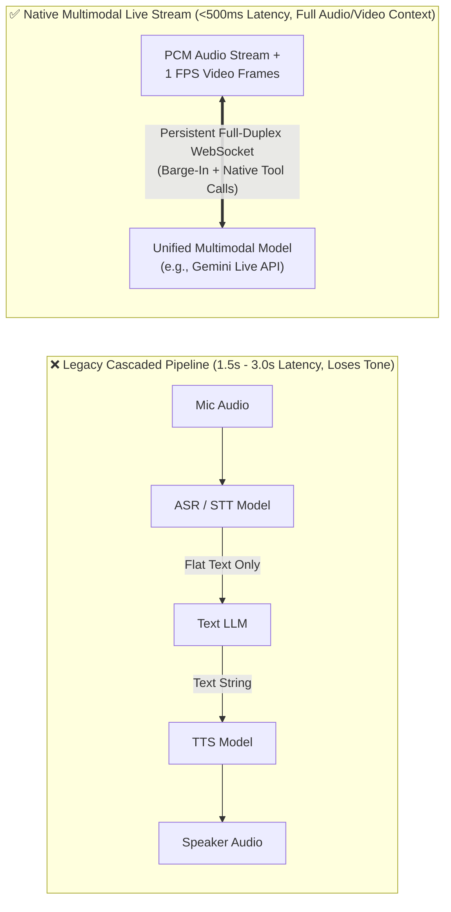
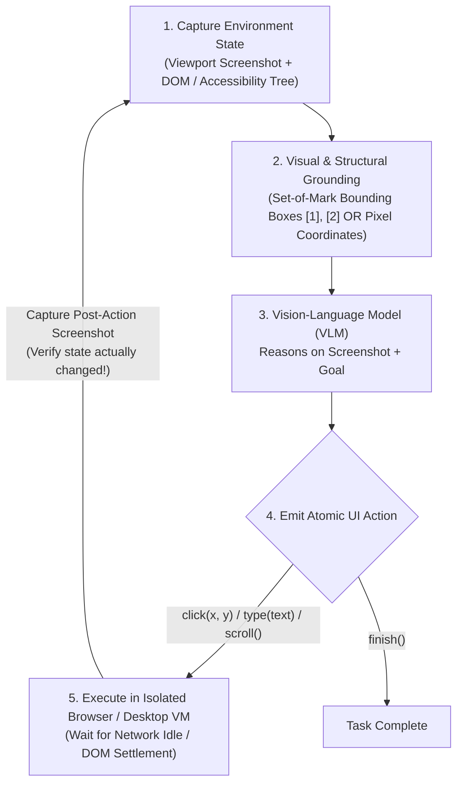

# Chapter 14: Multimodal, Computer-Use & Real-Time Streaming Agents (Beginner to Advanced)

[⬅️ Previous: Chapter 13 — Agentic FinOps & Tokenomics](./chapter-13-agentic-finops-and-tokenomics.md) | [📚 Book Index](./README.md) | [Next: Chapter 15 — Agent-to-Frontend & Commerce Protocols (AG-UI, A2UI, AP2) ➡️](./chapter-15-agent-to-frontend-ux-and-commerce-protocols.md)

---

Modern agentic systems are no longer restricted to turn-based text chat or clean JSON APIs. Enterprise agents must increasingly **see and hear** in real time (live audio/video streams for field claims, clinical triage, or customer support) and **operate legacy graphical interfaces** (browsers, virtual desktops, and mainframes that have no REST API or MCP server).

This chapter covers **Multimodal, Computer-Use, and Real-Time Streaming Agents** from **Beginner** (Cascaded STT-LLM-TTS vs. Native Multimodal Live Streaming) to **Intermediate** (Computer-Use / GUI Actuation Loops and Set-of-Mark Visual Grounding) to **Advanced** (Full-Duplex Barge-In Handling, Non-Blocking Async Tool Execution during Live Voice/Video, and Frame Token Budgeting).

---

## 14.1 Beginner: Cascaded Voice Pipelines vs. Native Multimodal Streaming

### Why Cascaded Pipelines (`ASR -> Text LLM -> TTS`) Struggle in Real-Time
Historically, voice and multimodal assistants chained three separate models sequentially:
1. **Automatic Speech Recognition (ASR / STT)** converts audio to text ($\sim 400\text{–}800\text{ms}$ after end-of-speech detection).
2. **Text LLM** reasons and generates a text reply ($\sim 600\text{–}1500\text{ms}$ TTFT).
3. **Text-to-Speech (TTS)** synthesizes audio ($\sim 300\text{–}600\text{ms}$).

**Two Structural Flaws of Cascaded Pipelines:**
* **High Turn-Taking Latency ($1.5\text{s}\text{–}3.0\text{s}$):** Feels unnatural and robotic in live conversation.
* **Acoustic & Visual Information Loss:** The Text LLM only sees a flat transcript—it is completely blind to the caller's tone of voice (urgency, frustration, hesitation), background sounds, or live camera frames pointed at a damaged vehicle or error screen.

### Native Multimodal Bidirectional Streaming (e.g., Gemini Live API / Realtime WebSockets)
**Native Multimodal Streaming Models** ingest raw audio PCM chunks, video frames (e.g., $1\text{ FPS}$ JPEG frames), and text tokens directly into a unified multimodal transformer over a persistent **stateful WebSocket session**, and emit native audio + tool calls directly:



---

## 14.2 Intermediate: Computer-Use & Browser/GUI Agents

What do you do when an agent needs to file a claim in a 20-year-old insurance portal, operate an ERP desktop app, or test a web UI that has **no API and no MCP server**? You use a **Computer-Use Agent (CUA)** that interacts with software the way a human does: **looking at the screen and emitting mouse/keyboard actions**.

### The Computer-Use Perception $\rightarrow$ Grounding $\rightarrow$ Actuation Loop
At each step, the agent executes a closed feedback loop inside an isolated browser (Playwright/CDP) or virtual desktop (X11/Wayland inside a MicroVM):



### Three Grounding Strategies for GUI Agents

| Grounding Strategy | How It Works | Pros | Cons / When It Breaks |
| :--- | :--- | :--- | :--- |
| **1. Raw DOM / Accessibility (AX) Tree** | Feeds stripped HTML or Accessibility Tree JSON to an LLM; agent clicks via `element_id`. | Low token cost; exact selector precision. | Fails on `<canvas>` apps, Citrix/remote desktops, PDFs, or poorly labeled custom web components. |
| **2. Pure Pixel Coordinate Vision (`click(x=412, y=289)`)** | VLM inspects a raw screenshot (e.g., $1024 \times 768$) and outputs normalized `(x, y)` coordinates directly. | Works on **any** OS, desktop app, or canvas game without DOM access. | Small coordinate estimation errors can misclick tiny icons unless model is specifically trained for GUI grounding. |
| **3. Hybrid Set-of-Mark (SoM) Visual Prompting (Recommended for Web)** | A pre-processing script queries the browser's interactive bounding boxes and draws numbered visual badges (`[1]`, `[2]`, `[3]`) directly onto the screenshot before sending it to the VLM. | **Highest accuracy:** VLM sees visual layout AND selects exact deterministic element ID `click(mark_id=14)`. | Requires access to browser/OS bounding box metadata. |

> [!WARNING]
> **Always Verify UI State Transitions After Every Click:** Web apps suffer from network spinners, validation popups, and modal overlays. A Computer-Use agent must **never** chain 10 blind clicks (`click -> type -> click -> submit`) without inspecting the post-action screenshot after critical transitions to confirm the modal actually opened or the form actually submitted.

---

## 14.3 Advanced: Full-Duplex Barge-In, Non-Blocking Tool Calls & Multimodal Token Economics

Building a production real-time multimodal voice/video agent introduces three systems engineering challenges that do not exist in turn-based text agents:

### 1. Handling Full-Duplex "Barge-In" (User Interruption)
In a natural conversation, if an agent is halfway through reading a 20-second explanation and the user interrupts (*"Wait, I meant the EU cluster, not US!"*), the system must react in **$<100\text{ms}$**:
1. **Voice Activity Detection (VAD) Interrupt:** As soon as user speech is detected, the server emits an `interrupted: true` control frame over the WebSocket.
2. **Client Audio Buffer Flush:** The frontend immediately clears its local WebAudio playback queue so the agent's voice stops instantaneously (no awkward 2-second talking-over-the-user).
3. **Server Context Truncation:** The server truncates the assistant's in-context transcript to the exact audio timestamp the user actually heard before interrupting, so the model knows what was and wasn't said!

### 2. Non-Blocking Asynchronous Tool Execution During Live Streams
In a text chat, waiting $3.5\text{s}$ for a BigQuery or MCP tool call is normal. In a live voice call, $3.5\text{s}$ of dead silence makes the caller think the line dropped!
* **The Non-Blocking Async Tool Pattern:**
  1. When the live multimodal model emits a slow tool call (`check_flood_zone_elevation(address)`), the runtime dispatches the tool asynchronously in a background task and **immediately** returns a provisional status (`{"status": "RUNNING_IN_BACKGROUND"}`) or lets the model continue speaking naturally (*"I'm pulling up the FEMA elevation records for your address right now—while that loads, can you show me the water line on your camera?"*).
  2. When the background tool finishes $3.5\text{s}$ later, the runtime injects a `ToolResponse` event into the active WebSocket session, and the model seamlessly weaves the result into its next sentence.

```python
async def handle_live_stream_tool_call(
    ws_session: LiveMultimodalSession, tool_call: ToolCall, tools: dict
) -> None:
    if tool_call.name in FAST_SUB_200MS_TOOLS:
        # Fast lookup: execute inline and return immediately
        result = await tools[tool_call.name](**tool_call.args)
        await ws_session.send_tool_response(tool_call.id, result)
        return

    # Slow tool (>500ms): Run in background task so voice/video stream NEVER freezes!
    async def run_and_inject_when_ready():
        try:
            result = await tools[tool_call.name](**tool_call.args)
        except Exception as exc:
            result = {"error": str(exc)}
        # Inject completed tool observation asynchronously into the live session
        await ws_session.send_tool_response(tool_call.id, result, scheduling="WHEN_IDLE")

    asyncio.create_task(run_and_inject_when_ready())
```

### 3. Multimodal Frame & Audio Token Budgeting
Continuous video streaming at $1\text{ FPS}$ ($~258\text{ tokens/frame}$) + continuous audio ($~25\text{ tokens/sec}$) consumes **$\sim 17,000\text{ tokens per minute}$** ($>1\text{M tokens/hour}$):
* **Adaptive Frame Sampling (Motion/Change Gating):** Only transmit a new video frame when pixel diff / perceptual hash ($pHash$) against the previous frame exceeds a threshold, or when the user is actively speaking/pointing.
* **Session Sliding Window + Context Compression:** Enable automatic sliding-window context compression on the live session so 30-minute video calls stay within a bounded token window without disconnecting.

---

## Chapter 14 Summary Progression

| Level | Multimodal & CUA Capability | Latency / Modality | Key Architectural Takeaway |
| :--- | :--- | :--- | :--- |
| **🟢 Beginner** | **Native Multimodal Streaming vs. Cascaded STT-LLM-TTS** | $<500\text{ms}$ native audio/video | Native live streaming preserves vocal tone, visual context, and natural sub-second turn-taking. |
| **🟡 Intermediate** | **Computer-Use Agents (CUA) & Set-of-Mark (SoM) Grounding** | Browser / Desktop GUI loop | Overlay Set-of-Mark `[ID]` badges on interactive elements and verify post-action screenshots after every click. |
| **🔴 Advanced** | **Full-Duplex Barge-In, Async Non-Blocking Tools & Frame Gating** | Zero-freeze live orchestration | Flush client audio buffers on VAD barge-in, run slow tools asynchronously (`WHEN_IDLE`), and gate video frames by perceptual diff. |

---

[⬅️ Previous: Chapter 13 — Agentic FinOps & Tokenomics](./chapter-13-agentic-finops-and-tokenomics.md) | [📚 Book Index](./README.md) | [Next: Chapter 15 — Agent-to-Frontend & Commerce Protocols (AG-UI, A2UI, AP2) ➡️](./chapter-15-agent-to-frontend-ux-and-commerce-protocols.md)
