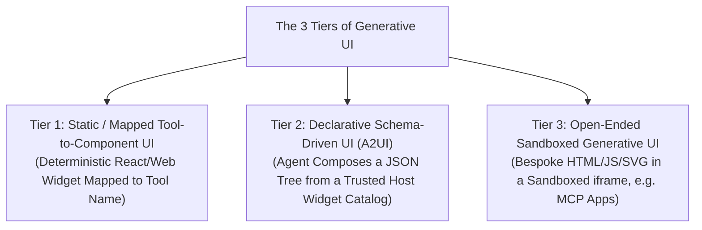
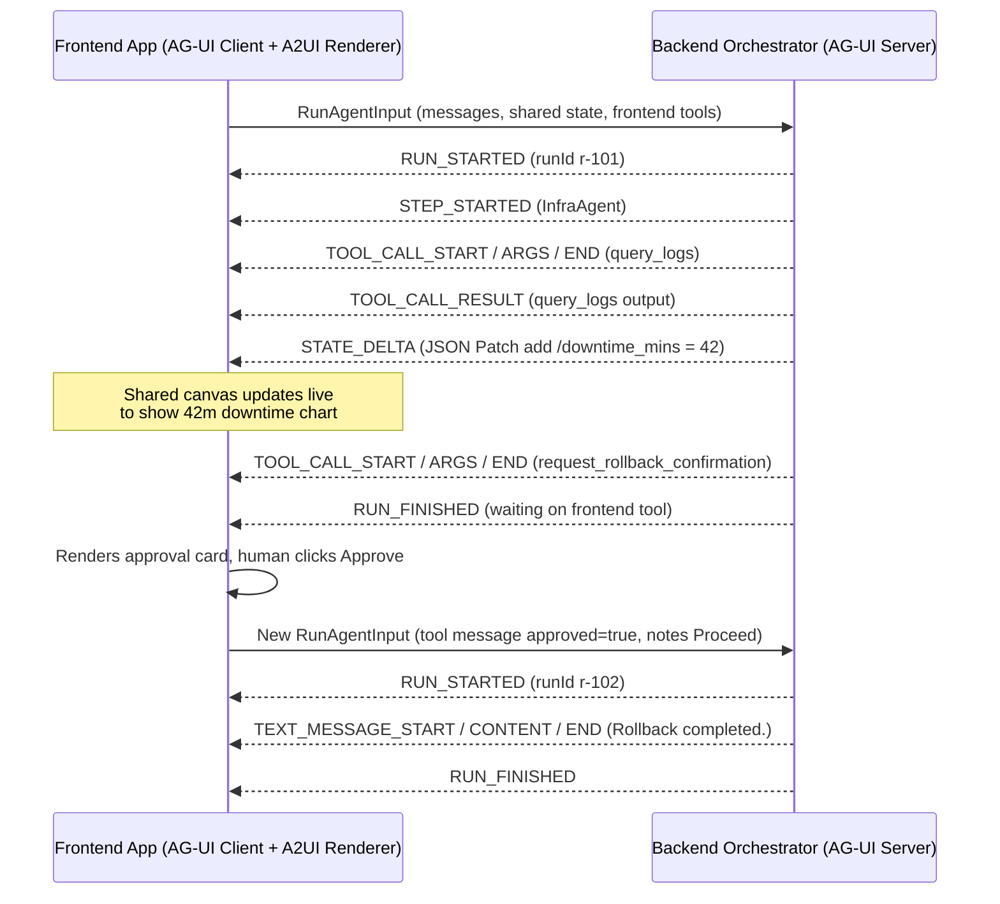
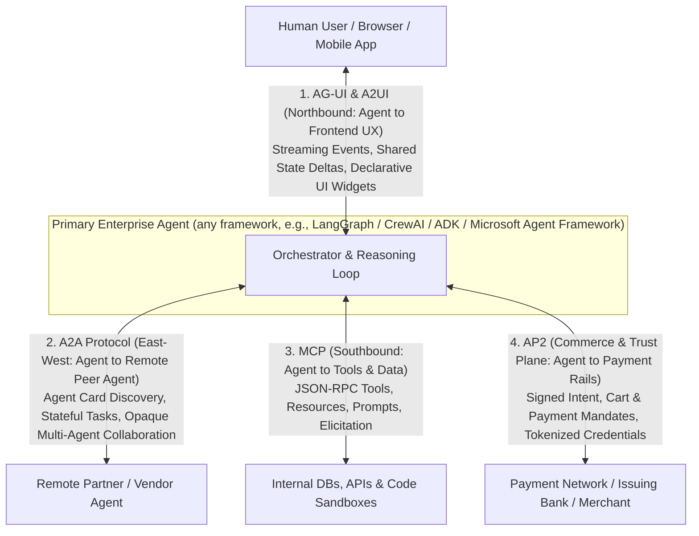

# Chapter 15: Agent-to-Frontend UX and Commerce Protocols

[← Previous: Chapter 14 — Multimodal, Computer-Use & Streaming Agents](./chapter-14-multimodal-computer-use-and-streaming-agents.md) | [Book Index](./README.md) | [Next: Chapter 16 — The Agent Quality Flywheel & Distillation →](./chapter-16-agent-quality-flywheel-and-distillation.md)

---

[Chapter 9](./chapter-09-mcp-and-a2a-interoperability.md) covered backend interoperability: MCP (agent $\leftrightarrow$ tools) and A2A (agent $\leftrightarrow$ remote agent). That still leaves two gaps in an enterprise agent architecture:
1. How does an agent send rich, interactive state and UI components to a human frontend, instead of plain Markdown text? That's the job of Generative UI, AG-UI, A2UI and MCP Apps.
2. How does an agent carry out auditable, cryptographically verifiable financial transactions on a user's behalf? That's where AP2 (the Agent Payments Protocol) and the other agentic-commerce protocols come in.

A note on naming: the official acronym is AP2. You'll occasionally see it written as "A2P", and earlier drafts of this book used "AP2 / A2P". Treat both as meaning AP2.

The chapter starts at the Beginner level with the three tiers of Generative UI. The Intermediate section covers the AG-UI event and state-sync protocol, A2UI's declarative component specs, and MCP Apps. The Advanced section gets into AP2's signed intent, cart and payment mandates, the other commerce protocols, and the unified 4-protocol enterprise architecture.

> [!WARNING]
> Everything in this chapter is young. Most of these specs appeared between mid-2025 and early 2026 and are still pre-1.0 or early 1.x. Event, message and field names change between versions, so pin a spec version and check the current docs before you build on any detail.

---

## 15.1 Generative UI in three tiers (Beginner)

Plain text and Markdown tables are poor interfaces for picking a seat on a flight, approving a 5-parameter Kubernetes rollback, exploring a multi-dimensional time-series anomaly, or comparing insurance deductibles.

**Generative UI** lets an agent respond with interactive visual components instead of walls of text. In production it comes in three architectural tiers:



| Tier | How it works | Security and determinism | Best for |
| :--- | :--- | :--- | :--- |
| 1. Static / mapped UI | When the agent calls `check_sla_credit()`, the frontend maps that tool result directly to a pre-built `<SLACreditApprovalCard />` React component. | Highest. The frontend code is pre-tested and the LLM only supplies props. Still validate those props against a schema, since they're untrusted model output. | High-frequency, standardized domain workflows such as checkout cards, approval modals and ticket cards. |
| 2. Declarative UI (A2UI, Agent-to-User Interface) | The agent emits declarative JSON that composes components (`Card`, `Text`, `Button`, `TextField`, or your own `TimeSeriesChart`) drawn from a component catalog the client has registered and advertised. | High. It's data rather than code, so no arbitrary JS runs, and the host renders with its own native widgets, styling and accessibility. | Dynamic dashboards, multi-step forms and adaptive layouts where the exact mix of widgets changes per query. |
| 3. Open-ended sandboxed UI | Agent- or tool-server-authored HTML/CSS/JS/SVG rendered inside an isolated `<iframe sandbox="allow-scripts">` that talks to the host only through a `postMessage` bridge. MCP Apps (§15.2.3) standardizes this pattern for MCP tool servers. | Needs a sandbox. Never combine `allow-scripts` with `allow-same-origin`. Serve from a separate origin and restrict egress with a strict CSP (for example `connect-src 'none'` unless explicitly allow-listed). | Bespoke interactive simulations, custom D3/Canvas visualizations, and rich third-party app experiences inside a chat host. |

---

## 15.2 AG-UI, A2UI and MCP Apps (Intermediate)

A plain `POST /chat` REST endpoint isn't enough for a modern agent frontend, because an agent run is long-lived, stateful and collaborative. While it runs, the user wants to see step progress, tool arguments as they stream, partial state diffs on a shared canvas, and human-in-the-loop confirmation prompts in the middle of the task.

### 1. The AG-UI protocol

**AG-UI** (the Agent–User Interaction protocol) is an open, event-based protocol that the CopilotKit team started in 2025. It standardizes how backend agent frameworks (LangGraph, CrewAI, Google ADK, Microsoft Agent Framework, AG2, Mastra, Pydantic AI, LlamaIndex, and others) talk to frontend applications. It's transport-agnostic. The reference implementations stream events over Server-Sent Events (SSE) or HTTP streaming, but WebSockets or other transports can carry the same event schema.

A run starts when the client sends a `RunAgentInput` payload containing thread and run IDs, messages, the current shared `state`, client-provided `tools`, and context. The agent then streams typed events, which fall into a few core categories:
1. Lifecycle events: `RUN_STARTED`, `STEP_STARTED`, `STEP_FINISHED`, `RUN_FINISHED`, `RUN_ERROR`.
2. Text message streaming: `TEXT_MESSAGE_START` $\rightarrow$ `TEXT_MESSAGE_CONTENT` (token deltas) $\rightarrow$ `TEXT_MESSAGE_END`.
3. Tool call streaming: `TOOL_CALL_START` $\rightarrow$ `TOOL_CALL_ARGS` $\rightarrow$ `TOOL_CALL_END`. The `TOOL_CALL_ARGS` events carry streaming JSON argument fragments, so the UI can start rendering a widget while the LLM is still generating. There's also `TOOL_CALL_RESULT`, for when a backend tool's output is surfaced to the UI.
4. State management (`STATE_SNAPSHOT`, `STATE_DELTA`, `MESSAGES_SNAPSHOT`). Rather than re-sending a 50KB state object on every change, the agent emits RFC 6902 JSON Patch deltas (`STATE_DELTA: [{"op": "replace", "path": "/downtime_mins", "value": 42}]`) and sends a periodic `STATE_SNAPSHOT` to resynchronize, for instance after a reconnect or a failed patch. This is what powers co-pilot or shared-canvas UIs, where the human and the agent edit the same document, code diff or incident plan in near real time. User-side edits flow back as the `state` field of the next `RunAgentInput`.
5. Special events: `RAW` (pass-through of framework-native events) and `CUSTOM` (application-defined events). Newer protocol versions also add event families such as reasoning/thinking and activity events, so check which version your SDK implements.

Frontend-executed tools are how AG-UI handles human-in-the-loop UI actions. The client declares its own tools (say, `request_rollback_confirmation`) in `RunAgentInput.tools`. When the model calls one, the agent streams `TOOL_CALL_START/ARGS/END` and the run ends. The frontend renders an interactive `[Approve] / [Edit] / [Reject]` card, then starts a new run whose message history includes a `role: "tool"` message carrying the user's decision. The agent picks up from there. Framework adapters such as LangGraph's `interrupt()` map onto the same shape: pause, then resume in a new run.



### 2. A2UI, the declarative component spec

**A2UI** (Agent-to-User Interface) is an open-source declarative UI protocol that Google released in late 2025. Think of AG-UI as the transport and state-sync pipe, and A2UI as the format for the UI payload itself. A2UI is transport-agnostic too, so it can travel over A2A (via an A2A extension), over AG-UI, or over other channels.

Safety comes from catalog negotiation. The client advertises which component catalogs it can render, for example through `supportedCatalogIds` in its A2UI client capabilities, sent as A2A message metadata. The agent may only reference components from a catalog the client supports, and that restriction is what keeps Tier 2 safe.

The format is built for streaming. Components are sent as a flat list of nodes with IDs and child-ID references (an adjacency list) rather than a deeply nested tree, so the LLM can emit and patch them incrementally. Component properties bind to the surface's data model through JSON Pointer paths (`{"path": "/downtime_mins"}`), which means updating the data model updates the bound components without regenerating the layout.

Expect the message types to move between versions. v0.8 uses `surfaceUpdate`, `dataModelUpdate`, `beginRendering`, and `deleteSurface`. v0.9 reworked these into `createSurface`, `updateComponents`, `updateDataModel`, and `deleteSurface`, with a more "prompt-first" schema.

Here's an *illustrative sketch* of a v0.9-style `updateComponents` message. Exact field shapes, such as how `children` lists are wrapped, differ between spec versions, so check the one you target:

```json
{"version": "v0.9", "updateComponents": {"surfaceId": "incident", "components": [
  {"id": "root", "component": "Column", "children": ["downtime", "approve"]},
  {"id": "downtime", "component": "Text", "text": {"path": "/downtime_mins"}},
  {"id": "approve", "component": "Button", "text": "Approve rollback"}
]}}
```

> [!NOTE]
> AG-UI shared state and an A2UI surface's data model are two different things. In A2UI, data changes travel as A2UI data-model messages (`dataModelUpdate` / `updateDataModel`). When A2UI rides on AG-UI, a host can choose to mirror AG-UI `STATE_DELTA` patches into the surface's data model, so that a single patch to `/downtime_mins` re-renders the bound component. That mapping is an integration choice. Neither spec does it for you automatically.

### 3. MCP Apps: UI delivered by MCP servers

The third route to rich UI comes from the tool side. **MCP Apps** is an official MCP extension (SEP-1865) that standardizes what the community MCP-UI project and OpenAI's Apps SDK (built on MCP) pioneered in 2025.

An MCP server exposes UI templates as resources using the `ui://` URI scheme (HTML, MIME type `text/html;profile=mcp-app`), and a tool links to its template through metadata (`_meta.ui.resourceUri`). The host renders the template in a sandboxed iframe and talks to it over a JSON-RPC-over-`postMessage` bridge. Through that bridge the widget can receive tool results, call further tools (subject to host policy) and post follow-up messages. Because the UI ships with the tool server, one implementation can render in any host that supports MCP Apps; ChatGPT, Claude, VS Code and others have adopted it.

How to choose: use A2UI when your own agent should compose UI from your design-system catalog across surfaces (web, mobile, Flutter). Use MCP Apps when a third-party tool provider needs to ship its own bespoke UI into someone else's chat host. Either way, AG-UI is the event and state pipe between your agent backend and your frontend.

---

## 15.3 AP2, commerce protocols and the 4-protocol stack (Advanced)

### 1. Why autonomous agents break checkout and payment rails

Suppose a user tells their procurement or travel agent: *"Monitor flights to Tokyo for next Tuesday and automatically buy a business-class ticket if the price drops below \$2,200 while I'm asleep."*

Existing payment systems can't handle this, for three reasons:
1. Nobody is present at checkout. Traditional 3DS and biometric step-up challenges assume a human is in session.
2. There's no audit trail for disputes. If an agent hallucinates and buys a \$9,000 non-refundable ticket, the merchant, issuing bank and card network have no verifiable proof of what the user actually authorized the agent to buy, and no clear way to assign liability.
3. PCI scope spreads. Passing raw card numbers (`PAN` / `CVV`) through LLM prompts drags the model provider, prompt logs, traces and every agent hop into PCI-DSS scope, and it exposes credentials to prompt injection and log leakage. Agents should handle tokens, never raw credentials.

### 2. How AP2 approaches agentic commerce

**AP2** was announced by Google in September 2025 with a coalition of 60+ payments and technology partners. It's an open, payment-method-agnostic protocol built as an extension of A2A and MCP. It defines the roles in a purchase: the user, the Shopping Agent, a Merchant Endpoint or Merchant Agent, a Credentials Provider such as a wallet, and the Merchant Payment Processor. User intent travels as cryptographically signed mandates, implemented as **Verifiable Digital Credentials (VDCs)**. These are tamper-evident, signed objects that together form a non-repudiable audit trail. There are three kinds.

* An **Intent Mandate** holds the user's goal and constraints, signed up front. It's the key primitive for "human-not-present" (autonomous) purchases. Here's an *illustrative, simplified* example (not the normative AP2 schema):
    ```json
    {
      "type": "IntentMandate",
      "principal": "did:web:alice.example",
      "authorized_agent": "spiffe://agents.acme/travel-buyer",
      "natural_language_description": "Business-class SFO->HND next Tuesday, under $2,200",
      "constraints": {
        "merchant_category": "AIRLINES",
        "route": "SFO-HND",
        "max_amount": {"value": 2200.00, "currency": "USD"},
        "requires_refundability": false
      },
      "intent_expiry": "2026-10-20T00:00:00Z",
      "user_signature": "<signature from the user's device-bound key / passkey>"
    }
    ```
* A **Cart Mandate** pins down the exact cart: line items, price, merchant and fulfillment details. The merchant signs the cart to guarantee price and fulfillment. In human-present flows, the agent negotiates the cart with the Merchant Agent over A2A and renders it via AG-UI / A2UI. The user then approves it on a trusted device surface, which binds their signature to what they actually saw. In human-not-present flows, the agent assembles the cart under the authority of the Intent Mandate, and every party can check the signed cart against the mandate's constraints (e.g., `1950 <= 2200` and `route == "SFO-HND"`).
* A **Payment Mandate** is a credential shared with the payment network and issuer. It references the authorized cart and signals that an AI agent is involved and whether the human is present, so risk engines can evaluate the transaction appropriately. The Credentials Provider supplies a tokenized payment credential, so the LLM never sees a card number. If the issuer's risk policy demands it, the issuer can still trigger a step-up challenge to the user's device (a push notification, say) before settlement.

> [!IMPORTANT]
> **A mandate proves authorization. It doesn't prove good judgment.** A perfectly signed Intent Mandate with loose constraints ("any airline, under \$9,000") will happily authorize a bad purchase. Constraint design is the real safety lever: tight caps, short expiries, refundability requirements, merchant allow-lists. Also note that AP2 v0.1 focused on human-present card ("pull") payments. Human-not-present flows, push payments and other rails were on its published roadmap, so check the current spec status before relying on them.

### 3. Other agentic commerce protocols

AP2 isn't the only effort. The protocols below are mostly complementary layers, and few of them compete head-on:

| Protocol | Backers | Layer | Key idea |
| :--- | :--- | :--- | :--- |
| AP2 (Sep 2025) | Google + payments coalition | Trust and authorization | Signed Intent / Cart / Payment Mandates (VDCs); extension of A2A and MCP. |
| ACP, Agentic Commerce Protocol (Sep 2025) | OpenAI & Stripe | Checkout | Merchant checkout API for in-chat purchases (launched with ChatGPT Instant Checkout); payment via scoped, time-limited tokens such as Stripe's Shared Payment Token. |
| UCP, Universal Commerce Protocol (Jan 2026) | Google with Shopify, Walmart, Target, Etsy & others | Discovery → checkout → post-purchase | Merchants publish machine-readable capability profiles; any agent surface can run the full shopping journey; designed to work with AP2 for payment authorization. |
| x402 | Coinbase (open) | Settlement (crypto rail) | Revives HTTP `402 Payment Required` for programmatic stablecoin payments; AP2 has an x402 extension. |

Card networks are adding their own agent-identity and tokenization programs too (e.g., Visa Intelligent Commerce, Mastercard Agent Pay). The names will keep changing, but the architectural lesson holds up: keep discovery and checkout semantics, cryptographic authorization, and settlement rails as separate concerns.

---

### 4. The 4-protocol enterprise agent architecture

Put [Chapter 9](./chapter-09-mcp-and-a2a-interoperability.md) and this chapter together and you get four open protocol families mapped onto four architectural planes:



| Protocol | Plane | Connects | Main payload primitives |
| :--- | :--- | :--- | :--- |
| 1. MCP | Southbound (vertical) | Agent $\leftrightarrow$ Tools & Data | `Tool`, `Resource` (URI), `Prompt`, `Elicitation` (+ MCP Apps `ui://` resources; `Sampling`/`Roots` deprecated in spec `2026-07-28`) |
| 2. A2A | East–West (horizontal) | Agent $\leftrightarrow$ Remote Peer Agent | `AgentCard`, `Task` (`TASK_STATE_SUBMITTED` / `WORKING` / `INPUT_REQUIRED` / `COMPLETED` / ... in A2A v1.0), `Message`, `Artifact` |
| 3. AG-UI + A2UI | Northbound (user experience) | Agent $\leftrightarrow$ Frontend UI & Human | `STATE_DELTA` (JSON Patch), `TOOL_CALL_*`, declarative component lists bound to a data model |
| 4. AP2 | Commerce and trust plane | User $\leftrightarrow$ Agent $\leftrightarrow$ Merchant $\leftrightarrow$ Payment Rails | Signed `IntentMandate`, `CartMandate` & `PaymentMandate` (Verifiable Digital Credentials) |

The four-planes picture is a useful mental model, but the boundaries leak. AP2 is itself carried as an extension of A2A/MCP. A2UI payloads can travel over A2A as well as AG-UI. And MCP Apps lets the southbound tool plane ship UI northbound. I'd think of the planes as responsibilities rather than four isolated wires.

---

## Chapter 15 summary

| Level | Capability | Problem solved | Takeaway |
| :--- | :--- | :--- | :--- |
| Beginner | The 3 tiers of Generative UI (mapped, declarative `A2UI`, sandboxed) | Replaces walls of Markdown text with rich interactive widgets. | Default to mapped or declarative `A2UI` catalogs for safety; use properly sandboxed iframes (or MCP Apps) for bespoke Canvas/D3 apps. |
| Intermediate | AG-UI event and state-sync protocol, A2UI and MCP Apps | Synchronizes streaming steps, shared canvas state (`STATE_DELTA`) and frontend HITL tools; lets agents and tool servers ship UI safely. | Use RFC 6902 JSON Patch deltas (`STATE_DELTA`) for collaborative co-pilot canvases; frontend tools resume via a new run carrying the tool result. |
| Advanced | AP2 signed mandates, other commerce protocols and the 4-protocol stack | Enables auditable agent-initiated purchases without exposing card numbers to the LLM. | Use a signed `IntentMandate` (tight constraints) for autonomous buys, a merchant-signed + user-approved `CartMandate` for human-present buys, and unite `AG-UI + A2A + MCP + AP2`. |

---

[← Previous: Chapter 14 — Multimodal, Computer-Use & Streaming Agents](./chapter-14-multimodal-computer-use-and-streaming-agents.md) | [Book Index](./README.md) | [Next: Chapter 16 — The Agent Quality Flywheel & Distillation →](./chapter-16-agent-quality-flywheel-and-distillation.md)
