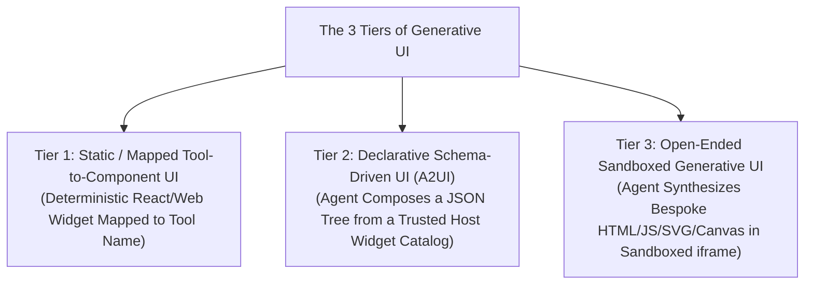
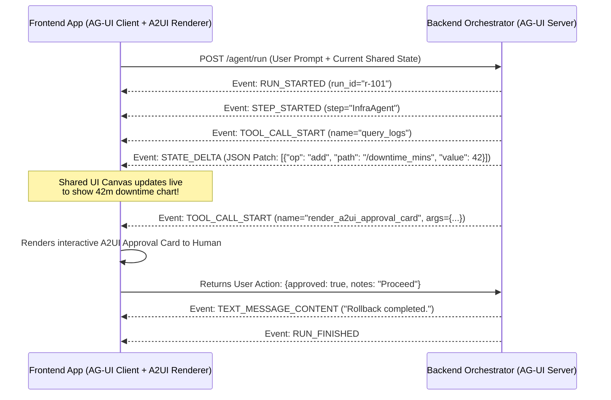
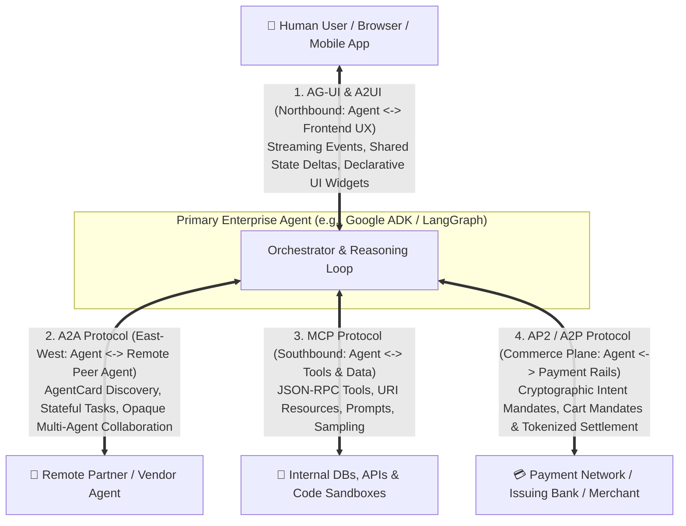

# Chapter 15: Agent-to-Frontend UX & Commerce Protocols — Generative UI, AG-UI, A2UI, A2A & AP2/A2P (Beginner to Advanced)

[⬅️ Previous: Chapter 14 — Multimodal, Computer-Use & Streaming Agents](./chapter-14-multimodal-computer-use-and-streaming-agents.md) | [📚 Book Index](./README.md) | [Next: Chapter 16 — The Agent Quality Flywheel & Distillation ➡️](./chapter-16-agent-quality-flywheel-and-distillation.md)

---

In Chapter 9, we covered backend interoperability: **MCP** (Agent $\leftrightarrow$ Tools) and **A2A** (Agent $\leftrightarrow$ Remote Agent). However, two massive gaps remain in a complete enterprise agent architecture:
1. **How does an agent communicate rich, interactive state and UI components to a human frontend beyond plain Markdown text?** (**Generative UI**, **AG-UI**, and **A2UI**)
2. **How does an agent execute legally binding, cryptographically verifiable financial transactions on a user's behalf?** (**AP2 / A2P — Agent Payments Protocol**)

This chapter covers the full **Frontend UX & Agentic Commerce Protocol Stack** from **Beginner** (The 3 Tiers of Generative UI) to **Intermediate** (The **AG-UI** Bidirectional Event & State-Sync Protocol and **A2UI** Declarative Component Specs) to **Advanced** (Cryptographic **AP2 / A2P** Intent & Cart Mandates and the **Unified 4-Protocol Enterprise Architecture**).

---

## 15.1 Beginner: Moving Beyond the Text Chatbox — The 3 Tiers of Generative UI

Plain text and Markdown tables are terrible interfaces for selecting seats on a flight, approving a 5-parameter Kubernetes rollback, exploring a multi-dimensional time-series anomaly, or comparing insurance deductibles.

**Generative UI** allows an agent to respond with **interactive visual components** rather than walls of text. In production engineering, Generative UI is divided into **three distinct architectural tiers**:



| Generative UI Tier | How It Works | Security & Determinism | Best Used When... |
| :--- | :--- | :--- | :--- |
| **1. Static / Mapped UI** | When the agent calls `check_sla_credit()`, the frontend maps that tool result directly to a pre-built `<SLACreditApprovalCard />` React component. | **Highest:** 100% pre-tested frontend code; LLM only supplies typed props. | High-frequency, standardized domain workflows (checkout cards, approval modals, ticket cards). |
| **2. Declarative UI (`A2UI` — Agent-to-UI)** | The agent emits a declarative JSON layout composing primitives (`Card`, `DataTable`, `BarChart`, `Slider`, `ActionButton`) from the frontend's registered component catalog. | **High:** No arbitrary JS execution; native host styling & accessibility guaranteed. | Dynamic dashboards, multi-step forms, and adaptive layouts where the exact combination of widgets varies per query. |
| **3. Open-Ended Sandboxed UI** | The agent writes a self-contained HTML/CSS/JS/SVG widget rendered inside an isolated `<iframe sandbox="allow-scripts">` with postMessage bridge. | **Requires Sandbox:** Must strip network egress and isolate origin. | Bespoke interactive simulations, custom D3/Canvas visualizations, and architectural explainers. |

---

## 15.2 Intermediate: AG-UI (Agent–User Interaction Protocol) & A2UI

Why can't you just use a standard `POST /chat` REST endpoint for modern agent frontends? Because an agent run is **long-lived, stateful, and collaborative**: the user needs to see live step progress, streaming tool arguments, partial state diffs on a shared canvas, and human-in-the-loop confirmation prompts mid-turn.

### 1. The AG-UI (Agent–User Interaction) Protocol
**AG-UI** is an open, event-driven wire protocol (typically streamed over Server-Sent Events [SSE] or WebSockets) that standardizes communication between **any backend agent framework** (LangGraph, Google ADK, CrewAI, AutoGen) and **any frontend UI** (React, Next.js, Flutter, iOS/Android).

AG-UI standardizes **5 categories of real-time events**:
1. **Lifecycle Events:** `RUN_STARTED`, `STEP_STARTED`, `STEP_FINISHED`, `RUN_FINISHED`, `RUN_ERROR`.
2. **Text Message Streaming:** `TEXT_MESSAGE_START` $\rightarrow$ `TEXT_MESSAGE_CONTENT` (token deltas) $\rightarrow$ `TEXT_MESSAGE_END`.
3. **Tool Call Streaming:** `TOOL_CALL_START` $\rightarrow$ `TOOL_CALL_ARGS` (streaming JSON arguments so the UI can progressively render a widget while the LLM is still typing!) $\rightarrow$ `TOOL_CALL_END` $\rightarrow$ `TOOL_CALL_RESULT`.
4. **Shared State Synchronization (`STATE_SNAPSHOT` & `STATE_DELTA`):**
   * Instead of re-sending a 50KB state object on every keystroke, the agent emits **RFC 6902 JSON Patch deltas** (`STATE_DELTA: [{"op": "replace", "path": "/downtime_mins", "value": 42}]`).
   * This powers **Co-Pilot / Shared Canvas UIs** where the human and the agent collaboratively edit the same document, code diff, or incident plan in real time!
5. **Frontend-Executed Tools (Human-in-the-Loop UI Actions):** The backend agent emits a tool call `request_rollback_confirmation(cluster="us-east1")`, which the **frontend UI** executes by rendering an interactive `[Approve] / [Edit] / [Reject]` card and returning the user's click as the `TOOL_CALL_RESULT`.



### 2. A2UI (Agent-to-UI Declarative Component Specification)
While **AG-UI** is the *transport & state-sync pipe*, **A2UI** defines the *declarative payload format* for UI components:
* The frontend advertises its supported **Component Catalog** (e.g., `MetricCard`, `TimeSeriesChart`, `ApprovalForm`) in the session handshake.
* The agent emits a flat, streaming-friendly list of component nodes with data-binding references (`value_path: "/state/downtime_mins"`), so updating the state via an AG-UI `STATE_DELTA` automatically updates the bound A2UI component without re-rendering the component tree!

---

## 15.3 Advanced: AP2 / A2P (Agent Payments Protocol) & The Unified 4-Protocol Stack

### 1. Why Autonomous Agents Break Traditional Checkout & Payment Rails
Suppose a user tells their procurement or travel agent: *"Monitor flights to Tokyo for next Tuesday and automatically buy a business-class ticket if the price drops below \$2,200 while I'm asleep."*
This breaks existing payment systems for three reasons:
1. **No Human Present at Checkout:** Traditional 3DS / biometric challenges fail when the human is asleep.
2. **Auditability & Dispute Liability:** If an agent hallucinates and buys a \$9,000 non-refundable ticket, the merchant, issuing bank, and card network have **no cryptographic proof** of what the user actually authorized the agent to buy.
3. **PCI Scope Pollution:** Passing raw 16-digit credit card numbers (`PAN` / `CVV`) through LLM prompts violates PCI-DSS immediately.

### 2. How AP2 / A2P (Agent Payments Protocol) Solves Agentic Commerce
**AP2 (Agent Payments Protocol)** introduces **Cryptographically Signed Verifiable Mandates** (W3C Verifiable Credentials) that prove user intent across the User, Agent, Merchant Agent, and Payment Provider:

* **Primitive 1 — The Intent Mandate (For Autonomous / "Human-Not-Present" Purchases):**
  * Before going to sleep, the user cryptographically signs an **Intent Mandate** using their device passkey/wallet:
    ```json
    {
      "type": "IntentMandate",
      "principal": "did:web:alice.example",
      "authorized_agent": "spiffe://agents.acme/travel-buyer",
      "constraints": {
        "merchant_category": "AIRLINES",
        "route": "SFO-HND",
        "max_amount_usd": 2200.00,
        "currency": "USD",
        "expires_at": "2026-10-20T00:00:00Z"
      },
      "user_signature": "0x9f8a..."
    }
    ```
  * When the price drops to \$1,950 at 3:00 AM, the Agent signs a **Cart Mandate** referencing that `IntentMandate`. The Payment Provider and Issuing Bank cryptographically verify that `$1950 <= $2200` and `route == "SFO-HND"`, issuing a single-use tokenized payment credential without ever exposing a card number to the LLM!
* **Primitive 2 — The Cart Mandate (For Interactive / "Human-Present" Purchases):**
  * The agent negotiates the exact line-item cart with the Merchant Agent via **A2A**, renders the final cart to the user via **AG-UI / A2UI**, and the human signs the exact **Cart Mandate** (`items`, `exact_total: $412.50`, `merchant_id`) on their device hardware enclave.

---

### 3. The Complete 4-Protocol Enterprise Agent Architecture

Putting Chapters 9 and 15 together reveals how all four open protocols fit cleanly into four non-overlapping architectural planes:



| Protocol | Architectural Plane | Connects... | Primary Payload Primitives |
| :--- | :--- | :--- | :--- |
| **1. MCP** | **Southbound (Vertical)** | Agent $\leftrightarrow$ Tools & Data | `Tool`, `Resource` (URI), `Prompt`, `Sampling` |
| **2. A2A** | **East–West (Horizontal)** | Agent $\leftrightarrow$ Remote Peer Agent | `AgentCard`, `Task` (`working`/`input-required`), `Artifact` |
| **3. AG-UI + A2UI** | **Northbound (User Experience)** | Agent $\leftrightarrow$ Frontend UI & Human | `STATE_DELTA` (JSON Patch), `TOOL_CALL_*`, Declarative UI Trees |
| **4. AP2 / A2P** | **Commerce & Trust Plane** | User $\leftrightarrow$ Agent $\leftrightarrow$ Payment Rails | Cryptographically signed `IntentMandate` & `CartMandate` (VCs) |

---

## Chapter 15 Summary Progression

| Level | UX & Protocol Capability | Problem Solved | Key Architectural Takeaway |
| :--- | :--- | :--- | :--- |
| **🟢 Beginner** | **The 3 Tiers of Generative UI (Mapped, Declarative `A2UI`, Sandboxed)** | Replaces walls of Markdown text with rich interactive widgets. | Default to Mapped or Declarative `A2UI` catalogs for safety; use sandboxed iframes for bespoke Canvas/D3 apps. |
| **🟡 Intermediate** | **AG-UI Bidirectional Event & State-Sync Protocol** | Synchronizes streaming steps, shared canvas state (`STATE_DELTA`), and frontend HITL tools. | Use RFC 6902 JSON Patch deltas (`STATE_DELTA`) to power collaborative human+agent Co-Pilot canvases. |
| **🔴 Advanced** | **AP2 / A2P Cryptographic Mandates & The 4-Protocol Stack** | Enables legally auditable autonomous purchases without exposing credit card numbers. | Use signed `IntentMandate` (constraints) for autonomous buys, `CartMandate` for human-present buys, and unite `AG-UI + A2A + MCP + AP2`. |

---

[⬅️ Previous: Chapter 14 — Multimodal, Computer-Use & Streaming Agents](./chapter-14-multimodal-computer-use-and-streaming-agents.md) | [📚 Book Index](./README.md) | [Next: Chapter 16 — The Agent Quality Flywheel & Distillation ➡️](./chapter-16-agent-quality-flywheel-and-distillation.md)
