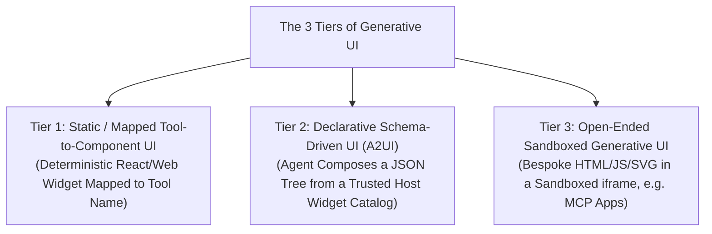
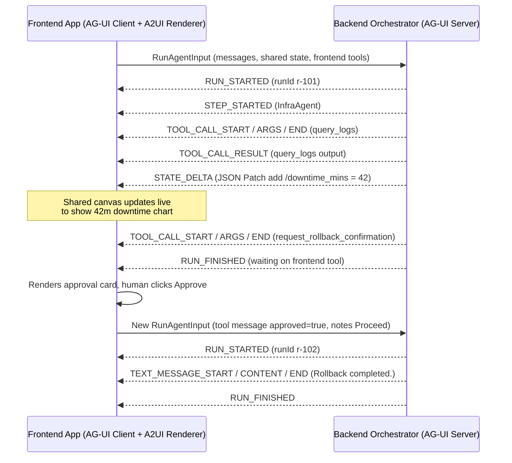
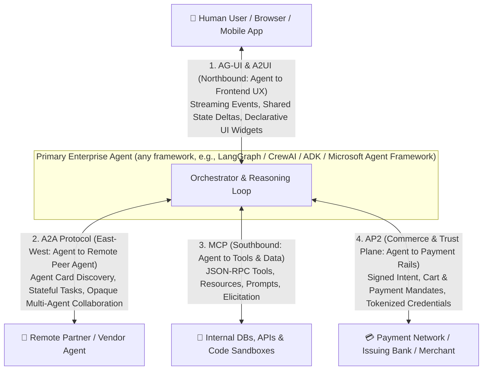

# Chapter 15: Agent-to-Frontend UX & Commerce Protocols — Generative UI, AG-UI, A2UI, MCP Apps, A2A & AP2 (Beginner to Advanced)

[⬅️ Previous: Chapter 14 — Multimodal, Computer-Use & Streaming Agents](./chapter-14-multimodal-computer-use-and-streaming-agents.md) | [📚 Book Index](./README.md) | [Next: Chapter 16 — The Agent Quality Flywheel & Distillation ➡️](./chapter-16-agent-quality-flywheel-and-distillation.md)

---

In [Chapter 9](./chapter-09-mcp-and-a2a-interoperability.md), we covered backend interoperability: **MCP** (Agent $\leftrightarrow$ Tools) and **A2A** (Agent $\leftrightarrow$ Remote Agent). However, two massive gaps remain in a complete enterprise agent architecture:
1. **How does an agent communicate rich, interactive state and UI components to a human frontend beyond plain Markdown text?** (**Generative UI**, **AG-UI**, **A2UI**, and **MCP Apps**)
2. **How does an agent execute auditable, cryptographically verifiable financial transactions on a user's behalf?** (**AP2 — Agent Payments Protocol**, and the wider agentic-commerce protocol landscape)

> [!NOTE]
> The official acronym is **AP2** (Agent Payments Protocol). You will occasionally see it mis-written as "A2P"; earlier drafts of this book used "AP2 / A2P" — treat both as referring to AP2.

This chapter covers the full **Frontend UX & Agentic Commerce Protocol Stack** from **Beginner** (The 3 Tiers of Generative UI) to **Intermediate** (The **AG-UI** Event & State-Sync Protocol, **A2UI** Declarative Component Specs, and **MCP Apps**) to **Advanced** (Cryptographic **AP2** Intent, Cart & Payment Mandates, the commerce protocol landscape, and the **Unified 4-Protocol Enterprise Architecture**).

> [!WARNING]
> Everything in this chapter is young (most of these specs appeared between mid-2025 and early 2026) and still at pre-1.0 or early-1.x versions. Event names, message names, and field names change between versions — always pin a spec version and check the current docs before you build on a detail.

---

## 15.1 Beginner: Moving Beyond the Text Chatbox — The 3 Tiers of Generative UI

Plain text and Markdown tables are terrible interfaces for selecting seats on a flight, approving a 5-parameter Kubernetes rollback, exploring a multi-dimensional time-series anomaly, or comparing insurance deductibles.

**Generative UI** allows an agent to respond with **interactive visual components** rather than walls of text. In production engineering, Generative UI is divided into **three distinct architectural tiers**:



| Generative UI Tier | How It Works | Security & Determinism | Best Used When... |
| :--- | :--- | :--- | :--- |
| **1. Static / Mapped UI** | When the agent calls `check_sla_credit()`, the frontend maps that tool result directly to a pre-built `<SLACreditApprovalCard />` React component. | **Highest:** Pre-tested frontend code; the LLM only supplies props (still validate them against a schema — props are untrusted model output). | High-frequency, standardized domain workflows (checkout cards, approval modals, ticket cards). |
| **2. Declarative UI (`A2UI` — Agent-to-User Interface)** | The agent emits declarative JSON composing components (`Card`, `Text`, `Button`, `TextField`, or your own `TimeSeriesChart`) drawn from a component **catalog** the client has registered and advertised. | **High:** Data, not code — no arbitrary JS execution; the host renders with its own native widgets, styling & accessibility. | Dynamic dashboards, multi-step forms, and adaptive layouts where the exact combination of widgets varies per query. |
| **3. Open-Ended Sandboxed UI** | Agent- or tool-server-authored HTML/CSS/JS/SVG rendered inside an isolated `<iframe sandbox="allow-scripts">` that talks to the host only via a `postMessage` bridge. **MCP Apps** (§15.2.3) standardizes this pattern for MCP tool servers. | **Requires Sandbox:** Never combine `allow-scripts` with `allow-same-origin`; serve from a separate origin and restrict egress with a strict CSP (e.g., `connect-src 'none'` unless explicitly allow-listed). | Bespoke interactive simulations, custom D3/Canvas visualizations, rich third-party app experiences inside a chat host. |

---

## 15.2 Intermediate: AG-UI (Agent–User Interaction Protocol), A2UI & MCP Apps

Why can't you just use a standard `POST /chat` REST endpoint for modern agent frontends? Because an agent run is **long-lived, stateful, and collaborative**: the user needs to see live step progress, streaming tool arguments, partial state diffs on a shared canvas, and human-in-the-loop confirmation prompts mid-task.

### 1. The AG-UI (Agent–User Interaction) Protocol
**AG-UI** is an open, event-based protocol (originated by the CopilotKit team in 2025) that standardizes communication between **backend agent frameworks** (LangGraph, CrewAI, Google ADK, Microsoft Agent Framework, AG2, Mastra, Pydantic AI, LlamaIndex, and others) and **frontend applications**. It is **transport-agnostic**: the reference implementations stream events over **Server-Sent Events (SSE)** or HTTP streaming, and WebSockets or other transports can carry the same event schema.

A run starts when the client sends a `RunAgentInput` payload (thread/run IDs, messages, current shared `state`, client-provided `tools`, and context). The agent then streams typed events, grouped into these core categories:
1. **Lifecycle Events:** `RUN_STARTED`, `STEP_STARTED`, `STEP_FINISHED`, `RUN_FINISHED`, `RUN_ERROR`.
2. **Text Message Streaming:** `TEXT_MESSAGE_START` $\rightarrow$ `TEXT_MESSAGE_CONTENT` (token deltas) $\rightarrow$ `TEXT_MESSAGE_END`.
3. **Tool Call Streaming:** `TOOL_CALL_START` $\rightarrow$ `TOOL_CALL_ARGS` (streaming JSON argument fragments, so the UI can progressively render a widget while the LLM is still generating) $\rightarrow$ `TOOL_CALL_END`, plus `TOOL_CALL_RESULT` when a **backend** tool's output is surfaced to the UI.
4. **State Management (`STATE_SNAPSHOT`, `STATE_DELTA`, `MESSAGES_SNAPSHOT`):**
   * Instead of re-sending a 50KB state object on every change, the agent emits **RFC 6902 JSON Patch deltas** (`STATE_DELTA: [{"op": "replace", "path": "/downtime_mins", "value": 42}]`), with periodic `STATE_SNAPSHOT`s to resynchronize (e.g., after a reconnect or a failed patch).
   * This powers **Co-Pilot / Shared Canvas UIs** where the human and the agent collaboratively edit the same document, code diff, or incident plan in near real time. (User-side edits flow back as the `state` field of the next `RunAgentInput`.)
5. **Special Events:** `RAW` (pass-through of framework-native events) and `CUSTOM` (application-defined events). Newer protocol versions also add event families such as reasoning/thinking and activity events — check the version your SDK implements.

**Frontend-Executed Tools (Human-in-the-Loop UI Actions):** The client declares its own tools (e.g., `request_rollback_confirmation`) in `RunAgentInput.tools`. When the model calls one, the agent streams `TOOL_CALL_START/ARGS/END` and the run ends; the **frontend** renders an interactive `[Approve] / [Edit] / [Reject]` card, and then starts a **new run** whose message history includes a `role: "tool"` message carrying the user's decision. The agent resumes from there. (Framework adapters such as LangGraph's `interrupt()` map onto the same pause-and-resume-in-a-new-run shape.)



### 2. A2UI (Agent-to-User Interface Declarative Component Specification)
**A2UI** is an open-source declarative UI protocol that Google released in late 2025. While **AG-UI** is the *transport & state-sync pipe*, **A2UI** defines a *declarative payload format* for UI — and it is transport-agnostic, so it can be carried over A2A (via an A2A extension), AG-UI, or other channels:
* **Catalog negotiation:** The client advertises which component **catalogs** it can render (e.g., via `supportedCatalogIds` in its A2UI client capabilities, sent as A2A message metadata). The agent may only reference components from a catalog the client supports — this is what keeps Tier 2 safe.
* **Flat, streaming-friendly components:** Components are sent as a flat list of nodes with IDs and child-ID references (an adjacency list), not a deeply nested tree, so the LLM can emit and patch them incrementally.
* **Separate data model with path bindings:** Component properties bind to a surface's data model using **JSON Pointer** paths (`{"path": "/downtime_mins"}`). Updating the data model updates the bound components without regenerating the layout.
* **Message types change across versions:** v0.8 uses `surfaceUpdate`, `dataModelUpdate`, `beginRendering`, and `deleteSurface`; v0.9 reworked these into `createSurface`, `updateComponents`, `updateDataModel`, and `deleteSurface` with a more "prompt-first" schema.

An *illustrative sketch* of a v0.9-style `updateComponents` message (exact field shapes, such as how `children` lists are wrapped, differ between spec versions — check the one you target):

```json
{"version": "v0.9", "updateComponents": {"surfaceId": "incident", "components": [
  {"id": "root", "component": "Column", "children": ["downtime", "approve"]},
  {"id": "downtime", "component": "Text", "text": {"path": "/downtime_mins"}},
  {"id": "approve", "component": "Button", "text": "Approve rollback"}
]}}
```

> [!NOTE]
> AG-UI shared state and an A2UI surface's data model are **two different things**. In A2UI, data changes travel as A2UI data-model messages (`dataModelUpdate` / `updateDataModel`). When A2UI rides on AG-UI, a host can choose to mirror AG-UI `STATE_DELTA` patches into the surface's data model so that a single patch to `/downtime_mins` re-renders the bound component — but that mapping is an integration choice, not something either spec does for you automatically.

### 3. MCP Apps (Interactive UI Delivered by MCP Servers)
The third path to rich UI comes from the tool side. **MCP Apps** is an official MCP extension (SEP-1865) that standardizes what the community **MCP-UI** project and **OpenAI's Apps SDK** (built on MCP) pioneered in 2025:
* An MCP server exposes UI templates as resources using the `ui://` URI scheme (HTML, MIME type `text/html;profile=mcp-app`), and a tool links to its template via metadata (`_meta.ui.resourceUri`).
* The host renders the template in a **sandboxed iframe** and talks to it over a JSON-RPC-over-`postMessage` bridge, so the widget can receive tool results, call further tools (subject to host policy), and post follow-up messages.
* Because the UI ships *with the tool server*, one implementation can render in any MCP Apps-capable host (ChatGPT, Claude, VS Code, and others have adopted it).

**Choosing between them:** Use **A2UI** when *your agent* should compose UI from *your* design-system catalog across surfaces (web, mobile, Flutter); use **MCP Apps** when a *third-party tool provider* needs to ship its own bespoke UI into someone else's chat host; use **AG-UI** as the event/state pipe between your agent backend and your frontend either way.

---

## 15.3 Advanced: AP2 (Agent Payments Protocol), the Commerce Protocol Landscape & The Unified 4-Protocol Stack

### 1. Why Autonomous Agents Break Traditional Checkout & Payment Rails
Suppose a user tells their procurement or travel agent: *"Monitor flights to Tokyo for next Tuesday and automatically buy a business-class ticket if the price drops below \$2,200 while I'm asleep."*
This breaks existing payment systems for three reasons:
1. **No Human Present at Checkout:** Traditional 3DS / biometric step-up challenges assume a human is in session.
2. **Auditability & Dispute Liability:** If an agent hallucinates and buys a \$9,000 non-refundable ticket, the merchant, issuing bank, and card network have **no verifiable proof** of what the user actually authorized the agent to buy — and no clear way to assign liability.
3. **PCI Scope Pollution:** Passing raw card numbers (`PAN` / `CVV`) through LLM prompts drags the model provider, prompt logs, traces, and every agent hop into PCI-DSS scope and exposes credentials to prompt injection and log leakage. Agents should handle **tokens**, never raw credentials.

### 2. How AP2 (Agent Payments Protocol) Approaches Agentic Commerce
**AP2**, announced by Google in September 2025 with a coalition of 60+ payments and technology partners, is an open, payment-method-agnostic protocol built as an **extension of A2A and MCP**. It defines roles (the user, the **Shopping Agent**, a **Merchant Endpoint / Merchant Agent**, a **Credentials Provider** such as a wallet, and the **Merchant Payment Processor**) and conveys user intent through cryptographically signed **Mandates**, implemented as **Verifiable Digital Credentials (VDCs)** — tamper-evident, signed objects that form a non-repudiable audit trail:

* **Intent Mandate** — the user's goal and constraints, signed up-front. This is the key primitive for **"human-not-present"** (autonomous) purchases. An *illustrative, simplified* example (not the normative AP2 schema):
    ```json
    {
      "type": "IntentMandate",
      "principal": "did:web:alice.example",
      "authorized_agent": "spiffe://agents.acme/travel-buyer",
      "natural_language_description": "Business-class SFO->HND next Tuesday, under $2,200",
      "constraints": {
        "merchant_category": "AIRLINES",
        "route": "SFO-HND",
        "max_amount": {"value": 2200.00, "currency": "USD"},
        "requires_refundability": false
      },
      "intent_expiry": "2026-10-20T00:00:00Z",
      "user_signature": "<signature from the user's device-bound key / passkey>"
    }
    ```
* **Cart Mandate** — the exact cart (line items, price, merchant, fulfillment details). The **merchant signs the cart** to guarantee price and fulfillment. In **human-present** flows, the agent negotiates the cart with the Merchant Agent via **A2A**, renders it via **AG-UI / A2UI**, and the user approves it on a trusted device surface, binding their signature to what they actually saw. In **human-not-present** flows, the agent assembles the cart under the authority of the Intent Mandate, and every party can check the signed cart against the mandate's constraints (e.g., `1950 <= 2200` and `route == "SFO-HND"`).
* **Payment Mandate** — a credential shared with the payment network and issuer that references the authorized cart and signals **AI-agent involvement and the human-present / not-present modality**, so risk engines can evaluate the transaction appropriately. The Credentials Provider supplies a **tokenized** payment credential, so the LLM never sees a card number. If the issuer's risk policy demands it, it can still trigger a **step-up challenge** to the user's device (e.g., a push notification) before settlement.

> [!IMPORTANT]
> **Mandates prove *authorization*, not *good judgment*.** A perfectly signed Intent Mandate with loose constraints ("any airline, under \$9,000") will happily authorize a bad purchase. Constraint design (tight caps, short expiries, refundability requirements, merchant allow-lists) is the real safety lever. Note also that AP2 v0.1 focused on human-present, card ("pull") payments; human-not-present flows, push payments, and other rails were on its published roadmap — check current spec status before relying on them.

### 3. The Wider Agentic Commerce Protocol Landscape
AP2 is not the only effort, and these protocols are mostly **complementary layers** rather than direct substitutes:

| Protocol | Backers | Layer | Key Idea |
| :--- | :--- | :--- | :--- |
| **AP2** (Sep 2025) | Google + payments coalition | **Trust & authorization** | Signed Intent / Cart / Payment Mandates (VDCs); extension of A2A & MCP. |
| **ACP — Agentic Commerce Protocol** (Sep 2025) | OpenAI & Stripe | **Checkout** | Merchant checkout API for in-chat purchases (launched with ChatGPT Instant Checkout); payment via scoped, time-limited tokens such as Stripe's Shared Payment Token. |
| **UCP — Universal Commerce Protocol** (Jan 2026) | Google with Shopify, Walmart, Target, Etsy & others | **Discovery → checkout → post-purchase** | Merchants publish machine-readable capability profiles; any agent surface can run the full shopping journey; designed to work with AP2 for payment authorization. |
| **x402** | Coinbase (open) | **Settlement (crypto rail)** | Revives HTTP `402 Payment Required` for programmatic stablecoin payments; AP2 has an x402 extension. |

Card networks are layering in their own agent-identity and tokenization programs as well (e.g., Visa Intelligent Commerce, Mastercard Agent Pay). The architectural lesson is stable even as names churn: **separate discovery/checkout semantics from cryptographic authorization from settlement rails.**

---

### 4. The Complete 4-Protocol Enterprise Agent Architecture

Putting [Chapter 9](./chapter-09-mcp-and-a2a-interoperability.md) and Chapter 15 together shows how four open protocol families map onto four architectural planes:



| Protocol | Architectural Plane | Connects... | Primary Payload Primitives |
| :--- | :--- | :--- | :--- |
| **1. MCP** | **Southbound (Vertical)** | Agent $\leftrightarrow$ Tools & Data | `Tool`, `Resource` (URI), `Prompt`, `Elicitation` (+ MCP Apps `ui://` resources; `Sampling`/`Roots` deprecated in spec `2026-07-28`) |
| **2. A2A** | **East–West (Horizontal)** | Agent $\leftrightarrow$ Remote Peer Agent | `AgentCard`, `Task` (`TASK_STATE_SUBMITTED` / `WORKING` / `INPUT_REQUIRED` / `COMPLETED` / ... in A2A v1.0), `Message`, `Artifact` |
| **3. AG-UI + A2UI** | **Northbound (User Experience)** | Agent $\leftrightarrow$ Frontend UI & Human | `STATE_DELTA` (JSON Patch), `TOOL_CALL_*`, declarative component lists bound to a data model |
| **4. AP2** | **Commerce & Trust Plane** | User $\leftrightarrow$ Agent $\leftrightarrow$ Merchant $\leftrightarrow$ Payment Rails | Signed `IntentMandate`, `CartMandate` & `PaymentMandate` (Verifiable Digital Credentials) |

> [!NOTE]
> The "four planes" picture is a useful mental model, but the boundaries are not airtight: AP2 is itself carried as an **extension of A2A/MCP**, A2UI payloads can travel over **A2A** as well as AG-UI, and **MCP Apps** lets the southbound tool plane ship UI northbound. Think of the planes as *responsibilities*, not as four isolated wires.

---

## Chapter 15 Summary Progression

| Level | UX & Protocol Capability | Problem Solved | Key Architectural Takeaway |
| :--- | :--- | :--- | :--- |
| **🟢 Beginner** | **The 3 Tiers of Generative UI (Mapped, Declarative `A2UI`, Sandboxed)** | Replaces walls of Markdown text with rich interactive widgets. | Default to Mapped or Declarative `A2UI` catalogs for safety; use properly sandboxed iframes (or MCP Apps) for bespoke Canvas/D3 apps. |
| **🟡 Intermediate** | **AG-UI Event & State-Sync Protocol, A2UI & MCP Apps** | Synchronizes streaming steps, shared canvas state (`STATE_DELTA`), and frontend HITL tools; lets agents and tool servers ship UI safely. | Use RFC 6902 JSON Patch deltas (`STATE_DELTA`) for collaborative Co-Pilot canvases; frontend tools resume via a new run carrying the tool result. |
| **🔴 Advanced** | **AP2 Cryptographic Mandates, Commerce Landscape & The 4-Protocol Stack** | Enables auditable agent-initiated purchases without exposing card numbers to the LLM. | Use a signed `IntentMandate` (tight constraints) for autonomous buys, a merchant-signed + user-approved `CartMandate` for human-present buys, and unite `AG-UI + A2A + MCP + AP2`. |

---

[⬅️ Previous: Chapter 14 — Multimodal, Computer-Use & Streaming Agents](./chapter-14-multimodal-computer-use-and-streaming-agents.md) | [📚 Book Index](./README.md) | [Next: Chapter 16 — The Agent Quality Flywheel & Distillation ➡️](./chapter-16-agent-quality-flywheel-and-distillation.md)
