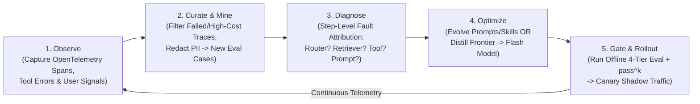
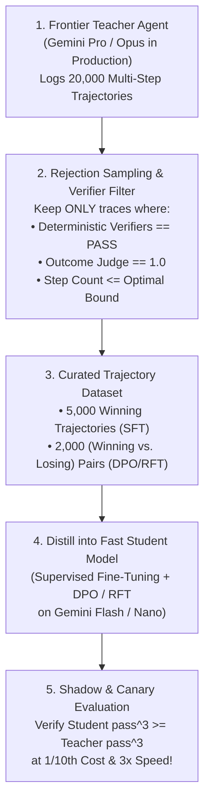

# Chapter 16: The Agent Quality Flywheel — Continuous Optimization & Model Distillation (Beginner to Advanced)

[⬅️ Previous: Chapter 15 — Agent-to-Frontend & Commerce Protocols](./chapter-15-agent-to-frontend-ux-and-commerce-protocols.md) | [📚 Book Index](./README.md) | [Next: Chapter 17 — Production State, HITL & Framework Survey ➡️](./chapter-17-production-state-hitl-and-frameworks.md)

---

Launching an agent into production is Day 1. Unlike traditional deterministic software—which behaves identically until someone changes the code—an agentic system operates in a shifting environment of **evolving user queries, changing external APIs, growing knowledge bases, and periodic foundation model upgrades**.

**The Agent Quality Flywheel** is the closed-loop engineering system that continuously converts production telemetry into higher accuracy, lower latency, and $10\times$ lower inference cost via **Automated Failure Mining**, **Programmatic Prompt/Skill Evolution**, and **Trajectory Distillation**.

---

## 16.1 Beginner: Why Static Agents Degrade & The 5-Stage Quality Flywheel

### Three Sources of Production Agent Drift
1. **Input Distribution Shift:** Real users phrase compound queries, typos, and edge cases in ways your initial 50-case golden dataset never anticipated.
2. **Tool & Environment Drift:** Upstream microservices add new status codes, database schemas gain new columns, or runbook documents change.
3. **Model Version & Prompt Drift:** A minor tweak to a system prompt to fix Bug A silently degrades routing accuracy on Workflow B by $12\%$.

### The 5-Stage Agent Quality Flywheel
Instead of ad-hoc manual prompt tweaking ("vibe-driven development"), production teams run a disciplined **5-Stage Closed Loop**:



### Implicit vs. Explicit Production Quality Signals
Don't wait for users to click a "Thumbs Down" button (fewer than $1\%$ of users do). Mine **implicit behavioral & systems signals** from OpenTelemetry traces:
* **User Rephrase / Retry within 30s:** The user immediately re-asked the same question because the first answer missed the mark.
* **HITL Edit Distance:** A human reviewer had to heavily edit the agent's drafted email or tool arguments before approving.
* **Loop & Step Anomalies:** Any trace where `step_count > P95` or where `ToolExecutionError` occurred $>2$ times.

---

## 16.2 Intermediate: Step-Level Fault Attribution & Programmatic Prompt/Skill Evolution

### 1. Step-Level Fault Attribution (Blame Assignment in Multi-Agent Graphs)
When a 4-agent pipeline (`Router -> Retriever -> Analyst -> Writer`) produces a wrong final answer, which component do you fix?
* **The Attribution Waterfall:** Inspect the intermediate state checkpoints along the trace in forward order:
  1. **Routing Fault:** Did the Router classify the intent incorrectly?
  2. **Retrieval / Context Fault:** Did the Retriever return 0 relevant chunks (`Recall@K = 0`)?
  3. **Tool Execution / Schema Fault:** Did a tool call fail validation or return misleading error text?
  4. **Reasoning / Synthesis Fault:** All required facts were present in `Analyst`'s context window, but the LLM hallucinated or dropped a constraint during generation.

### 2. Programmatic Prompt & Skill Optimization (DSPy / TextGrad / Meta-Prompting)
Once you have a 4-Tier Golden Eval Suite (Chapter 10) and fault attribution, you can replace manual prompt guessing with **automated optimization loops**:

* **Pattern A — Automated Few-Shot Bootstrapping (`BootstrapFewShot` / MIPRO style):**
  1. Run your agent across 200 training scenarios.
  2. Filter for traces that achieved $100\%$ Trajectory + Outcome pass with the lowest step count.
  3. Automatically select the top $K=3\text{–}5$ diverse passing trajectories and inject them as **few-shot exemplars** into the agent's prompt or `SKILL.md` `examples/` folder, selecting the subset that maximizes validation score.
* **Pattern B — Textual Gradient Descent (`TextGrad` / Critic-Driven Skill Evolution):**
  1. Collect a batch of failing evaluation traces where fault attribution points to an instruction gap in `SKILL.md` or a tool docstring.
  2. Pass `(Current SKILL.md, Failing Traces, Expected Rubric)` to a **Meta-Optimizer LLM**, asking it to diagnose the instruction ambiguity and propose a minimal diff patch.
  3. **The Golden Regression Gate:** Accept the proposed `SKILL.md` patch *if and only if* it resolves the failing cases **and** causes zero regressions across the entire existing golden evaluation dataset!

```python
async def evolve_skill_from_failures(
    skill_md: str,
    failing_cases: list[EvalCase],
    full_regression_suite: list[EvalCase],
) -> str:
    baseline_score = await run_eval_suite(full_regression_suite, current_skill=skill_md)

    # Meta-Optimizer proposes a targeted patch to SKILL.md based on failure traces
    candidate_skill_md = meta_optimizer_llm.generate(
        f"Current SKILL.md:\n{skill_md}\n\n"
        f"Failed Trajectories & Critiques:\n{failing_cases}\n\n"
        "Propose a concise update to SKILL.md that prevents these exact errors without breaking existing rules."
    )
    new_score = await run_eval_suite(full_regression_suite, current_skill=candidate_skill_md)

    # Strict hill-climbing acceptance gate: must improve overall score with 0 regressions on Tier-1!
    if new_score.overall_pass_rate > baseline_score.overall_pass_rate and new_score.tier1_regressions == 0:
        return candidate_skill_md
    return skill_md
```

---

## 16.3 Advanced: Trajectory Distillation & Model Down-Tiering (Frontier $\rightarrow$ Flash)

The ultimate ROI of the Agent Quality Flywheel is **Model Distillation (Down-Tiering)**: starting with a heavyweight **Frontier Reasoning Model** (e.g., Gemini Pro / Ultra) on Day 1 to achieve high accuracy rapidly, and then distilling its verified behavior into a **$10\times$ faster, $10\times$ cheaper Student Model** (e.g., Gemini Flash / Nano or fine-tuned open weights) once production traffic scales.



### The Three Distillation Techniques for Agents
1. **Rejection-Sampled Supervised Fine-Tuning (Trajectory SFT):**
   * Filter Teacher production logs for trajectories that passed all deterministic code gates, trajectory checks, and outcome rubrics with minimal steps.
   * Fine-tune the smaller Student model on `(System + Context + Turn_t) -> (Teacher Thought + ToolCall_t)` pairs. This teaches a small Flash model to reason and select tools like a Frontier Pro model inside your specific domain!
2. **Direct Preference Optimization (DPO) on Branched Trajectories:**
   * Whenever an agent fails on Attempt 1 (e.g., emits an invalid SQL query or wrong tool call) and self-heals on Attempt 2 (via Chapter 2 Error-as-Observation or Reflexion), you automatically get a natural **Preference Pair** at that exact context state:
     * $\mathbf{y_{\text{win}}}$ (Chosen): Attempt 2's valid tool call.
     * $\mathbf{y_{\text{lose}}}$ (Rejected): Attempt 1's failed tool call.
   * Training with DPO teaches the Student model to avoid the exact mistakes it previously had to self-correct, eliminating retry turns altogether!
3. **Reinforcement Fine-Tuning (RFT) with Deterministic Verifiers:**
   * For domains with executable verifiers (code compilers, SQL sandboxes, math/schema graders), train the model using RL against the deterministic grader reward + step-efficiency penalty.

### Canary & Shadow Deployment for Distilled Agents
Never swap a Teacher model for a distilled Student model in one big-bang release:
* **Stage 1 — Dark Shadow Mode:** Route $10\%$ of live read-only traffic to the Student model asynchronously in the background (discarding its output) and compare its tool selections against the live Teacher model.
* **Stage 2 — Confidence-Gated Hybrid Cascade:** Let the fast Student model handle traffic first; if its router confidence is $<0.80$ or if it hits a `ToolExecutionError` on Turn 1, **escalate seamlessly to the Frontier Teacher model** for that turn!

---

## Chapter 16 Summary Progression

| Level | Flywheel Capability | Engineering Mechanism | Key Architectural Takeaway |
| :--- | :--- | :--- | :--- |
| **🟢 Beginner** | **5-Stage Closed-Loop Flywheel & Implicit Signal Mining** | OTel trace capture $\rightarrow$ PII redaction $\rightarrow$ CI eval case | Mine implicit failure signals (user retries, high step counts, HITL edits) into golden test cases continuously. |
| **🟡 Intermediate** | **Step-Level Fault Attribution & Automated Prompt/Skill Evolution** | Waterfall blame assignment + `BootstrapFewShot` / `TextGrad` | Attribute failures to the exact node (Router vs. RAG vs. Tool vs. Prompt) and gate automated prompt/skill diffs against your regression suite. |
| **🔴 Advanced** | **Trajectory Distillation (SFT/DPO/RFT) & Shadow Cascades** | Rejection sampling Teacher logs $\rightarrow$ Fine-tuning Flash Student | Use self-healed `(Attempt 2 win, Attempt 1 lose)` traces as DPO pairs to distill Frontier accuracy into a $10\times$ cheaper/faster Flash model. |

---

[⬅️ Previous: Chapter 15 — Agent-to-Frontend & Commerce Protocols](./chapter-15-agent-to-frontend-ux-and-commerce-protocols.md) | [📚 Book Index](./README.md) | [Next: Chapter 17 — Production State, HITL & Framework Survey ➡️](./chapter-17-production-state-hitl-and-frameworks.md)
