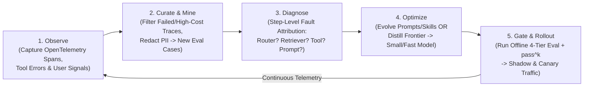
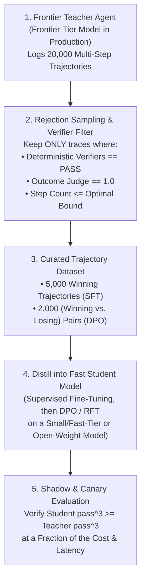

# Chapter 16: The Agent Quality Flywheel — Continuous Optimization & Model Distillation (Beginner to Advanced)

[⬅️ Previous: Chapter 15 — Agent-to-Frontend & Commerce Protocols](./chapter-15-agent-to-frontend-ux-and-commerce-protocols.md) | [📚 Book Index](./README.md) | [Next: Chapter 17 — Production State, HITL & Framework Survey ➡️](./chapter-17-production-state-hitl-and-frameworks.md)

---

Launching an agent into production is Day 1. Unlike traditional deterministic software—which behaves identically until someone changes the code—an agentic system operates in a shifting environment of **evolving user queries, changing external APIs, growing knowledge bases, and periodic foundation model upgrades**.

**The Agent Quality Flywheel** is the closed-loop engineering system that continuously converts production telemetry into higher accuracy, lower latency, and—once distillation pays off—substantially lower inference cost (often an order of magnitude for narrow, high-volume tasks) via **Automated Failure Mining**, **Programmatic Prompt/Skill Evolution**, and **Trajectory Distillation**.

---

## 16.1 Beginner: Why Static Agents Degrade & The 5-Stage Quality Flywheel

### Three Sources of Production Agent Drift
1. **Input Distribution Shift:** Real users phrase compound queries, typos, and edge cases in ways your initial 50-case golden dataset never anticipated.
2. **Tool & Environment Drift:** Upstream microservices add new status codes, database schemas gain new columns, or runbook documents change.
3. **Model Version & Prompt Drift:** A minor tweak to a system prompt to fix Bug A can silently degrade routing accuracy on Workflow B (e.g., by double-digit percentages). Likewise, a model upgrade—or a provider silently re-pointing a floating alias like `*-latest`—can change tool-selection behavior overnight. **Pin dated model versions in production, and treat every model or prompt change as a release that must pass the full eval suite.** Prompts tuned for one model often do not transfer cleanly to the next.

### The 5-Stage Agent Quality Flywheel
Instead of ad-hoc manual prompt tweaking ("vibe-driven development"), production teams run a disciplined **5-Stage Closed Loop**:



### Implicit vs. Explicit Production Quality Signals
Don't wait for users to click a "Thumbs Down" button—explicit feedback is sparse (typically only a small fraction of sessions) and skewed toward extreme experiences. Mine **implicit behavioral & systems signals** from OpenTelemetry traces (in whichever backend you export to: Langfuse, Arize Phoenix, LangSmith, Datadog, or your cloud's native tracing service):
* **User Rephrase / Retry within 30s:** The user immediately re-asked the same question because the first answer missed the mark.
* **HITL Edit Distance:** A human reviewer had to heavily edit the agent's drafted email or tool arguments before approving.
* **Loop & Step Anomalies:** Any trace where `step_count > P95` or where `ToolExecutionError` occurred $>2$ times.

Implicit signals are noisy proxies (a rephrase can also mean the user simply changed their mind), so treat them as a **triage queue for human or LLM-judge review**, not as ground-truth labels.

---

## 16.2 Intermediate: Step-Level Fault Attribution & Programmatic Prompt/Skill Evolution

### 1. Step-Level Fault Attribution (Blame Assignment in Multi-Agent Graphs)
When a 4-agent pipeline (`Router -> Retriever -> Analyst -> Writer`) produces a wrong final answer, which component do you fix?
* **The Attribution Waterfall:** Inspect the intermediate state checkpoints along the trace in forward order and blame the **earliest** failing step (later failures are often just downstream consequences):
  1. **Routing Fault:** Did the Router classify the intent incorrectly?
  2. **Retrieval / Context Fault:** Did the Retriever miss the relevant chunks (e.g., `Recall@K = 0` against labeled evidence)?
  3. **Tool Execution / Schema Fault:** Did a tool call fail validation or return misleading error text?
  4. **Reasoning / Synthesis Fault:** All required facts were present in `Analyst`'s context window, but the LLM hallucinated or dropped a constraint during generation.

### 2. Programmatic Prompt & Skill Optimization (DSPy / GEPA / TextGrad / Meta-Prompting)
Once you have a [4-Tier Golden Eval Suite (Chapter 10)](./chapter-10-agentic-evaluation-and-observability.md) and fault attribution, you can replace manual prompt guessing with **automated optimization loops**. All of them share one non-negotiable requirement: a **trustworthy metric** and a **held-out validation set**—an optimizer will happily overfit to (or exploit) a weak metric.

* **Pattern A — Automated Few-Shot Bootstrapping (DSPy `BootstrapFewShot` / `MIPROv2` style):**
  1. Run your agent across 200 training scenarios.
  2. Filter for traces that achieved $100\%$ Trajectory + Outcome pass with the lowest step count.
  3. Select the top $K=3\text{–}5$ diverse passing trajectories and inject them as **few-shot exemplars** into the agent's prompt or the `SKILL.md` `examples/` folder, keeping the subset that maximizes the validation score. (`MIPROv2` goes further and jointly searches over instructions *and* demonstrations.)
  4. Caveat: with modern reasoning models, long few-shot blocks sometimes help less than clear instructions—or even hurt—so always let the validation score decide.
* **Pattern B — Textual Gradients & Reflective Evolution (`TextGrad`, `GEPA`, Critic-Driven Skill Evolution):**
  1. Collect a batch of failing evaluation traces where fault attribution points to an instruction gap in `SKILL.md` or a tool docstring.
  2. Pass `(Current SKILL.md, Failing Traces, Expected Rubric)` to a **Meta-Optimizer LLM**, asking it to diagnose the instruction ambiguity in natural language and propose a minimal diff patch. This is the core idea behind **TextGrad** (Yuksekgonul et al.; preprint 2024, published in *Nature* 2025), which "backpropagates" LLM-written feedback through a compound system, and **GEPA** (Agrawal et al., 2025, "Reflective Prompt Evolution Can Outperform Reinforcement Learning"; available as `dspy.GEPA`), which reflects on full trajectories and keeps a **Pareto frontier** of candidate prompts rather than a single best one. The GEPA authors report beating GRPO-style RL fine-tuning on their benchmarks with far fewer rollouts—a strong reason to try prompt evolution *before* reaching for fine-tuning.
  3. **The Golden Regression Gate:** Accept the proposed `SKILL.md` patch *if and only if* it resolves the targeted failing cases **and** causes no regressions on the existing golden dataset (no previously passing case now fails)—and confirm the gain on a held-out set the optimizer never saw.

```python
import asyncio

async def evolve_skill_from_failures(
    skill_md: str,
    failing_cases: list[EvalCase],
    regression_suite: list[EvalCase],
    holdout_suite: list[EvalCase],
    k: int = 3,  # a case "passes" only if all k trials pass (pass^k), to resist LLM noise
) -> str:
    # The baseline eval and the patch proposal are independent: run them concurrently.
    baseline, candidate_skill_md = await asyncio.gather(
        run_eval_suite(regression_suite + holdout_suite, skill=skill_md, trials=k),
        meta_optimizer_llm.generate(
            f"Current SKILL.md:\n{skill_md}\n\n"
            f"Failed Trajectories & Critiques:\n{format_traces(failing_cases)}\n\n"
            "Diagnose the instruction gap and propose a minimal update to SKILL.md that "
            "prevents these errors without breaking existing rules. Return the full file."
        ),
    )
    candidate = await run_eval_suite(
        failing_cases + regression_suite + holdout_suite, skill=candidate_skill_md, trials=k
    )

    fixes_targets = all(candidate.passed(c.id) for c in failing_cases)
    regressions = [
        c.id for c in regression_suite if baseline.passed(c.id) and not candidate.passed(c.id)
    ]
    holdout_ok = candidate.pass_rate(holdout_suite) >= baseline.pass_rate(holdout_suite)

    # Strict acceptance gate: fix the targets, zero regressions, no held-out degradation.
    if fixes_targets and not regressions and holdout_ok:
        return candidate_skill_md
    return skill_md
```

---

## 16.3 Advanced: Trajectory Distillation & Model Down-Tiering (Frontier $\rightarrow$ Small/Fast Model)

The ultimate ROI of the Agent Quality Flywheel is **Model Distillation (Down-Tiering)**: starting with a heavyweight **Frontier Reasoning Model** (e.g., a GPT-, Claude Opus-, or Gemini Pro-class model) on Day 1 to achieve high accuracy rapidly, and then distilling its verified behavior into a **much faster, much cheaper Student Model** (e.g., a small/fast tier such as GPT mini-, Claude Haiku-, or Gemini Flash-class models, or a fine-tuned open-weight model such as Llama, Qwen, Mistral, or Gemma) once production traffic scales. Gains of roughly an order of magnitude in cost are common for narrow, high-volume tasks, but measure them on *your* workload.

> [!WARNING]
> **Check the terms before you distill.** Many model providers' terms of service restrict using their outputs to train models that compete with them. Distilling within the same provider's family (via their managed tuning service, e.g., OpenAI fine-tuning, Amazon Bedrock model customization, Azure AI Foundry fine-tuning, or Vertex AI tuning) or from a teacher whose license permits it is the safe path. Also note that many reasoning-model APIs return only **summarized or encrypted reasoning**, not the raw chain-of-thought—so plan to distill the *actions* (tool calls, arguments, final answers) plus any visible rationale, not hidden thoughts.



### The Three Distillation Techniques for Agents
1. **Rejection-Sampled Supervised Fine-Tuning (Trajectory SFT):**
   * Filter Teacher production logs for trajectories that passed all deterministic code gates, trajectory checks, and outcome rubrics with minimal steps.
   * Fine-tune the smaller Student model on `(System + Context + Turn_t) -> (Teacher visible rationale + ToolCall_t)` pairs. This teaches a small model to select tools and arguments like the Frontier model *inside your specific domain*—it does not make it a general-purpose frontier model.
   * Caveat: SFT on teacher traces is **off-policy**—the student never sees its own mistakes. **On-policy distillation** (the student generates trajectories and the teacher or a verifier scores/corrects them; e.g., GKD, Agarwal et al., ICLR 2024) often closes the remaining gap.
2. **Direct Preference Optimization (DPO; Rafailov et al., 2023) on Branched Trajectories:**
   * Whenever an agent fails on Attempt 1 (e.g., emits an invalid SQL query or wrong tool call) and self-heals on Attempt 2 (via [Chapter 2](./chapter-02-single-agent-loops.md) Error-as-Observation or Reflexion), you get a candidate **Preference Pair**:
     * $\mathbf{y_{\text{win}}}$ (Chosen): Attempt 2's valid tool call.
     * $\mathbf{y_{\text{lose}}}$ (Rejected): Attempt 1's failed tool call.
   * Nuance: DPO pairs must share the **same prompt/context**. Attempt 2 was generated *after* seeing the error message, so build the pair on the pre-error context (the state before Attempt 1) and verify that Attempt 2's call is actually correct when replayed from that state.
   * Training with DPO teaches the Student model to avoid the mistakes it previously had to self-correct, substantially **reducing** (not eliminating) retry turns—keep error-as-observation in the runtime as a safety net.
3. **Reinforcement Fine-Tuning (RFT) with Deterministic Verifiers:**
   * For domains with executable verifiers (code compilers and tests, SQL sandboxes, math/schema graders), train the model with RL (e.g., PPO- or GRPO-style algorithms, or managed RFT offerings) against the deterministic grader reward plus a step-efficiency penalty.
   * Guard against **reward hacking**: the policy will exploit any loophole in the grader (e.g., special-casing tests), so audit high-reward trajectories and keep a held-out eval.

### Shadow & Canary Deployment for Distilled Agents
Never swap a Teacher model for a distilled Student model in one big-bang release:
* **Stage 1 — Dark Shadow Mode:** Mirror a sample (e.g., $10\%$) of live traffic to the Student model asynchronously, discard its output, and compare its tool selections and arguments against the live Teacher. Side-effecting tool calls must be **stubbed or dry-run** in shadow mode—never let the shadow agent actually send emails or mutate state.
* **Stage 2 — Canary:** Route a small percentage of real traffic to the Student with automated rollback on eval-metric or business-KPI regressions.
* **Stage 3 — Confidence-Gated Hybrid Cascade:** Let the fast Student model handle traffic first; escalate to the Frontier Teacher for that turn when a **verifiable signal** fires—schema-validation failure, a `ToolExecutionError` on Turn 1, a low verifier/judge score, or low token log-probabilities on the routing decision. Avoid relying on the model's *self-reported* confidence (e.g., "confidence: 0.80"); verbalized confidence is poorly calibrated.

---

## Chapter 16 Summary Progression

| Level | Flywheel Capability | Engineering Mechanism | Key Architectural Takeaway |
| :--- | :--- | :--- | :--- |
| **🟢 Beginner** | **5-Stage Closed-Loop Flywheel & Implicit Signal Mining** | OTel trace capture $\rightarrow$ PII redaction $\rightarrow$ CI eval case | Mine implicit failure signals (user retries, high step counts, HITL edits) into golden test cases continuously; pin model versions and gate every model/prompt change on evals. |
| **🟡 Intermediate** | **Step-Level Fault Attribution & Automated Prompt/Skill Evolution** | Waterfall blame assignment + `BootstrapFewShot` / `MIPROv2` / `GEPA` / `TextGrad` | Attribute failures to the earliest failing node (Router vs. RAG vs. Tool vs. Prompt) and gate automated prompt/skill diffs against your regression suite plus a held-out set. |
| **🔴 Advanced** | **Trajectory Distillation (SFT/DPO/RFT) & Shadow Cascades** | Rejection sampling Teacher logs $\rightarrow$ Fine-tuning a small/fast-tier Student | Use verified traces (SFT), same-context self-heal pairs (DPO), and verifier rewards (RFT) to distill Frontier accuracy into a much cheaper/faster model—within your provider's terms—and roll out via shadow, canary, and verifier-gated cascades. |

---

[⬅️ Previous: Chapter 15 — Agent-to-Frontend & Commerce Protocols](./chapter-15-agent-to-frontend-ux-and-commerce-protocols.md) | [📚 Book Index](./README.md) | [Next: Chapter 17 — Production State, HITL & Framework Survey ➡️](./chapter-17-production-state-hitl-and-frameworks.md)
