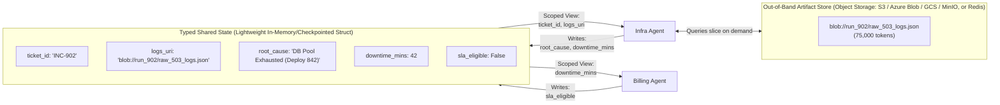
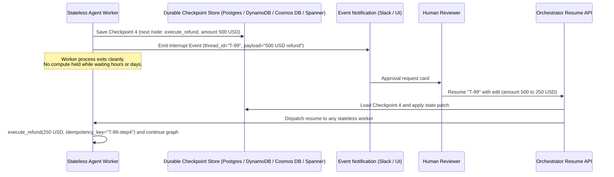
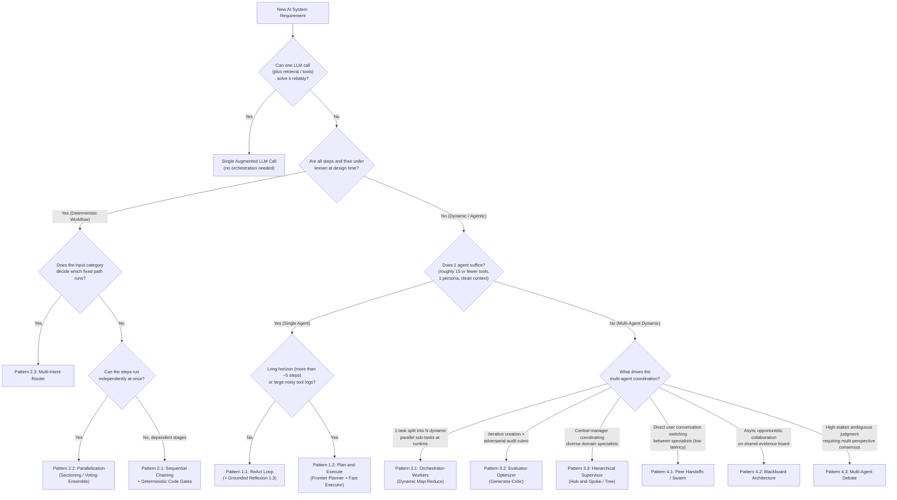

# Chapter 17: Production state, durable HITL, decision guides, and a framework survey

[← Previous: Chapter 16 — The Agent Quality Flywheel & Distillation](./chapter-16-agent-quality-flywheel-and-distillation.md) | [Book Index](./README.md) | [Next: Chapter 18 — 105-question architecture quiz →](./chapter-18-mcq-assessment-and-case-studies.md)

---

This chapter pulls the orchestration topologies (Chapters 1–5) and capability pillars (Chapters 6–16) together into the things you actually have to build in production. We cover state management between agents, durable Human-in-the-Loop (HITL) checkpointing, the Master Architecture Decision Matrix, and how the patterns map onto code in LangGraph, CrewAI, Microsoft Agent Framework (plus its predecessor AutoGen and the community fork AG2), the OpenAI Agents SDK, the Claude Agent SDK, and Google ADK. The patterns don't depend on any particular framework, model, or cloud. The frameworks are just different APIs over them.

> [!NOTE]
> Framework APIs move fast. The idioms below reflect the frameworks' public docs as of late 2026, but always pin versions and confirm exact signatures in the official docs before copying code into production.

---

## 17.1 Passing context and state between agents

When Agent A hands over to Agent B, the real question is which tokens should end up in Agent B's context window. There are four common answers.

| Strategy | How it works | Pros | Cons and production failure mode |
| :--- | :--- | :--- | :--- |
| 1. Full history broadcast | Every agent reads and appends to a single shared `messages: list[Message]` transcript. | Zero setup; every agent sees everything. | $O(K^2)$ token explosion and attention dilution: Agent B gets confused by Agent A's internal tool calls and stack traces. |
| 2. Filtered or summarized history (handoff filters) | On handoff, a filter strips tool calls and internal reasoning, or compresses prior turns into a recap, before Agent B sees the transcript (e.g., the OpenAI Agents SDK's handoff `input_filter`). | Keeps conversational continuity for user-facing handoffs with much less noise. | Lossy recap: the filter or summarizer can silently drop a detail Agent B needed, and context still grows with conversation length. |
| 3. Scoped task string (`AgentTool` / `as_tool()`) | The supervisor passes Agent B a synthesized instruction string; Agent B returns only its final summary string. | Cleanest context isolation; Agent B's raw tool logs are discarded on return. | The "telephone game": the supervisor may forget to include a critical constraint when prompting Agent B. |
| 4. Typed shared state + scoped views + artifact pointers (recommended default for multi-agent workflows) | Agents read and write a strongly typed state schema (`IncidentState`). Each agent's prompt builder renders *only* the state keys relevant to its role, and large payloads live out-of-band behind a reference URI. | Minimal information loss with minimal context bloat, because facts are written once as structured fields instead of being re-summarized at every hop. | Requires explicit upfront schema design (`Pydantic` / `TypedDict`), plus a merge policy (reducers or per-agent keys) when agents write concurrently. |

A scoped view is only as good as the schema behind it. If an agent's view leaves out a field it actually needs, the agent will often hallucinate a value rather than ask. Version your state schema and log each agent's rendered view, so that when someone asks "why didn't the Billing Agent know X?" you can answer from the traces.



---

## 17.2 Human-in-the-loop, durable checkpointing, and time-travel

Sooner or later a workflow will propose something with real consequences: issuing a \$5,000 refund, rolling back a production cluster, deleting customer data. You can't park a Python thread on `input()` or `time.sleep()` for the hours it might take a human to answer in Slack.

Production orchestrators handle this with durable checkpointing and interrupts. The worker saves its state, emits an approval request, and exits. Whoever resumes the run later loads the checkpoint and carries on:



### The three standard HITL primitives

1. Approve or reject. Suspend execution right before a mutating tool call. On approval, resume; on rejection, inject a rejection observation so the agent can choose another path.
2. Edit state and resume. Let the operator change tool arguments or shared state fields (editing a drafted email, say, or changing a refund amount) before resuming from the checkpoint.
3. Time-travel (replay and fork). If an agent makes a bad decision at Step 5 of an 8-step trace, load the checkpoint saved after Step 4 in a debugging UI, change the state or prompt, and fork a new execution branch from there without re-running Steps 1–4.

### Production caveats that are easy to miss

Resumption may re-execute code. Many engines resume at the node or step boundary, not at the exact line. In LangGraph, for example, resuming after `interrupt()` re-runs the interrupted node from its first line, so any side effect placed *before* the `interrupt()` call executes twice. Put side effects in a separate node after the approval, or make them idempotent.

Every mutating tool needs an idempotency key. Workers crash, messages get redelivered, and humans double-click "Approve". Pass a deterministic key (e.g., `thread_id + step`) to payment, ticketing, and infra APIs so a retried call can't refund twice.

Time-travel forks your state, not the world. Replaying from Checkpoint 4 rewinds *your* state; a refund already issued or an email already sent in the abandoned branch stays issued and sent. Treat external effects as committed, and use compensating actions (the Saga pattern) when you need to "undo".

Checkpointers and durable-execution engines solve different problems. Framework checkpointers (LangGraph checkpointers, OpenAI Agents SDK `RunState` serialization, CrewAI `@persist`, Microsoft Agent Framework workflow checkpoints, ADK resumable apps) persist agent state between steps. For long-running business processes with timers, retries, and cross-service transactions, teams often run the agent loop inside a general durable-execution engine (e.g., Temporal, Restate, DBOS, AWS Step Functions, Azure Durable Functions). The engine records each step's result and recovers from crashes without redoing completed steps.

Approval fatigue is a security risk. Reviewers who see dozens of low-risk prompts an hour start rubber-stamping them. Gate only on risk (amount thresholds, irreversible verbs, external recipients), and show the reviewer the exact arguments and a diff rather than the agent's persuasive summary.

| Framework | Native HITL mechanism (late 2026) |
| :--- | :--- |
| LangGraph | `interrupt(payload)` inside a node (requires a checkpointer + `thread_id`); resume with `graph.invoke(Command(resume=value), config)`. Static breakpoints via `interrupt_before` / `interrupt_after` at compile time. |
| OpenAI Agents SDK | `@function_tool(needs_approval=...)`; the run surfaces `result.interruptions`, you call `state = result.to_state()`, then `state.approve(...)` / `state.reject(...)`, and resume with `Runner.run(agent, state)`. `RunState` can be serialized for cross-process resumes. |
| Claude Agent SDK | Permission modes plus a `can_use_tool` callback and `PreToolUse` hooks that can allow, deny, or modify a tool call before it executes. |
| Microsoft Agent Framework | Tools can be marked `approval_mode="always_require"` so the run pauses with an approval request instead of executing; graph Workflows add human-in-the-loop request/response steps plus checkpointing for resume. |
| Google ADK | Tool confirmation via `FunctionTool(func, require_confirmation=...)` (a bool or a predicate over the arguments), `LongRunningFunctionTool` for async external work, and app-level resumability (`ResumabilityConfig`) so a paused invocation can resume later. |

---

## 17.3 The master architecture decision tree

Use this tree to pick the simplest orchestration pattern that meets the requirement. It follows the core advice of Anthropic's *Building Effective Agents* (Dec 2024): prefer a single augmented LLM call or a predefined workflow (code-controlled paths), and reach for agents (LLM-directed paths) only when the steps genuinely can't be known in advance.



The thresholds in the tree ("~15 tools", "~5 steps") are rules of thumb, not hard limits. Modern reasoning models with large context windows, well-written tool descriptions, and context management (compaction, tool-result clearing, sub-agents for noisy exploration; see [Chapter 11](./chapter-11-context-engineering-and-long-term-memory.md)) push these boundaries a long way. Measure on your own eval set ([Chapter 10](./chapter-10-agentic-evaluation-and-observability.md)) before adding agents, because every extra agent brings more latency, more cost, and another handoff that can fail.

---

## 17.4 Master pattern comparison matrix

Notation: $L$ is the average latency of a single LLM call, $K$ the number of loop iterations, $M$ the number of specialist agents (or pipeline stages), $N_{\text{workers}}$ the number of dynamically spawned workers, and $C_{\text{cycles}}$ the number of blackboard trigger cycles. Read the table as an order-of-magnitude guide for comparing patterns, not as a precise cost model.

| Chapter and level | Pattern | Who owns control flow | Typical latency | Token cost scaling | Context isolation | Main failure mode and the guardrail it needs |
| :--- | :--- | :--- | :--- | :--- | :--- | :--- |
| [Ch 02 (Beginner)](./chapter-02-single-agent-loops.md) | 1.1 ReAct Loop | Single LLM | $K \cdot L$ | $O(K^2)$ (shared window; prompt caching cuts the price, not the context growth) | Low | Myopia and context bloat: cap `max_steps`; return tool exceptions as observations. |
| [Ch 02 (Beginner)](./chapter-02-single-agent-loops.md) | 1.2 Plan-and-Execute | Planner LLM + code loop | $(2 + K) \cdot L$ | $O(K)$ (scoped steps) | High | Stale plan: always include a Replanner after each step summary. |
| [Ch 02 (Beginner)](./chapter-02-single-agent-loops.md) | 1.3 Grounded Reflexion | Actor + verifier loop | $(1\text{–}3) \cdot 2L$ | $O(\text{trials})$ | Medium | Sycophantic flip-flop: run deterministic verifiers (AST/tests/regex) before LLM critique. |
| [Ch 03 (Intermediate I)](./chapter-03-deterministic-multi-agent-workflows.md) | 2.1 Sequential Chain | Application code | $\sum_{i=1}^M L_i$ | $O(M)$ | High | Compound error decay ($r^M$): insert deterministic `Pydantic`/business-rule gates between stages. |
| [Ch 03 (Intermediate I)](./chapter-03-deterministic-multi-agent-workflows.md) | 2.2 Parallelization | Application code | $\max_i(L_i) + L_{\text{synth}}$ | $O(M)$ | High | Hidden data dependencies and lost sibling results: ensure true independence; use `asyncio.gather(..., return_exceptions=True)` (or `asyncio.TaskGroup` with explicit per-task error handling) so one failure doesn't discard sibling results. |
| [Ch 03 (Intermediate I)](./chapter-03-deterministic-multi-agent-workflows.md) | 2.3 Intent Router | Fast classifier + code | $L_{\text{fast}} + L_{\text{branch}}$ | Lowest ($O(1)$) | High | Dropped compound intents: use a multi-label `list[Intent]` schema to detect multi-part queries. |
| [Ch 04 (Intermediate II)](./chapter-04-dynamic-and-hierarchical-orchestration.md) | 3.1 Orchestrator–Workers | Orchestrator LLM | $2L + \max_i(L_{\text{worker}})$ | $O(N_{\text{workers}})$ | High | Fan-out rate-limit bomb: enforce `max_length` on subtasks + `asyncio.Semaphore(max_concurrency)`. |
| [Ch 04 (Intermediate II)](./chapter-04-dynamic-and-hierarchical-orchestration.md) | 3.2 Evaluator–Optimizer | Generator + critic LLMs | $(1\text{–}3) \cdot 2L$ | $O(\text{rounds})$ | High (clean critic) | Endless nitpicking: separate `blocking_defects` from `minor_suggestions` in the critic schema. |
| [Ch 04 (Intermediate II)](./chapter-04-dynamic-and-hierarchical-orchestration.md) | 3.3 Hierarchical Supervisor | Central supervisor LLM | $2K \cdot L$ (hub hops) | $O(K \cdot M)$ | High | "Telephone game" lossy summaries: write structured facts directly to typed shared state. |
| [Ch 05 (Advanced)](./chapter-05-decentralized-and-emergent-topologies.md) | 4.1 Peer Handoffs / Swarm | Active specialist LLM | $1 \cdot L$ per turn (no hub hop) | 1 call per turn, but each call carries the (filtered) conversation history | Medium | Ping-pong handoff cycle ($A \leftrightarrow B$): track `visited_edges` per turn + `max_handoffs`. |
| [Ch 05 (Advanced)](./chapter-05-decentralized-and-emergent-topologies.md) | 4.2 Blackboard | Event controller + board | $C_{\text{cycles}} \cdot \max(L_i)$ | $O(\text{triggers})$ | High | Infinite re-triggering and write races: deduplicate `(agent, precondition_hash)` + atomic patch reducers. |
| [Ch 05 (Advanced)](./chapter-05-decentralized-and-emergent-topologies.md) | 4.3 Multi-Agent Debate | Debaters + judge LLM | $(K_{\text{rounds}} + 1) \cdot L$ | Highest ($O(M \cdot K)$ calls; prompt tokens approach $O(M^2 \cdot K)$ when every debater reads all peers) | High | Anchoring and echo chamber: enforce blind Round-1 parallel generation + orthogonal personas + early exit. |

---

## 17.5 Framework survey: from concepts to code

Once the patterns make sense, each major framework turns out to be a different API over the same three things: agents, control edges, and shared state. Below is how six widely used frameworks implement the patterns (in no order of preference). Other capable options include LlamaIndex (Workflows / `AgentWorkflow`), Pydantic AI, AWS's open-source Strands Agents SDK, and Mastra (TypeScript), and the same concept-to-idiom mapping applies to them.

---

### 1. LangGraph (LangChain ecosystem)

LangGraph is a low-level, graph-based state machine (`StateGraph`, with cycles allowed). It gives you explicit typed state reducers, durable checkpointers as a first-class feature, and the dynamic `Send` and `Command` primitives. It reached a stable 1.0 in late 2025, and LangChain's higher-level `create_agent` is built on top of it.

The idioms you'll use most:

1. Typed state reducers (`Annotated[list, operator.add]`). When parallel nodes run in the same step, each returning `{"reports": [new_item]}`, the reducer merges the writes instead of letting one branch overwrite the other. (Without a reducer, concurrent writes to the same key raise an `InvalidUpdateError`.)
2. Dynamic orchestrator–workers with the `Send` API. A conditional edge can return `[Send("worker_node", {"subtask": t}) for t in state["subtasks"]]` to spawn $N$ parallel worker invocations at runtime, each with its own private input.
3. Peer-to-peer handoffs with the `Command` API. Any node can return `Command(update={"downtime": 42}, goto="billing_agent")` to update state and jump straight to a peer node in one step. `graph=Command.PARENT` hands off from a subgraph to a node in the parent graph.
4. Durable HITL with `interrupt()`. Calling `decision = interrupt({"question": "Approve $500 refund?"})` inside a node pauses the run. The configured checkpointer (Postgres, SQLite, etc.) has already persisted state for that `thread_id`, and the run continues when you invoke the graph with `Command(resume=...)`. On resume, the node restarts from its first line and `interrupt()` returns the resume value.

```python
import operator
from typing import Annotated, TypedDict
from langgraph.graph import StateGraph, START, END
from langgraph.types import Send, Command, interrupt
from langgraph.checkpoint.memory import InMemorySaver  # use a Postgres checkpointer in production

class IncidentState(TypedDict):
    ticket: str
    subtasks: list[str]
    reports: Annotated[list[str], operator.add]  # Reducer: merges parallel worker writes
    final_answer: str
    approved: bool

class WorkerInput(TypedDict):
    subtask: str

# plan_subtasks / investigate / synthesize are your LLM calls (placeholders).
def orchestrator_node(state: IncidentState) -> dict:
    return {"subtasks": plan_subtasks(state["ticket"])}

def route_to_workers(state: IncidentState) -> list[Send]:   # Pattern 3.1 via Send
    return [Send("worker_node", {"subtask": t}) for t in state["subtasks"]]

def worker_node(payload: WorkerInput) -> dict:              # Sees only its own subtask
    return {"reports": [investigate(payload["subtask"])]}

def synthesizer_node(state: IncidentState) -> dict:
    return {"final_answer": synthesize(state["reports"])}

def approval_node(state: IncidentState) -> dict:
    # Code above interrupt() re-runs on resume, so keep it side-effect free.
    decision = interrupt({"question": "Publish this RCA?", "draft": state["final_answer"]})
    return {"approved": decision["approved"]}

builder = StateGraph(IncidentState)
builder.add_node("orchestrator", orchestrator_node)
builder.add_node("worker_node", worker_node)
builder.add_node("synthesizer", synthesizer_node)
builder.add_node("approval", approval_node)
builder.add_edge(START, "orchestrator")
builder.add_conditional_edges("orchestrator", route_to_workers, ["worker_node"])
builder.add_edge("worker_node", "synthesizer")
builder.add_edge("synthesizer", "approval")
builder.add_edge("approval", END)
graph = builder.compile(checkpointer=InMemorySaver())

config = {"configurable": {"thread_id": "INC-902"}}
graph.invoke({"ticket": "503s on checkout"}, config)          # Runs until interrupt(), then returns
graph.invoke(Command(resume={"approved": True}), config)      # Later, from any process sharing the checkpointer
```

---

### 2. CrewAI (Crews and Flows)

CrewAI has two layers. On the outside are Flows: deterministic, event-driven workflows built with `@start`, `@listen`, `@router`, and the `and_` / `or_` combinators over a typed Pydantic state (`Flow[MyState]`). On the inside are Crews: collaborative role-playing agent teams run with `Process.sequential` or `Process.hierarchical`, where a manager agent delegates and validates.

In production, use Flows as the backbone and call Crews only for the steps that need autonomous collaboration. The `@persist` decorator saves Flow state (SQLite by default) so a run can resume after a restart. CrewAI suits teams that want declarative YAML definitions of `Agents` (`role`, `goal`, `backstory`) and `Tasks` (`description`, `expected_output`, `context`) wrapped inside event-driven Python workflows.

---

### 3. Microsoft Agent Framework (successor to AutoGen and Semantic Kernel) and the AG2 fork

People often mix up three related codebases. They are different projects:

| Project | Status (late 2026) | Multi-agent idioms |
| :--- | :--- | :--- |
| Microsoft Agent Framework (Python + .NET) | Microsoft's unified successor to AutoGen and Semantic Kernel; reached 1.0 GA. The recommended path for new Microsoft-stack projects. | Graph-based Workflows (typed executors and edges, checkpointing, human-in-the-loop request/response) plus prebuilt orchestrations: `SequentialBuilder`, `ConcurrentBuilder`, `HandoffBuilder`, `GroupChatBuilder`, and `MagenticBuilder`. Native MCP and A2A support. |
| AutoGen 0.4+ (`autogen-agentchat`) | Microsoft's earlier async, event-driven rewrite; now in maintenance mode (fixes only) with migration guides to Agent Framework. | `RoundRobinGroupChat` (sequential / debate loops), `SelectorGroupChat` (LLM picks next speaker), `Swarm` (handoff messages), `MagenticOneGroupChat`. |
| AG2 (`ag2` / `autogen` package) | Independent community fork that continued the AutoGen 0.2 lineage under open governance. | `ConversableAgent` plus group-chat orchestration patterns (`AutoPattern`, `RoundRobinPattern`, etc.) launched with `initiate_group_chat`. |

Magentic orchestration comes from the *Magentic-One* system (Fourney et al., Microsoft Research, 2024). It is a Plan-and-Execute orchestrator with two ledgers. The outer loop maintains a Task Ledger holding given facts, facts to look up, educated guesses, and the plan. The inner loop keeps a Progress Ledger that checks whether the task is done, whether progress is being made, and which agent should act next, and it triggers replanning when it detects a stall.

---

### 4. OpenAI Agents SDK (production successor to Swarm)

The Agents SDK is a minimal, Python-first library (a TypeScript SDK also exists) that adds very few new abstractions. Deterministic workflows are just standard Python `for`, `if/else`, and `asyncio.gather`. For multi-agent orchestration it gives you a small set of primitives:

1. `handoffs=[billing_agent, infra_agent]` for peer-to-peer control transfer (Pattern 4.1). Each handoff is exposed to the model as a tool (e.g., `transfer_to_billing_agent`), and `handoff(..., input_filter=...)` controls what history the next agent sees.
2. `agent.as_tool(tool_name=..., tool_description=...)` for hierarchical supervisor delegation (Pattern 3.3). The sub-agent runs and returns its output, and the caller keeps control.
3. Guardrails. `@input_guardrail` / `@output_guardrail` functions return a `GuardrailFunctionOutput(tripwire_triggered=...)`, and if the tripwire fires, the SDK raises `InputGuardrailTripwireTriggered` (or `OutputGuardrailTripwireTriggered`). Input guardrails run concurrently with the agent by default to save latency; set `run_in_parallel=False` when the check must finish before the model (and any tools) start. Input guardrails apply to the first agent in a run, output guardrails to the agent producing the final output.
4. Sessions, HITL, and tracing. Session objects (e.g., `SQLiteSession`) persist conversation history across runs. `needs_approval` on tools pauses for human approval with a serializable `RunState` (see 17.2). Built-in tracing records every model call, tool call, handoff, and guardrail as spans.

```python
from agents import Agent, Runner, SQLiteSession, function_tool

@function_tool(needs_approval=True)          # HITL gate on the mutating tool
def issue_refund(order_id: str, amount: float) -> str:
    ...

infra_agent = Agent(name="Infra", instructions="Diagnose outages.", tools=[query_logs])  # query_logs: another @function_tool
billing_agent = Agent(name="Billing", instructions="Handle SLA credits.", tools=[issue_refund])
triage = Agent(
    name="Triage",
    instructions="Answer directly, diagnose with the tool, or hand off billing issues.",
    tools=[infra_agent.as_tool(tool_name="diagnose_outage", tool_description="Run an infra diagnosis")],
    handoffs=[billing_agent],
)

async def handle(user_id: str, message: str):
    result = await Runner.run(triage, message, session=SQLiteSession(user_id))
    return result  # check result.interruptions before treating result.final_output as done
```

---

### 5. Claude Agent SDK (Anthropic)

This is the agent harness behind Claude Code, exposed as a library (it was renamed from the *Claude Code SDK* in 2025). You don't compose graphs. You configure one capable agent loop with built-in tools (file operations, shell, web search/fetch), custom tools, and MCP servers, then delegate noisy sub-tasks to subagents that run in their own context windows and return only a summary. In effect, that's Pattern 3.3 with automatic context isolation.

The main entry points are `query()` for one-shot streaming runs and `ClaudeSDKClient` for multi-turn sessions. `ClaudeAgentOptions` sets allowed tools, the system prompt, MCP servers, and subagent definitions. Hooks (`PreToolUse`, `PostToolUse`, etc.) enforce deterministic policy, and permission modes plus a `can_use_tool` callback handle HITL approvals. The SDK also supports Agent Skills (`SKILL.md`, see [Chapter 8](./chapter-08-agent-skills-and-procedural-memory.md)) and automatic context compaction for long-running tasks. Claude models can be served via Anthropic's API or through Amazon Bedrock, Google Vertex AI, or Microsoft Foundry.

It's the best fit for long-horizon, tool-heavy "computer-like" agents (coding, research, ops runbooks), where a single strong agent with good context management beats a hand-built multi-agent graph.

---

### 6. Google ADK (Agent Development Kit)

ADK builds a composable hierarchy out of deterministic workflow agents (`SequentialAgent`, `ParallelAgent`, `LoopAgent`) and dynamic `LlmAgent` nodes (also exported as `Agent`). Agents share `session.state`, and MCP and A2A are supported natively.

The idioms worth knowing:

1. State piping via `output_key`. When an `LlmAgent` defines `output_key="rca_report"`, ADK automatically writes its final response into `session.state["rca_report"]`, and a later agent in a `SequentialAgent` can reference it directly in its instruction template (`{rca_report}`).
2. Deterministic orchestration containers. `SequentialAgent`, `ParallelAgent`, and `LoopAgent` run without spending an LLM call on routing. A `LoopAgent` stops at `max_iterations` or when a sub-agent escalates (e.g., a checker tool sets `tool_context.actions.escalate = True`). Sub-agents of a `ParallelAgent` share the same `session.state`, so give each one a distinct `output_key` to avoid clobbering.
3. Two dynamic delegation modes:
   * Peer handoffs (`sub_agents`). Passing `sub_agents=[infra_agent, billing_agent]` to an `LlmAgent` lets the model call the built-in `transfer_to_agent` function; control (and subsequent turns) moves to the target agent.
   * Supervisor (`AgentTool`). Wrapping a specialist with `AgentTool(agent=infra_agent)` lets a supervisor call the sub-agent like a standard function and get the result back while keeping control.
4. Custom orchestration (`BaseAgent`). Subclassing `BaseAgent` and implementing `async def _run_async_impl(self, ctx: InvocationContext) -> AsyncGenerator[Event, None]` gives you arbitrary Python control flow (e.g., Blackboard controllers or dynamic Map-Reduce).
5. Callbacks and plugins for guardrails and policy. Per-agent callbacks (`before_agent_callback`, `before_model_callback`, `before_tool_callback`, and their `after_*` counterparts) can inspect, modify, or short-circuit a step. Plugins (`BasePlugin` subclasses registered on the `Runner`/`App`) apply the same kind of hooks globally across every agent, which makes them the right home for audit logging, PII redaction, and tool-permission policies.
6. HITL and deployment. Tool confirmation (`require_confirmation`) plus resumable apps cover durable approvals (see 17.2). `adk web` / `adk eval` give you a local dev UI and trajectory evals. An ADK agent is an ordinary application service, so you can containerize it and run it on any Kubernetes cluster or serverless container platform (AWS Fargate, Azure Container Apps, Cloud Run, etc.). `adk deploy` adds one-command targets for Google Cloud: Cloud Run, GKE, or Google's managed agent runtime (formerly *Vertex AI Agent Engine*, now branded Agent Runtime in the Gemini Enterprise Agent Platform).

```python
from google.adk.agents import LlmAgent, SequentialAgent, ParallelAgent
from google.adk.tools.agent_tool import AgentTool

# Placeholders: query_logs, get_deploys, check_sla_policy are plain Python functions
# (ADK wraps them as FunctionTools); human_escalation_agent is another LlmAgent.
# Model IDs are placeholders for a fast/small tier and a frontier tier. ADK accepts Gemini
# model IDs as plain strings and other providers' models (OpenAI, Anthropic, Bedrock,
# Ollama, ...) via its LiteLlm wrapper, e.g. LiteLlm(model="<provider>/<model>").
FAST_MODEL = "<fast-small-model-id>"   # pin a validated version in production
SMART_MODEL = "<frontier-model-id>"

# 1. Specialist Agents writing to session.state via output_key
log_agent = LlmAgent(name="LogAgent", model=FAST_MODEL, tools=[query_logs], output_key="log_findings")
deploy_agent = LlmAgent(name="DeployAgent", model=FAST_MODEL, tools=[get_deploys], output_key="deploy_findings")

# 2. Pattern 2.2 (Parallel Fan-Out) -> Pattern 2.1 (Sequential Pipeline)
parallel_diag = ParallelAgent(name="ParallelDiagnostics", sub_agents=[log_agent, deploy_agent])
sla_agent = LlmAgent(
    name="SLAAgent",
    model=SMART_MODEL,
    instruction="Given {log_findings} and {deploy_findings}, check SLA policy.",
    tools=[check_sla_policy],
)
incident_pipeline = SequentialAgent(name="IncidentPipeline", sub_agents=[parallel_diag, sla_agent])

# 3. Pattern 3.3 (Supervisor via AgentTool) AND Pattern 4.1 (Handoff via sub_agents)
supervisor = LlmAgent(
    name="SupportSupervisor",
    model=SMART_MODEL,
    instruction="Diagnose incidents with the IncidentPipeline tool; transfer to a human if policy requires it.",
    tools=[AgentTool(agent=incident_pipeline)],  # Calls the pipeline as a scoped tool; control returns here.
    sub_agents=[human_escalation_agent],         # Or hands off control entirely via transfer_to_agent.
)
```

---

## 17.6 Which framework should you pick?

| If your main requirement is... | Pick | Why |
| :--- | :--- | :--- |
| Complex cyclic graphs, custom Blackboard state machines, fine-grained time-travel checkpointing, and model-agnostic flexibility | LangGraph | Exposes the raw state-machine primitives (`StateGraph`, reducers, `Send`, `Command`, `interrupt`) without opinionated role wrappers. |
| Rapid role-based prototyping (Researcher + Analyst + Writer) with declarative YAML configs | CrewAI | Fastest path from a role/task mental model to a working multi-agent prototype using `Flows` + `Crews`. |
| .NET / Python enterprise shops (often Microsoft- or Azure-aligned) needing group chats, Magentic-style ledger orchestration, or graph workflows with checkpointing | Microsoft Agent Framework (migrate from AutoGen/Semantic Kernel; AG2 if you prefer the community fork) | Unifies AutoGen's multi-agent patterns with Semantic Kernel's enterprise features (telemetry, type safety, connectors) in one supported SDK. |
| A lightweight Python-first codebase with minimal framework lock-in and fast peer-to-peer handoffs | OpenAI Agents SDK | Small surface area; standard Python handles workflows while `handoffs`, `as_tool()`, guardrails, sessions, and tracing cover the rest. Works with non-OpenAI models via LiteLLM or other model providers. |
| A single long-horizon, tool-heavy agent (coding, research, ops) with strong context management and deterministic hooks | Claude Agent SDK | Production-tested agent harness with subagents, hooks, permissions, MCP, and Skills out of the box. |
| Clean hierarchical + deterministic composition (`Sequential`/`Parallel`/`Loop`) and native A2A + MCP | Google ADK | Built for composable agent hierarchies, with deterministic workflow containers, callbacks/plugins for policy, and built-in trajectory evaluation. Model-agnostic via LiteLLM and other model connectors; runs on any container platform, with one-command `adk deploy` targets if you are on Google Cloud (Cloud Run, GKE, or the managed Agent Runtime, formerly Vertex AI Agent Engine). |

> [!TIP]
> You rarely have to bet the whole system on one framework. These frameworks increasingly speak MCP (agent-to-tool) and A2A (agent-to-agent) ([Chapter 9](./chapter-09-mcp-and-a2a-interoperability.md)), so a LangGraph workflow can call a Microsoft Agent Framework or ADK agent exposed over A2A, and every framework can share the same MCP tool servers. Pick per component and keep your state schema, evals, and traces framework-neutral. Then the switching cost stays low.

---

[← Previous: Chapter 16 — The Agent Quality Flywheel & Distillation](./chapter-16-agent-quality-flywheel-and-distillation.md) | [Book Index](./README.md) | [Next: Chapter 18 — 105-question architecture quiz →](./chapter-18-mcq-assessment-and-case-studies.md)
