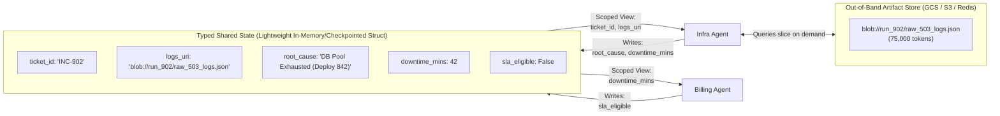
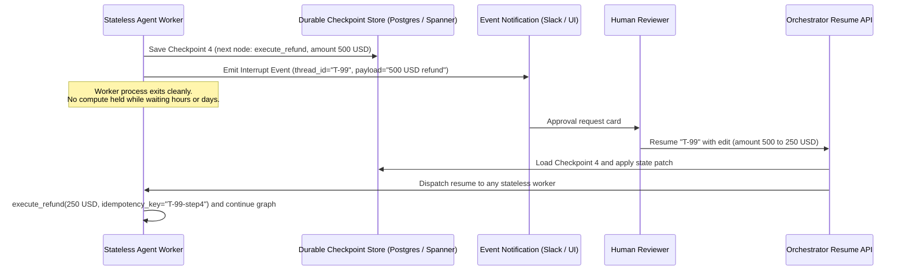
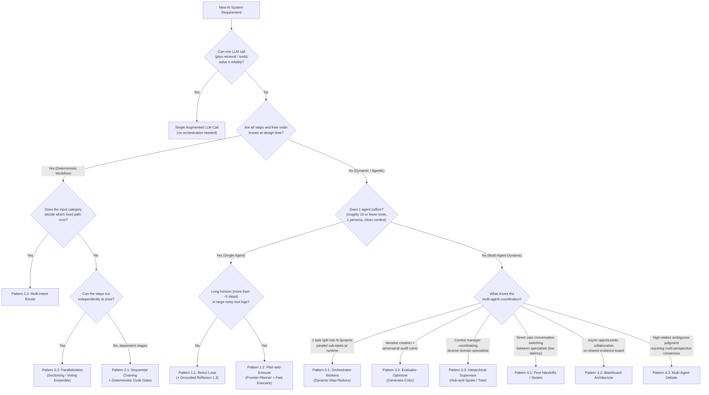

# Chapter 17: Production State, Durable HITL, Master Decision Matrix & Framework Survey

[⬅️ Previous: Chapter 16 — The Agent Quality Flywheel & Distillation](./chapter-16-agent-quality-flywheel-and-distillation.md) | [📚 Book Index](./README.md) | [Next: Chapter 18 — 90-MCQ Architectural Mastery Quiz ➡️](./chapter-18-mcq-assessment-and-case-studies.md)

---

This chapter synthesizes our orchestration topologies (Chapters 1–5) and capability pillars (Chapters 6–16) into production state management, durable Human-in-the-Loop (HITL) checkpointing, the **Master Architecture Decision Matrix**, and concrete code mappings across **Google ADK**, **LangGraph**, **CrewAI**, **Microsoft Agent Framework** (plus its predecessor AutoGen and the community fork **AG2**), **OpenAI Agents SDK**, and the **Claude Agent SDK**.

> [!NOTE]
> Framework APIs move fast. The idioms below reflect the frameworks' public docs as of late 2026, but always pin versions and confirm exact signatures in the official docs before copying code into production.

---

## 17.1 Context & State Passing Strategies Across Agents

When Agent A transitions to Agent B, **what exact tokens should enter Agent B's context window?**

| Strategy | Mechanism | Pros | Cons / Production Failure Mode |
| :--- | :--- | :--- | :--- |
| **1. Full History Broadcast** | Every agent reads and appends to a single shared `messages: list[Message]` transcript. | Zero setup; every agent sees everything. | **$O(K^2)$ Token Explosion & Attention Dilution:** Agent B gets confused by Agent A's internal tool calls and stack traces. |
| **2. Filtered / Summarized History (Handoff Filters)** | On handoff, a filter strips tool calls and internal reasoning, or compresses prior turns into a recap, before Agent B sees the transcript (e.g., the OpenAI Agents SDK's handoff `input_filter`). | Keeps conversational continuity for user-facing handoffs with much less noise. | **Lossy Recap:** The filter/summarizer can silently drop a detail Agent B needed; context still grows with conversation length. |
| **3. Scoped Task String (`AgentTool` / `as_tool()`)** | Supervisor passes Agent B a synthesized instruction string; Agent B returns only its final summary string. | Cleanest context isolation; Agent B's raw tool logs are discarded on return. | **"Telephone Game":** Supervisor may forget to include a critical constraint when prompting Agent B. |
| **4. Typed Shared State + Scoped Views + Artifact Pointers (Recommended default for multi-agent workflows)** | Agents read/write to a strongly-typed state schema (`IncidentState`). Each agent's prompt builder renders *only* the state keys relevant to its role, while large payloads are stored out-of-band by reference URI. | **Minimal information loss with minimal context bloat:** facts are written once as structured fields instead of being re-summarized at every hop. | Requires explicit upfront schema design (`Pydantic` / `TypedDict`), plus a merge policy (reducers or per-agent keys) when agents write concurrently. |

> [!TIP]
> Scoped views are only as good as the schema. If an agent's view omits a field it actually needs, it will often hallucinate a value rather than ask for it. Version your state schema and log each agent's rendered view so you can answer "why didn't the Billing Agent know X?" from traces.



---

## 17.2 Human-in-the-Loop (HITL), Durable Checkpointing & Time-Travel

When an agentic workflow proposes a high-consequence action (issuing a \$5,000 refund, rolling back a production cluster, deleting customer data), you **cannot** block a Python thread with `input()` or `time.sleep()` waiting hours for a human in Slack.

Production orchestrators implement **Durable Checkpointing & Interrupts**:



### Three Standard HITL Primitives
1. **Approve / Reject Gate:** Suspend execution immediately prior to a mutating tool call; resume on approval or inject a rejection observation so the agent can choose an alternative path.
2. **Edit State & Resume:** Allow the human operator to modify tool arguments or shared state fields (e.g., editing a drafted email or changing a refund amount) before resuming from the checkpoint.
3. **Time-Travel (Replay & Fork):** If an agent makes a bad decision at Step 5 of an 8-step trace, load the checkpoint saved after Step 4 in a debugging UI, modify the state or prompt, and fork a new execution branch from that point without re-running Steps 1–4.

### Production Caveats Learners Often Miss
* **Resumption may re-execute code.** Many engines resume at the *node/step* boundary, not the exact line. In LangGraph, for example, resuming after `interrupt()` re-runs the interrupted node from its first line, so any side effect placed *before* the `interrupt()` call executes twice. Put side effects in a separate node after the approval, or make them idempotent.
* **Idempotency keys on every mutating tool.** Workers crash, messages are redelivered, and humans double-click "Approve". Pass a deterministic key (e.g., `thread_id + step`) to payment, ticketing, and infra APIs so a retried call cannot refund twice.
* **Time-travel forks state, not the world.** Replaying from Checkpoint 4 rewinds *your* state; a refund already issued or an email already sent in the abandoned branch is not undone. Treat external effects as committed and use compensating actions (the Saga pattern) when you need to "undo".
* **Checkpointers vs. durable-execution engines.** Framework checkpointers (LangGraph checkpointers, ADK resumable apps, OpenAI Agents SDK `RunState` serialization, CrewAI `@persist`) persist *agent state* between steps. For long-running business processes with timers, retries, and cross-service transactions, teams often run the agent loop inside a general durable-execution engine (e.g., Temporal, Restate, DBOS, AWS Step Functions), which records each step's result and recovers from crashes without redoing completed steps.
* **Approval fatigue is a security risk.** If reviewers see dozens of low-risk prompts per hour, they rubber-stamp. Gate only on risk (amount thresholds, irreversible verbs, external recipients), and show the reviewer the exact arguments and a diff, not the agent's persuasive summary.

| Framework | Native HITL Mechanism (late 2026) |
| :--- | :--- |
| **LangGraph** | `interrupt(payload)` inside a node (requires a checkpointer + `thread_id`); resume with `graph.invoke(Command(resume=value), config)`. Static breakpoints via `interrupt_before` / `interrupt_after` at compile time. |
| **Google ADK** | Tool confirmation via `FunctionTool(func, require_confirmation=...)` (a bool or a predicate over the arguments), `LongRunningFunctionTool` for async external work, and app-level resumability (`ResumabilityConfig`) so a paused invocation can resume later. |
| **OpenAI Agents SDK** | `@function_tool(needs_approval=...)`; the run surfaces `result.interruptions`, you call `state = result.to_state()`, then `state.approve(...)` / `state.reject(...)`, and resume with `Runner.run(agent, state)`. `RunState` can be serialized for cross-process resumes. |
| **Claude Agent SDK** | Permission modes plus a `can_use_tool` callback and `PreToolUse` hooks that can allow, deny, or modify a tool call before it executes. |

---

## 17.3 The Master Architecture Decision Tree

Use this decision tree to select the **simplest** orchestration pattern that meets the requirement. It encodes the core advice of Anthropic's *Building Effective Agents* (Dec 2024): prefer a single augmented LLM call or a predefined **workflow** (code-controlled paths), and reach for **agents** (LLM-directed paths) only when the steps genuinely cannot be known in advance.



> [!NOTE]
> The thresholds in this tree ("~15 tools", "~5 steps") are rules of thumb, not hard limits. Modern reasoning models with large context windows, well-written tool descriptions, and context management (compaction, tool-result clearing, sub-agents for noisy exploration; see [Chapter 11](./chapter-11-context-engineering-and-long-term-memory.md)) push these boundaries considerably. Measure on your own eval set ([Chapter 10](./chapter-10-agentic-evaluation-and-observability.md)) before adding agents: every extra agent adds latency, cost, and a new handoff failure mode.

---

## 17.4 Master Pattern Comparison Matrix

Let $L$ be the average latency of a single LLM call, $K$ be the number of loop iterations, $M$ be the number of specialist agents (or pipeline stages), $N_{\text{workers}}$ be the number of dynamically spawned workers, and $C_{\text{cycles}}$ be the number of blackboard trigger cycles. Treat these as order-of-magnitude guides for comparing patterns, not precise cost models:

| Chapter & Level | Pattern | Control Flow Owner | Typical Latency | Token Cost Scaling | Context Isolation | Primary Failure Mode & Required Guardrail |
| :--- | :--- | :--- | :--- | :--- | :--- | :--- |
| **[Ch 02: Beginner](./chapter-02-single-agent-loops.md)** | **1.1 ReAct Loop** | Single LLM | $K \cdot L$ | $O(K^2)$ (Shared window; prompt caching cuts the price, not the context growth) | Low | **Myopia & Context Bloat:** Cap `max_steps`; return tool exceptions as observations. |
| **[Ch 02: Beginner](./chapter-02-single-agent-loops.md)** | **1.2 Plan-and-Execute** | Planner LLM + Code Loop | $(2 + K) \cdot L$ | $O(K)$ (Scoped steps) | High | **Stale Plan:** Always include a Replanner after each step summary. |
| **[Ch 02: Beginner](./chapter-02-single-agent-loops.md)** | **1.3 Grounded Reflexion** | Actor + Verifier Loop | $(1\text{–}3) \cdot 2L$ | $O(\text{trials})$ | Medium | **Sycophantic Flip-Flop:** Run deterministic verifiers (AST/tests/regex) before LLM critique. |
| **[Ch 03: Interm. I](./chapter-03-deterministic-multi-agent-workflows.md)** | **2.1 Sequential Chain** | Application Code | $\sum_{i=1}^M L_i$ | $O(M)$ | High | **Compound Error Decay ($r^M$):** Insert deterministic `Pydantic`/business-rule gates between stages. |
| **[Ch 03: Interm. I](./chapter-03-deterministic-multi-agent-workflows.md)** | **2.2 Parallelization** | Application Code | $\max_i(L_i) + L_{\text{synth}}$ | $O(M)$ | High | **Hidden Data Dependencies & Lost Sibling Results:** Ensure true independence; use `asyncio.gather(..., return_exceptions=True)` (or `asyncio.TaskGroup` with explicit per-task error handling) so one failure doesn't discard sibling results. |
| **[Ch 03: Interm. I](./chapter-03-deterministic-multi-agent-workflows.md)** | **2.3 Intent Router** | Fast Classifier + Code | $L_{\text{fast}} + L_{\text{branch}}$ | **Lowest** ($O(1)$) | High | **Dropped Compound Intents:** Use multi-label `list[Intent]` schema to detect multi-part queries. |
| **[Ch 04: Interm. II](./chapter-04-dynamic-and-hierarchical-orchestration.md)** | **3.1 Orchestrator–Workers** | Orchestrator LLM | $2L + \max_i(L_{\text{worker}})$ | $O(N_{\text{workers}})$ | High | **Fan-Out Rate-Limit Bomb:** Enforce `max_length` on subtasks + `asyncio.Semaphore(max_concurrency)`. |
| **[Ch 04: Interm. II](./chapter-04-dynamic-and-hierarchical-orchestration.md)** | **3.2 Evaluator–Optimizer** | Generator + Critic LLMs | $(1\text{–}3) \cdot 2L$ | $O(\text{rounds})$ | **High** (Clean Critic) | **Endless Nitpicking:** Separate `blocking_defects` from `minor_suggestions` in Critic schema. |
| **[Ch 04: Interm. II](./chapter-04-dynamic-and-hierarchical-orchestration.md)** | **3.3 Hierarchical Supervisor** | Central Supervisor LLM | $2K \cdot L$ (Hub hops) | $O(K \cdot M)$ | High | **"Telephone Game" Lossy Summaries:** Write structured facts directly to Typed Shared State. |
| **[Ch 05: Advanced](./chapter-05-decentralized-and-emergent-topologies.md)** | **4.1 Peer Handoffs / Swarm** | Active Specialist LLM | **$1 \cdot L$ per turn** (no hub hop) | 1 call per turn, but each call carries the (filtered) conversation history | Medium | **Ping-Pong Handoff Cycle ($A \leftrightarrow B$):** Track `visited_edges` per turn + `max_handoffs`. |
| **[Ch 05: Advanced](./chapter-05-decentralized-and-emergent-topologies.md)** | **4.2 Blackboard** | Event Controller + Board | $C_{\text{cycles}} \cdot \max(L_i)$ | $O(\text{triggers})$ | High | **Infinite Re-Triggering & Write Races:** Deduplicate `(agent, precondition_hash)` + atomic patch reducers. |
| **[Ch 05: Advanced](./chapter-05-decentralized-and-emergent-topologies.md)** | **4.3 Multi-Agent Debate** | Debaters + Judge LLM | $(K_{\text{rounds}} + 1) \cdot L$ | **Highest** ($O(M \cdot K)$ calls; prompt tokens approach $O(M^2 \cdot K)$ when every debater reads all peers) | High | **Anchoring & Echo Chamber:** Enforce blind Round-1 parallel generation + orthogonal personas + early exit. |

---

## 17.5 Deep-Dive Framework Survey: Mapping Concepts to Real Code Idioms

Once you understand the conceptual patterns, every major framework is simply a different ergonomic API over **Agents**, **Control Edges**, and **Shared State**. Below is how six widely used frameworks implement these patterns in practice.

---

### 1. Google ADK (Agent Development Kit)
* **Core Philosophy:** Composable hierarchy combining **Deterministic Workflow Agents** (`SequentialAgent`, `ParallelAgent`, `LoopAgent`) with dynamic **`LlmAgent`** nodes (also exported as `Agent`), shared `session.state`, and native **MCP + A2A** support.
* **Key Architectural Idioms:**
  1. **State Piping via `output_key`:** When an `LlmAgent` defines `output_key="rca_report"`, ADK automatically writes its final response into `session.state["rca_report"]`, which a later agent in a `SequentialAgent` can reference directly in its instruction template (`{rca_report}`).
  2. **Deterministic Orchestration Containers:** `SequentialAgent`, `ParallelAgent`, and `LoopAgent` execute without spending an LLM call on orchestration routing. A `LoopAgent` stops at `max_iterations` or when a sub-agent escalates (e.g., a checker tool sets `tool_context.actions.escalate = True`). Sub-agents of a `ParallelAgent` share the same `session.state`, so give each a distinct `output_key` to avoid clobbering.
  3. **Two Dynamic Delegation Modes:**
     * **Peer Handoffs (`sub_agents`):** Passing `sub_agents=[infra_agent, billing_agent]` to an `LlmAgent` lets the model call the built-in `transfer_to_agent` function; control (and subsequent turns) moves to the target agent.
     * **Supervisor (`AgentTool`):** Wrapping a specialist with `AgentTool(agent=infra_agent)` lets a Supervisor call the sub-agent like a standard function and get the result back, keeping control.
  4. **Custom Orchestration (`BaseAgent`):** Subclassing `BaseAgent` and implementing `async def _run_async_impl(self, ctx: InvocationContext) -> AsyncGenerator[Event, None]` allows arbitrary Python control flow (e.g., Blackboard controllers or dynamic Map-Reduce).
  5. **Callbacks & Plugins (Guardrails / Policy):** Per-agent callbacks (`before_agent_callback`, `before_model_callback`, `before_tool_callback`, and their `after_*` counterparts) can inspect, modify, or short-circuit a step. **Plugins** (`BasePlugin` subclasses registered on the `Runner`/`App`) apply the same kind of hooks globally across every agent, which is the right home for audit logging, PII redaction, and tool-permission policies.
  6. **HITL & Deployment:** Tool confirmation (`require_confirmation`) plus resumable apps cover durable approvals (see 17.2). `adk web` / `adk eval` give a local dev UI and trajectory evals; `adk deploy` targets Cloud Run, GKE, or Google Cloud's managed agent runtime (formerly *Vertex AI Agent Engine*, now branded **Agent Runtime** in the Gemini Enterprise Agent Platform).

```python
from google.adk.agents import LlmAgent, SequentialAgent, ParallelAgent
from google.adk.tools.agent_tool import AgentTool

# Placeholders: query_logs, get_deploys, check_sla_policy are plain Python functions
# (ADK wraps them as FunctionTools); human_escalation_agent is another LlmAgent.
FAST_MODEL = "gemini-flash-latest"   # rolling alias; pin a validated version in production
SMART_MODEL = "gemini-pro-latest"

# 1. Specialist Agents writing to session.state via output_key
log_agent = LlmAgent(name="LogAgent", model=FAST_MODEL, tools=[query_logs], output_key="log_findings")
deploy_agent = LlmAgent(name="DeployAgent", model=FAST_MODEL, tools=[get_deploys], output_key="deploy_findings")

# 2. Pattern 2.2 (Parallel Fan-Out) -> Pattern 2.1 (Sequential Pipeline)
parallel_diag = ParallelAgent(name="ParallelDiagnostics", sub_agents=[log_agent, deploy_agent])
sla_agent = LlmAgent(
    name="SLAAgent",
    model=SMART_MODEL,
    instruction="Given {log_findings} and {deploy_findings}, check SLA policy.",
    tools=[check_sla_policy],
)
incident_pipeline = SequentialAgent(name="IncidentPipeline", sub_agents=[parallel_diag, sla_agent])

# 3. Pattern 3.3 (Supervisor via AgentTool) AND Pattern 4.1 (Handoff via sub_agents)
supervisor = LlmAgent(
    name="SupportSupervisor",
    model=SMART_MODEL,
    instruction="Diagnose incidents with the IncidentPipeline tool; transfer to a human if policy requires it.",
    tools=[AgentTool(agent=incident_pipeline)],  # Calls the pipeline as a scoped tool; control returns here.
    sub_agents=[human_escalation_agent],         # Or hands off control entirely via transfer_to_agent.
)
```

---

### 2. LangGraph (LangChain Ecosystem)
* **Core Philosophy:** Low-level, graph-based state machine (`StateGraph`, cycles allowed) with explicit **Typed State Reducers**, first-class durable **Checkpointers**, and dynamic `Send` / `Command` primitives. LangGraph reached a stable **1.0** in late 2025; LangChain's higher-level `create_agent` is built on top of it.
* **Key Architectural Idioms:**
  1. **Typed State Reducers (`Annotated[list, operator.add]`):** When parallel nodes run in the same step, returning `{"reports": [new_item]}` from each is merged by the reducer instead of one branch overwriting the other. (Without a reducer, concurrent writes to the same key raise an `InvalidUpdateError`.)
  2. **Dynamic Orchestrator–Workers (`Send` API):** A conditional edge can return `[Send("worker_node", {"subtask": t}) for t in state["subtasks"]]` to spawn $N$ parallel worker invocations at runtime, each with its own private input.
  3. **Peer-to-Peer Handoffs (`Command` API):** Any node can return `Command(update={"downtime": 42}, goto="billing_agent")` to mutate state and jump directly to a peer node in one step (`graph=Command.PARENT` hands off from a subgraph to a node in the parent graph).
  4. **Durable HITL (`interrupt()`):** Calling `decision = interrupt({"question": "Approve $500 refund?"})` inside a node pauses the run; the configured checkpointer (Postgres, SQLite, etc.) has persisted state for that `thread_id`, and the run continues when you invoke the graph with `Command(resume=...)`. On resume, the node restarts from its first line and `interrupt()` returns the resume value.

```python
import operator
from typing import Annotated, TypedDict
from langgraph.graph import StateGraph, START, END
from langgraph.types import Send, Command, interrupt
from langgraph.checkpoint.memory import InMemorySaver  # use a Postgres checkpointer in production

class IncidentState(TypedDict):
    ticket: str
    subtasks: list[str]
    reports: Annotated[list[str], operator.add]  # Reducer: merges parallel worker writes
    final_answer: str
    approved: bool

class WorkerInput(TypedDict):
    subtask: str

# plan_subtasks / investigate / synthesize are your LLM calls (placeholders).
def orchestrator_node(state: IncidentState) -> dict:
    return {"subtasks": plan_subtasks(state["ticket"])}

def route_to_workers(state: IncidentState) -> list[Send]:   # Pattern 3.1 via Send
    return [Send("worker_node", {"subtask": t}) for t in state["subtasks"]]

def worker_node(payload: WorkerInput) -> dict:              # Sees only its own subtask
    return {"reports": [investigate(payload["subtask"])]}

def synthesizer_node(state: IncidentState) -> dict:
    return {"final_answer": synthesize(state["reports"])}

def approval_node(state: IncidentState) -> dict:
    # Code above interrupt() re-runs on resume, so keep it side-effect free.
    decision = interrupt({"question": "Publish this RCA?", "draft": state["final_answer"]})
    return {"approved": decision["approved"]}

builder = StateGraph(IncidentState)
builder.add_node("orchestrator", orchestrator_node)
builder.add_node("worker_node", worker_node)
builder.add_node("synthesizer", synthesizer_node)
builder.add_node("approval", approval_node)
builder.add_edge(START, "orchestrator")
builder.add_conditional_edges("orchestrator", route_to_workers, ["worker_node"])
builder.add_edge("worker_node", "synthesizer")
builder.add_edge("synthesizer", "approval")
builder.add_edge("approval", END)
graph = builder.compile(checkpointer=InMemorySaver())

config = {"configurable": {"thread_id": "INC-902"}}
graph.invoke({"ticket": "503s on checkout"}, config)          # Runs until interrupt(), then returns
graph.invoke(Command(resume={"approved": True}), config)      # Later, from any process sharing the checkpointer
```

---

### 3. CrewAI (`Crews` + `Flows`)
* **Core Philosophy:** Two-layer architecture combining **CrewAI Flows** (deterministic, event-driven workflows using `@start`, `@listen`, `@router`, and the `and_` / `or_` combinators over a typed Pydantic state, `Flow[MyState]`) on the outside with **Crews** (collaborative role-playing agent teams run with `Process.sequential` or `Process.hierarchical`, where a manager agent delegates and validates) on the inside.
* **Production Notes:** Use Flows as the backbone and call Crews only for the steps that need autonomous collaboration; the `@persist` decorator saves Flow state (SQLite by default) so a run can resume after a restart.
* **Best For:** Teams that want declarative YAML definitions of `Agents` (`role`, `goal`, `backstory`) and `Tasks` (`description`, `expected_output`, `context`) wrapped inside event-driven Python workflows.

---

### 4. Microsoft Agent Framework (successor to AutoGen + Semantic Kernel) & the AG2 Fork
Three related but **different** codebases are often conflated:

| Project | Status (late 2026) | Multi-Agent Idioms |
| :--- | :--- | :--- |
| **Microsoft Agent Framework** (Python + .NET) | Microsoft's unified successor to **AutoGen** and **Semantic Kernel**; reached 1.0 GA. The recommended path for new Microsoft-stack projects. | Graph-based **Workflows** (typed executors and edges, checkpointing, human-in-the-loop request/response) plus prebuilt orchestrations: `SequentialBuilder`, `ConcurrentBuilder`, `HandoffBuilder`, `GroupChatBuilder`, and `MagenticBuilder`. Native MCP and A2A support. |
| **AutoGen 0.4+ (`autogen-agentchat`)** | Microsoft's earlier async, event-driven rewrite; now in **maintenance mode** (fixes only) with migration guides to Agent Framework. | `RoundRobinGroupChat` (sequential / debate loops), `SelectorGroupChat` (LLM picks next speaker), `Swarm` (handoff messages), `MagenticOneGroupChat`. |
| **AG2** (`ag2` / `autogen` package) | Independent **community fork** that continued the AutoGen 0.2 lineage under open governance. | `ConversableAgent` plus group-chat orchestration patterns (`AutoPattern`, `RoundRobinPattern`, etc.) launched with `initiate_group_chat`. |

* **Magentic orchestration** (from the *Magentic-One* system, Fourney et al., Microsoft Research, 2024) is a **Plan-and-Execute + ledger** orchestrator: an outer loop maintains a **Task Ledger** (given facts, facts to look up, educated guesses, and the plan), while an inner loop keeps a **Progress Ledger** that checks whether the task is done, whether progress is being made, and which agent should act next, and triggers replanning when it detects a stall.

---

### 5. OpenAI Agents SDK (Production Successor to Swarm)
* **Core Philosophy:** Minimal, Python-first library (a TypeScript SDK also exists) with very few new abstractions: use standard Python `for`, `if/else`, and `asyncio.gather` for deterministic workflows, and a small set of primitives for multi-agent orchestration:
  1. **`handoffs=[billing_agent, infra_agent]`** for Peer-to-Peer control transfer (Pattern 4.1). Each handoff is exposed to the model as a tool (e.g., `transfer_to_billing_agent`); `handoff(..., input_filter=...)` controls what history the next agent sees.
  2. **`agent.as_tool(tool_name=..., tool_description=...)`** for Hierarchical Supervisor delegation (Pattern 3.3): the sub-agent runs and returns its output, and the caller keeps control.
  3. **Guardrails:** `@input_guardrail` / `@output_guardrail` functions return a `GuardrailFunctionOutput(tripwire_triggered=...)`. If the tripwire fires, the SDK raises `InputGuardrailTripwireTriggered` (or `OutputGuardrailTripwireTriggered`). Input guardrails run **concurrently** with the agent by default for latency; set `run_in_parallel=False` when the check must complete before the model (and any tools) start. Input guardrails apply to the first agent in a run and output guardrails to the agent producing the final output.
  4. **Sessions, HITL & Tracing:** Session objects (e.g., `SQLiteSession`) persist conversation history across runs; `needs_approval` on tools pauses for human approval with a serializable `RunState` (see 17.2); built-in tracing records every model call, tool call, handoff, and guardrail as spans.

```python
from agents import Agent, Runner, SQLiteSession, function_tool

@function_tool(needs_approval=True)          # HITL gate on the mutating tool
def issue_refund(order_id: str, amount: float) -> str:
    ...

infra_agent = Agent(name="Infra", instructions="Diagnose outages.", tools=[query_logs])  # query_logs: another @function_tool
billing_agent = Agent(name="Billing", instructions="Handle SLA credits.", tools=[issue_refund])
triage = Agent(
    name="Triage",
    instructions="Answer directly, diagnose with the tool, or hand off billing issues.",
    tools=[infra_agent.as_tool(tool_name="diagnose_outage", tool_description="Run an infra diagnosis")],
    handoffs=[billing_agent],
)

async def handle(user_id: str, message: str):
    result = await Runner.run(triage, message, session=SQLiteSession(user_id))
    return result  # check result.interruptions before treating result.final_output as done
```

---

### 6. Claude Agent SDK (Anthropic)
* **Core Philosophy:** The agent harness behind Claude Code, exposed as a library (renamed from the *Claude Code SDK* in 2025). Instead of composing graphs, you configure **one capable agent loop** with built-in tools (file operations, shell, web search/fetch), custom tools, and MCP servers, then delegate noisy sub-tasks to **subagents** that run in their own context windows and return only a summary (Pattern 3.3 with automatic context isolation).
* **Key Idioms:** `query()` for one-shot streaming runs and `ClaudeSDKClient` for multi-turn sessions; `ClaudeAgentOptions` for allowed tools, system prompt, MCP servers, and subagent definitions; **hooks** (`PreToolUse`, `PostToolUse`, etc.) for deterministic policy enforcement; permission modes plus a `can_use_tool` callback for HITL approvals; support for **Agent Skills** (`SKILL.md`, see [Chapter 8](./chapter-08-agent-skills-and-procedural-memory.md)) and automatic context compaction for long-running tasks.
* **Best For:** Long-horizon, tool-heavy "computer-like" agents (coding, research, ops runbooks) where a single strong agent with good context management beats a hand-built multi-agent graph.

---

## 17.6 Summary: Which Framework Should You Pick?

| Your Team's Primary Requirement | Recommended Framework | Why |
| :--- | :--- | :--- |
| **Google Cloud / Gemini-native deployment, clean hierarchical + deterministic composition (`Sequential`/`Parallel`/`Loop`), and native A2A + MCP** | **Google ADK** | Purpose-built for composable agent hierarchies, deterministic workflow containers, callbacks/plugins for policy, built-in trajectory evaluation, and `adk deploy` to Cloud Run, GKE, or Google's managed Agent Runtime (formerly Vertex AI Agent Engine). Model-agnostic via LiteLLM and other model connectors. |
| **Complex cyclic graphs, custom Blackboard state machines, fine-grained time-travel checkpointing, and model-agnostic flexibility** | **LangGraph** | Exposes the raw state-machine primitives (`StateGraph`, Reducers, `Send`, `Command`, `interrupt`) without opinionated role wrappers. |
| **Rapid role-based prototyping (Researcher + Analyst + Writer) with declarative YAML configs** | **CrewAI** | Fastest path from role/task mental model to working multi-agent prototype using `Flows` + `Crews`. |
| **Azure / .NET / Python enterprise shops needing group chats, Magentic-style ledger orchestration, or graph workflows with checkpointing** | **Microsoft Agent Framework** (migrate from AutoGen/Semantic Kernel; AG2 if you prefer the community fork) | Unifies AutoGen's multi-agent patterns with Semantic Kernel's enterprise features (telemetry, type safety, connectors) in one supported SDK. |
| **Lightweight Python-first codebase with minimal framework lock-in and fast peer-to-peer handoffs** | **OpenAI Agents SDK** | Small surface area; standard Python handles workflows while `handoffs`, `as_tool()`, guardrails, sessions, and tracing cover the rest. Works with non-OpenAI models via LiteLLM or other model providers. |
| **A single long-horizon, tool-heavy agent (coding, research, ops) with strong context management and deterministic hooks** | **Claude Agent SDK** | Production-tested agent harness with subagents, hooks, permissions, MCP, and Skills out of the box. |

> [!TIP]
> You rarely have to bet the whole system on one framework. Because these frameworks increasingly speak **MCP** (agent-to-tool) and **A2A** (agent-to-agent) ([Chapter 9](./chapter-09-mcp-and-a2a-interoperability.md)), a LangGraph workflow can call an ADK agent exposed over A2A, and every framework can share the same MCP tool servers. Pick per component, keep your **state schema, evals, and traces** framework-neutral, and the switching cost stays low.

---

[⬅️ Previous: Chapter 16 — The Agent Quality Flywheel & Distillation](./chapter-16-agent-quality-flywheel-and-distillation.md) | [📚 Book Index](./README.md) | [Next: Chapter 18 — 90-MCQ Architectural Mastery Quiz ➡️](./chapter-18-mcq-assessment-and-case-studies.md)
